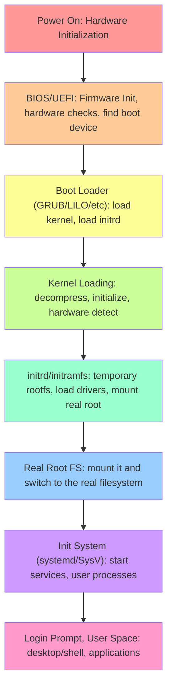

# Linux Boot Process Diagram

## Boot Process Steps Explained

1. **Power On** - Hardware initialization, CPU starts
2. **BIOS/UEFI** - Firmware tests hardware, locates boot device
3. **Boot Loader** - GRUB loads kernel and initial ramdisk into memory
4. **Kernel** - Decompresses, initializes, detects hardware, starts init
5. **initrd/initramfs** - Temporary filesystem loads essential drivers
6. **Real Root** - Mounts actual root filesystem, switches from initrd
7. **Init System** - Starts system services and daemons
8. **User Space** - Login manager, desktop environment, user applications

**Key Files/Locations:**
- `/boot/vmlinuz*` - Kernel image
- `/boot/initrd*` - Initial ramdisk
- `/boot/grub/` - GRUB configuration
- `/etc/fstab` - Filesystem mount points
- `/sbin/init` - First user process (PID 1)
