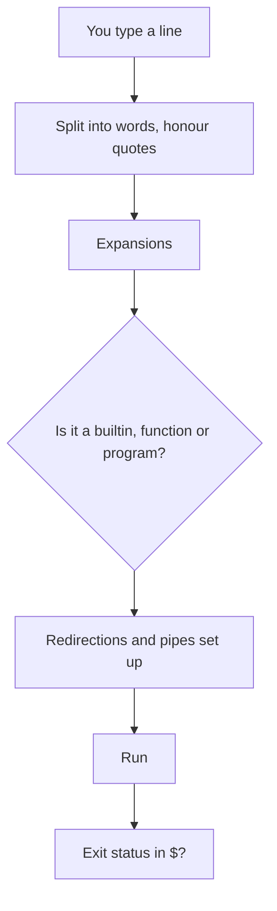

# 01. Intro

Bash is the shell most Linux systems give you: a program that reads commands, runs them, and doubles as a scripting language. This note covers using it day to day and writing your first safe scripts. The full language reference (variables, arrays, loops, functions) is in [[Bash]].

## Shell, terminal and Bash

| Term | Meaning |
| ---- | ------- |
| **Terminal** | The window that shows text and sends your keystrokes |
| **Shell** | The program inside it that understands commands (Bash, zsh, fish, dash) |
| **Bash** | "Bourne Again SHell": the default login shell on most Linux distributions |
| **`sh`** | The POSIX shell; on Debian and Ubuntu `/bin/sh` is **dash**, not Bash |

```
$ echo $SHELL            # your login shell
$ bash --version         # which Bash you have (macOS ships an old one; its default shell is zsh)
$ ps -p $$               # the shell you are in right now
$ cat /etc/shells        # shells installed on this machine
```

## How a command line is processed



Expansion order, which explains most "why did Bash do that?" moments:
1. **Brace** `{a,b}` -> 2. **tilde** `~` -> 3. **variables** `$x`, **arithmetic** `$((1+2))`, **command substitution** `$(cmd)` -> 4. **word splitting** -> 5. **globbing** `*.txt` -> 6. **quote removal**.

```
$ echo file{1,2,3}.txt       # file1.txt file2.txt file3.txt
$ echo ~                     # /home/you
$ echo "today is $(date +%F)"
$ echo $((7 * 6))            # 42
```

## Using it interactively

**Anatomy of a command**
```
$ ls  -l  -h  /var/log
  │   └──┬──┘  └── argument
  │      └── options (flags)
  └── command
```

**Keyboard shortcuts that save hours**

| Keys | Does |
| ---- | ---- |
| `Tab` | Complete a command or path (press twice to list options) |
| `Ctrl+R` | Search your history as you type |
| `Ctrl+C` | Stop the running command |
| `Ctrl+D` | End of input / log out |
| `Ctrl+A` / `Ctrl+E` | Jump to start / end of the line |
| `Ctrl+U` / `Ctrl+K` | Delete to start / end of the line |
| `Ctrl+W` | Delete the previous word |
| `Ctrl+L` | Clear the screen |
| `Alt+.` | Insert the last argument of the previous command |
| `!!` | Repeat the last command (`sudo !!` reruns it as root) |

**Finding help** (see [[Manual Pages]])
```
$ man ls                 # full manual
$ ls --help | less       # quick summary
$ help cd                # for shell builtins
$ type ll                # is it an alias, builtin, function or file?
$ apropos "copy files"   # search manual descriptions
```

## The building blocks

### Pipes and redirection

| Syntax | Meaning |
| ------ | ------- |
| `cmd1 \| cmd2` | Send the output of one command into the next |
| `cmd > file` | Write output to a file (overwrites) |
| `cmd >> file` | Append output |
| `cmd < file` | Read input from a file |
| `cmd 2> err.txt` | Send **errors** (stream 2) to a file |
| `cmd > out.txt 2>&1` | Send output and errors to the same file |
| `cmd &> all.txt` | Same, Bash shorthand |
| `cmd > /dev/null` | Throw output away |
| `cmd1 && cmd2` | Run `cmd2` only if `cmd1` succeeded |
| `cmd1 \|\| cmd2` | Run `cmd2` only if `cmd1` failed |
| `cmd1 ; cmd2` | Run both, one after the other |
| `cmd &` | Run in the background |

```
$ ps aux | grep nginx | wc -l                 # how many nginx processes
$ sort access.log | uniq -c | sort -rn | head # most common lines
$ mkdir build && cd build                     # only cd if mkdir worked
$ grep -r TODO src/ 2> /dev/null              # hide "permission denied" noise
```
Streams: **0** standard input, **1** standard output, **2** standard error.

### Exit status

Every command returns a number: **0 means success**, anything else means failure.
```
$ ls /nonexistent; echo $?     # 2
$ true; echo $?                # 0
```

### Variables

```
$ name="Sharif"                # no spaces around =
$ echo "Hello, $name"
$ export EDITOR=vim            # export makes it visible to programs you start
$ echo $PATH                   # where Bash looks for commands
$ env | sort | less            # all environment variables
```

### Quoting

| Quote | Effect | Example |
| ----- | ------ | ------- |
| `"double"` | Variables and `$(...)` expand; spaces kept together | `"$HOME/My Files"` |
| `'single'` | Everything literal | `'$HOME stays as text'` |
| `\` | Escape one character | `echo \$5` |

**Always quote variables** (`"$file"`). Unquoted, a filename with a space becomes two words.

### Globbing (filename patterns)

```
$ ls *.log             # any name ending .log
$ ls report-?.pdf      # ? matches exactly one character
$ ls [abc]*.txt        # starts with a, b or c
$ ls **/*.py           # recursive (after: shopt -s globstar)
```
Globs are for **filenames** and are handled by the shell. Patterns inside `grep` and `sed` are **regular expressions**, a different thing: [[09. REGEX Cheat List|Regex Cheat List]].

### Aliases and functions

```
$ alias ll='ls -alFh'
$ alias gs='git status -sb'
$ mkcd() { mkdir -p "$1" && cd "$1"; }     # a small function
```
Put them in `~/.bashrc` to keep them.

## Startup files

| File | Read when |
| ---- | --------- |
| `/etc/profile`, `~/.profile` or `~/.bash_profile` | **Login** shells (SSH, console login) |
| `~/.bashrc` | **Interactive non-login** shells (a new terminal window) |
| `~/.bash_logout` | A login shell exits |

```
$ source ~/.bashrc          # reload after editing (or: . ~/.bashrc)
$ history | tail            # recent commands; the file is ~/.bash_history
```
Many distributions make `~/.profile` load `~/.bashrc`, so one place is enough. Put **aliases and prompt** in `.bashrc`, **PATH and environment** in `.profile`.

## Your first script

```bash
#!/usr/bin/env bash
# greet.sh: say hello to each name given

if [[ $# -eq 0 ]]; then
  echo "usage: $0 name [name...]" >&2
  exit 1
fi

for name in "$@"; do
  echo "Hello, $name!"
done
```

```
$ chmod +x greet.sh           # make it executable
$ ./greet.sh Alice Bob        # run it
$ bash greet.sh Alice         # or run it through Bash explicitly
```

| Special variable | Meaning |
| ---------------- | ------- |
| `$0` | Script name |
| `$1`, `$2` ... | Arguments |
| `$#` | Number of arguments |
| `"$@"` | All arguments, each kept as its own word |
| `$?` | Exit status of the last command |
| `$$` | Process ID of the shell |

The first line, `#!/usr/bin/env bash`, is the **shebang**. It must be exactly `#!` with no space. See [[Bash]] for loops, functions, arrays and more.

## Write scripts that fail safely

```bash
#!/usr/bin/env bash
set -euo pipefail          # stop on errors, undefined variables, and failed pipes
IFS=$'\n\t'                # safer word splitting

tmp=$(mktemp -d)           # a private temporary directory
trap 'rm -rf "$tmp"' EXIT  # always clean up, even on failure
```

| Option | Effect |
| ------ | ------ |
| `set -e` | Exit when a command fails |
| `set -u` | Error on an unset variable (catches typos) |
| `set -o pipefail` | A pipeline fails if **any** part fails, not just the last |
| `set -x` | Print each command as it runs (debugging) |

**Habits**
- Quote every variable: `"$var"`, `"${array[@]}"`.
- Use `[[ ... ]]` for tests (safer than `[ ... ]`).
- Check input before acting: `[[ -f "$file" ]] || { echo "no such file" >&2; exit 1; }`.
- Never build a command from untrusted input; avoid `eval`.
- Run **ShellCheck** (`shellcheck script.sh`) and **shfmt** to catch bugs and format.
- Test destructive scripts with `echo` in front of the dangerous command first.

## A real example: a dated backup

```bash
#!/usr/bin/env bash
set -euo pipefail

src="${1:?usage: backup.sh SOURCE_DIR [DEST_DIR]}"
dest="${2:-$HOME/backups}"
stamp=$(date +%F_%H%M)
archive="$dest/$(basename "$src")-$stamp.tar.gz"

mkdir -p "$dest"
tar -czf "$archive" -C "$(dirname "$src")" "$(basename "$src")"
echo "Created $archive ($(du -h "$archive" | cut -f1))"

# keep only the 7 newest backups of this folder
ls -1t "$dest/$(basename "$src")"-*.tar.gz | tail -n +8 | xargs -r rm --
```
- `${1:?message}` stops with a message if the argument is missing; `${2:-default}` supplies a default.
- Schedule it with cron or a systemd timer: [[22. Automation|Automation]].

## Handy one-liners

```
$ du -ah . | sort -rh | head -20                       # biggest files and folders
$ find . -name "*.log" -mtime +30 -delete              # delete logs older than 30 days
$ for f in *.jpeg; do mv -- "$f" "${f%.jpeg}.jpg"; done  # rename extensions
$ grep -rn "TODO" --include="*.py" .                   # search code
$ awk '{print $1}' access.log | sort | uniq -c | sort -rn | head   # top client IPs
$ ss -tulpn                                            # what is listening on the network
$ tail -f /var/log/syslog | grep --line-buffered error # follow a log, filtered
$ curl -s https://example.com | head -5                # fetch a page quietly
```
More tools: [[Basic Commands]], [[Toolset]], [[Grep]].

## Bash or Python?

| Reach for **Bash** when... | Reach for **Python** (or another language) when... |
| -------------------------- | -------------------------------------------------- |
| Gluing commands and files together | You need real data structures, JSON or APIs |
| It is under about 50 lines | The logic gets complicated or needs tests |
| It runs on servers with nothing else installed | You need portability to Windows, or good error handling |
| Startup speed matters | Performance on large data matters |

## Common mistakes

| Mistake | Fix |
| ------- | --- |
| `name = "x"` (spaces) | `name="x"` |
| `rm -rf $dir/` with `$dir` empty or unquoted | `set -u`, quote it, check it, or avoid `rm -rf` on variables |
| `for f in $(ls)` | `for f in *` (handles spaces correctly) |
| `[ $a = $b ]` with empty values | `[[ $a == "$b" ]]` |
| `cat file \| grep x` | `grep x file` (no extra process) |
| `# !/bin/bash` (space) | `#!/bin/bash` |
| Editing scripts with Windows line endings | `dos2unix script.sh` |
| Forgetting `chmod +x` | `chmod +x script.sh` |

## Where next

- [[Bash]]: the complete syntax reference.
- [[Powershell]]: the equivalent on Windows.
- [[09. REGEX Cheat List|Regex Cheat List]], [[Grep]], [[22. Automation|Automation]].
- Hardening your shell access: [[Server Hardening with SSH, UFW and Fail2ban]].
