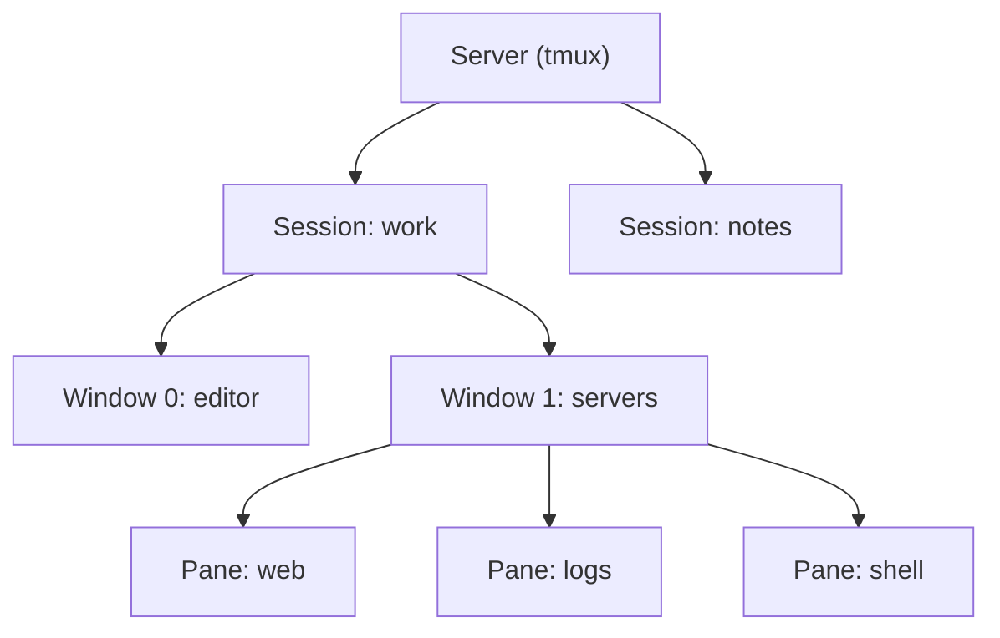

# 01. tmux

tmux is a **terminal multiplexer**: one terminal window that holds many shells, split into panes and grouped into windows, all living inside a **session** that keeps running when you disconnect. Close the terminal, drop an SSH connection, come back later and `tmux attach`: everything is still there.

> Checked against tmux 3.6. Alternative with a graphical take on the same idea: [[Wave Terminal]].

## Why use it

- Run several things at once (editor, server, logs, shell) in one window, with no mouse.
- Survive dropped SSH connections: long jobs keep running on the server.
- Pick up the same layout from another machine or terminal.
- Same keys everywhere: works over SSH on any server that has it installed.

## The model



- **Session**: a named collection of windows. Detach and attach to it.
- **Window**: a full-screen tab inside a session.
- **Pane**: a split of a window, each running its own shell.

## Install

```bash
$ sudo apt install tmux        # Debian/Ubuntu
$ sudo dnf install tmux        # Fedora/RHEL
$ sudo pacman -S tmux          # Arch
$ brew install tmux            # macOS
$ tmux -V                      # check the version
```

## The prefix key

Almost every shortcut is **prefix, then key**. The default prefix is `Ctrl + b`: press and release it, then press the next key. Below, `prefix c` means `Ctrl + b`, release, `c`.

## Sessions (from the shell)

| Command | Action |
|---------|--------|
| `tmux` | New unnamed session |
| `tmux new -s work` | New session called `work` |
| `tmux ls` | List sessions |
| `tmux attach -t work` (or `tmux a -t work`) | Attach to `work` |
| `tmux a` | Attach to the most recent session |
| `tmux new -As work` | Attach to `work`, create it if missing |
| `tmux kill-session -t work` | Kill one session |
| `tmux kill-server` | Kill everything |
| `tmux rename-session -t old new` | Rename |

## Sessions (inside tmux)

| Keys | Action |
|------|--------|
| `prefix d` | **Detach** (leave it running) |
| `prefix s` | Pick a session from a list |
| `prefix $` | Rename the session |
| `prefix (` / `prefix )` | Previous / next session |

## Windows

| Keys | Action |
|------|--------|
| `prefix c` | New window |
| `prefix ,` | Rename window |
| `prefix n` / `prefix p` | Next / previous window |
| `prefix 0`–`9` | Go to window by number |
| `prefix w` | Choose from a window list |
| `prefix l` | Last window used |
| `prefix &` | Close window (asks first) |

## Panes

| Keys | Action |
|------|--------|
| `prefix %` | Split left / right |
| `prefix "` | Split top / bottom |
| `prefix arrow` | Move to the pane in that direction |
| `prefix o` | Cycle to the next pane |
| `prefix ;` | Last active pane |
| `prefix z` | **Zoom**: toggle a pane full screen |
| `prefix x` | Close pane (asks first) |
| `prefix {` / `prefix }` | Swap pane with previous / next |
| `prefix Space` | Cycle through built-in layouts |
| `prefix !` | Break the pane out into its own window |
| `prefix q` | Show pane numbers (press a number to jump) |
| `prefix Ctrl + arrow` | Resize by 1 cell (hold to repeat) |
| `prefix Alt + arrow` | Resize by 5 cells |

## Copy mode (scrolling and copying)

Scrolling the terminal does not show tmux's history; you use copy mode.

| Keys | Action |
|------|--------|
| `prefix [` | Enter copy mode |
| `arrows`, `PgUp`, `PgDn` | Move around |
| `q` or `Esc` | Leave copy mode |
| `/` or `?` | Search forward / backward |
| `Space` then `Enter` | Start selection, copy it (default emacs keys) |
| `prefix ]` | Paste the last copy |

With `set -g mode-keys vi` (see config) copy mode uses vi keys: `h j k l`, `v` to select, `y` to copy, `/` to search. Related: [[Vim]].

## Other useful keys

| Keys | Action |
|------|--------|
| `prefix ?` | List every key binding |
| `prefix :` | Command prompt (type any tmux command, e.g. `kill-pane`) |
| `prefix t` | Show a clock |

## Config: `~/.tmux.conf`

A small starting point. Reload without restarting: `tmux source-file ~/.tmux.conf` (or the `r` binding below).

```bash
# Easier prefix: Ctrl + a instead of Ctrl + b
unbind C-b
set -g prefix C-a
bind C-a send-prefix

# Mouse: click panes, drag borders, scroll
set -g mouse on

# Start numbering at 1 (0 is far from the other keys) and keep numbers tidy
set -g base-index 1
setw -g pane-base-index 1
set -g renumber-windows on

# Bigger scrollback and no delay after Esc (helps Vim)
set -g history-limit 50000
set -sg escape-time 10

# Vi keys in copy mode
setw -g mode-keys vi

# Splits that open in the current directory and are easy to remember
bind | split-window -h -c "#{pane_current_path}"
bind - split-window -v -c "#{pane_current_path}"
bind c new-window -c "#{pane_current_path}"

# Reload config with prefix r
bind r source-file ~/.tmux.conf \; display "Reloaded"

# Colour support
set -g default-terminal "tmux-256color"
```

## Everyday workflows

**Long job over SSH**

```bash
$ ssh server
$ tmux new -s deploy
$ ./long-running-script.sh
# prefix d  → detach, then close the laptop
$ ssh server
$ tmux a -t deploy
```

**A ready-made project layout (script it)**

```bash
#!/usr/bin/env bash
tmux new-session -d -s dev -n code
tmux send-keys -t dev:code 'nvim .' Enter
tmux new-window -t dev -n run
tmux split-window -h -t dev:run
tmux send-keys -t dev:run.0 'npm run dev' Enter
tmux send-keys -t dev:run.1 'tail -f logs/app.log' Enter
tmux select-window -t dev:code
tmux attach -t dev
```

Pair with [[22. Automation|Automation]] to run it from a single command.

## Plugins

[TPM](https://github.com/tmux-plugins/tpm) (tmux plugin manager) installs plugins from lines in `~/.tmux.conf`. Common picks: **tmux-resurrect** and **tmux-continuum** (save and restore sessions across reboots), **tmux-yank** (copy to the system clipboard), **vim-tmux-navigator** (move between Vim splits and tmux panes with the same keys).

## Gotchas

- Nested tmux (tmux inside tmux over SSH): the outer one catches the prefix. Press the prefix twice only if you bind `send-prefix` (the config above does for `Ctrl + a`), or use a different prefix on the remote.
- Mouse mode on means selecting text for the system clipboard needs `Shift` held while dragging.
- Sessions live only as long as the tmux server: a reboot ends them unless you use resurrect.
- Colours look wrong inside tmux: check `default-terminal` and that your terminal supports 256 colours or truecolor.
