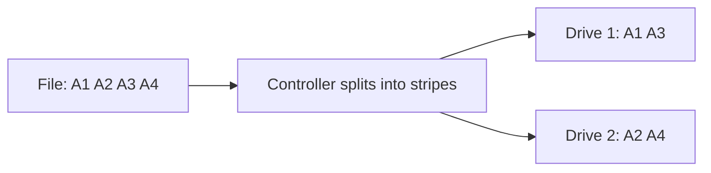
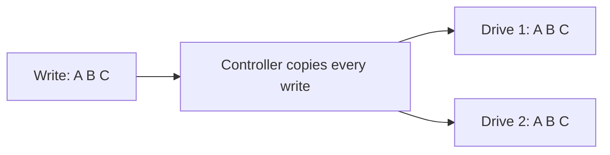
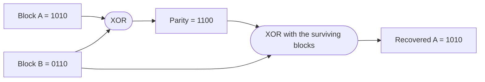
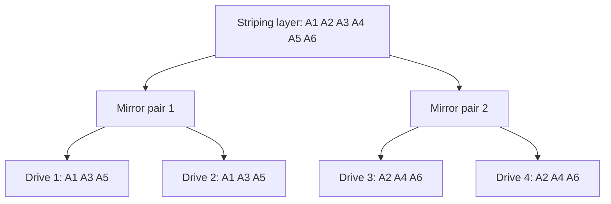
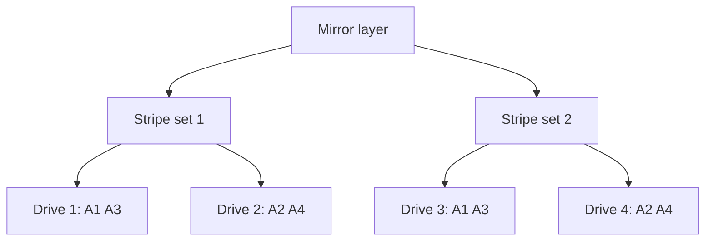
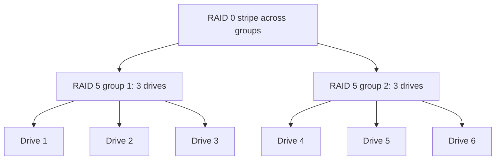
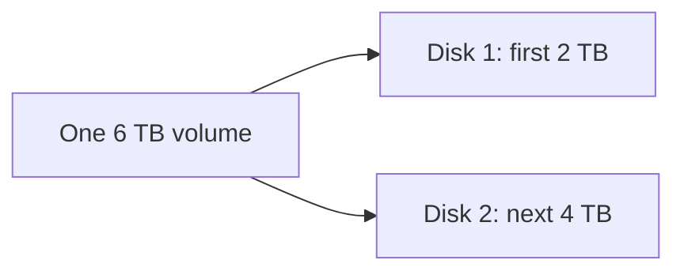
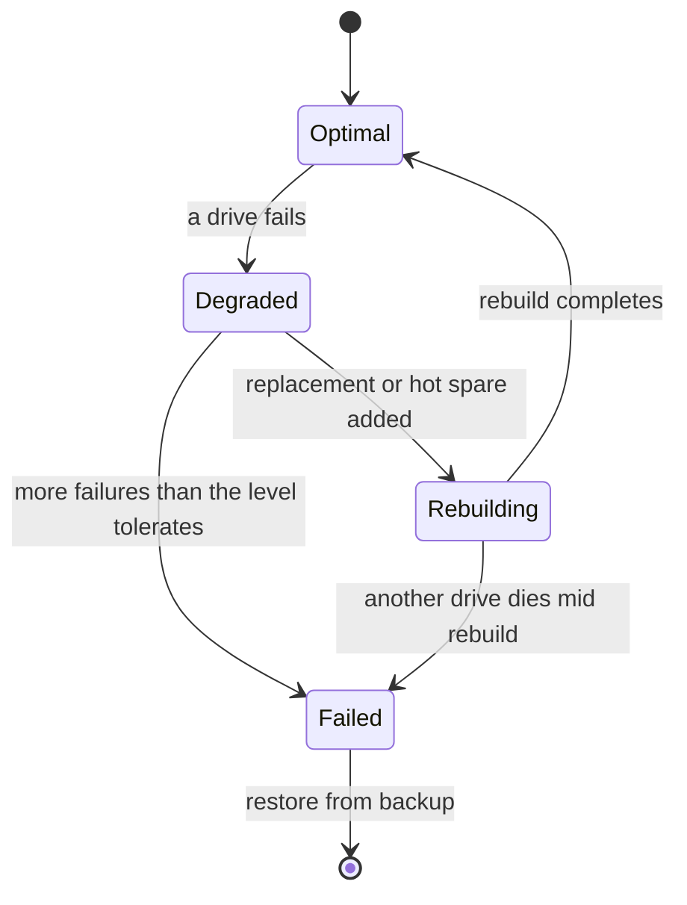
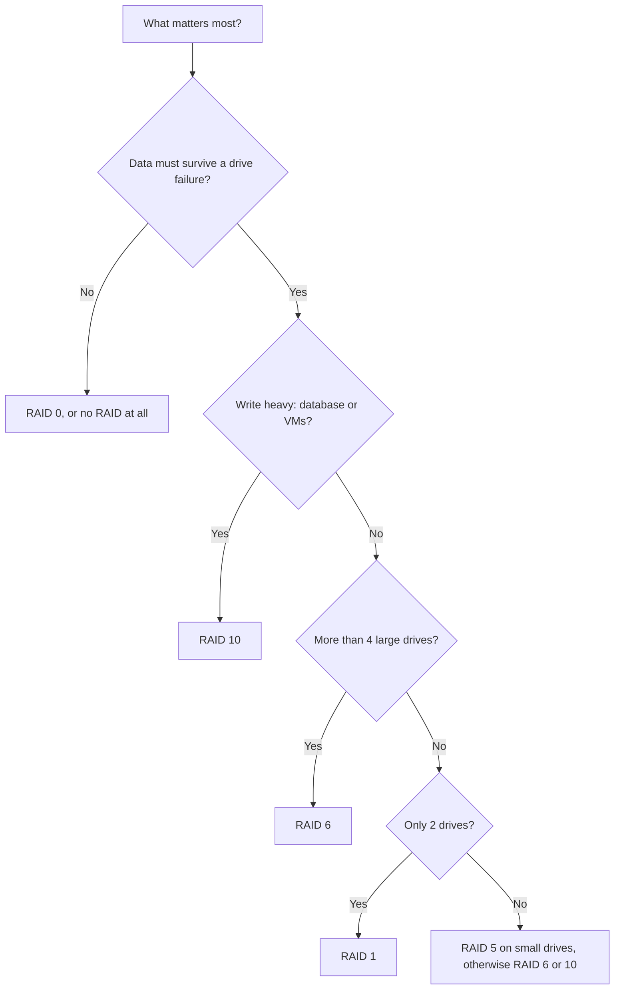

# 06. RAID (Redundant Array of Independent Disks)

## What is RAID?
RAID is a data storage virtualization technology that combines multiple physical disk drive components into one or more logical units for the purposes of data redundancy, performance improvement, or both. RAID distributes data across multiple drives using various techniques called "RAID levels."

**Key Benefits:**
- **Redundancy**: Protection against disk failures
- **Performance**: Improved read/write speeds
- **Capacity**: Combining multiple drives into larger storage pools
- **Availability**: System can continue operating even with drive failures

**RAID Types:**
- **Hardware RAID**: Managed by dedicated RAID controller cards
- **Software RAID**: Managed by the operating system
- **Hybrid RAID**: Combination of hardware and software approaches

## RAID 0 (Striping)

### How it Works
RAID 0 splits data evenly across two or more drives with no parity, redundancy, or fault tolerance. Data is written in "stripes" across all drives simultaneously.

**Configuration:**
- **Minimum drives**: 2
- **Capacity**: Sum of all drives (100% utilization)
- **Redundancy**: None - if any drive fails, all data is lost

### Characteristics
```
Drive 1: [A1] [A3] [A5] [A7]
Drive 2: [A2] [A4] [A6] [A8]
```



**Example:** two 2 TB drives give 4 TB and roughly double the throughput of one. With a 3% yearly failure rate per drive (an assumed figure, real rates vary), the chance that at least one of the two fails in a year is about 1 - 0.97² = **5.9%**, and any failure loses everything.

**Advantages:**
- Maximum performance improvement (both read and write)
- 100% storage efficiency - no space lost to redundancy
- Simple implementation
- Cost-effective for performance gains

**Disadvantages:**
- No fault tolerance - single drive failure destroys entire array
- Higher risk of data loss (failure rate multiplies with each added drive)
- Not suitable for critical data

**Best Use Cases:**
- Video editing and rendering
- Gaming systems
- Temporary high-performance storage
- Applications where performance matters more than data safety

## RAID 1 (Mirroring)

### How it Works
RAID 1 creates an exact copy (mirror) of data on two or more drives. Every write operation is performed on all drives simultaneously, maintaining identical copies.

**Configuration:**
- **Minimum drives**: 2
- **Capacity**: 50% of total drive space (half used for mirroring)
- **Redundancy**: Can survive failure of all but one drive

### Characteristics
```
Drive 1: [A] [B] [C] [D]
Drive 2: [A] [B] [C] [D] (exact copy)
```



**Example:** two 4 TB drives give 4 TB usable. Drive 1 dies, the system keeps running from drive 2, and you replace drive 1 and let it resync.

**Advantages:**
- Excellent fault tolerance - can lose multiple drives (as long as one remains)
- Fast read performance (can read from multiple drives)
- Simple recovery - remaining drive contains complete data
- No complex calculations needed

**Disadvantages:**
- 50% storage efficiency - half the space is "wasted" on redundancy
- Write performance can be slightly slower
- More expensive per usable gigabyte

**Best Use Cases:**
- Critical system drives (OS, databases)
- Important documents and files
- Servers requiring high availability
- Boot drives for servers

## RAID 5 (Distributed Parity)

### How it Works
RAID 5 uses block-level striping with distributed parity across all drives. Parity information is spread across all drives, allowing the array to continue operating with one drive failure.

**Configuration:**
- **Minimum drives**: 3
- **Capacity**: (N-1) × drive size (one drive's worth of space used for parity)
- **Redundancy**: Can survive failure of exactly one drive

### Characteristics
```
Drive 1: [A1] [B2] [C3] [Dp]
Drive 2: [A2] [Bp] [C1] [D3]
Drive 3: [Ap] [B1] [C2] [D1]
```
*(p = parity data)*

Parity is an XOR of the data blocks in a stripe, so any one missing block can be recomputed from the others:



**Example:** four 4 TB drives in RAID 5 give (4-1) × 4 = **12 TB** usable. With three drives it is 8 TB, with eight drives 28 TB; capacity efficiency improves with more drives, while rebuild risk grows.

**Advantages:**
- Good balance of performance, storage efficiency, and redundancy
- Better storage efficiency than RAID 1 (typically 67-80% depending on drive count)
- Can reconstruct data from any single drive failure
- Good read performance

**Disadvantages:**
- Poor write performance due to parity calculations
- Complex rebuild process - system vulnerable during rebuild
- Cannot survive multiple simultaneous drive failures
- "Write hole" vulnerability during unexpected power loss

**Best Use Cases:**
- File servers
- General-purpose storage with moderate reliability needs
- Backup systems
- Applications requiring balanced performance and redundancy

## RAID 6 (Double Parity)

### How it Works
RAID 6 is RAID 5 with a second, independently calculated parity block per stripe (usually called P and Q; Q uses Reed-Solomon maths rather than a plain XOR). Both parity blocks rotate across the drives, so any **two** drives can fail and the data can still be rebuilt.

**Configuration:**
- **Minimum drives**: 4
- **Capacity**: (N-2) × drive size
- **Redundancy**: any two drives

| Stripe | Drive 1 | Drive 2 | Drive 3 | Drive 4 |
|--------|---------|---------|---------|---------|
| 1 | 1a | 1b | P1 | Q1 |
| 2 | 2a | P2 | Q2 | 2b |
| 3 | P3 | Q3 | 3a | 3b |
| 4 | Q4 | 4a | 4b | P4 |

*(each stripe holds two data blocks plus one P and one Q; their positions rotate from stripe to stripe so no single drive carries all the parity)*

**Why it exists:** on large drives a rebuild takes many hours or days. Another drive failing, or hitting an unreadable sector, during that window destroys a RAID 5 array. RAID 6 keeps one parity block spare while the first failed drive is rebuilt.

**Example:** six 8 TB drives in RAID 6 give (6-2) × 8 = **32 TB** usable and survive any two failures. The same drives in RAID 5 give 40 TB but survive only one.

**Best use cases:** large archives, backup targets, NAS boxes with 6 or more big drives.
**Downsides:** slower writes than RAID 5 (two parities to compute), two drives of capacity lost.

## RAID 10 (Mirror of Stripes, "1+0")

### How it Works
Drives are paired into mirrors (RAID 1), and the data is then striped across the pairs (RAID 0). You get RAID 1's safety and RAID 0's speed.

**Configuration:**
- **Minimum drives**: 4 (an even number for hardware RAID)
- **Capacity**: 50% of the total
- **Redundancy**: one drive per mirror pair, so between **1** (worst case) and **N/2** (best case) failures



**Failure example (4 drives):**
- Drive 1 fails: the array is **degraded** but fully working, because drive 2 holds the same blocks.
- Now one more drive fails. Of the three drives left, only drive 2 is dangerous (it is the last copy of pair 1), so there is a **1 in 3** chance the second failure destroys the array. If it is drive 3 or 4 the array survives.

**Rebuild:** only the failed drive's partner is read and copied, with no parity calculation. This is much faster and gentler on the array than a RAID 5 or 6 rebuild.

**Best use cases:** databases, virtual machine storage, mail servers, anything write heavy where both speed and safety matter.
**Downsides:** half the space is spent on copies, so it is the most expensive of the common levels per usable terabyte.

## RAID 01 (Stripe of Mirrors, "0+1")

RAID 01 builds it the other way round: two full **stripe sets**, and the two sets mirror each other.



If drive 1 fails, the whole of stripe set 1 is lost (drive 2 on its own is only half the data), so the array is now running on set 2 alone. A second failure in set 2 is fatal. Of the six possible pairs of failed drives, RAID 10 survives four and RAID 01 only two, so **prefer RAID 10 over RAID 01**. RAID 01 is rarely offered and is mostly of interest for the comparison.

| 4 drives (1+2 and 3+4 grouped), two fail | RAID 10 | RAID 01 |
|--------------------|---------|---------|
| Drives 1 and 2 (one mirror pair / one stripe set) | dies, both copies of pair 1 are gone | survives, stripe set 2 is untouched |
| Drives 1 and 3 (one from each side) | survives | dies |
| Drives 1 and 4 (one from each side) | survives | dies |

## Nested RAID: RAID 50 and RAID 60

Nested levels stripe across several smaller RAID groups. Each group stays small, which keeps rebuilds short, and the stripe on top adds speed.



| Level | Built from | Min drives | Usable capacity | Survives |
|-------|------------|-----------|-----------------|----------|
| RAID 50 | RAID 5 groups, striped | 6 | N - number of groups | 1 drive per group |
| RAID 60 | RAID 6 groups, striped | 8 | N - 2 × number of groups | 2 drives per group |

**Example:** 12 drives of 4 TB as RAID 50 in 2 groups of 6: (12-2) × 4 = **40 TB** usable. As RAID 60 in 2 groups of 6: (12-4) × 4 = **32 TB**. Common on larger hardware controllers and storage arrays.

## JBOD, Linear and the Older Levels

**JBOD / linear ("just a bunch of disks")** joins drives end to end into one big volume. There is no striping, no redundancy and no speed gain; a drive failure loses whatever lived on it, and sometimes much more. `mdadm --level=linear` does this. LVM can do the same, and either is useful only for reusing odd-sized disks.



Levels 2, 3 and 4 exist in the original 1988 RAID paper and the later literature, but you will almost never build them:

| Level | Idea | Why it faded |
|-------|------|--------------|
| RAID 2 | Bit-level striping with Hamming-code error correction | Modern drives already correct errors internally |
| RAID 3 | Byte-level striping, one dedicated parity drive | Parity drive is a bottleneck; poor for small I/O |
| RAID 4 | Block-level striping, one dedicated parity drive | Every write hits the parity drive; RAID 5 spreads that load. Still used by some appliances (NetApp's WAFL design builds on it) |

## Degraded Mode, Rebuilds and Hot Spares

Every redundant level moves through the same states:



- **Degraded:** the array still serves data but with no safety margin, and RAID 5 and 6 run slower because they must calculate missing blocks.
- **Hot spare:** an idle drive attached to the array that the controller or `mdadm` starts using the moment a drive fails, shortening the time spent degraded.
- **Rebuild risk:** a rebuild reads every surviving drive end to end. On big drives the chance of hitting an unreadable sector is not trivial, which is the main argument for RAID 6 or RAID 10 over RAID 5 on multi-terabyte disks.
- **Write hole:** if power fails between writing data and writing its parity, the stripe is silently inconsistent. Hardware RAID answers this with a battery-backed cache; `mdadm` has a write-intent bitmap and a journal; ZFS avoids the problem altogether (see below).
- **Scrubbing:** a regular full read of the array finds bad sectors before a rebuild needs them. On Linux: `echo check | sudo tee /sys/block/md0/md/sync_action`. Many distros schedule this monthly.

> **RAID is not a backup.** It protects against a drive dying. It does not protect against deletion, corruption, ransomware, a fire or a controller fault, since all of those happen to every copy at once. Keep a separate backup as well.

## RAID Comparison Summary

| RAID Level | Min Drives | Usable Capacity | Fault Tolerance | Read | Write | Typical use |
|------------|------------|-----------------|-----------------|------|-------|-------------|
| RAID 0 | 2 | 100% | None | Excellent | Excellent | Scratch space, caches |
| RAID 1 | 2 | 50% (1/N for N-way) | N-1 drives | Good | Fair | Boot drives, small servers |
| RAID 5 | 3 | (N-1)/N | 1 drive | Good | Fair to poor | File servers, small drives |
| RAID 6 | 4 | (N-2)/N | 2 drives | Good | Poor | Large archives, NAS |
| RAID 10 | 4 | 50% | 1 per mirror pair | Excellent | Very good | Databases, VMs |
| RAID 50 | 6 | (N-groups)/N | 1 per group | Very good | Good | Large arrays |
| RAID 60 | 8 | (N-2×groups)/N | 2 per group | Very good | Fair | Very large arrays |
| JBOD | 1 | 100% | None | Single drive | Single drive | Reusing odd disks |

### Worked capacity example: six 4 TB drives

| Level | Usable space | Drives you can lose |
|-------|--------------|---------------------|
| RAID 0 | 24 TB | 0 |
| RAID 1 (three 2-drive mirrors, striped = RAID 10) | 12 TB | 1 guaranteed, up to 3 |
| RAID 5 | 20 TB | 1 |
| RAID 6 | 16 TB | 2 |
| RAID 50 (2 groups of 3) | 16 TB | 1 per group |

### Choosing a level



## ZFS and Btrfs "RAID"

Filesystems that manage their own disks have equivalents, with the advantage that they know which blocks are actually in use and checksum everything.

| Concept | ZFS | Btrfs | Roughly equal to |
|---------|-----|-------|------------------|
| Mirror | `mirror` vdev | `raid1` profile | RAID 1 |
| Striped mirrors | several `mirror` vdevs in one pool | `raid10` profile | RAID 10 |
| Single parity | `raidz1` | `raid5` (see note) | RAID 5 |
| Double parity | `raidz2` | `raid6` (see note) | RAID 6 |
| Triple parity | `raidz3` | none (`raid1c3` keeps three copies) | RAID 6 plus one |

- **No write hole in ZFS:** it is copy-on-write, so a stripe is never half updated. RAIDZ also uses variable stripe widths.
- **Self-healing:** a checksum mismatch on one copy is repaired from the other copy or from parity. Classic RAID cannot tell which of two differing mirror copies is the correct one.
- **Btrfs note:** the `raid5` and `raid6` profiles have long-standing known issues; its own documentation advises care, so use `raid1`, `raid1c3` or `raid10` for data you care about.

```bash
# ZFS: pool of two mirrors (like RAID 10)
sudo zpool create tank mirror /dev/sdb /dev/sdc mirror /dev/sdd /dev/sde
# ZFS: double parity across six drives
sudo zpool create tank raidz2 /dev/sd{b,c,d,e,f,g}
sudo zpool status tank
sudo zpool scrub tank

# Btrfs: RAID 1 for data and metadata over two drives
sudo mkfs.btrfs -d raid1 -m raid1 /dev/sdb /dev/sdc
sudo btrfs scrub start /mnt
```

## Hardware RAID vs Software RAID

### Hardware RAID

**What is Hardware RAID?**
Hardware RAID uses a dedicated RAID controller card or chipset to manage the RAID array. The controller has its own processor, memory, and sometimes battery backup to handle all RAID operations independently of the host system's CPU.

**Components:**
- **RAID Controller Card**: PCIe card with dedicated processor and RAM
- **Onboard RAID**: Built into motherboard chipset (Intel RST, AMD RAIDXpert)
- **Battery Backup Unit (BBU)**: Protects write cache during power outages
- **Write Cache**: High-speed memory for improved write performance

**Advantages:**
- **Superior Performance**: Dedicated processor handles all RAID calculations
- **CPU Offloading**: No impact on system CPU resources
- **Advanced Features**: Write-back caching, battery backup, hot-swap support
- **Boot Support**: Can boot from RAID arrays without OS support
- **Management Tools**: Sophisticated monitoring and configuration utilities
- **Consistency**: Works across different operating systems
- **Better Write Performance**: Especially for RAID 5/6 due to hardware XOR calculations

**Disadvantages:**
- **Higher Cost**: Controller cards range from $100-$1000+
- **Vendor Lock-in**: Arrays tied to specific controller models
- **Single Point of Failure**: Controller failure can make entire array inaccessible
- **Complexity**: More complex setup and troubleshooting
- **Driver Dependencies**: Requires proper drivers for OS support

**Popular Hardware RAID Controllers:**
- LSI MegaRAID (now Broadcom)
- Adaptec (Microsemi)
- Intel RAID controllers
- HP Smart Array
- Dell PERC controllers

### Software RAID

**What is Software RAID?**
Software RAID is implemented entirely in software, using the operating system's drivers and the main system CPU to manage RAID operations. No dedicated hardware is required beyond the disk drives.

**Implementation Methods:**
- **Linux mdadm**: Native Linux software RAID
- **Windows Storage Spaces**: Microsoft's software RAID solution
- **ZFS RAID**: Part of the ZFS filesystem
- **Btrfs RAID**: Built into Btrfs filesystem

**Advantages:**
- **Cost Effective**: No additional hardware required
- **Flexibility**: Not tied to specific hardware
- **Portability**: Arrays can move between systems easily
- **Open Source**: Transparent implementation, community support
- **No Vendor Lock-in**: Uses standard disk interfaces
- **Advanced Features**: Modern implementations offer sophisticated features
- **Easy Replacement**: Any compatible system can take over the array

**Disadvantages:**
- **CPU Overhead**: Uses system CPU for RAID calculations
- **OS Dependency**: Requires OS support to access arrays
- **Boot Limitations**: Complex setup for boot drives
- **Performance Impact**: Can affect overall system performance
- **Memory Usage**: Uses system RAM for caching operations

### Hardware vs Software RAID Comparison

| Feature | Hardware RAID | Software RAID |
|---------|---------------|---------------|
| **Cost** | High ($100-1000+) | Low (free) |
| **Performance** | Superior | Good (depends on CPU) |
| **CPU Usage** | None | Moderate |
| **Flexibility** | Limited | High |
| **Vendor Lock-in** | Yes | No |
| **Boot Support** | Excellent | Limited |
| **Management** | Advanced GUIs | Command-line tools |
| **Portability** | Poor | Excellent |
| **Reliability** | High | High |
| **Feature Set** | Rich | Varies |

### When to Choose Hardware RAID
- **High-performance servers** requiring maximum throughput
- **Database servers** with intensive I/O operations
- **Enterprise environments** with budget for dedicated hardware
- **Systems requiring hot-swap** drive replacement
- **Boot drive protection** with minimal OS complexity
- **24/7 operations** where CPU overhead matters

### When to Choose Software RAID
- **Budget-conscious** implementations
- **Home servers** and small business systems
- **Development and testing** environments
- **Systems requiring flexibility** and portability
- **Modern filesystems** like ZFS or Btrfs integration
- **Cloud environments** where hardware RAID isn't available

## Linux RAID Management

### Software RAID (mdadm)
```bash
# Install mdadm
sudo apt install mdadm

# Create RAID 0 array
sudo mdadm --create --verbose /dev/md0 --level=0 --raid-devices=2 /dev/sdb /dev/sdc

# Create RAID 1 array
sudo mdadm --create --verbose /dev/md0 --level=1 --raid-devices=2 /dev/sdb /dev/sdc

# Create RAID 5 array
sudo mdadm --create --verbose /dev/md0 --level=5 --raid-devices=3 /dev/sdb /dev/sdc /dev/sdd

# Check RAID status
cat /proc/mdstat
sudo mdadm --detail /dev/md0

# Monitor RAID array
sudo mdadm --monitor /dev/md0

# Stop RAID array
sudo mdadm --stop /dev/md0

# Remove RAID array
sudo mdadm --remove /dev/md0

# Add spare drive
sudo mdadm --add /dev/md0 /dev/sde

# Remove failed drive
sudo mdadm --fail /dev/md0 /dev/sdb
sudo mdadm --remove /dev/md0 /dev/sdb

# Save RAID configuration
sudo mdadm --detail --scan >> /etc/mdadm/mdadm.conf

# Assemble existing array
sudo mdadm --assemble /dev/md0 /dev/sdb /dev/sdc
```

### Worked Examples with mdadm

**1. RAID 1 for a boot or data pair, with a hot spare**
```bash
$ sudo mdadm --create /dev/md0 --level=1 --raid-devices=2 --spare-devices=1 /dev/sdb /dev/sdc /dev/sdd
$ sudo mkfs.ext4 /dev/md0
$ sudo mkdir -p /srv/data && sudo mount /dev/md0 /srv/data
$ cat /proc/mdstat
md0 : active raid1 sdd[2](S) sdc[1] sdb[0]
      3906886464 blocks super 1.2 [2/2] [UU]
```
`[UU]` means both members are up, `(S)` marks the spare.

**2. RAID 10 across four drives**
```bash
$ sudo mdadm --create /dev/md1 --level=10 --raid-devices=4 /dev/sd{b,c,d,e}
```
`mdadm` RAID 10 is its own implementation, so it also accepts an odd number of drives, and `--layout` (`n2` near, `f2` far, `o2` offset) changes how the copies are placed. `f2` favours sequential reads.

**3. RAID 6 across six drives**
```bash
$ sudo mdadm --create /dev/md2 --level=6 --raid-devices=6 /dev/sd{b,c,d,e,f,g}
```

**4. Failure drill: replace a dead drive**
```bash
$ cat /proc/mdstat
md0 : active raid1 sdc[1] sdb[0](F)
      3906886464 blocks super 1.2 [2/1] [_U]          # [_U] = first member missing

$ sudo mdadm --detail /dev/md0 | grep -E "State|Failed"
$ sudo mdadm /dev/md0 --remove /dev/sdb              # drop the dead member
# swap the physical disk, then partition or wipe it to match
$ sudo mdadm /dev/md0 --add /dev/sdb                 # start the rebuild
$ watch cat /proc/mdstat                             # shows recovery progress
```
Practise this on loop devices or a virtual machine first: `mdadm --fail /dev/md0 /dev/sdb` simulates a failure safely.

**5. Make it survive a reboot, and get told when it breaks**
```bash
$ sudo mdadm --detail --scan | sudo tee -a /etc/mdadm/mdadm.conf
$ sudo update-initramfs -u
# in mdadm.conf:  MAILADDR you@example.com   (needs a working mail relay)
$ sudo systemctl enable --now mdmonitor      # unit name varies by distribution
```

**6. Practice array from files (no spare drives needed)**
```bash
$ for i in 0 1 2 3; do truncate -s 1G /tmp/d$i.img; sudo losetup /dev/loop$i /tmp/d$i.img; done
$ sudo mdadm --create /dev/md9 --level=5 --raid-devices=4 /dev/loop{0,1,2,3}
$ sudo mdadm /dev/md9 --fail /dev/loop2     # break it
$ sudo mdadm --stop /dev/md9
$ for i in 0 1 2 3; do sudo losetup -d /dev/loop$i; done   # clean up
```

### Hardware RAID Management
```bash
# Check for hardware RAID controllers
lspci | grep -i raid
lsmod | grep -i raid

# LSI MegaRAID (MegaCLI / storcli)
sudo megacli -AdpAllInfo -aAll                    # Controller info
sudo megacli -LDInfo -Lall -aAll                  # Logical drive info
sudo megacli -PDList -aAll                        # Physical drive list
sudo megacli -AdpBbuCmd -GetBbuStatus -aAll       # Battery status
sudo storcli /c0 show                             # Modern storcli tool

# HP Smart Array (hpacucli / ssacli)
sudo hpacucli ctrl all show config                # Show configuration
sudo hpacucli ctrl slot=0 show status             # Controller status
sudo hpacucli ctrl slot=0 logicaldrive all show   # Logical drives
sudo ssacli ctrl all show config                  # Newer ssacli tool

# Adaptec RAID (arcconf)
sudo arcconf getconfig 1                          # Show controller 1 config
sudo arcconf getlogs 1 events                     # Show event logs
sudo arcconf gettasks 1                           # Show background tasks

# Dell PERC (perccli)
sudo perccli /c0 show all                         # Show controller info
sudo perccli /c0/v0 show                          # Show virtual drive 0

# Intel RAID (intel-rst)
sudo mdadm --detail-platform                      # Show platform info
```

### Monitoring Hardware RAID
```bash
# Create monitoring script for LSI controllers
#!/bin/bash
megacli -AdpEventLog -GetEvents -f /var/log/megacli.log -aAll

# Monitor HP Smart Array
sudo hpacucli ctrl all show config | grep -i "status\|error"

# Set up SNMP monitoring (varies by controller)
# Check controller documentation for MIB files

# Use monitoring tools
sudo apt install nagios-plugins-basic
sudo /usr/lib/nagios/plugins/check_raid
```
