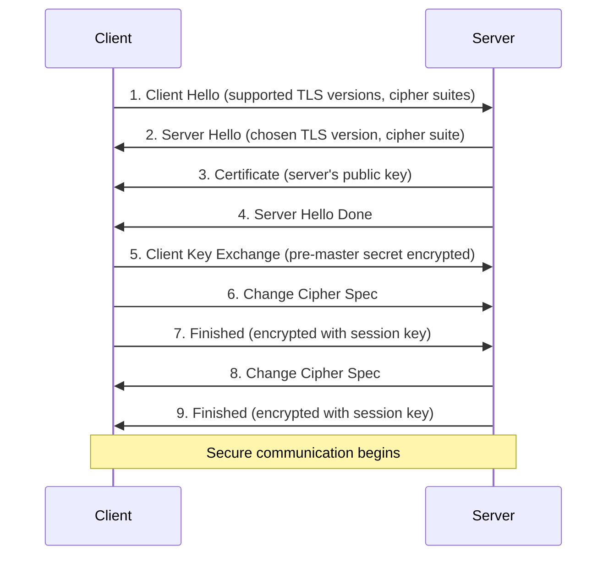

# SSL/TLS: Secure Communications

## Overview

SSL (Secure Sockets Layer) and its successor TLS (Transport Layer Security) are cryptographic protocols that provide secure communication over networks. While SSL is deprecated, the term is still commonly used to refer to TLS.

## SSL/TLS Versions

| Version | Release Year | Status | Security |
|---------|--------------|--------|----------|
| SSL 1.0 | Never released | - | - |
| SSL 2.0 | 1995 | **Deprecated** | Vulnerable |
| SSL 3.0 | 1996 | **Deprecated** | Vulnerable (POODLE) |
| TLS 1.0 | 1999 | **Deprecated** | Weak |
| TLS 1.1 | 2006 | **Deprecated** | Weak |
| TLS 1.2 | 2008 | **Secure** | Recommended |
| TLS 1.3 | 2018 | **Most Secure** | Best practice |

## How SSL/TLS Works

### TLS Handshake Process


### Key Components
1. **Certificate Authority (CA)** - Trusted third party that issues certificates
2. **Digital Certificate** - Contains public key and identity information
3. **Public/Private Key Pair** - Asymmetric encryption for key exchange
4. **Session Key** - Symmetric key for actual data encryption

## Certificate Types

### By Validation Level
```bash
# Domain Validated (DV)
# - Basic domain ownership verification
# - Cheapest and fastest
# - Suitable for blogs, personal sites

# Organization Validated (OV)
# - Verifies organization identity
# - More expensive, more trust
# - Good for business websites

# Extended Validation (EV)
# - Highest level of validation
# - Shows organization name in browser
# - Required for high-trust applications
```

### By Certificate Scope
```bash
# Single Domain
example.com

# Wildcard (covers subdomains)
*.example.com
# Covers: mail.example.com, www.example.com, api.example.com

# Multi-Domain (SAN - Subject Alternative Names)
example.com, example.org, test.com
```

## Working with Certificates

### Using OpenSSL

#### Generate Private Key
```bash
# RSA key (2048-bit minimum, 4096-bit recommended)
openssl genrsa -out private.key 4096

# ECDSA key (more efficient, same security with smaller key size)
openssl ecparam -genkey -name secp384r1 -out private.key
```

#### Generate Certificate Signing Request (CSR)
```bash
# Interactive CSR generation
openssl req -new -key private.key -out certificate.csr

# Non-interactive CSR
openssl req -new -key private.key -out certificate.csr \
  -subj "/C=US/ST=CA/L=San Francisco/O=MyCompany/CN=example.com"

# CSR with Subject Alternative Names
openssl req -new -key private.key -out certificate.csr \
  -config <(cat <<EOF
[req]
distinguished_name = req_distinguished_name
req_extensions = v3_req

[req_distinguished_name]
CN = example.com

[v3_req]
subjectAltName = @alt_names

[alt_names]
DNS.1 = example.com
DNS.2 = www.example.com
DNS.3 = api.example.com
EOF
)
```

#### Self-Signed Certificates
```bash
# Generate self-signed certificate (for testing)
openssl req -x509 -newkey rsa:4096 -keyout key.pem -out cert.pem \
  -days 365 -nodes \
  -subj "/C=US/ST=CA/L=SF/O=Test/CN=localhost"

# Self-signed with SAN
openssl req -x509 -newkey rsa:4096 -keyout key.pem -out cert.pem \
  -days 365 -nodes \
  -config <(cat <<EOF
[req]
distinguished_name = req_distinguished_name
x509_extensions = v3_req

[req_distinguished_name]
CN = localhost

[v3_req]
subjectAltName = @alt_names

[alt_names]
DNS.1 = localhost
DNS.2 = *.localhost
IP.1 = 127.0.0.1
IP.2 = ::1
EOF
)
```

### Certificate Information
```bash
# View certificate details
openssl x509 -in certificate.crt -text -noout

# Check certificate expiration
openssl x509 -in certificate.crt -noout -dates

# Verify certificate against private key
openssl x509 -noout -modulus -in certificate.crt | openssl md5
openssl rsa -noout -modulus -in private.key | openssl md5
# MD5 hashes should match

# Check certificate chain
openssl verify -CAfile ca-bundle.crt certificate.crt
```

### Testing SSL/TLS Connections
```bash
# Test SSL connection
openssl s_client -connect example.com:443

# Test with SNI (Server Name Indication)
openssl s_client -connect example.com:443 -servername example.com

# Test specific TLS version
openssl s_client -connect example.com:443 -tls1_2

# Check certificate chain
openssl s_client -connect example.com:443 -showcerts

# Test cipher suites
nmap --script ssl-enum-ciphers -p 443 example.com
```

## Web Server Configuration

### Apache HTTP Server
```apache
# Enable SSL module
LoadModule ssl_module modules/mod_ssl.so

# Virtual host configuration
<VirtualHost *:443>
    ServerName example.com
    DocumentRoot /var/www/html
    
    SSLEngine on
    SSLCertificateFile /path/to/certificate.crt
    SSLCertificateKeyFile /path/to/private.key
    SSLCertificateChainFile /path/to/ca-bundle.crt
    
    # Security headers
    Header always set Strict-Transport-Security "max-age=63072000; includeSubDomains; preload"
    Header always set X-Frame-Options DENY
    Header always set X-Content-Type-Options nosniff
    
    # Strong SSL configuration
    SSLProtocol all -SSLv3 -TLSv1 -TLSv1.1
    SSLCipherSuite ECDHE-ECDSA-AES128-GCM-SHA256:ECDHE-RSA-AES128-GCM-SHA256:ECDHE-ECDSA-AES256-GCM-SHA384:ECDHE-RSA-AES256-GCM-SHA384
    SSLHonorCipherOrder off
    SSLSessionTickets off
</VirtualHost>

# Redirect HTTP to HTTPS
<VirtualHost *:80>
    ServerName example.com
    Redirect permanent / https://example.com/
</VirtualHost>
```

### Nginx
```nginx
server {
    listen 443 ssl http2;
    server_name example.com;
    
    ssl_certificate /path/to/certificate.crt;
    ssl_certificate_key /path/to/private.key;
    ssl_trusted_certificate /path/to/ca-bundle.crt;
    
    # SSL configuration
    ssl_protocols TLSv1.2 TLSv1.3;
    ssl_ciphers ECDHE-ECDSA-AES128-GCM-SHA256:ECDHE-RSA-AES128-GCM-SHA256:ECDHE-ECDSA-AES256-GCM-SHA384:ECDHE-RSA-AES256-GCM-SHA384;
    ssl_prefer_server_ciphers off;
    
    # OCSP stapling
    ssl_stapling on;
    ssl_stapling_verify on;
    
    # Security headers
    add_header Strict-Transport-Security "max-age=63072000; includeSubDomains; preload" always;
    add_header X-Frame-Options DENY always;
    add_header X-Content-Type-Options nosniff always;
    
    location / {
        root /var/www/html;
        index index.html;
    }
}

# Redirect HTTP to HTTPS
server {
    listen 80;
    server_name example.com;
    return 301 https://$server_name$request_uri;
}
```

## Let's Encrypt (Free SSL Certificates)

### Using Certbot
```bash
# Install Certbot
# Ubuntu/Debian
sudo apt install certbot python3-certbot-apache
# or for Nginx
sudo apt install certbot python3-certbot-nginx

# CentOS/RHEL
sudo yum install certbot python3-certbot-apache

# Get certificate (Apache)
sudo certbot --apache -d example.com -d www.example.com

# Get certificate (Nginx)
sudo certbot --nginx -d example.com -d www.example.com

# Manual certificate (for custom setups)
sudo certbot certonly --standalone -d example.com
```

### Certbot Management
```bash
# List certificates
sudo certbot certificates

# Renew certificates (dry run)
sudo certbot renew --dry-run

# Renew certificates
sudo certbot renew

# Revoke certificate
sudo certbot revoke --cert-path /etc/letsencrypt/live/example.com/cert.pem

# Delete certificate
sudo certbot delete --cert-name example.com
```

### Automatic Renewal
```bash
# Add to crontab
0 12 * * * /usr/bin/certbot renew --quiet

# Or use systemd timer (usually pre-configured)
systemctl status certbot.timer
systemctl enable certbot.timer
```

## SSL/TLS Best Practices

### Server Configuration
```bash
# 1. Use strong protocols only
SSLProtocol all -SSLv3 -TLSv1 -TLSv1.1

# 2. Use strong cipher suites
SSLCipherSuite ECDHE-ECDSA-AES128-GCM-SHA256:ECDHE-RSA-AES128-GCM-SHA256

# 3. Enable HSTS (HTTP Strict Transport Security)
Header always set Strict-Transport-Security "max-age=63072000; includeSubDomains; preload"

# 4. Disable SSL compression (CRIME attack prevention)
SSLCompression off

# 5. Enable OCSP stapling
SSLUseStapling on
```

### Security Headers
```bash
# Prevent clickjacking
X-Frame-Options: DENY

# Prevent MIME type sniffing
X-Content-Type-Options: nosniff

# Control referrer information
Referrer-Policy: strict-origin-when-cross-origin

# Content Security Policy
Content-Security-Policy: default-src 'self'
```

## Certificate Management Tools

### Automated Certificate Management
```bash
# acme.sh - Alternative to Certbot
curl https://get.acme.sh | sh
acme.sh --issue -d example.com -w /var/www/html

# Caddy - Automatic HTTPS
# Automatically obtains and renews certificates
caddy start
```

### Certificate Monitoring
```bash
# Check certificate expiration
#!/bin/bash
DOMAIN="example.com"
EXPIRY=$(echo | openssl s_client -servername $DOMAIN -connect $DOMAIN:443 2>/dev/null | \
         openssl x509 -noout -dates | grep 'notAfter' | cut -d= -f2)
echo "Certificate expires: $EXPIRY"

# Days until expiration
EXPIRY_DATE=$(date -d "$EXPIRY" +%s)
CURRENT_DATE=$(date +%s)
DAYS_LEFT=$(( (EXPIRY_DATE - CURRENT_DATE) / 86400 ))
echo "Days until expiration: $DAYS_LEFT"
```

## Troubleshooting SSL/TLS Issues

### Common Problems and Solutions

#### Certificate Chain Issues
```bash
# Check if intermediate certificates are missing
openssl s_client -connect example.com:443 -showcerts

# Fix: Include intermediate certificates in certificate file
cat certificate.crt intermediate.crt > fullchain.crt
```

#### Mixed Content Warnings
```bash
# Problem: Loading HTTP resources on HTTPS pages
# Solution: Update all resources to use HTTPS or protocol-relative URLs

# Check for mixed content
grep -r "http://" /var/www/html/
```

#### Certificate Mismatch
```bash
# Problem: Certificate CN doesn't match domain
# Check certificate details
openssl x509 -in certificate.crt -text -noout | grep -A1 "Subject:"

# Solution: Get certificate with correct CN or add SAN entries
```

### SSL Testing Tools
```bash
# Online tools
# SSL Labs SSL Test: https://www.ssllabs.com/ssltest/
# SSL Checker: https://www.sslshopper.com/ssl-checker.html

# Command line testing
# Test SSL configuration
testssl.sh example.com

# Check certificate transparency logs
curl -s "https://crt.sh/?q=example.com&output=json" | jq .
```

## Advanced SSL/TLS Topics

### Perfect Forward Secrecy (PFS)
```bash
# Use ECDHE (Elliptic Curve Diffie-Hellman Ephemeral) cipher suites
SSLCipherSuite ECDHE-ECDSA-AES256-GCM-SHA384:ECDHE-RSA-AES256-GCM-SHA384
```

### Certificate Pinning
```javascript
// HTTP Public Key Pinning (HPKP) - Deprecated
// Use Certificate Transparency instead

// JavaScript example for certificate pinning in mobile apps
const expectedFingerprint = "sha256/AAAAAAAAAAAAAAAAAAAAAAAAAAAAAAAAAAAAAAAAAAA=";
```

### DANE (DNS-based Authentication of Named Entities)
```bash
# Generate TLSA record
tlsa --create --selector 1 --matching-type 1 --certificate certificate.crt

# DNS record example
_443._tcp.example.com. IN TLSA 3 1 1 1234567890abcdef...
```

SSL/TLS is crucial for modern web security, protecting data in transit and ensuring secure communications between clients and servers.
