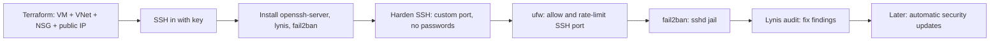

> **Repository:** [sharifndlovu123/linux-server-hardening](https://github.com/sharifndlovu123/linux-server-hardening) · Terraform + a step-by-step `extra/cheatsheet.sh` (read it, do not run it blindly)

A hands-on walk-through: create a small Ubuntu VM on Azure with Terraform, then harden it by hand. The infrastructure side is in [[2. Terraform|Terraform]]; the same ideas apply to any Linux server, cloud or home lab. Source: the `linux-server-hardening` repo.

## Tools at a glance

| Tool | Role |
| ---- | ---- |
| **Terraform** (`azurerm` provider) | Creates the VM, network, NSG and public IP |
| **OpenSSH server** | Remote login; the main thing to lock down |
| **SSH key pair** | Key-only authentication |
| **ufw** | Simple host firewall on top of iptables / nftables |
| **fail2ban** | Bans IPs after repeated failed logins |
| **Lynis** | Security audit tool that scores and suggests fixes |
| **netplan** | Ubuntu network configuration (static IP, Wi-Fi) |
| **Azure NSG** | Cloud-level firewall in front of the VM |

---

# The Plan



Two firewalls apply: the **cloud NSG** (outside the VM) and **ufw** (inside). Both must allow the SSH port or you cannot connect.

---

# 1. Provision with Terraform

A repo layout that keeps secrets out of Git:

```
bootstrap/
├── providers.tf    # azurerm provider, version pinned
├── network.tf      # resource group, VNet and subnet, NSG + rules, public IP, NIC
├── compute.tf      # Ubuntu 22.04 VM (Standard_B1s) + data disk
├── outputs.tf
├── variables.tf    # gitignored: subscription_id, tenant_id, my_ip, username
└── pub/            # gitignored: the SSH public key
```

```
$ ssh-keygen -t ed25519 -f ~/.ssh/id_az_compute       # or rsa -b 4096
$ cd bootstrap && terraform init && terraform plan && terraform apply
$ ssh -i ~/.ssh/id_az_compute <username>@<public-ip>
```

Do **not** commit `*.tfstate`, `*.tfvars`, `variables.tf` or private keys ([[3. Terraform Best Practices|Terraform Best Practices]]). Destroy when finished: `terraform destroy`.

## Two bugs worth remembering in NSG rules
Found in the repo's own notes:
- An SSH rule must match the **destination** port (`destination_port_range`), not the source port, because clients connect from random source ports
- Every inbound rule needs a **unique priority** (Azure rejects duplicates in the same direction)

NSG concepts are in [[3. Azure Networking]].

---

# 2. Harden SSH

Edit `/etc/ssh/sshd_config`:

```
Port 7587                      # a non-standard port cuts log noise (obscurity, not real security)
PasswordAuthentication no      # keys only
PermitRootLogin no
PubkeyAuthentication yes
```

```
$ sudo sshd -t                 # test the config before restarting
$ sudo systemctl restart ssh
```

Notes:
- **Keys beat passwords**: a stolen password list cannot log in
- Changing the port reduces automated scans but is **not** a defence by itself; the real controls are keys, the firewall and fail2ban
- On Ubuntu 22.10 and later, SSH can be socket-activated, so check `systemctl status ssh` and `ss -tlnp | grep ssh` to confirm the new port is really listening
- Open the new port in the **NSG first**, then switch

---

# 3. Firewall with ufw

```
$ sudo ufw allow ssh                         # keep the old port until the new one works
$ sudo ufw limit 7587/tcp                    # rate-limit: blocks an IP after 6 attempts in 30 seconds
$ sudo ufw allow from <MY_IP> to any port 7587 proto tcp    # alternative: only your IP
$ sudo ufw enable
$ sudo ufw status verbose
$ sudo ufw reload
```

- Default policy is **deny incoming, allow outgoing**
- `limit` is lightweight brute-force protection; `allow from <ip>` is stricter
- Remove the old rule once the new port is proven: `sudo ufw delete allow ssh`

---

# 4. fail2ban

Reads logs, and bans IPs that fail too often by adding firewall rules.

```
$ sudo cp /etc/fail2ban/jail.conf /etc/fail2ban/jail.local    # edit .local, never the .conf
```

```ini
# /etc/fail2ban/jail.local
[DEFAULT]
bantime  = 600     # seconds an IP stays banned
findtime = 600     # window in which failures are counted
maxretry = 3       # failures allowed before a ban

[sshd]
enabled = true
port    = 7587     # match the custom port
```

```
$ sudo systemctl restart fail2ban
$ sudo fail2ban-client status sshd           # currently banned IPs and counts
$ sudo fail2ban-client set sshd unbanip <IP>
```

---

# 5. Audit with Lynis

```
$ sudo lynis audit system
```

Read the **warnings** and **suggestions** and the final **hardening index**. Typical quick wins:
- Install and enable `unattended-upgrades` for automatic security updates
- Set a password policy and umask, restrict `su`
- Disable unused services and protocols
- Add banners, set file permissions on `/etc/cron*`
- Install `auditd`, `rkhunter` or AIDE for integrity checks

Re-run after each batch of changes to watch the score improve.

---

# 6. Network Config with netplan

For servers with static addresses or Wi-Fi:

```yaml
# /etc/netplan/01-netcfg.yaml
network:
  version: 2
  ethernets:
    eth0:
      dhcp4: false
      addresses: [192.168.1.20/24]
      routes:
        - to: default
          via: 192.168.1.1
      nameservers:
        addresses: [1.1.1.1, 8.8.8.8]
```

```
$ sudo netplan generate
$ sudo netplan try        # applies with automatic rollback if you lose connectivity
$ sudo netplan apply
```

Background in [[09. Network Services|Network Services]] and [[05. Subnetting|Subnetting]].

---

# Don't Lock Yourself Out

1. Keep the **current SSH session open** while testing
2. Test the new port from a **second terminal** before closing the first
3. Allow the new port in **both** the NSG and ufw before enabling it
4. Use `netplan try`, not `netplan apply`, for network changes
5. Have a recovery path: the cloud serial console or a snapshot

---

# Next Steps
- **Automatic security updates** (deliberately deferred in the repo)
- Disable SSH password auth in `sshd_config.d` drop-ins too, since later files can override
- **Two-factor** for SSH, or use a bastion / VPN instead of a public SSH port ([[Remote Workstation Anywhere]])
- Central logging and alerts ([[14. Network Operations and Monitoring|Network Operations and Monitoring]])
- Move the manual steps into configuration management ([[9. Ansible|Ansible]])
- Wider concepts: [[13. Network Security|Network Security]]
