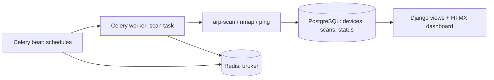

# 16. Network Device Monitoring with NetPulse

> **Repository:** [sharifndlovu123/iot_monitoring](https://github.com/sharifndlovu123/iot_monitoring) · Django 5, Celery, PostgreSQL, Redis, Docker
> **Get it:** `git clone https://github.com/sharifndlovu123/iot_monitoring.git && cd iot_monitoring` then follow the README (the repo ships `start.sh` and `stop.sh`; the README text still mentions `./build.sh`). Linux (Debian/Ubuntu) with Docker and sudo. Scan only networks you own.

NetPulse is a Django platform that **discovers, monitors and tracks devices on a local network**, combining scanning tools with background tasks for a live view of what is connected. It is a good example of running network tools without root, and of a Django + Celery + Redis stack. Source: the `iot_monitoring` repo.

## Tools at a glance

| Tool | Role |
| ---- | ---- |
| **Django 5** | Web app, auth, admin |
| **PostgreSQL** (or SQLite for dev) | Device and scan data |
| **Celery + Redis** | Background scanning and scheduled monitoring (worker + beat) |
| **HTMX + Bootstrap 5** | Live-updating UI without a SPA |
| **arp-scan, nmap, ping** | Discovery and status checks |
| **Docker Compose** | PostgreSQL, Redis (and the whole stack in the "complete" option) |
| **`setcap`** | Gives scanners raw-socket capability without root |

---

# What It Does

- **Device management**: inventory with MAC and IP tracking
- **Network scanning**: ARP scan, nmap and ping discovery
- **Live dashboard**: device status with alerts
- **Camera profiles**: IP cameras with RTSP / ONVIF details
- **Reports**: uptime, latency and inventory history
- **Roles**: Admin and Viewer permissions



Layout: one Django app per concern (`accounts`, `cameras`, `dashboard`, `devices`...), each with models, views, URLs, admin and tests.

---

# How the Scans Work

| Method | What it does | Layer |
| ------ | ------------ | ----- |
| **ARP scan** | Broadcasts "who has this IP?" on the local subnet; every live host answers with its MAC | Layer 2, LAN only, very reliable |
| **Ping sweep** | ICMP echo to each address | Layer 3, some hosts block it |
| **nmap** | Host discovery, port scan, service and OS detection | Layers 3-7 |

```
$ sudo arp-scan --localnet
$ nmap -sn 192.168.1.0/24           # host discovery only, no port scan
$ nmap -sV -p 1-1024 192.168.1.20    # service versions on one host
```

ARP and nmap theory are in [[15. Network Troubleshooting|Network Troubleshooting]], [[10. Network Devices|Network Devices]] and [[11. Switching and VLANs|Switching and VLANs]]. Only scan networks you own or have permission to scan.

---

# Raw Sockets Without Root: Linux Capabilities

Scanners need **raw sockets** (craft their own packets). Normally that needs root, but running a whole web app as root is dangerous. Linux **capabilities** split root's powers into small pieces.

```
$ sudo setcap cap_net_raw,cap_net_admin+eip /usr/bin/nmap
$ sudo setcap cap_net_raw+ep /usr/sbin/arp-scan
$ getcap /usr/bin/nmap                        # list the capability on a file
$ sudo setcap -r /usr/bin/nmap                # remove it
```

| Capability | Allows |
| ---------- | ------ |
| `CAP_NET_RAW` | Raw and packet sockets (ARP, ICMP, custom packets) |
| `CAP_NET_ADMIN` | Network configuration, some scan modes |
| `CAP_NET_BIND_SERVICE` | Bind to ports below 1024 |

Flags: `e` effective, `p` permitted, `i` inheritable. Granting this to a **Python interpreter** (so Celery tasks can use raw sockets) is powerful: anything running under that Python gets the capability, so keep the environment tightly scoped and avoid untrusted code. A safer pattern is a **small helper binary or container** that has the capability and nothing else.

---

# The Setup Script Idea

A single setup script (`start.sh` in the repo; the README refers to it as `build.sh`) that is **safe to re-run**: it checks what already exists and skips straight to starting services on later runs.

1. Install system dependencies (`arp-scan`, `nmap`) and grant capabilities
2. Install Docker if missing
3. Create a virtualenv and install requirements
4. Copy `.env.example` to `.env`
5. Start PostgreSQL and Redis containers ([[2. Docker Compose|02. Docker Compose]])
6. Run migrations, optionally create a superuser
7. Start Celery worker and beat
8. Launch Django on port 8000

`stop.sh` shuts everything down; logs go to `logs/celery_worker.log`, `logs/celery_beat.log` and `docker compose logs -f`.

---

# Lessons
- **Celery beat + worker** is the standard way to run recurring jobs in Django; keep tasks short and idempotent
- **HTMX** gives live dashboards with server-rendered HTML: poll or push partial updates
- **Separate concerns** into Django apps and give each its own tests
- **Least privilege**: capabilities instead of root
- **Make setup repeatable**: scripts that detect existing state
- **Ethics and safety**: scanning tools are dual-use, so document that they are for networks you own
- See also [[7. Siteward Web Security Scanner|Siteward Web Security Scanner]] for a scanner built around a strict "own sites only" rule, and [[13. Network Security|Network Security]]

# Build Your Own Scanner: Concurrency Compared

A companion repo, [custom_port_scanner](https://github.com/sharifndlovu123/custom_port_scanner), implements a TCP port scanner in Python three ways to compare I/O-bound concurrency:

| Script | Approach |
| ------ | -------- |
| `main.py` | Sequential, one connection at a time |
| `concurrent_future.py` | `ThreadPoolExecutor` with 500 worker threads |
| `async_scanner.py` | `asyncio` with a `Semaphore(500)` capping concurrent connections |

Scanning thousands of ports is **waiting on the network**, so threads and `asyncio` finish far faster than the sequential version. Use it only on hosts you own.

A different example of a small ops tool is [server_performance_stats](https://github.com/sharifndlovu123/server_performance_stats): a shell script that prints memory, CPU and disk usage once or on a 5 second refresh, also packaged as a multi-stage Docker image.
