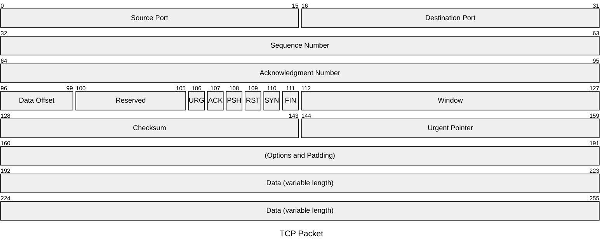

# 02. PDUs


(Protocol Data Unit) is a term used to describe a single unit of data that is transmitted across a network at a specific layer of the OSI (Open Systems Interconnection) model.

Each layer of the OSI model has its own specific PDU, and it encapsulates the data from the higher layers with the necessary information for transmission. Here's a breakdown of the PDUs for each OSI layer:


**PDU (Protocol Data Unit)** is a term used to describe a single unit of data that is transmitted across a network at a specific layer of the OSI (Open Systems Interconnection) model.

Each layer of the OSI model has its own specific PDU, and it encapsulates the data from the higher layers with the necessary information for transmission. Here's a breakdown of the PDUs for each OSI layer:

### 1. **Application Layer (Layer 7)**:
   - **PDU**: Data
   - The application layer sends data, which can be a file, a request, or any application-level information.

### 2. **Presentation Layer (Layer 6)**:
   - **PDU**: Data
   - This layer formats or translates data (like encryption or compression), but doesn't change the PDU name.

### 3. **Session Layer (Layer 5)**:
   - **PDU**: Data
   - The session layer establishes, manages, and terminates connections, but again, doesn't change the PDU name.

### 4. **Transport Layer (Layer 4)**:
   - **PDU**: Segment (for TCP) / Datagram (for UDP)
   - The transport layer divides the data into segments (TCP) or datagrams (UDP), and includes header information like port numbers and sequence numbers.

### 5. **Network Layer (Layer 3)**:
   - **PDU**: Packet
   - The network layer adds an IP header to the segment or datagram, routing information, and determines the best path for data to travel.

### 6. **Data Link Layer (Layer 2)**:
   - **PDU**: Frame
   - The data link layer packages the packet into a frame, adding MAC addresses and error-checking information like CRC (Cyclic Redundancy Check).

### 7. **Physical Layer (Layer 1)**:
   - **PDU**: Bit
   - The physical layer is responsible for the transmission of raw bits over the physical medium (like cables). It converts the frame into electrical, optical, or radio signals.

---

### Summary of PDUs by Layer:

| OSI Layer             | PDU Name          |
|-----------------------|-------------------|
| Application Layer      | Data             |
| Presentation Layer     | Data             |
| Session Layer          | Data             |
| Transport Layer        | Segment/Datagram |
| Network Layer          | Packet           |
| Data Link Layer        | Frame            |
| Physical Layer         | Bit              |

Each of these PDUs adds specific header or footer information as the data travels down through the layers to ensure proper handling and transmission.


### Difference Between Segments, Packets, and Frames:
- **Data**: This is the raw user data that originates from the application layer (Layer 7). Data is what the end-user or application wants to send across the network.
- **Segment**: Data unit at the transport layer (Layer 4), used for end-to-end communication between devices (e.g., TCP segment).
- **Packet**: Data unit at the network layer (Layer 3), used for routing and delivering data across networks (e.g., IP packet).
- **Frame**: Data unit at the data link layer (Layer 2), used for communication between devices on the same local network (e.g., Ethernet frame).


---


## Segment

A **segment** is a unit of data that is used in the **transport layer** (Layer 4) of the OSI model, particularly in connection-oriented communication protocols like **TCP** (Transmission Control Protocol). It is created when data is passed down from the **application layer** (Layer 7) and is prepared for transmission over the network.

### Key Components of a Segment (TCP Segment Example):
1. **Header**:
   - **Source Port**: The sending application’s port.
   - **Destination Port**: The receiving application’s port.
   - **Sequence Number**: Identifies the order of data sent (used for reliable delivery).
   - **Acknowledgment Number**: The sequence number of the next expected byte (used for acknowledgment in TCP).
   - **Flags**: Control information like SYN, ACK, FIN, etc.
   - **Window Size**: Size of the receiver's buffer space for flow control.
   - **Checksum**: Used for error-checking.
   - **Urgent Pointer**: Indicates if any urgent data is included.
   - **Options**: Can include various control and configuration options (e.g., maximum segment size).

2. **Payload (Data)**: This is the actual data being transmitted, which could be from higher layers like HTTP, DNS, or other application data. 

3. **Trailer (Optional)**: In some protocols, segments may include a trailer for error detection or padding.

### How Segments Work:
1. Data from the application layer (e.g., HTTP request) is passed to the transport layer, where it is divided into smaller chunks called segments.
2. The transport layer adds a header to each segment, containing the necessary control information, such as sequence numbers, port numbers, and flags.
3. The segment is then passed to the network layer (IP layer) to be encapsulated into a packet.
4. When the segment reaches the destination, the transport layer reassembles the segments in the correct order (based on the sequence number) to reconstruct the original message.


### Example of a TCP Segment:
```
| Source Port | Destination Port | Sequence Number | Acknowledgment Number | Flags (SYN, ACK, etc.) | Window Size | Checksum | Data (Payload) |
```

In summary, a **segment** is the transport layer unit of data that allows reliable, ordered, and flow-controlled delivery of information between hosts. It is crucial for protocols like **TCP** to provide reliability and error recovery during data transmission.

--- 

## Packet

A **packet** is a unit of data transmitted over a network. It is the fundamental structure used to send information from one device to another in networking protocols, particularly in the Internet Protocol (IP). A packet is composed of two main parts: the **header** and the **payload** (data).

### Key Components of a Packet:
1. **Header**: Contains control information necessary for the packet to reach its destination.
   - **Source Address**: Identifies the sender's device.
   - **Destination Address**: Specifies where the packet should go.
   - **Protocol Information**: Indicates which protocol is used (e.g., TCP, UDP).
   - **Sequence Number**: In case the data needs to be reassembled, this helps in maintaining the order of packets.
   - **Checksum**: Used for error detection.

2. **Payload (Data)**: The actual data being transmitted. This is the content that the sender wants to share, like a file, part of a web page, or other application data.

### How a Packet Works:
- When a larger message (like a file or a web request) is sent over a network, it's broken into smaller chunks called packets. These packets are individually transmitted through the network.
- Each packet might take a different route to reach the destination. Once all the packets arrive, they are reassembled into the original message.

### Packet Example:
For instance, in an **IPv4 packet**, the packet might contain:
- **Header** with source and destination IP addresses.
- **Payload** with data, which could be part of a web page or a file chunk.

### Types of Packets:
- **IP Packet**: Carries data at the network layer (e.g., IPv4 or IPv6).
- **TCP Packet**: An IP packet carrying data for the TCP protocol, used for reliable communication.
- **UDP Packet**: Similar to TCP but without the guarantees of delivery (less overhead).
- **Ethernet Frame**: A lower-level packet used in local area networks (LAN).


ie sample TCP packet





In summary, a packet is a way of breaking down and organizing data for efficient, reliable, and error-checked communication over networks.


---

## Segment

A **frame** is a data packet that has been formatted for transmission over a specific type of physical or data link layer network, such as Ethernet, Wi-Fi, or other link-layer protocols. The frame contains both the **header** and the **payload**, with additional information necessary for proper delivery over the link.

### Key Components of a Frame:
1. **Frame Header**: Contains control and address information.
   - **Destination MAC Address**: The address of the receiving device.
   - **Source MAC Address**: The address of the sending device.
   - **Type/Protocol Field**: Identifies the protocol used in the data (e.g., IPv4, ARP, or other higher-layer protocols).
   - **Error-Detection Field (e.g., FCS - Frame Check Sequence)**: Used to detect transmission errors (checksum or CRC).
   
2. **Payload (Data)**: This is the actual data being transmitted, which could be an IP packet or other types of higher-layer data.

3. **Trailer (Optional)**: Some protocols add a trailer at the end of the frame to help with error detection or padding.


### How Frames Work:
1. When a packet (e.g., an IP packet) is ready to be transmitted over the network, it is encapsulated in a **frame**.
2. The frame is then passed down to the **data link layer**, where it is prepared for transmission over the physical medium (e.g., copper wire, fiber optics, or air for Wi-Fi).
3. The receiving device extracts the packet from the frame, processes it, and passes it to the appropriate layer (e.g., network layer for routing).

### Example of Frame Structure (Ethernet Frame):
```
| Destination MAC Address | Source MAC Address | Type/Protocol | Payload (IP Packet) | FCS (Error Checking) |
```

In summary, a **frame** is the format used to transmit packets over the physical layer of a network, with the frame itself providing necessary addressing, error checking, and control information for local or link-layer communication.


