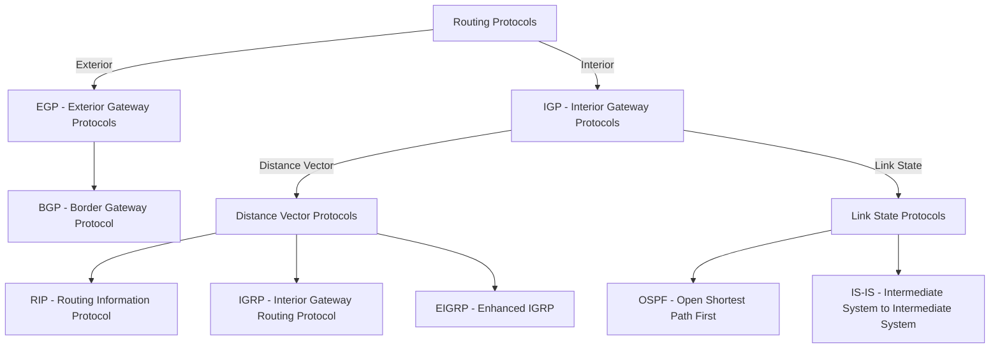

## **Exterior vs. Interior Gateway Protocols**  




#### **What Are EGP and IGP?**  
Routing protocols are classified into two main types based on where they operate:  

- **EGP (Exterior Gateway Protocols)** → Used for routing between **different Autonomous Systems (AS)**.  
- **IGP (Interior Gateway Protocols)** → Used for routing **within** a single **Autonomous System (AS)** (such as an enterprise network or ISP).  

---

## **1. IGP (Interior Gateway Protocols)**  
IGPs handle **internal routing** within a network under a single administrative domain (Autonomous System).  

### **Types of IGPs**  
IGPs are further divided into:  

| **Type** | **Protocols** | **How It Works** |
|----------|-------------|----------------|
| **Distance-Vector** | - **RIP (Routing Information Protocol)** <br> - **EIGRP (Enhanced Interior Gateway Routing Protocol) (Cisco-only)** | - Routers exchange **entire routing tables** periodically. <br> - Uses **hop count** as a metric (RIP) or **composite metric** (EIGRP). |
| **Link-State** | - **OSPF (Open Shortest Path First)** <br> - **IS-IS (Intermediate System to Intermediate System)** | - Builds a **complete map of the network**. <br> - Uses **Dijkstra’s algorithm** to find the shortest path. <br> - More efficient and scalable than distance-vector. |

### **IGP Key Characteristics**  
- Operates **within a single Autonomous System (AS)**.  
- Converges faster than EGP.  
- Uses **metrics like cost, bandwidth, and hop count** to determine the best path.  

---

## **2. EGP (Exterior Gateway Protocols)**  
EGPs handle routing between **Autonomous Systems (AS)**, which are large networks under different administrative control (e.g., ISPs, data centers).  

### **Types of EGPs**  
| **Protocol** | **Description** |
|-------------|----------------|
| **BGP (Border Gateway Protocol)** | - The **only widely used EGP today**. <br> - Routes **between ISPs and large networks**. <br> - Uses **AS numbers (ASN)** to identify networks. <br> - Determines best paths based on **policies, AS-path, and BGP attributes**. |

### **EGP Key Characteristics**  
- Operates **between different AS** (e.g., ISP to ISP).  
- Uses **AS numbers (ASN) to identify networks**.  
- Relies on **path-vector routing** instead of link-state or distance-vector.  
- **Highly scalable but slower convergence** than IGP.  

---

## **EGP vs. IGP: Key Differences**  

| **Feature** | **IGP (Interior Gateway Protocols)** | **EGP (Exterior Gateway Protocols)** |
|------------|--------------------------------|--------------------------------|
| **Scope** | Within a single **Autonomous System (AS)** | Between **Autonomous Systems (AS)** |
| **Examples** | RIP, OSPF, IS-IS, EIGRP | BGP |
| **Routing Algorithm** | Distance-vector, Link-state | Path-vector |
| **Administrative Control** | Managed by **one organization** | Operates across **multiple organizations (ISPs, data centers)** |
| **Scalability** | Designed for small to medium networks | Designed for **large-scale global networks** |
| **Routing Table Size** | Smaller, focuses on **internal networks** | Large, stores **global internet routes** |
| **Convergence Speed** | Fast (OSPF, EIGRP) | Slower due to global AS dependencies |
| **Protocol Overhead** | Lower | Higher due to AS-path calculations |

---

## **When to Use IGP vs. EGP?**  

| **Use Case** | **Protocol to Use** |
|-------------|----------------|
| Routing inside an **enterprise network** | OSPF, IS-IS, EIGRP |
| Connecting multiple **branch offices** | OSPF, EIGRP |
| Routing between **ISPs and data centers** | BGP |
| Managing **global internet routing** | BGP |
| Large cloud network peering (AWS, GCP) | BGP |

---

### **Key Takeaway:**  
- **IGPs** (RIP, OSPF, EIGRP, IS-IS) are used for **internal routing** inside an **Autonomous System (AS)**.  
- **EGP** (BGP) is used for **external routing** between **different Autonomous Systems** (ISPs, cloud providers, large networks).  
- **BGP is the only major EGP in use today** because it powers **internet routing worldwide**.

---

There are three main types of gateway routing protocols:

# 1. **Distance Vector Protocols**
   * Calculate routes based on distance and direction to destination networks
   * Examples: RIP (Routing Information Protocol), EIGRP (Enhanced Interior Gateway Routing Protocol)
   * Characteristics: Simple implementation, less CPU/memory usage, periodic updates of entire routing table

## **RIP (Routing Information Protocol)**  

#### **What is RIP?**  
RIP (Routing Information Protocol) is a **distance-vector routing protocol** used to determine the best path for data packets in an IP network. It is one of the oldest routing protocols and operates using **hop count** as the metric for route selection.  

---

### **Key Features of RIP**  

- **Distance-Vector Algorithm**  
  - Uses the **Bellman-Ford algorithm** to determine the shortest path.  
  - Each router shares its routing table with neighbors every **30 seconds**.  

- **Hop Count as a Metric**  
  - Limits the maximum number of hops to **15** (16 is considered unreachable).  
  - Prevents routing loops but restricts scalability.  

- **Types of RIP**  
  1. **RIP v1** – Classful routing, no subnet support, broadcasts updates.  
  2. **RIP v2** – Classless routing, supports subnet masks, multicasts updates.  
  3. **RIPng (RIP Next Generation)** – Supports **IPv6** networks.  

- **Loop Prevention Mechanisms**  
  - Implements **split horizon**, **route poisoning**, and **hold-down timers** to avoid routing loops.  

---

### **How RIP Works**  

1. **Routers exchange routing tables** with their directly connected neighbors.  
2. Each router updates its table by **adding 1 hop to each received route**.  
3. If a router finds a shorter path, it updates its table.  
4. Updates are sent every **30 seconds** (causing slow convergence in large networks).  

---

### **Ports Used by RIP**  
- **UDP port 520** → Used for routing updates (RIP v1 & v2).  
- **UDP port 521** → Used for **RIPng (IPv6)**.  

---

### **Limitations of RIP**  

- **Not scalable** due to **15-hop limit**.  
- **Slow convergence** (can take minutes to update network changes).  
- **No advanced security** (RIP v1 lacks authentication).  
- **High network overhead** due to frequent updates.  

---

### **RIP vs. Other Routing Protocols**  

| **Feature**  | **RIP** | **OSPF** | **EIGRP** | **BGP** |
|-------------|--------|--------|--------|--------|
| **Type** | Distance-vector | Link-state | Hybrid | Path-vector |
| **Metric** | Hop count | Cost (bandwidth) | Bandwidth & delay | AS Path |
| **Hop Limit** | 15 | No limit | No limit | No limit |
| **Convergence** | Slow | Fast | Faster | Slower (internet scale) |
| **Used In** | Small networks | Medium to large | Enterprise | Internet routing |

---

### **Where is RIP Used?**  
- **Small networks** where simplicity is preferred.  
- **Backup routing** for simple failover scenarios.  
- **Legacy systems** that do not support advanced protocols.  

While RIP is outdated for large-scale networks, it is still used in specific environments where ease of setup and minimal configuration are priorities.

---

## **EIGRP (Enhanced Interior Gateway Routing Protocol)**  

#### **What is EIGRP?**  
EIGRP (Enhanced Interior Gateway Routing Protocol) is a **hybrid routing protocol** developed by Cisco, combining the best features of **distance-vector and link-state protocols**. It is more efficient and scalable than RIP while maintaining faster convergence and lower overhead compared to OSPF.  

---

### **Key Features of EIGRP**  

- **Hybrid Routing Protocol**  
  - Uses **distance-vector** principles but maintains a **topology table** like link-state protocols.  
  - Uses the **DUAL (Diffusing Update Algorithm)** to find the best path and backup routes quickly.  

- **Uses Multiple Metrics for Path Selection**  
  - Calculates routes based on:  
    - **Bandwidth** (higher bandwidth preferred).  
    - **Delay** (lower delay preferred).  
    - **Reliability** (link quality).  
    - **Load** (traffic load on a link).  

- **Fast Convergence with Feasible Successors**  
  - Maintains **backup routes (feasible successors)** for quick failover.  
  - No need to wait for full network recalculations.  

- **Classless Routing**  
  - Supports **VLSM (Variable Length Subnet Masking)** and **CIDR (Classless Inter-Domain Routing)**.  

- **Supports IPv4 and IPv6**  
  - **EIGRP for IPv4** uses **protocol number 88**.  
  - **EIGRP for IPv6** uses **IPv6 multicast (FF02::A)**.  

- **Reduced Network Overhead**  
  - Only **sends updates when network changes occur** (not periodic updates like RIP).  
  - Uses **hello packets** to check neighbor availability.  

---

### **How EIGRP Works**  

1. **Neighbor Discovery** → EIGRP routers exchange **hello packets** to establish adjacency.  
2. **Topology Exchange** → Routers share their **routing and metric information**.  
3. **DUAL Algorithm Calculation** → Best path and backup routes (feasible successors) are determined.  
4. **Routing Updates** → Only sent **when there are topology changes**, reducing bandwidth usage.  

---

### **Ports & Multicast Addresses Used by EIGRP**  

| **Feature** | **Value** |
|------------|----------|
| **Protocol Number** | 88 |
| **IPv4 Multicast Address** | 224.0.0.10 |
| **IPv6 Multicast Address** | FF02::A |

---

### **EIGRP vs. Other Routing Protocols**  

| **Feature**  | **EIGRP** | **OSPF** | **RIP** | **BGP** |
|-------------|--------|--------|--------|--------|
| **Type** | Hybrid | Link-state | Distance-vector | Path-vector |
| **Metric** | Bandwidth, Delay | Cost (Bandwidth) | Hop count | AS Path |
| **Hop Limit** | 255 | No limit | 15 | No limit |
| **Convergence Speed** | Fast (DUAL) | Slower | Slow | Slowest |
| **Scalability** | Medium-Large | Large | Small | Internet-scale |
| **Vendor Support** | Cisco (Proprietary, now Open) | Open Standard | Open Standard | Open Standard |

---

### **Where is EIGRP Used?**  
- **Enterprise networks** that require fast convergence and scalability.  
- **Cisco-based environments** where proprietary solutions are preferred.  
- **Hybrid networks** needing efficient routing without full OSPF complexity.  

EIGRP provides a **balance between performance, scalability, and ease of configuration**, making it an ideal choice for medium-to-large networks.

---

# 2. **Link State Protocols**
   * Each router builds a complete topological map of the network
   * Examples: OSPF (Open Shortest Path First), IS-IS (Intermediate System to Intermediate System)
   * Characteristics: More complex but faster convergence, more efficient bandwidth usage, triggered updates

## **IS-IS (Intermediate System to Intermediate System)**  

#### **What is IS-IS?**  
IS-IS (Intermediate System to Intermediate System) is a **link-state interior gateway protocol (IGP)** used for routing within large networks, including ISPs and enterprise backbones. It was originally designed for **OSI (Open Systems Interconnection) networks** but was later adapted for **IPv4 and IPv6**.  

---

### **Key Features of IS-IS**  

- **Link-State Protocol**  
  - Uses the **Shortest Path First (SPF) algorithm** (Dijkstra’s algorithm) to determine the best path.  
  - Routers exchange **link-state advertisements (LSAs)** to build a complete network map.  

- **Scalable and Hierarchical Design**  
  - Uses **Levels** for routing:  
    - **Level 1 (Intra-area routing)** – Works within a local area.  
    - **Level 2 (Inter-area routing)** – Works between different areas in the network.  

- **Supports IPv4 and IPv6 Natively**  
  - Uses **Multi-Topology IS-IS (MT-IS-IS)** to support **dual-stack routing**.  

- **Faster Convergence than OSPF**  
  - Sends **fewer updates**, making it more efficient in large-scale deployments.  

- **Uses CLNP (Connectionless Network Protocol) Addresses**  
  - Unlike OSPF, IS-IS **does not rely on IP** for neighbor discovery—it operates at **Layer 2** (data link layer).  

---

### **How IS-IS Works**  

1. **Neighbor Discovery** → Routers establish adjacencies using **Hello packets**.  
2. **Database Synchronization** → Each router **floods LSAs** to inform others of its links.  
3. **SPF Calculation** → The **best path is computed** using the link-state database.  
4. **Route Installation** → The best routes are installed into the routing table.  

---

### **Ports & Protocol Numbers Used by IS-IS**  

| **Feature** | **Value** |
|------------|----------|
| **Protocol Type** | IS-IS (not directly over IP) |
| **Multicast Address** | N/A (Operates at Layer 2) |
| **Transport Protocol** | Uses Ethernet frames instead of UDP/TCP |

---

### **IS-IS vs. OSPF**  

| **Feature**  | **IS-IS** | **OSPF** |
|-------------|--------|--------|
| **Type** | Link-State | Link-State |
| **Algorithm** | SPF (Dijkstra) | SPF (Dijkstra) |
| **Hierarchy** | Level 1 (intra-area) & Level 2 (inter-area) | Area-based (Backbone Area 0) |
| **Addressing** | Uses **CLNP** (not directly tied to IP) | Uses **IP-based addressing** |
| **Convergence** | Faster | Slightly slower |
| **Scalability** | Better for large networks | Less efficient in large networks |
| **Usage** | ISP and large enterprise networks | Enterprises and smaller networks |

---

### **Where is IS-IS Used?**  
- **Large-scale ISP and telecom networks** due to its scalability.  
- **Service provider backbones** where fast convergence is critical.  
- **Multi-protocol networks** (IPv4/IPv6, MPLS, etc.).  

IS-IS is a **powerful alternative to OSPF** in large networks and is widely used in **carrier-grade routing**.

---

## **OSPF (Open Shortest Path First)**  

#### **What is OSPF?**  
OSPF (Open Shortest Path First) is a **link-state interior gateway protocol (IGP)** used for routing in **large enterprise and service provider networks**. It dynamically calculates the best path using **Dijkstra’s Shortest Path First (SPF) algorithm** and efficiently adapts to network changes.  

---

### **Key Features of OSPF**  

- **Link-State Protocol**  
  - Each router maintains a **link-state database (LSDB)** with a complete map of the network.  
  - Uses **LSAs (Link-State Advertisements)** to exchange topology information.  

- **Hierarchical Design with Areas**  
  - Reduces overhead by dividing networks into **areas** connected to a central **backbone (Area 0)**.  

- **Fast Convergence**  
  - Uses **incremental updates** (only changes are sent, not entire tables).  
  - Faster than distance-vector protocols like RIP.  

- **Supports Classless Routing (VLSM & CIDR)**  
  - Allows for **efficient IP addressing** and **route summarization**.  

- **Multicast Updates for Efficiency**  
  - Uses **multicast addresses 224.0.0.5 (all OSPF routers) and 224.0.0.6 (designated routers)** instead of broadcasting.  

- **Supports Equal-Cost Multi-Path (ECMP)**  
  - Can load-balance traffic across multiple equal-cost paths.  

---

### **OSPF Hierarchy: Areas and Types**  

| **Area Type** | **Description** |
|--------------|----------------|
| **Backbone Area (0)** | Central area that connects all other OSPF areas. |
| **Regular Area** | Standard area that exchanges full routing information. |
| **Stub Area** | Blocks external routes to reduce database size. |
| **Totally Stubby Area** | Blocks both external and inter-area routes. |
| **NSSA (Not-So-Stubby Area)** | Allows limited external route injection. |

---

### **How OSPF Works**  

1. **Neighbor Discovery** → Routers exchange **Hello packets** to form adjacencies.  
2. **Topology Exchange** → Routers share **LSAs** to build the link-state database.  
3. **SPF Calculation** → Dijkstra’s algorithm computes the shortest path.  
4. **Route Installation** → The best paths are installed in the routing table.  

---

### **OSPF Packet Types**  

| **Packet Type** | **Purpose** |
|---------------|------------|
| **Hello** | Discovers and maintains neighbors. |
| **Database Description (DBD)** | Summarizes LSDB contents. |
| **Link-State Request (LSR)** | Requests missing LSAs. |
| **Link-State Update (LSU)** | Sends LSA updates. |
| **Link-State Acknowledgment (LSAck)** | Confirms receipt of LSAs. |

---

### **Ports Used by OSPF**  

| **Feature** | **Value** |
|------------|----------|
| **IP Protocol** | 89 |
| **Multicast Addresses** | 224.0.0.5 (All OSPF Routers), 224.0.0.6 (DR/BDR) |

---

### **OSPF vs. Other Routing Protocols**  

| **Feature**  | **OSPF** | **EIGRP** | **RIP** | **IS-IS** |
|-------------|--------|--------|--------|--------|
| **Type** | Link-State | Hybrid | Distance-Vector | Link-State |
| **Algorithm** | SPF (Dijkstra) | DUAL | Bellman-Ford | SPF (Dijkstra) |
| **Hop Limit** | No limit | 255 | 15 | No limit |
| **Convergence** | Fast | Faster | Slow | Faster |
| **Scalability** | High | Medium | Low | High |
| **Used In** | Enterprises, Large Networks | Enterprises | Small Networks | ISP Backbone |

---

### **Where is OSPF Used?**  
- **Enterprise networks** needing hierarchical, efficient routing.  
- **Service provider networks** (with MPLS, VPNs, etc.).  
- **Data centers** for optimized routing.  

OSPF is **one of the most widely used IGPs**, offering scalability, fast convergence, and efficient routing for **large networks**.


# 3. **Path Vector Protocols**
   * Maintain the entire path to reach destinations, not just distance
   * Primary example: BGP (Border Gateway Protocol)
   * Characteristics: Policy-based routing, loop prevention via AS path information, scalable for large networks


## **BGP (Border Gateway Protocol)**  

#### **What is BGP?**  
BGP (Border Gateway Protocol) is a **path-vector routing protocol** used to route traffic between **autonomous systems (AS)** on the internet. It is the backbone of internet routing, enabling ISPs and large enterprises to exchange routing information efficiently.  

---

### **Key Features of BGP**  

- **Path-Vector Protocol**  
  - Uses **AS-Path** to determine the best path between networks.  
  - Maintains a **routing table of reachable networks and their associated AS numbers**.  

- **Exterior Gateway Protocol (EGP)**  
  - Unlike OSPF or EIGRP, which operate **inside** an organization (IGPs), BGP is used to **connect different networks (ASes)**.  

- **Best Path Selection via Attributes**  
  - BGP uses **attributes** like AS-path length, local preference, and MED (Multi-Exit Discriminator) instead of hop count or bandwidth.  

- **Supports Classless Routing**  
  - Works with **CIDR (Classless Inter-Domain Routing)**, allowing efficient IP address allocation.  

- **Two Operational Modes**  
  - **eBGP (External BGP)** → Routes between **different** ASes (e.g., ISP to ISP).  
  - **iBGP (Internal BGP)** → Routes **within** a single AS (e.g., between data centers in a large enterprise).  

- **Slow Convergence but Highly Scalable**  
  - BGP is designed for **stability over speed**, prioritizing **reliable, loop-free routing** over fast convergence.  

---

### **How BGP Works**  

1. **Neighbor (Peer) Establishment** → BGP routers establish a **TCP connection (port 179)** and exchange **routing tables**.  
2. **Exchange of Prefixes** → Routers share network reachability information, updating their routing tables.  
3. **Best Path Selection** → BGP selects the most optimal path based on **attributes like AS path, local preference, and MED**.  
4. **Route Propagation** → Updates are sent only when network changes occur, reducing unnecessary overhead.  

---

### **BGP Attributes for Path Selection**  

| **Attribute** | **Description** |
|--------------|----------------|
| **AS-Path** | Shorter AS-Path is preferred. |
| **Local Preference** | Higher value is preferred (used in iBGP). |
| **MED (Multi-Exit Discriminator)** | Lower MED is preferred for inbound traffic control. |
| **Next-Hop** | Specifies the next router to reach a destination. |
| **Weight (Cisco Proprietary)** | Higher weight is preferred (local router preference). |

---

### **Ports Used by BGP**  

| **Feature** | **Value** |
|------------|----------|
| **Protocol** | TCP |
| **Port** | 179 |

---

### **BGP vs. Other Routing Protocols**  

| **Feature**  | **BGP** | **OSPF** | **EIGRP** | **RIP** |
|-------------|--------|--------|--------|--------|
| **Type** | Path-Vector | Link-State | Hybrid | Distance-Vector |
| **Use Case** | Internet Routing | Enterprise | Enterprise | Small Networks |
| **Convergence** | Slow | Fast | Faster | Slow |
| **Metric** | AS-Path, Local Preference | Cost (Bandwidth) | Bandwidth & Delay | Hop Count |
| **Scalability** | Extremely High | Medium-High | Medium | Low |

---

### **Where is BGP Used?**  
- **Internet backbone routing (ISP-to-ISP communication).**  
- **Large enterprises managing multi-homed connections.**  
- **Cloud providers and data centers for interconnectivity.**  

BGP is **critical for the internet**, ensuring traffic is routed efficiently and securely across thousands of networks worldwide.

Each type has specific use cases:
- Distance vector protocols work well in small networks
- Link state protocols excel in medium to large enterprise networks
- Path vector protocols (especially BGP) are essential for internet routing between autonomous systems


---

### **Breakdown of Dijkstra’s Algorithm**  

#### **Overview**  
Dijkstra’s algorithm is a **shortest path algorithm** used to find the **minimum-cost path** from a **source node** to all other nodes in a weighted graph.  

#### **Characteristics**  
- **Greedy** → Selects the shortest known path at each step.  
- **Static/Non-Adaptive** → Requires all edge weights beforehand; does not handle dynamic network changes.  
- **Centralized** → Runs from a **single source node**, calculating all shortest paths at once.  

#### **Algorithm Steps**  
1. **Initialize**:  
   - Set the distance to the **source node** (`A`) as `0`.  
   - Set the distance to all other nodes as **infinity** (`∞`).  
   - Mark all nodes as **unvisited**.  

2. **Select the Node with the Smallest Distance**  
   - Start with the source node (`A`).  
   - Visit its neighboring nodes and **update their distances** if a shorter path is found.  

3. **Update Neighboring Nodes**  
   - For each neighbor, calculate:  
     \[
     \text{new distance} = \text{current node's distance} + \text{edge cost}
     \]
   - If the **new distance is smaller** than the known distance, **update it**.  

4. **Mark the Current Node as Visited**  
   - Once a node is visited, its **shortest path is finalized**.  

5. **Repeat Until All Nodes Are Visited**  

---

#### **Example: Shortest Paths from Node A**  
Given the graph:  
```
A–B: 1  
A–C: 9  
A–E: 6  
B–C: 10  
B–D: 4  
B–G: 9  
C–E: 1  
C–F: 1  
E–F: 5  
E–G: 7  
F–G: 9  
```
Using Dijkstra’s algorithm, we compute the **shortest paths from A**.

| Node | Shortest Distance from A | Previous Node |
|------|--------------------------|--------------|
| A    | 0                        | -            |
| B    | 1                        | A            |
| C    | 7                        | E            |
| D    | 5                        | B            |
| E    | 6                        | A            |
| F    | 11                       | C            |
| G    | 13                       | E            |

---

## **Breakdown of Bellman-Ford Algorithm**  

#### **Overview**  
The **Bellman-Ford algorithm** is used to find the **shortest paths** from a single source node to all other nodes in a graph. Unlike **Dijkstra’s algorithm**, it can handle **negative edge weights** and is used in **adaptive routing protocols**.  

#### **Characteristics**  
- **Distributed** → Each node updates its own shortest path based on information from neighbors.  
- **Adaptive** → Can handle network changes dynamically.  
- **Handles Negative Weights** → Unlike Dijkstra, it works even when some edges have **negative costs**.  
- **Count-to-Infinity Problem** → Can suffer from infinite loops in certain conditions.  

---

### **Algorithm Steps**  

1. **Initialize Distances**  
   - Set the distance to the **source node** as `0`.  
   - Set all other node distances to **infinity** (`∞`).  

2. **Relax All Edges (V - 1) Times**  
   - For each edge `(u → v)`, update the shortest path if:  
     \[
     \text{new distance} = \text{distance to } u + \text{weight of edge } (u \to v)
     \]
   - If the new distance is **smaller than the existing one**, update it.  
   - Repeat this **(V - 1) times** (where `V` is the number of vertices).  

3. **Detect Negative Cycles**  
   - After `(V - 1)` iterations, perform one extra check:  
   - If a shorter path is still found, a **negative weight cycle exists** (infinite loop).  

---

### **Example: Finding Shortest Paths from A**  

Given the graph:  
```
A–B: 1  
A–C: 4  
B–C: -3  
B–D: 2  
C–D: 3  
```
**Step-by-Step Relaxation Process:**  

| Iteration | Distance to B | Distance to C | Distance to D |
|-----------|-------------|-------------|-------------|
| **Start** | ∞           | ∞           | ∞           |
| **A → B** | 1           | ∞           | ∞           |
| **A → C** | 1           | 4           | ∞           |
| **B → C** | 1           | **-2**      | ∞           |
| **B → D** | 1           | -2          | **3**       |
| **C → D** | 1           | -2          | 1           |

Final shortest paths:  
- `A → B` = 1  
- `A → C` = -2  
- `A → D` = 1  

---

### **Comparison to Dijkstra’s Algorithm**  

| **Algorithm** | **Bellman-Ford** | **Dijkstra** |
|--------------|----------------|------------|
| **Approach** | Distributed, Adaptive | Greedy, Centralized |
| **Handles Negative Weights?** | ✅ Yes | ❌ No |
| **Efficiency** | \(O(VE)\) | \(O(V^2)\) or \(O(E + V \log V)\) |
| **Used In** | **Distance Vector Routing (RIP)** | **Link-State Routing (OSPF, IS-IS)** |
| **Problem** | **Count-to-Infinity** | Can't handle negative edges |


---

## **Administrative Distance (AD) in Routing**  

#### **What is Administrative Distance (AD)?**  
Administrative Distance (AD) is a **numerical value** assigned to routing protocols to **prioritize routes** when multiple protocols provide a route to the same destination. The lower the AD value, the more **trustworthy** the route.  

---

### **Default Administrative Distance Values**  

| **Routing Source** | **Administrative Distance (AD)** | **Description** |
|-------------------|------------------------------|----------------|
| **Directly Connected** | 0  | Most trusted (immediate connection). |
| **Static Route (Manually Configured)** | 1  | Highly reliable but must be manually managed. |
| **EIGRP (Internal)** | 90  | Cisco’s fast hybrid routing protocol. |
| **OSPF (Open Shortest Path First)** | 110  | Link-state protocol, widely used in enterprises. |
| **IS-IS (Intermediate System to Intermediate System)** | 115  | Link-state protocol, often used by ISPs. |
| **RIP (Routing Information Protocol)** | 120  | Basic distance-vector protocol, least preferred. |
| **EIGRP (External - Learned from Another AS)** | 170  | Less reliable than internal EIGRP. |
| **iBGP (Internal BGP)** | 200  | Used inside an AS, requires full mesh. |
| **eBGP (External BGP)** | 20  | Highly trusted for inter-AS communication. |
| **Unknown/Untrusted Route** | 255  | Never used. |

---

### **How AD Works in Routing**  

1. **Router Receives Multiple Routes to the Same Destination**  
   - Example: A router gets a **192.168.1.0/24** route from **OSPF (AD 110)** and **EIGRP (AD 90)**.  
2. **Router Chooses the Route with the Lowest AD**  
   - Since **EIGRP has a lower AD (90) than OSPF (110)**, the router selects **EIGRP’s route**.  
3. **The Best Route is Installed in the Routing Table**  
   - The router ignores higher AD routes unless the preferred route fails.  

---

### **Use Cases of Administrative Distance**  

- **Redundant Routing Configuration** → AD helps determine primary vs. backup routes.  
- **Load Balancing & Failover** → Lower AD routes are used first, while higher AD routes serve as backups.  
- **Route Manipulation** → AD can be manually adjusted to influence route selection.  

---

### **Customizing Administrative Distance**  

Routers allow **manual modification** of AD to influence routing behavior:  

```bash
Router(config)# ip route 192.168.10.0 255.255.255.0 192.168.1.1 200
```
This forces the static route to have **AD 200**, making it less preferred than dynamic routes.  

---

### **AD vs. Routing Metrics**  

| **Concept** | **Administrative Distance (AD)** | **Routing Metric** |
|------------|--------------------------------|-------------------|
| **Purpose** | Selects the most trusted protocol | Determines the best path within the protocol |
| **Comparison Scope** | Between different protocols | Inside the same protocol |
| **Example** | Choosing between EIGRP (90) and OSPF (110) | Choosing the lowest-cost path in OSPF |

---

### **Where is AD Used?**  
- **Enterprises & ISPs** to prioritize trusted routing sources.  
- **Hybrid networks** using multiple routing protocols.  
- **Backup routing strategies** where static and dynamic routes coexist.  

### **Key Takeaway:**  
**Administrative Distance (AD) ensures that a router selects the most reliable route when multiple routing protocols provide conflicting information. Lower AD = Higher Trust.**