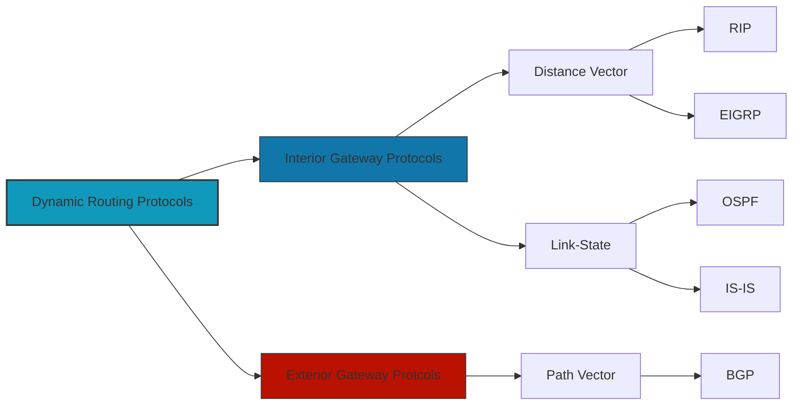

# 11. Routing Protocols

Routing Protocols Explained
Routing protocols determine the best paths for data packets to travel across a network. 

---

|Protocol Name|Description|Common Usage|
|---|---|---|
|**RIP** (Routing Information Protocol)|A distance-vector protocol that uses hop count as a metric to determine the best path for data.|Common in smaller networks, often used for simpler configurations or legacy systems.|
|**OSPF** (Open Shortest Path First)|A link-state protocol that uses a more complex metric based on bandwidth to find the shortest path. It supports hierarchical network design and faster convergence.|Widely used in enterprise networks and large-scale IP routing.|
|**BGP** (Border Gateway Protocol)|A path-vector protocol used for routing between different autonomous systems (ASes). It uses policy-based routing and is crucial for inter-domain routing on the internet.|Used in the Internet backbone and large-scale networks to route between different organizations or ISPs.|
|**EIGRP** (Enhanced Interior Gateway Routing Protocol)|A hybrid routing protocol that combines features of both link-state and distance-vector protocols. It uses bandwidth, delay, load, and MTU to determine the best path.|Used primarily in Cisco networks for dynamic routing.|
|**IS-IS** (Intermediate System to Intermediate System)|A link-state routing protocol similar to OSPF, used for routing within large-scale networks. It is more flexible and scalable than OSPF.|Used in large-scale ISP and enterprise networks for inter-domain routing.|
|**RIPng** (Routing Information Protocol next generation)|The IPv6 version of RIP, using hop count as its metric, similar to RIP but designed for IPv6 networks.|Used in IPv6 networks for simpler routing in small to medium-sized networks.|
|**BGP4** (Border Gateway Protocol version 4)|The most common version of BGP, used to route data between different autonomous systems, primarily on the internet.|Essential for global internet routing.|
|**OSPFv3** (Open Shortest Path First version 3)|The version of OSPF designed to support IPv6, with similar functionality to OSPF but optimized for IPv6.|Used for IPv6 networks, maintaining hierarchical routing and efficient pathfinding.|
|**IGRP** (Interior Gateway Routing Protocol)|A proprietary Cisco distance-vector protocol, similar to RIP but with more advanced features.|Legacy Cisco networks before EIGRP became more popular.|

### **Explanation of Protocol Types**:

- **Distance-Vector Protocols**: These protocols (like **RIP**, **RIPng**, **IGRP**) use a simple metric (such as hop count) to decide the best route.
- **Link-State Protocols**: Protocols like **OSPF** and **IS-IS** use a more complex approach, maintaining a full map of the network's topology to determine the best route.
- **Path-Vector Protocols**: **BGP** is a path-vector protocol that uses paths, policies, and network attributes for routing decisions.

