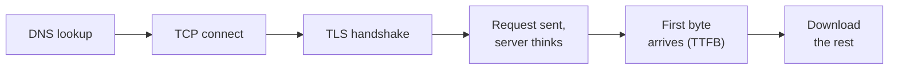

# 13. Web Performance from Around the World

> **Repository:** [sharifndlovu123/speedward](https://github.com/sharifndlovu123/speedward) · MIT licence · Python 3.11+
> **Get it:** `git clone https://github.com/sharifndlovu123/speedward.git && cd speedward && pip install -e .` then `speedward scan https://your-site.example --estimate` (or run the Docker image / local web UI, see the repo README). Only test sites you own or may test.

A site that feels fast from your desk can be slow for a visitor on another continent. The fix starts with **measuring from where the visitors are**. **Speedward** is a small, self-hostable tool that does this: give it a URL, it asks test machines in many cities to load the site, and it draws the timings on a world map. It is the performance sibling of [[7. Siteward Web Security Scanner|07. Siteward Web Security Scanner]] and uses the same stack and conventions.

## Tools at a glance

| Part | Choice |
| ---- | ------ |
| **Test machines** | [Globalping](https://globalping.io) network of probes in many cities (free up to a limit, optional key) |
| **Language** | Python 3.11+ |
| **CLI** | `speedward scan <url>` with Markdown, JSON or HTML output |
| **Web UI** | Django, no login, results kept in the browser tab only |
| **Hosting** | Docker (gunicorn, one worker with threads, non-root) |
| **Map** | Bundled Natural Earth outlines, no tile or geo-IP service called |

```
$ speedward scan https://example.com --estimate            # cost and allowance only
$ speedward scan https://example.com                       # 12 default places, Markdown
$ speedward scan https://example.com --format html --out report.html
$ speedward scan https://example.com --locations Berlin,Tokyo,Brazil --max-ttfb 600
```

Exit codes make it usable as a gate: `0` done and every limit passed, `1` a limit failed (`--max-ttfb`, `--max-load`, `--max-blocked`), `2` the scan could not run.

---

# Where the Time Goes

One page load is a chain of small waits. Each one is a different part of the network stack, and each has a different fix.



| Phase | What happens | Mostly depends on |
| ----- | ------------ | ----------------- |
| **DNS** | Name turned into an address ([[07. DNS\|05. DNS]]) | Resolver, DNS provider, cache |
| **TCP** | Three-way handshake | Distance (round-trip time) |
| **TLS** | Keys agreed and certificate checked | Distance, TLS version (1.3 needs fewer round trips than 1.2) |
| **First byte (TTFB)** | Time until the first byte of the answer | Server work, backend, cache hit or miss, plus distance |
| **Download** | Rest of the body | Page size, compression, bandwidth |

- **Time to first byte** is the number to watch first. It folds the distance and the server's own work together, so a high TTFB in one city and a low one in another points at distance or caching rather than slow code
- Distance matters because a signal in fibre covers roughly 100 km per millisecond of round trip at best, and real paths are longer than straight lines. Several round trips (TCP, TLS, request) multiply it
- Speedward colours each place by TTFB against two limits, `FAST_MS` (default 300) and `SLOW_MS` (default 800). They are settings, not laws: tune them to your own target

---

# CDNs, Edges and Origins

A **content delivery network** keeps copies of your content on **edge** servers near visitors, so most requests never travel to your **origin**.

- A visitor in Tokyo and one in Frankfurt usually reach **different edge servers** under the same name. That is **anycast** or DNS-based steering at work
- Seeing a different answering address per place is normal, not a bug. It is also why "where is my server?" has no single answer for a CDN-fronted site
- A **cache hit** at the edge is fast everywhere. A **miss** goes back to the origin and is slow for far-away places. A repeat request from the same test machine shows warm-connection and cache effects, but it is not a test of a returning visitor's browser cache
- Cloudflare names the edge in its `cf-ray` header, which ends with an airport code (for example `-NRT` for Tokyo). Speedward keeps only that code, never the headers
- Related ideas: caching and traffic shaping in [[14. Network Operations and Monitoring|11. Network Operations and Monitoring]], the HTTP side in [[08. HTTP|06. HTTP]]

## Placing the server on the map

Speedward can draw a square where each answering server is, with a line from the test location to it. Positions come from an **offline geo-IP database** (MaxMind GeoLite2 City or DB-IP Lite City, check the licence) or from the Cloudflare airport code. Nothing about the target is sent to an outside service.

A position is drawn only when it can be trusted; otherwise the table says why:

- **Shared address** answering places on two or more continents: anycast or a shared CDN address, which databases register at a single place
- **Database and CDN header disagree** by a large distance
- **Delay too short**: a connect time faster than light could travel to that position rules it out. This is a useful sanity check to remember: latency puts a **lower bound on distance**, and geo-IP databases are best-effort, not truth
- Private address, address not in the database, or no answering address

If nothing can be placed, you can drop a manual pin or set `SERVER_LAT` and `SERVER_LON`; exports record these as your claim, not a measurement.

---

# Reading the Results

Each place gets exactly one status, and they mean different things:

| Status | Meaning |
| ------ | ------- |
| **measured** | Test ran and the site answered. Only these rows have timings and count in averages and limits |
| **blocked** | The site itself refused the request or timed out |
| **test failed** | A problem on the test network's side. Says nothing about your site |
| **did not run** | The test never started |

- Failed places are dimmed and shown as "no data" with a reason, never as an invented number
- Optional extras: `--traceroute` shows the network path per place (see [[15. Network Troubleshooting|12. Network Troubleshooting]]) and `--dns` checks DNS answers per place
- Results are a **snapshot**, not a benchmark: they vary with the hour and with each probe's own network. Repeat before drawing conclusions

---

# Cost, Safety and Privacy

- **Every location costs tests**: about 3 per place for the default scan (36 for 12 places), more with traceroute and DNS. `--estimate` prints the cost and your remaining hourly allowance, and a scan that does not fit is refused unless you confirm
- **Authorised targets only.** Each scan sends real requests from many machines
- **API key**: optional, server-side only, never in the browser, exports or logs
- **No login on the web UI.** Bind it to loopback or put your own authentication in front before sharing it. Use exactly one worker with threads, because progress lives in that process's memory
- **Nothing stored**: no database, no result files. In the web UI results live in the browser's session storage and expire; export to keep them

---

# Using It Well

1. Run `--estimate` first, then scan after each release or CDN change
2. Compare TTFB **between places**: a big gap means distance or a cache miss, not slow code
3. If TTFB is high everywhere, look at the origin (backend, database, cold starts) rather than the network
4. Set `--max-ttfb` in CI as a rough gate, with a margin for noise
5. Pair it with security checks from [[7. Siteward Web Security Scanner|07. Siteward Web Security Scanner]] and watch trends over time rather than single runs

Related: [[08. HTTP|06. HTTP]], [[07. DNS|05. DNS]], [[14. Network Operations and Monitoring|11. Network Operations and Monitoring]], [[15. Network Troubleshooting|12. Network Troubleshooting]], [[24. Network Device Monitoring with NetPulse|16. Network Device Monitoring with NetPulse]]
