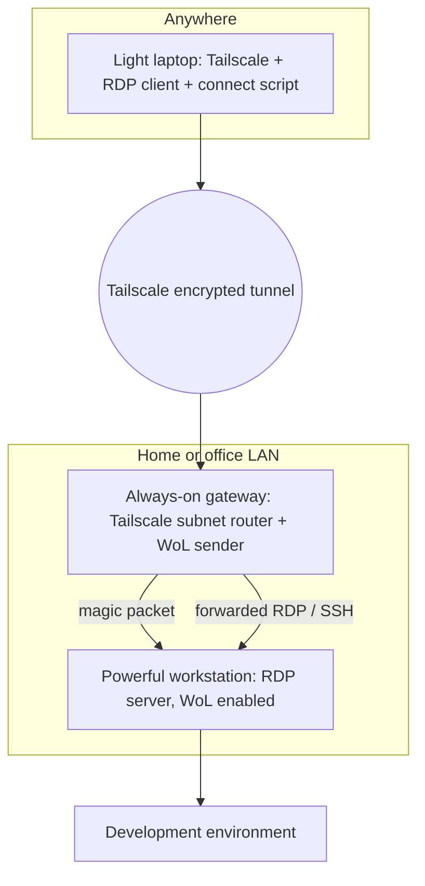

> **Repository:** [sharifndlovu123/Remote-Workstation-Anywhere-](https://github.com/sharifndlovu123/Remote-Workstation-Anywhere-) · docs, scripts and example config
> **Get it:** `git clone https://github.com/sharifndlovu123/Remote-Workstation-Anywhere-.git` and start with `docs/prerequisites.md`.

Use a powerful desktop at home or the office from a light laptop anywhere, over an encrypted private network, with a tiny always-on device waking the desktop on demand. It wires together mature tools rather than inventing a new one. Network background is in [[09. Network Services|Network Services]] and [[13. Network Security|Network Security]].

## Tools at a glance

| Tool | Role |
| ---- | ---- |
| **Tailscale** | Private encrypted mesh network (WireGuard-based) between your devices |
| **Subnet router** | A Tailscale node that exposes the home LAN to your other devices |
| **Wake-on-LAN (WoL)** | A "magic packet" that powers on a sleeping machine |
| **GNOME Remote Desktop (RDP)** | Remote desktop server on the workstation |
| **FreeRDP / Remmina** | RDP client on Linux; Microsoft Remote Desktop on macOS |
| **SSH** | Command-line access and tunnels |
| **Raspberry Pi** | Low-power always-on gateway |

---

# How It Works



Why this shape:
- **No open ports on the router**: nothing on the home network is exposed to the internet, which avoids port-forwarding risks
- **Power saving**: the workstation sleeps until needed
- **One command**: a connect script wakes the machine, waits for it, then opens the RDP session

---

# Setup Steps

1. **Workstation**: enable **Wake-on-LAN** in the BIOS and on the network card, and turn on GNOME Remote Desktop (RDP)
2. **Gateway (Raspberry Pi)**: install Tailscale, advertise the LAN as a **subnet route**, and install a WoL tool
3. **Laptop**: install Tailscale and an RDP client
4. **Connect script**: wake, wait, connect

```
# on the workstation: allow WoL on the NIC
$ sudo ethtool -s eth0 wol g
$ ip link show eth0 | grep ether              # note the MAC address

# on the gateway
$ sudo tailscale up --advertise-routes=192.168.1.0/24
$ sudo apt install wakeonlan
$ wakeonlan AA:BB:CC:DD:EE:FF                # send the magic packet

# on the laptop
$ tailscale status
$ xfreerdp /v:192.168.1.50 /u:sharif /dynamic-resolution
```

Approve the advertised subnet route in the Tailscale admin console.

## Wake-on-LAN facts
- The magic packet is a **broadcast** of 6 bytes of `FF` followed by the target **MAC address** 16 times, sent on the local network (usually UDP port 9)
- It works on the **LAN**, so you need a device inside it to send it: that is the gateway's job
- Must be enabled in firmware and the OS, and may not work over Wi-Fi

---

# The Repository

The project is published as the `Remote-Workstation-Anywhere-` repo: documentation plus small, readable shell scripts.

```
docs/          architecture, prerequisites, tailscale-setup, wake-on-lan, ubuntu-gnome,
               linux / macos / windows client guides, security, troubleshooting,
               raspberry-pi backup and read-only OverlayFS guides, roadmap
scripts/       common/ (shared library, wake.sh), linux/connect.sh, macos/connect.sh
examples/      config.example.env
assets/        architecture and sequence diagrams (Mermaid)
```

The connect script reads a config file, wakes the workstation through the gateway, waits for RDP to answer, then launches the client. A `--check` mode verifies the setup. Quality tooling: `shellcheck` config, a contributing guide, and a validation checklist.

## Subnet router prerequisites
The gateway must **forward packets**, so enable IP forwarding persistently, then advertise and approve the route:

```
$ sudo tee /etc/sysctl.d/99-tailscale.conf <<'EOF'
net.ipv4.ip_forward = 1
net.ipv6.conf.all.forwarding = 1
EOF
$ sudo sysctl -p /etc/sysctl.d/99-tailscale.conf
$ sudo tailscale up --advertise-routes=192.168.1.0/24
$ sudo tailscale set --accept-routes=true       # on Linux clients
```

An advertised route does nothing until it is **approved** in the Tailscale admin console. Consider disabling **key expiry** on the always-on gateway so it stays online, and compensate by securing the device.

---

# Security Model (from the repo's threat model)

- **Never port-forward RDP or SSH** on the router: public RDP is scanned and attacked constantly, and this design needs no inbound rules
- **Network access is not authentication.** Being on the tailnet only allows packets; keep a second layer (strong RDP password and certificate checking, SSH keys)

| Layer | Controls | Where |
| ----- | -------- | ----- |
| **Network** | Which devices reach which addresses and ports | Tailscale access policies, workstation firewall |
| **Application** | Who may log in | RDP credentials, SSH keys, OS accounts |

- Restricting SSH on the gateway does **not** restrict RDP to the workstation; write rules for both
- Use **SSO with MFA** for the tailnet owner, **device approval**, key expiry on clients, and **tags** (e.g. `tag:gateway`) for infrastructure
- Tighten the default "allow all" policy, name the workstation's **address and port**, and **test that blocked things are actually blocked**
- Consider advertising a narrower route (just the workstation's `/32`)

```jsonc
{
  "tagOwners": { "tag:gateway": ["autogroup:admin"] },
  "acls": [
    { "action": "accept", "src": ["autogroup:member"], "dst": ["tag:gateway:22"] },
    { "action": "accept", "src": ["autogroup:member"], "dst": ["192.168.1.50:3389"] }
  ]
}
```

Check the current Tailscale policy syntax before applying (a newer "grants" syntax also exists). Hardening basics for the machines themselves are in [[Server Hardening with SSH, UFW and Fail2ban]].

---

# Troubleshooting: Work Outside In

Order: **client → tailnet → gateway → workstation power → workstation service → client app.**

```
# on the client
$ tailscale status
$ ssh gateway 'hostname'
$ nc -vz -w 5 192.168.1.50 3389

# on the workstation
$ sudo grdctl --system status
$ sudo systemctl status gnome-remote-desktop.service --no-pager
$ sudo ss -lntp '( sport = :3389 )'
$ sudo journalctl -u gnome-remote-desktop.service --no-pager -l
```

| Symptom | Likely area | First check |
| ------- | ----------- | ----------- |
| `ssh gateway` fails | Tailscale, alias, keys | `tailscale status`, `ssh -v gateway` |
| Gateway reachable, workstation not | Power, route, address | WoL, DHCP reservation, `ping` from the gateway |
| Workstation will not wake | WoL, firmware, standby power | `sudo ethtool eno1`, NetworkManager profile |
| TCP 3389 refused | RDP service not running | `systemctl status gnome-remote-desktop.service` |
| TCP 3389 times out | Routing or firewall | Tailscale route, forwarding on the gateway |
| "Credentials are not set" | System-level RDP credentials | `grdctl --system rdp set-credentials`, restart |
| Stalls "securing connection" | Client or NLA incompatibility | Try FreeRDP, read the journal |
| Tiny remote display | HiDPI | Display scale, dynamic resolution |

A successful `nc` test proves only that **something accepts connections** on the port, not that RDP authentication will work.

---

# Roadmap Ideas
Tested Linux and Windows client scripts, a smarter readiness check than a TCP probe, alternative WoL senders, a restricted forced-command SSH helper, a tested narrow-route guide, certificate pinning helper, multi-workstation profiles, and CI running `shellcheck`, link checks and a secrets scan.

---

# Keeping the Gateway Reliable

An always-on Raspberry Pi should survive power cuts and SD-card wear:
- **Read-only root filesystem with an overlay** (OverlayFS) so writes go to RAM and the card is protected
- **Backup and recovery** of the SD image so a failed card can be replaced quickly
- Static IP or DHCP reservation ([[09. Network Services|Network Services]])
- Monitoring and an out-of-band path for recovery ([[14. Network Operations and Monitoring|Network Operations and Monitoring]])

---

# Security Notes
- Use **MFA** on the Tailscale account and **ACLs** to limit which devices can reach which ports
- RDP stays on the private network only; never expose it to the internet ([[13. Network Security|Network Security]])
- Keep the workstation and gateway patched
- Prefer SSH keys over passwords
- Compare with cloud approaches: VPN gateways and bastion hosts ([[3. Azure Networking]], [[5. AWS Networking|5. AWS Networking]])
