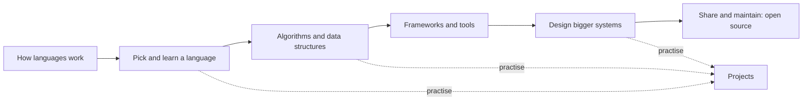

# Programming

Programming is turning an idea into instructions a computer can follow. This section goes from *what languages are* to *how real systems are built*. Read it top to bottom, or jump to what you need.

## A suggested path

## 1. Understand languages

| Note | What it gives you |
| ---- | ----------------- |
| [[03. Levels of Programming Languages|Levels of Programming Languages]] | Machine code to high-level: how far a language is from the hardware |
| [[04. Programming Language Categories|Programming Language Categories]] | Procedural, object-oriented, functional, logic and scripting, with examples |
| [[05. Language History And Contributions|Language History and Contributions]] | Who made what, and why |
| [[Compilers]], [[Interpreters]], [[Hybrid]] | How source code becomes something that runs |

## 2. Learn languages

The individual language notes are in `06. Languages`, for example [[Python]], [[Java]], [[JavaScript]], [[Go]], [[Rust]], [[C]], [[C++]], [[C-Sharp]], [[Bash]] and [[Powershell]]. Not sure which to pick? See [[9. Choosing a Language|Choosing a Language]].

## 3. Think in algorithms

[[Sorting Algorithms]], [[Heuristic Search]], and the optimisation methods in [[Metaheuristics - Ant Colony, Tabu Search and Simulated Annealing|Metaheuristics]]. Practice ideas with a "what you will learn" column are in [[02. What to program to improve my skills|What to Program]].

## 4. Use frameworks and tools

- [[09. Frameworks|Frameworks]]: what they are and how to choose one.
- Django in practice: [[1. Django Data Modelling Lessons|data modelling]], [[2. Multi-Tenant Django by Subdomain|multi-tenancy]], [[3. Django Payments and Webhooks|payments]], [[4. Celery and Message Brokers|background jobs]], [[5. Async Django - ASGI, Channels and SSE|async]].
- Editors and IDEs: [[11. Text Editors|Text Editors]].

## 5. Design systems

[[1. Fundamentals|System Design]] covers scaling, caching, data stores, reliability patterns and worked designs, plus how to size a system ([[7. Capacity Estimation and Sizing|Capacity Estimation]]) and pick tools ([[8. Choosing Data Stores|Choosing Data Stores]]).

## 6. Share and maintain

[[1. Open Source Fundamentals|Open Source]]: licences, good contributing manners, running a project, versioning and security hygiene.

## 7. Extras and research

- [[HTTP Server]], [[Telnet]], [[CGI Setup]], [[SSH|SSH setup]]: small hands-on guides in `12. EXTRAS`.
- [[Research Notes]]: writing papers with [[LaTex]] and [[BibTeX]].

## Habits that matter in every language

- **Read more code than you write**, and read the error message first.
- **Make it work, make it right, make it fast**, in that order.
- **Write small functions** with clear names; comments explain *why*, not *what*.
- **Use version control** from day one and commit small, meaningful changes.
- **Test the boring parts** so you can change the exciting parts safely.
- **Measure before optimising.**
