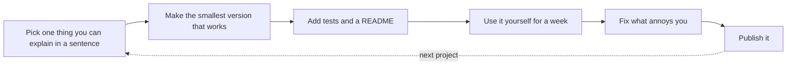

# 02. What to program to improve my skills

# What to Program to Improve My Skills

Skills grow by building things slightly beyond what you can already do. This page is a menu of projects by level, what each one teaches, and where the vault has notes to lean on.

## How to pick and finish a project

- **Scope small.** A finished small project teaches more than an abandoned big one.
- **Build something you will use**: it keeps you going when it gets boring.
- **Write it down**: a README with install steps, an example, and what you learned.
- **Use version control** and commit often ([[4. Versioning and Releases|Versioning and Releases]]).
- **Share it**: even one reviewer's feedback is worth hours of solo work ([[1. Open Source Fundamentals|Open Source]]).
- **Stuck?** Shrink the problem, print values, and write the failing test first.

## Beginner projects

Fundamentals: syntax, loops, functions, files, data structures.

| Project | You will learn |
| ------- | -------------- |
| **To-do list** (console, then with a file or database) | Lists, files, input handling |
| **Simple calculator** | Functions, parsing, error handling |
| **Weather app** (public API) | HTTP requests, JSON, API keys kept out of code |
| **Basic web scraper** (`requests` and `BeautifulSoup`) | HTML, politeness (`robots.txt`), cleaning data |
| **File organiser** (sort a folder by type) | File system, paths, scripting ([[Intro|Bash]], [[Python]]) |
| **Guess the number / hangman / tic-tac-toe** | Loops, state, game logic |
| **Unit converter or tip splitter** | Input validation, tests |

## Intermediate projects

Algorithms, data handling, APIs, tests and deployment.

| Project | You will learn |
| ------- | -------------- |
| **Expense tracker with a database** (SQLite or PostgreSQL) | Schema design, SQL, migrations ([[02. Foundation|Databases]]) |
| **REST API** (Flask, FastAPI, Express) | Routing, validation, status codes, auth |
| **URL shortener** | Hashing, base 62, caching ([[5. Worked Designs|Worked Designs]]) |
| **Rate limiter middleware** | Token bucket, Redis ([[4. Reliability Patterns|Reliability Patterns]]) |
| **Automated test suite** for an existing project | Pytest or JUnit, mocks, coverage |
| **CLI tool people can install** (`pipx install yourtool`) | Argument parsing, packaging, releases |
| **CLI password manager** | Encryption basics, secrets handling ([[5. Secure Coding and Supply Chain|Secure Coding]]) |
| **Game** (Pygame, Godot, Unity) | Game loop, state, assets |
| **CI/CD pipeline** for a project | GitHub Actions, build and deploy ([[2. GitHub Actions|GitHub Actions]]) |
| **Dockerise an app** and run it with Compose | Containers, networking ([[1. Docker|Docker]]) |
| **Dashboard on a Raspberry Pi** reading a sensor | Hardware, I/O, scheduling |

## Advanced projects

Performance, design, scale and reliability.

| Project | You will learn |
| ------- | -------------- |
| **Full-stack web app** (Django, Spring Boot, Next.js) | Auth, forms, background jobs ([[4. Celery and Message Brokers|Celery]]) |
| **Key-value store** | Consistent hashing, replication, quorum ([[3. Data and Consistency|Data and Consistency]]) |
| **Web crawler** | Queues, politeness, duplicate detection |
| **Chat server** (WebSockets) | Concurrency, presence, delivery guarantees |
| **Distributed ID generator** (snowflake-style) | Clocks, bit layouts |
| **Search autocomplete** with a trie | Data structures, caching, ranking |
| **Custom compiler or interpreter** | Lexing, parsing, code generation ([[Compilers]], [[Interpreters]]) |
| **Microservices with a queue** | Service boundaries, retries, idempotency ([[6. Distributed Patterns|Distributed Patterns]]) |
| **Infrastructure as code** for a small stack | Terraform or CloudFormation, Kubernetes ([[1. Infrastructure as Code|IaC]]) |
| **MCP server or AI agent tool** | Tool design, APIs, safe automation |
| **RAG chatbot over your own notes** | Embeddings, vector search ([[8. Choosing Data Stores|Choosing Data Stores]]) |
| **Observability for your own app** | Metrics, logs, tracing, alerts |
| **Smart contract app** (Solidity) | Deterministic code, gas, security |

## Super projects (not a breeze)

Deepen your programming knowledge with the challenge lists by **Austin Z. Henley** (Carnegie Mellon University). They involve tools and structures not commonly used, so expect a serious challenge.

- **[Original list](https://austinhenley.com/blog/challengingprojects.html)**
    - Text editor
    - 2D game (Space Invaders)
    - Compiler (Tiny BASIC)
    - Mini operating system
    - Spreadsheet
    - Video game console emulator
- **[Sequel](https://austinhenley.com/blog/morechallengingprojects.html)**
    - Ray tracer
    - Key-value store web API
    - Web browser
    - Stock trading bot
- **[Sequel 2: algorithm challenges](https://austinhenley.com/blog/challengingalgorithms.html)**
    - Topological sort
    - Recursive descent parsing
    - Myers string difference
    - Bloom filter
    - Piece table
    - Splay tree

## Pick a project by goal

| If you want to... | Build |
| ----------------- | ----- |
| Get hired as a web developer | A full-stack app with auth, tests, CI and a live demo |
| Learn how computers work | An emulator, a mini OS, or a compiler |
| Learn systems and scale | A key-value store, crawler or chat server |
| Get into DevOps or cloud | A pipeline that builds, tests, containerises and deploys a small app |
| Get into security | A small scanner, then fix what it finds ([[7. Siteward Web Security Scanner|Siteward]]) |
| Get into data and AI | A data pipeline, then a model or retrieval app on top |
| Learn algorithms | Solve a real problem with search or optimisation ([[Heuristic Search]]) |

## Habits that make practice count

1. **Contribute to open source**: read the guide in [[2. Contributing Etiquette|Contributing Etiquette]], then fix a documentation issue or a `good first issue`.
2. **Read other people's code and reviews**, and have yours reviewed.
3. **Rebuild something you use** (a tiny `grep`, `git`, a Markdown parser).
4. **Write about what you learned**: a short post or a note in this vault.
5. **Revisit old projects**: add tests, profile, simplify, and note what you would do differently.
6. **Deliberately use a new language or tool** on a familiar problem, so only one thing is new ([[9. Choosing a Language|Choosing a Language]]).

### Final thought
Pick something from each level, finish it, and keep a list of what you built. Skills show up in the things you shipped.
