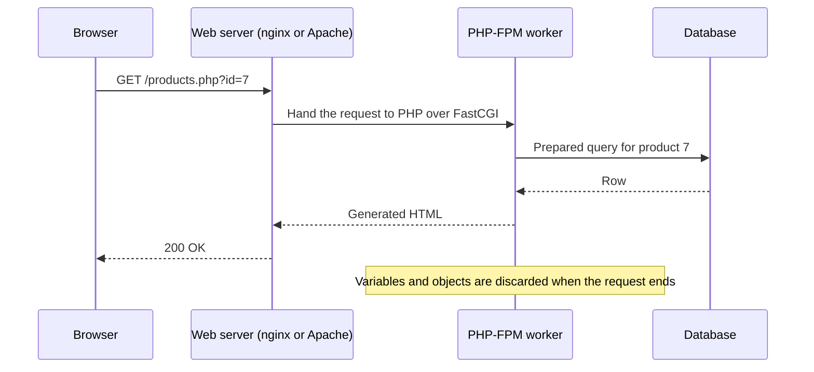

# 11. PHP

PHP (*PHP: Hypertext Preprocessor*) is an open-source, dynamically typed scripting language built for the web. It was created by Rasmus Lerdorf in 1994-95 as a set of tools for his personal home page and grew into one of the most widely deployed server-side languages. WordPress, Drupal, Wikipedia's MediaWiki and large parts of Facebook's early stack are PHP, and modern frameworks such as Laravel and Symfony have made the language far more disciplined than its reputation suggests.

> The examples assume a current PHP 8.x release. The newest features (8.4 and later) are marked where they appear; check [php.net/supported-versions](https://www.php.net/supported-versions.php) for which versions still get security fixes.

---

## 1. How PHP Runs

Unlike a long-running Node.js or Java server, classic PHP is **shared-nothing**: each HTTP request starts a fresh script, runs it top to bottom, sends the response and throws everything away.



- **PHP-FPM** keeps a pool of PHP worker processes; the web server hands requests to them.
- **OPcache** stores compiled bytecode in shared memory so scripts are not re-parsed on every request. Enable it in production.
- **Consequence:** state must live outside the script (database, cache, session store). That makes PHP easy to scale horizontally and hard to leak memory in, but it pays the start-up cost on every request.
- Long-running alternatives exist (Swoole, RoadRunner, FrankenPHP worker mode, Laravel Octane) that boot the application once and reuse it.
- PHP is interpreted at the language level; see [[Interpreters]] (the engine is the Zend Engine).

---

## 2. Basic Structure of a PHP Program

```php
<?php
declare(strict_types=1);

echo "Hello, World!\n";
```

- **`<?php`** opens PHP mode. In files that contain only PHP, leave out the closing `?>` so no stray whitespace is sent.
- **`declare(strict_types=1);`** makes scalar type declarations strict for that file (a `string` will no longer be silently accepted where an `int` is required). Put it at the top of every new file.
- PHP files can mix HTML and PHP, which is how templates work:

```php
<ul>
<?php foreach ($users as $user): ?>
    <li><?= htmlspecialchars($user['name']) ?></li>
<?php endforeach; ?>
</ul>
```

`<?= ... ?>` is shorthand for `<?php echo ... ?>`.

Run a script or a quick dev server straight from the terminal:

```bash
$ php hello.php
$ php -S localhost:8000 -t public     # built-in dev server (not for production)
$ php -r 'echo PHP_VERSION, "\n";'
$ php -a                              # interactive shell
```

---

## 3. Variables and Data Types

Variables start with `$` and are case-sensitive; the convention is `$camelCase` or `$snake_case` (follow the project).

```php
$name = "Alice";        // string
$age = 25;              // int
$height = 1.68;         // float
$isActive = true;       // bool
$nothing = null;        // null
$items = [1, 2, 3];     // array
```

| Type | Notes |
|------|-------|
| `int`, `float` | 64-bit integers on most platforms; large results overflow into float |
| `string` | Byte strings; use the `mb_*` functions for multi-byte text such as UTF-8 |
| `bool` | `false`, `0`, `""`, `"0"`, `[]` and `null` are falsy |
| `array` | An ordered map; serves as list and dictionary |
| `object`, `callable`, `iterable` | Class instances, anything callable, anything loopable |
| `null` | No value |

### Strings

```php
$greeting = "Hello, $name!";             // interpolation in double quotes
$expr     = "Next year: {$age}y";        // braces for complex expressions
$raw      = 'No $interpolation here\n';  // single quotes: literal
$joined   = "Hello" . " " . "World";     // concatenation uses a dot

echo strlen($name), strtoupper($name), str_contains($name, "li");
echo sprintf("%s is %d years old", $name, $age);
```

Heredocs (`<<<EOT ... EOT`) give multi-line strings with interpolation; nowdocs (`<<<'EOT'`) do not interpolate.

### Arrays

PHP's array is one structure that acts as a list, a dictionary or both.

```php
$list = ["apple", "banana", "cherry"];
$list[] = "date";                                   // append

$user = ["name" => "Alice", "age" => 25];           // associative
echo $user["name"];
echo $user["email"] ?? "no email";                  // null coalescing: default when missing

[$first, $second] = $list;                          // destructuring
['name' => $n, 'age' => $a] = $user;

$squares = array_map(fn(int $x) => $x * $x, [1, 2, 3]);   // [1, 4, 9]
$even    = array_filter([1, 2, 3, 4], fn($x) => $x % 2 === 0);
$sum     = array_sum([1, 2, 3]);
sort($list);                                        // sorts in place
$merged  = [...$list, ...["extra"]];                // spread
```

---

## 4. Operators and Control Flow

```php
if ($age >= 18) {
    echo "Adult";
} elseif ($age >= 13) {
    echo "Teen";
} else {
    echo "Child";
}

foreach ($user as $key => $value) {
    echo "$key = $value\n";
}

for ($i = 0; $i < 3; $i++) { echo $i; }
while ($queue) { array_shift($queue); }
```

### `match` (PHP 8.0+): a strict, expression-style switch

```php
$label = match (true) {
    $age >= 65 => "Senior",
    $age >= 18 => "Adult",
    default    => "Minor",
};
```

`match` uses strict comparison (`===`), returns a value and throws `UnhandledMatchError` if nothing matches and there is no `default`.

### Handy operators

| Operator | Meaning |
|----------|---------|
| `===` / `!==` | Identical (same value and type); **prefer these** |
| `==` / `!=` | Loose comparison with type juggling |
| `??` | Null coalescing: `$a ?? $b` |
| `??=` | Assign if null |
| `?->` | Nullsafe: `$user?->address?->city` |
| `<=>` | Spaceship: returns -1, 0 or 1 |
| `...` | Spread / variadic |

---

## 5. Functions

```php
function greet(string $name, string $greeting = "Hello"): string
{
    return "$greeting, $name!";
}

echo greet("Alice");
echo greet(greeting: "Hi", name: "Bob");   // named arguments (8.0+)
```

- **Types** on parameters and return values are optional but should be used. `void`, `never`, `?string` (nullable), `int|string` (union, 8.0+) and `mixed` all exist.
- **Arrow functions** capture the surrounding scope automatically: `fn($x) => $x * $factor`.
- **Variadics:** `function sum(int ...$nums): int { return array_sum($nums); }`
- **First-class callables (8.1+):** `$f = strlen(...);` or `$f = $object->method(...);`
- Functions do not see outer variables unless passed in or declared with `use`:

```php
$tax = 0.15;
$withTax = function (float $price) use ($tax): float {
    return $price * (1 + $tax);
};
```

---

## 6. Object-Oriented PHP

```php
<?php
declare(strict_types=1);

interface Shape
{
    public function area(): float;
}

final class Circle implements Shape
{
    public function __construct(private float $radius) {}   // constructor promotion (8.0+)

    public function area(): float
    {
        return M_PI * $this->radius ** 2;
    }
}

$c = new Circle(2.0);
echo round($c->area(), 2);   // 12.57
```

| Feature | Example / note |
|---------|----------------|
| Visibility | `public`, `protected`, `private` |
| Constructor promotion | Declares and assigns properties in the constructor signature |
| `readonly` (8.1+; whole classes in 8.2+) | Property can be set once, then never changed |
| `abstract`, `final` | Force subclassing or forbid it |
| `static` | Shared members, called as `Class::method()` |
| Interfaces | Contract of methods a class promises to implement |
| **Traits** | Reusable method bundles included with `use`, PHP's answer to multiple inheritance |
| **Enums (8.1+)** | Fixed sets of cases, optionally with values and methods |
| Attributes (8.0+) | `#[Route('/x')]` metadata read by frameworks, replaces docblock annotations |
| Magic methods | `__toString`, `__get`, `__call`, `__invoke` |
| Property hooks and asymmetric visibility (8.4) | Define getter/setter logic on the property itself; for example `public private(set) string $name` |

```php
enum Status: string
{
    case Draft = 'draft';
    case Published = 'published';

    public function label(): string
    {
        return ucfirst($this->value);
    }
}

$s = Status::from('draft');        // throws on an unknown value; tryFrom() returns null
echo $s->label();                  // Draft
```

```php
trait Timestamps
{
    public ?string $createdAt = null;
    public function touch(): void { $this->createdAt = date('c'); }
}

class Post { use Timestamps; }
```

---

## 7. Errors and Exceptions

PHP 7 and later throw `Error` and `Exception` objects, both of which implement `Throwable`.

```php
try {
    $result = intdiv(10, 0);
} catch (DivisionByZeroError $e) {
    error_log($e->getMessage());
} catch (InvalidArgumentException | TypeError $e) {
    // handle several types
} finally {
    echo "always runs";
}

throw new InvalidArgumentException("Age cannot be negative");
```

- Configure errors in `php.ini`: `display_errors=On` in development, **`Off` in production** with `log_errors=On` so users never see stack traces.
- `error_reporting(E_ALL)` during development catches notices and deprecations early.

---

## 8. Namespaces, Autoloading and Composer

```php
<?php
namespace App\Billing;

use App\Models\User;
use InvalidArgumentException;

final class Invoice { /* ... */ }
```

**Composer** is PHP's dependency manager (like npm or pip). Packages are listed on **Packagist**.

```bash
$ composer init
$ composer require guzzlehttp/guzzle        # add a dependency
$ composer require --dev phpunit/phpunit    # dev-only dependency
$ composer install                          # install exactly what composer.lock says
$ composer update                           # upgrade within the version constraints
$ composer dump-autoload                    # rebuild the class map
```

`composer.json` maps namespaces to folders (the **PSR-4** standard) so classes load themselves:

```json
{
  "autoload": { "psr-4": { "App\\": "src/" } },
  "require": { "php": ">=8.2" }
}
```

```php
require __DIR__ . '/vendor/autoload.php';   // once, in the entry point
$invoice = new App\Billing\Invoice();
```

Commit `composer.lock` for applications so every machine installs identical versions.

---

## 9. Web Basics: Requests, Forms and Sessions

```php
<?php
// POST /login handled by a script
$email = trim($_POST['email'] ?? '');
$query = $_GET['page'] ?? 1;
$agent = $_SERVER['HTTP_USER_AGENT'] ?? '';

session_start();
$_SESSION['user_id'] = 42;

header('Content-Type: application/json');
echo json_encode(['ok' => true, 'user' => $email]);
```

| Superglobal | Holds |
|-------------|-------|
| `$_GET`, `$_POST` | Query string and form fields |
| `$_REQUEST` | GET, POST and cookies merged; avoid |
| `$_SERVER` | Headers and server details |
| `$_COOKIE`, `$_SESSION` | Cookies and server-side session data |
| `$_FILES` | Uploaded files |

Frameworks wrap these in request and response objects so you rarely read superglobals directly.

---

## 10. Databases with PDO

**PDO** is the standard, driver-independent database interface (MySQL, PostgreSQL, SQLite and others).

```php
$pdo = new PDO(
    'mysql:host=localhost;dbname=shop;charset=utf8mb4',
    $user,
    $pass,
    [
        PDO::ATTR_ERRMODE            => PDO::ERRMODE_EXCEPTION,
        PDO::ATTR_DEFAULT_FETCH_MODE => PDO::FETCH_ASSOC,
        PDO::ATTR_EMULATE_PREPARES   => false,
    ]
);

$stmt = $pdo->prepare('SELECT id, name FROM products WHERE price < :max AND active = :active');
$stmt->execute(['max' => 20, 'active' => 1]);
$products = $stmt->fetchAll();
```

**Always use prepared statements with bound parameters.** Concatenating user input into SQL is how SQL injection happens:

```php
// WRONG: injectable
$pdo->query("SELECT * FROM users WHERE email = '$email'");

// RIGHT
$stmt = $pdo->prepare('SELECT * FROM users WHERE email = ?');
$stmt->execute([$email]);
```

Wrap multi-step changes in a transaction: `$pdo->beginTransaction(); ... $pdo->commit();` and `rollBack()` in the `catch`.

---

## 11. Security Checklist

| Risk | Defence |
|------|---------|
| SQL injection | PDO prepared statements |
| Cross-site scripting (XSS) | Escape output: `htmlspecialchars($value, ENT_QUOTES, 'UTF-8')`, or use a template engine that escapes by default (Twig, Blade) |
| Weak passwords | `password_hash($pw, PASSWORD_DEFAULT)` and `password_verify()`; never MD5 or SHA-1 |
| Session fixation | `session_regenerate_id(true)` after login; set `cookie_httponly`, `cookie_secure`, `cookie_samesite` |
| CSRF | Per-form tokens (frameworks provide middleware) |
| File uploads | Check the real MIME type, rename files, store outside the web root |
| Code execution | Never `eval()` or `include` a path built from user input; avoid `unserialize()` on untrusted data |
| Exposed errors and files | `display_errors=Off`, keep `.env` and `vendor/` outside the web root, serve only `public/` |
| Outdated runtime | Run a supported PHP version and update dependencies (`composer audit`) |

---

## 12. Quirks and Gotchas

- **Loose comparison.** `==` converts types. PHP 8 fixed the worst case (`0 == "abc"` is now `false`), but `"1e3" == "1000"` is still `true`. Use `===`.
- **Inconsistent standard library naming.** `strpos` vs `str_contains`, `array_map($fn, $arr)` vs `array_filter($arr, $fn)` (argument orders differ). A legacy of organic growth; keep the manual open (`php.net/functionname`).
- **Arrays are copied on assignment** (copy-on-write), whereas objects are handled by reference-like handles.
- **Needle and haystack order** differs between functions, a classic trip-up.
- **Everything is a string in `$_POST`.** Cast and validate input.
- **`null` and missing keys** raise warnings in PHP 8; use `??` or `isset()`.

---

## 13. Frameworks and Tooling

| Tool | Purpose |
|------|---------|
| **Laravel** | Full-stack framework with routing, Eloquent ORM, queues, Blade templates; the most popular today |
| **Symfony** | Component-based framework and library set; many other projects (including Laravel and Drupal) build on its components |
| **WordPress** | CMS powering a large share of the web; plugins and themes are PHP |
| **Slim** | Micro framework for small APIs |
| **PHPUnit / Pest** | Testing |
| **PHPStan / Psalm** | Static analysis that catches type errors without running the code |
| **PHP-CS-Fixer / PHP_CodeSniffer** | Coding-style enforcement (PSR-12) |
| **Xdebug** | Step debugging and profiling |

See [[09. Frameworks|Frameworks]] for how these compare with Django, Rails and Spring.

```bash
$ composer create-project laravel/laravel shop
$ cd shop && php artisan serve
$ php artisan make:model Product -m        # model plus migration
$ php artisan migrate
$ vendor/bin/phpunit
$ vendor/bin/phpstan analyse src --level=6
```

---

## 14. When to Choose PHP

| Strengths | Weaknesses |
|-----------|------------|
| Built for the web: forms, sessions and HTML output are first-class | Standard library naming and argument order are inconsistent |
| Cheap, ubiquitous hosting; deploy by copying files | Shared-nothing start-up cost on each request (mitigated by OPcache and worker modes) |
| Mature ecosystem: Composer, Laravel, Symfony, WordPress | Legacy code and old tutorials teach unsafe habits |
| Modern language: types, enums, attributes, JIT, fibers | Not suited to CPU-heavy or long-running compute (use Go, Rust, Java) |
| Fast to write CRUD applications | Weaker concurrency story than Go or Node.js, though async libraries exist |

**Good fit:** content sites, WordPress or Drupal work, CRUD back offices, APIs for small and medium products, anywhere cheap hosting matters.
**Look elsewhere for:** data science ([[Python]]), systems programming ([[Rust]], [[Go]]), large-scale services with long-lived connections.

Compare with [[Ruby]] (Rails) and [[Python]] (Django): all three offer batteries-included web development, but PHP has by far the easiest hosting and the largest installed base.

---

## 15. Quick Reference

```php
// Null and defaults
$v = $input ?? 'default';

// Array helpers
count($a); in_array($x, $a, true); array_keys($a); array_unique($a); usort($a, fn($x, $y) => $x <=> $y);

// Strings
trim($s); explode(',', $s); implode(',', $a); str_replace('a', 'b', $s); substr($s, 0, 5);

// Dates (prefer DateTimeImmutable)
$d = new DateTimeImmutable('2026-01-31');
echo $d->modify('+1 month')->format('Y-m-d');

// JSON
$data = json_decode($json, true, 512, JSON_THROW_ON_ERROR);
$json = json_encode($data, JSON_PRETTY_PRINT | JSON_THROW_ON_ERROR);

// Files
$text = file_get_contents('notes.txt');
file_put_contents('out.txt', $text, LOCK_EX);
```
