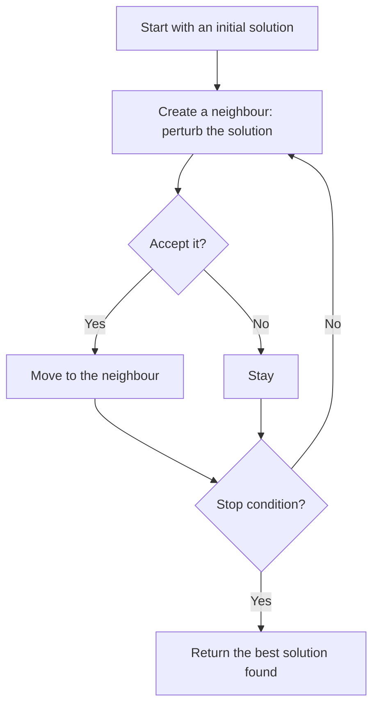
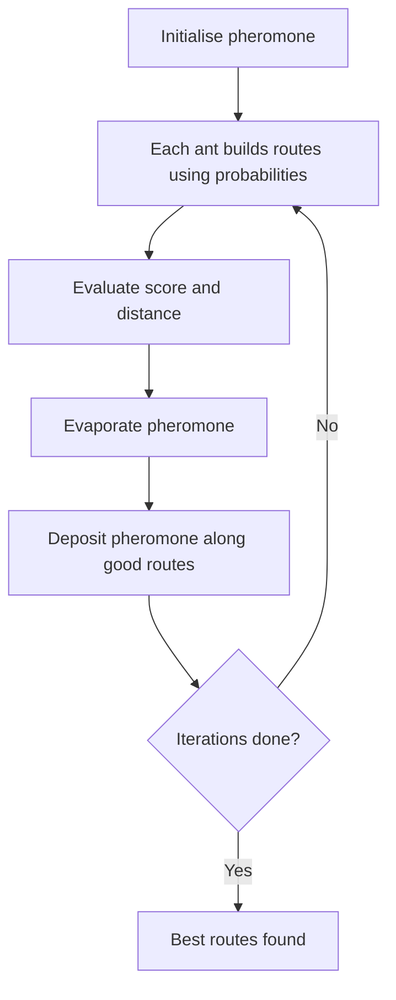

> **Repositories:** [sharifndlovu123/Ant-Colony-Implementation](https://github.com/sharifndlovu123/Ant-Colony-Implementation) (ACO for the team orienteering problem, `make run`, JDK 21+) · [sharifndlovu123/tabu_and_simulated_annealing](https://github.com/sharifndlovu123/tabu_and_simulated_annealing) (TSP, `java -jar app.jar`)

**Metaheuristics** are general strategies for finding **good-enough answers to hard optimisation problems** when trying every possibility is impossible. Three were implemented in Java: **Ant Colony Optimization** for a routing problem with scores and time limits, and **Simulated Annealing** and **Tabu Search** for the Traveling Salesman Problem. Sources: the `Ant-Colony-Implementation` and `tabu_and_simulated_annealing` repos. Searching and sorting basics are in the neighbouring Algorithms notes.

## At a glance

| Method | Inspiration | Core idea |
| ------ | ----------- | --------- |
| **Simulated Annealing (SA)** | Cooling metal | Accept worse moves sometimes, less often as it "cools" |
| **Tabu Search** | Memory | Remember recent moves and forbid undoing them |
| **Ant Colony Optimization (ACO)** | Ants finding food | Many simple agents leave **pheromone** on good paths |
| Genetic algorithms / programming | Evolution | See [[6. Genetic Programming and Decision Trees|Genetic Programming and Decision Trees]] |

---

# The Problems

## Traveling Salesman Problem (TSP)
Visit every city exactly once and return to the start by the **shortest total distance**. The number of tours grows factorially, so 25 cities already has more than 10^24 orderings. Cost is usually **Euclidean distance** between coordinates.

## Team Orienteering Problem (TOP)
A routing problem with **scores and a time budget**: several vehicles each start and end at fixed points, every location has a **score**, and each route may not exceed a maximum length **tMax**. You **cannot visit everything**, so you choose which nodes to visit and in what order to **maximise total score**.

Input file format used:

```
<number of nodes>
<number of vehicles>
<tMax: maximum distance per vehicle>
x y score        # one line per node
```

TSP is minimise-distance with everything visited; TOP is maximise-score with a limit, so it needs **selection** as well as ordering.

---

# Local Search Basics

All of these explore **neighbours** of a current solution.



Common TSP **perturbations** (neighbourhood moves):
- **Swap**: exchange two cities
- **Insert**: remove a city and place it elsewhere
- **2-opt**: reverse a segment of the tour, which removes crossing edges

The danger is a **local optimum**: a solution better than all its neighbours but worse than the best overall. Each method has its own way to escape.

---

# Simulated Annealing

Always accept a better neighbour; accept a **worse** one with probability that shrinks as a **temperature** T falls.

```
accept worse move with probability  p = exp( -Δ / T )     # Δ = increase in cost
```

- **High T**: nearly any move accepted, so it explores widely
- **Low T**: only improvements, so it settles down
- **Cooling schedule**: usually geometric, `T = α · T` with α such as 0.95 to 0.99
- Tune: starting temperature, α, moves per temperature, stopping temperature or iterations

```
T = T0; current = initial
while T > Tmin:
    candidate = perturb(current)
    Δ = cost(candidate) - cost(current)
    if Δ < 0 or random() < exp(-Δ / T):
        current = candidate
    if cost(current) < cost(best): best = current
    T = alpha * T
```

---

# Tabu Search

Always move to the **best neighbour**, even if it is worse than now, but keep a **tabu list** of recent moves (or solutions) that may not be repeated for a number of iterations (the **tenure**). That prevents cycling and pushes the search out of local optima.

- **Tabu tenure**: how long a move stays forbidden; too short allows cycles, too long over-restricts
- **Aspiration criterion**: a tabu move is allowed if it produces a new overall best
- Optional: **intensification** (search around good areas) and **diversification** (jump to new areas)

```
best = current
tabu = empty queue
repeat:
    pick the best non-tabu neighbour (or an aspirated one)
    current = that neighbour
    add the move to tabu; drop the oldest when over the tenure
    if cost(current) < cost(best): best = current
```

| | Simulated Annealing | Tabu Search |
| - | ------------------- | ----------- |
| Randomness | Central (probabilistic acceptance) | Mostly deterministic, best neighbour |
| Escape from local optima | Accepting worse moves by chance | Forbidding recent moves |
| Memory | None | Tabu list |
| Parameters | Temperature, cooling rate | Tenure, neighbourhood size |
| Cost per iteration | One neighbour | Evaluate many neighbours |

---

# Ant Colony Optimization (ACO)

Artificial ants build routes one step at a time. Edges on good routes receive more **pheromone**, which makes later ants more likely to choose them, while **evaporation** forgets old information.

## Choosing the next node
The probability of an ant moving from node *i* to node *j*:

```
p(i→j) = ( τ(i,j)^α · η(i,j)^β ) / Σ over allowed k ( τ(i,k)^α · η(i,k)^β )
```

- **τ** (tau): pheromone on the edge (learned experience)
- **η** (eta): heuristic desirability, e.g. `1/distance` for TSP, or `score/distance` for TOP
- **α** (alpha): how much to trust pheromone
- **β** (beta): how much to trust the heuristic (greedy information)

## Updating pheromone

```
τ(i,j) = (1 - ρ) · τ(i,j) + Σ over ants Δτ(i,j)
```

- **ρ** (rho): evaporation rate between 0 and 1; high ρ forgets quickly, low ρ converges early on early paths
- **Δτ**: pheromone deposited by ants that used the edge, bigger for better solutions (for TOP, proportional to total score)

## For the team orienteering problem
- Ants build a route per vehicle, adding nodes **only while the route can still return within tMax**
- The heuristic favours high score per unit of extra distance
- Track the best solution across iterations; report total score, total distance and each vehicle's route



## Parameters recorded with each run
Alpha, Beta, Rho, the **random seed**, execution time, total score and distance, and the detailed vehicle routes. Saving the **seed** makes results reproducible.

---

# Comparing Them

| | SA | Tabu | ACO |
| - | -- | ---- | --- |
| Works with | One solution | One solution | A population of ants |
| Memory | None | Recent moves | Pheromone matrix |
| Good at | Simple setup, general | Strong local refinement | Routing and path problems |
| Typical weakness | Sensitive to cooling | Needs good neighbourhood and tenure | Many parameters, slower |

# Doing Experiments Properly
- **Fix and report the random seed**, and run several seeds, since results vary
- Compare on **several instance sizes** (e.g. 8, 12, 15, 20 and 25 cities) and report best, average and run time
- Choose a clear **stopping criterion** (iterations or time) and keep it equal across methods
- Tune parameters on a few runs, then freeze them
- Report results in a table; for rigorous comparison use **statistical tests** over repeated runs
- Build with a **Makefile** and run from a JAR so others can reproduce (`make run`; Java 21 or later)

Related: [[Sorting Algorithms]], [[1. AI Agents and Workflows|AI Agents and Workflows]] (search and optimisation underlie many AI methods)
