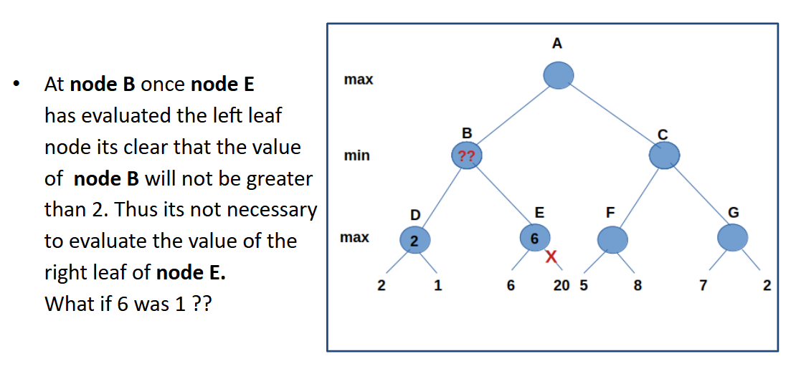
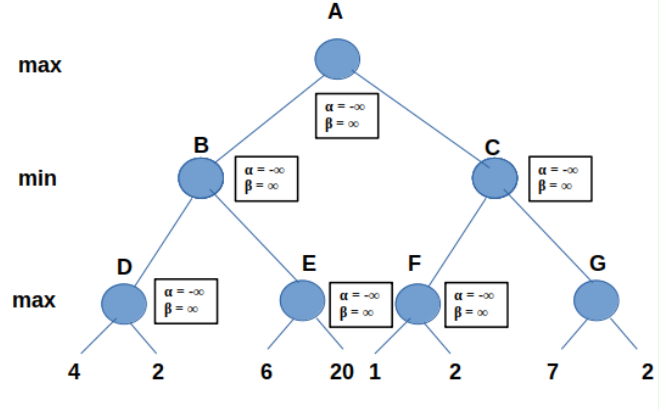
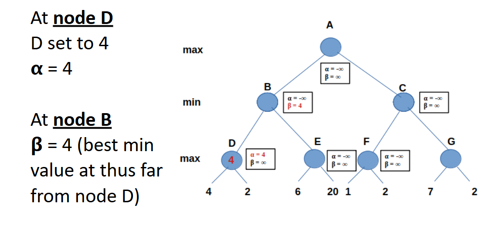
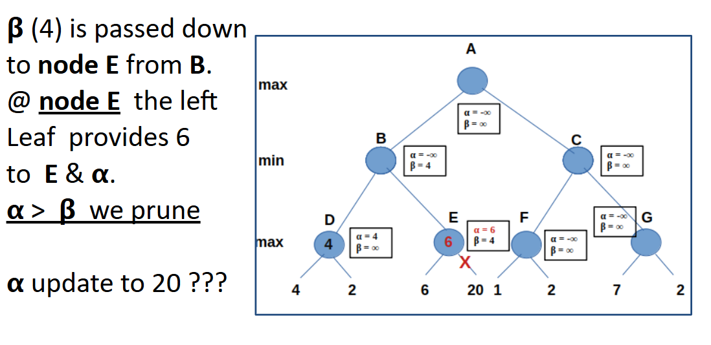
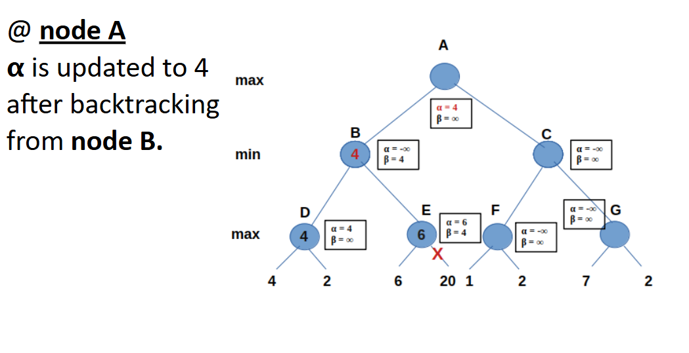
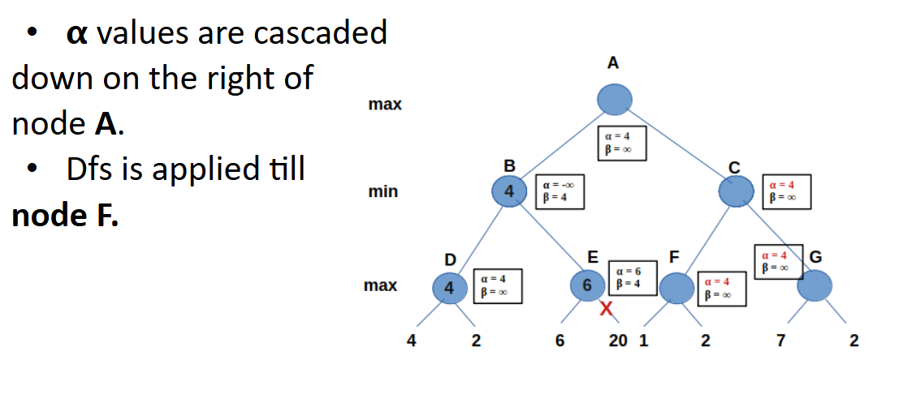
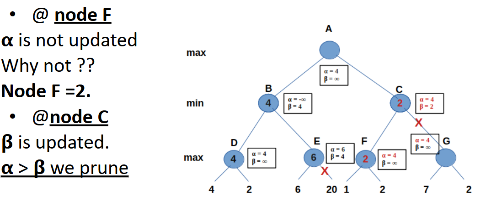
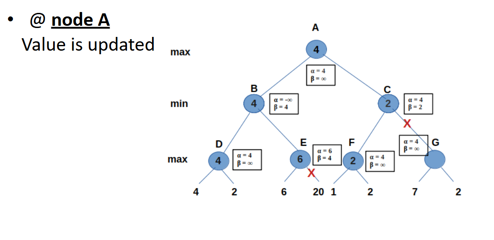
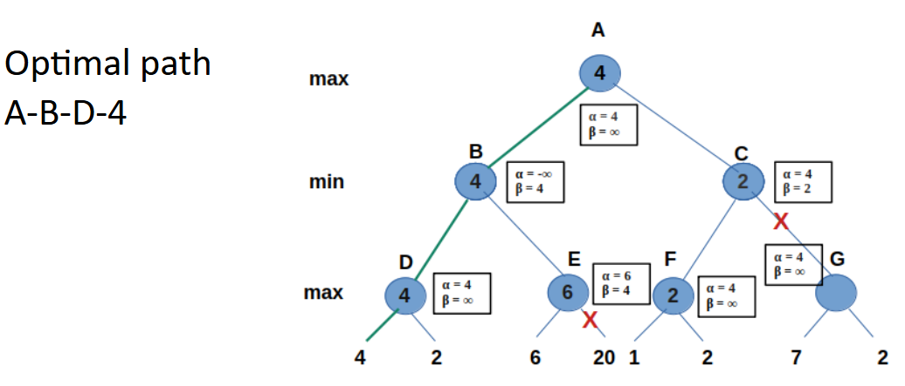

# Alpha Beta Pruning  

The disadvantage of the minimax algorithm is that all nodes in the game tree cut off to a certain depth were examined.  

Alpha-beta pruning reduces the number of nodes explored.  

  

## **Key Points**  

- Game trees can be enormous.  
- Some branches have no effect.  
- Several branches can be removed.  
- Pruning the branches reduces the time for the minimax algorithm.  

### **Alpha & Beta Variables**  

Two extra variables are assigned to every node in the tree: **alpha (α)** and **beta (β)**.  

#### **ALPHA (α)**  
- Stores the best already explored option along a path to the root for the **max layer**.  
- Represents the **maximum** score the maximizer can receive.  
- Only the **maximizer** can change this value.  
- **Initial value**: **-∞** (negative infinity).  

#### **BETA (β)**  
- Stores the best already explored option along a path to the root for the **minimizing layer**.  
- Represents the **minimum** score the maximizer can receive.  
- Only the **minimizer** can change this value.  
- **Initial value**: **∞** (positive infinity).  

### **Pruning Condition**  

- If **α ≥ β**, a given branch **can be pruned**, meaning there is no need to visit the given children.  
- **Pruning is not always guaranteed**—it depends on the distribution order of values.  

---  

## **Sample 1**  

The children of **B** have static values of **3** and **5**, and **B** is at the **MIN** level, so the value returned to **B** is **3**.  

If we consider **F**, it has a value of **-5**.  

Thus, the value returned to **C** is at most **-5**. However, **A** is at a **MAX** level, meaning the value at **A** will be at least **3**, which is greater than **-5**.  

Regardless of the value of **G**, **A** has a value of **3**. Therefore, we do **not** need to explore **G** because its value will **not** affect the value returned to **A**.  

This is called the **alpha cut**.  

Similarly, we can get a **beta cut** if the value of a subtree is always **greater** than the value returned by its sibling at a **minimizing level**.  

In **Alpha-Beta pruning**, we assign two extra variables to every node in the search tree: **alpha (α) and beta (β).**  

![[Pasted image 20250310005628.png]]  

---  

## **Sample 2**  

  
  
  
  
  
  
  
  
