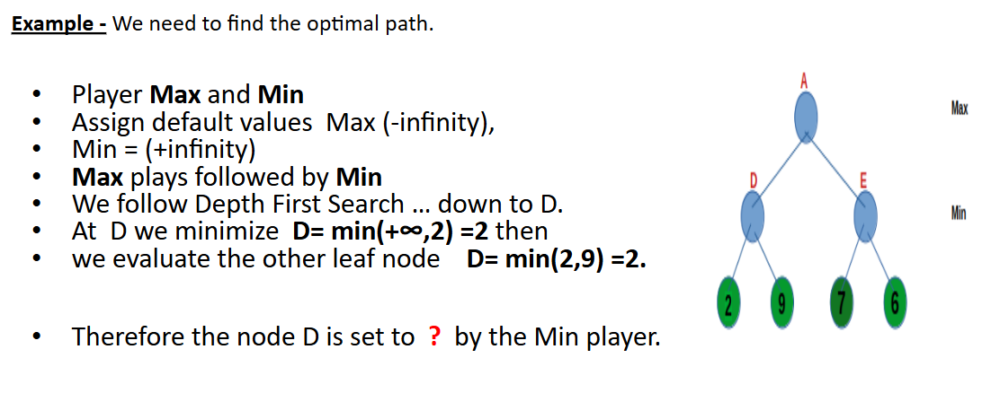
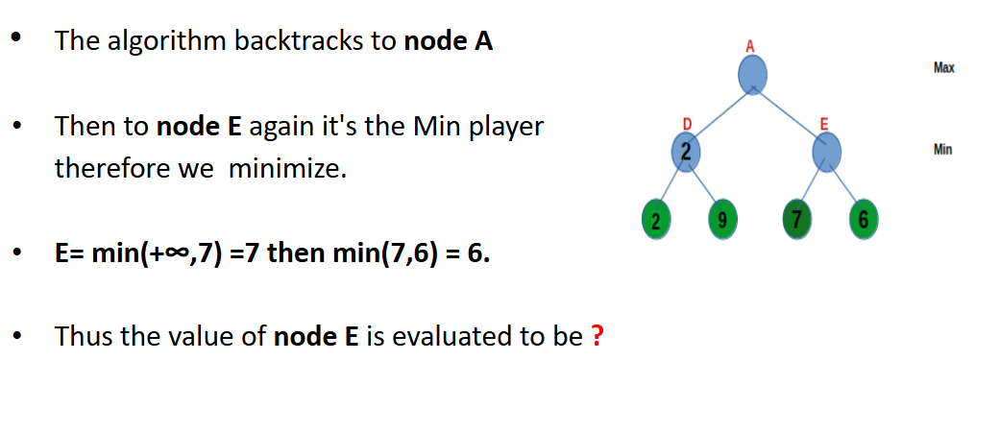

# 02. Minimax Search Algorithm


https://www.youtube.com/watch?v=l-hh51ncgDI

- An important search algorithm is the **Minimax Algorithm**.
- It is a **depth-first search** algorithm.
- It evaluates the **complete tree** using the Minimax Algorithm to select the best moves.

## **Game and Game Playing**

If the **game tree** is sufficiently small, we can generate the entire tree and look ahead to decide which move to make.  

- The Minimax algorithm **works by generating a complete tree** (if possible).  

In a **two-player game** where only one can win, we want to **maximize** the score for one player (**MAX**) and **minimize** the score for the opponent (**MIN**).  

- **MAX** represents the player trying to **win** the game by maximizing their score.  
- **MIN** represents the opponent who tries to **minimize** MAX’s score.  
- This assumes that the opponent has and uses the same **knowledge of the state space** as MAX.  

### **Tree Structure**  
- **Intermediate nodes** represent **game states**.  
- **Arcs** represent **moves**.  
- **Leaf nodes** hold the **score (utility) associated with that path**.  

### **Player Turns**  
- Players **alternate moves**.  
- The **first move** (layer) may represent **MAX**.  
- The next move represents **MIN**, and so on.  
- Leaf nodes contain **utility values**.  

### **Evaluation**  
- **Utility values** are propagated **back up** to their parents.  
- **MAX** tries to **maximize** the minimum values at that position.  
- **MIN** tries to **minimize** the maximum values at that position.  

Each level in the search space contains a label **MAX** or **MIN**, indicating **whose turn it is** at that point in the game.  

The Minimax algorithm is used to **look ahead** and decide which move to make first. It is mainly used in **decision-making** and **game theory**.  

If the **game space** is sufficiently **small**, the entire space can be generated, and leaf nodes can be assigned a **win (1), draw (0), or loss (-1)** value.  

---

## **Characteristics of Minimax**  
- **Always finds the optimal path** in a finite tree if both players play optimally.  
- Struggles with a **high branching factor**.  
- If the **game space is large**, a game tree can only be **generated up to a certain depth (ply)**.  
  - Win and loss values **cannot be assigned** to nodes at the cut-off depth because they are **not final nodes**.  
  - Instead, a **heuristic value** is used.  
- **Heuristic values** estimate how promising a node is for MAX to win.  

---

## **Minimax Algorithm**  

```plaintext
Repeat:
    If the search limit is reached:
        Compute the static value of the current position for the appropriate player.
        Report the result.

    Otherwise, if it is a minimizing level:
        Use Minimax on the children of the current position.
        Report the minimum value of the results.

    Otherwise, if it is a maximizing level:
        Use Minimax on the children of the current position.
        Report the maximum value of the results.

Until the entire tree is traversed.
```

---

## **Example**  
  
  
  
  

---

## **Advantages**  
- Considers **all possible moves**.  
- Ensures **optimal moves** are made.  
- **Highly accurate** in finding the best move.  

## **Drawbacks**  
- For **complex games** (e.g., chess) with a **large branching factor**, it is **very slow**.  

### **Solution:**  
**[Alpha-Beta Pruning]** can be used to improve efficiency.  
