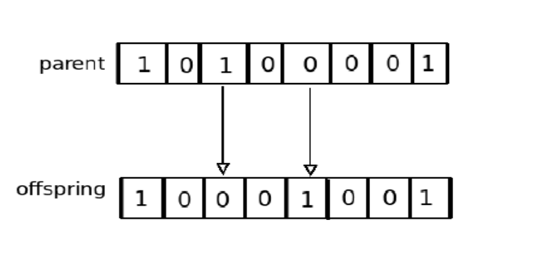

### Genetic Algorithm (GA)

A Genetic Algorithm (GA) is a search heuristic inspired by the process of natural selection. It is commonly used to find approximate solutions to optimization and search problems. Individuals in a population represent possible solutions, and the algorithm iteratively improves the population using genetic operators.

#### Steps of a Typical Genetic Algorithm:

1. **Initialize Population**
   - Begin by creating a population of random individuals (solutions).
   - The range of possible values for each gene is specified before the initial population is generated to ensure each randomly created individual is a valid candidate solution for the problem being solved.
   - Each individual is typically represented as a chromosome, which is a linear string of genes (binary bits, real numbers, or characters).
   - Example: A binary string `1100101` could represent one individual solution.


2. **Define Fitness Function**
   - A fitness function is used to evaluate how well each individual solves the problem.
   - The fitness score determines the "quality" of a solution.
   - Example: In the knapsack problem, the fitness function might calculate the total value of selected items, ensuring it doesn't exceed the weight capacity.

3. **Evaluation of Fitness**
   - Evaluate the fitness of each individual in the population. Each individual gets a fitness score based on how well it performs.
   - It can be a mathematical function or a measure of how well a Genetic Algorithm (GA) individual solves the specified problem.
   - Example: For each individual, calculate the total value of the knapsack and check if it fits within the weight limit.

4. **Selection**
   - Select individuals for reproduction based on their fitness scores. Individuals with higher fitness have a higher chance of being selected as parents.
   - Methods: Tournament selection, roulette wheel selection, or rank-based selection.
   - Example: Tournament Approach: A fixed number of individuals, `t`, are randomly selected from the population, and the individual with the best fitness from the `t` individuals is returned.
   - Example: A parent could be chosen based on the proportion of its fitness relative to the population.

5. **Genetic Operators (Crossover and Mutation)**
   - **Crossover (Recombination)**: Combine genes from two parent individuals to create offspring. This mimics biological reproduction.
     - The likelihood of crossover occurring is determined by a crossover probability, `pc`. A random number, `r`, is chosen between [0, 1], and if `r` is less than `pc`, then crossover takes place. 
     - The objective of a GA is to achieve convergence; therefore, crossover is usually applied at higher rates.
     - Example: If parent 1 has `1100101` and parent 2 has `1011100`, a crossover could result in offspring `1101100`.


   - **Mutation**: Introduce random changes to offspring's genes to maintain genetic diversity and explore new solutions.
     - Mutation plays an important role in preventing the search from prematurely converging to a local minimum/maximum. 
     - The application rate of mutation, given by `Pm`, is normally less than the crossover rate. A very high mutation rate may result in the search becoming a random search.
     - Example: A mutation could flip a bit from `1` to `0` or vice versa, like changing `1101100` to `1111100`.
     

    Mutation Sample
     

6. **Population Update**
   - Replace the old population with the new offspring created by the genetic operators.
   - This ensures the population evolves toward better solutions.
   - Population replacement methods for Genetic Algorithms (GAs) are generational and steady-state.
   - Example: After crossover and mutation, the old population is replaced by the newly created individuals.


   #### Generational replacement
   The current population is entirely replaced by a new population generated from crossover and mutation. 
   
   #### Steady-state
   Replacement replaces a specific number, `n`, of individuals in the current population with `n` offspring.

7. **Termination Condition**
   - The algorithm iterates through the process of evaluation, selection, crossover, and mutation until a stopping criterion is met.
   - Stopping conditions might include reaching a maximum number of generations, a target fitness level, or when no significant improvement occurs.

8. **Return Best Solution**
   - After the termination condition is met, the best solution (individual with the highest fitness score) is returned as the result of the algorithm.

#### Example Walkthrough of GA in the Knapsack Problem:

1. **Initial Population**: Randomly generate a population of binary strings, each representing a set of items selected for the knapsack.
   - Example: `1100`, `1011`, `0111`

2. **Fitness Evaluation**: Evaluate each individual by calculating the total value of the selected items and checking if the weight is within the knapsack’s capacity.
   - Example: `1100` has a weight of 20 and value 11, `1011` has a weight of 24 and value 12 (invalid solution), etc.

3. **Selection**: Select individuals with higher fitness (valid solutions with higher value) to be parents.
   - Example: Select `1100` and `0111` as parents.

4. **Crossover and Mutation**: Perform crossover and mutation to generate offspring.
   - Example: After crossover between `1100` and `0111`, you might get offspring `1111` or `1010`. Mutation might flip a bit in `1010` to produce `1000`.

5. **Update Population**: Replace the old population with the new offspring and repeat the process.

6. **Termination and Best Solution**: Once the termination condition is met (e.g., 100 generations or no improvement), the algorithm returns the best solution found.

### Algorithm 3: Genetic Algorithm (GA)

```plaintext
Initialize population with random individuals
Define fitness function to evaluate individuals
while termination condition not met do
    Evaluate fitness of each individual
    Select individuals for reproduction based on fitness
    Apply genetic operators (crossover and mutation) to create offspring
    Replace the old population with new offspring
end while
Return the best solution found
```