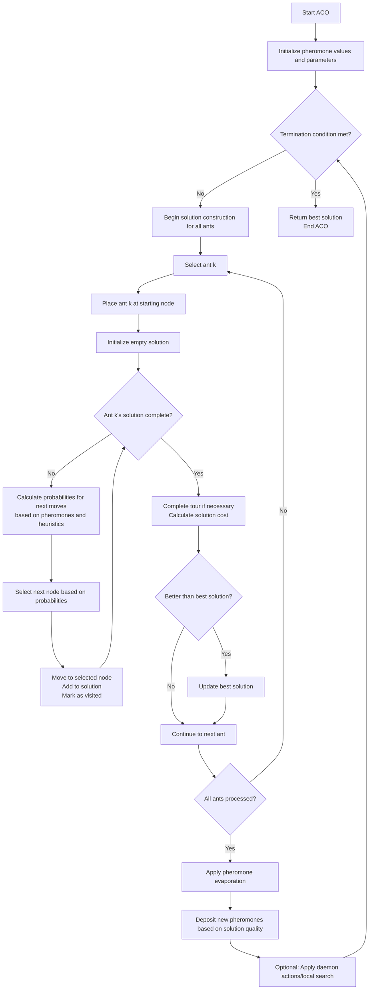

### Ant Colony Optimization (ACO)

- **ACO**: A swarm intelligence, metaheuristic algorithm based on ant behavior.
- **Population-Based**: Uses a colony of artificial ants; multipoint search technique.
- **Natural Behavior**:
    - Ants travel from nest to food source, aiming to minimize distance.
    - Ants deposit **pheromones** on paths.
    - Stronger pheromone trails attract more ants.
    - Pheromone strength fades over time unless reinforced (evaporation).
- **Algorithm Behavior**:
    - Artificial ants simulate natural trail-following.
    - Pheromone trails guide the search for optimal solutions.
    - Balances exploration (new paths) and exploitation (strong trails).

---
### Artificial Ants

- **ACO Process**:
    - Simulates ants collecting food to solve optimization problems.
    - At each decision point, artificial ants choose solution components to build a solution.
  
- **Key Elements**:
    - **C**: Set of all solution components.
    - **p_ij**: Individual solution component (specific choice at decision point).
    - **T_ij**: Trail parameter associated with solution component `p_ij`.
    - **τ_ij**: Pheromone value on trail `T_ij`.
  
- **Construction Graph**:
  - Vertices or edges represent solution components.
  - Each ant starts at a different node.
  - Ants move incrementally, building partial solutions.
  - Movement decisions are influenced by:
        - **Pheromone value (τ_ij)**: Represents learned desirability.
        - **Heuristic value**: Represents problem-specific knowledge.

- **After Solution Construction**:
    - Pheromone values are updated at the traversed vertices or edges.
    - Trails with stronger pheromone influence future ant decisions.
  
- **Algorithm 6.3 Overview**:
    - Initialize parameters (e.g., number of ants, pheromone levels).
    - Set initial pheromone values (τ_ij).
    - Guide ants to explore and build solutions using both pheromone and heuristic information.


| Variable | Meaning |
|:--------:|:--------|
| **C**    | Set of all solution components |
| **p_ij** | Individual solution component (choice made by an ant) |
| **T_ij** | Trail parameter associated with solution component `p_ij` |
| **τ_ij** | Pheromone value on the trail `T_ij` |

---

### ACO Algorithm 

#### Pseduocode 

```pseduo
// Ant Colony Optimization (ACO) Algorithm
procedure ACO()
   // Initialize parameters and pheromone trails
   Initialize pheromone values τij for all edges
   Initialize parameters (α, β, ρ, etc.)
   Initialize best solution as null

   // Main algorithm loop
   while termination condition not met do
       // Solution construction phase
       for each ant k = 1 to m do
           // Place ant at a starting position
           Place ant k at a random or fixed starting node
           
           // Solution construction process
           Initialize ant k's solution as empty
           Add starting node to ant k's solution
           Mark starting node as visited
           
           // Build complete solution
           while ant k's solution is incomplete do
               // Calculate probabilities for next moves
               for each unvisited node j do
                   Calculate probability pij using pheromone (τij) and heuristic (ηij) information:
                   pij = [τij]^α * [ηij]^β / Σ([τil]^α * [ηil]^β) for all unvisited nodes l
               end for
               
               // Select next node based on probabilities
               Choose next node j based on calculated probabilities
               
               // Move to selected node and update solution
               Add node j to ant k's solution
               Mark node j as visited
               Update ant k's current position to node j
           end while
           
           // Complete the solution if necessary (e.g., return to start for TSP)
           If required, complete the solution (e.g., close the tour)
           
           // Evaluate solution quality
           Calculate cost/fitness of ant k's solution
           
           // Update best solution if necessary
           if ant k's solution is better than best solution then
               Update best solution
           end if
       end for
       
       // Pheromone update phase
       Apply pheromone evaporation on all edges:
       τij = (1-ρ) * τij for all edges (i,j)
       
       // Deposit new pheromones based on solution quality
       for each ant k = 1 to m do
           for each edge (i,j) in ant k's solution do
               Increase pheromone: τij = τij + Δτij^k
               where Δτij^k is proportional to solution quality
           end for
       end for
       
       // Optional: Apply daemon actions (problem-specific optimizations)
       Apply local search or other improvements to best solution (optional)
   end while
   
   return best solution
end procedure
```

### Graphic ACO Algorithm



### Summary of ACO Concepts

Solution Construction Process

- Ants start with empty partial solutions
- They incrementally add components until solutions are complete
- Each ant completes its entire solution before the next ant begins


Probability Formula (pᵢⱼ)

- Determines likelihood of selecting next node based on:
    - Pheromone levels (τᵢⱼ)
    - Heuristic information (ηᵢⱼ)


- Parameters α and β control influence of each factor
- (i,j) refers to edges between nodes, not coordinates


Heuristic Component (ηᵢⱼ)

- Typically inverse of distance or cost (1/dᵢⱼ)
- Makes shorter/cheaper paths more attractive
- Represents the "greedy" approach to problem-solving


Daemon Actions/Local Search

- Optional improvement procedures
- Applied to complete solutions, not partial ones
- Centrally controlled, not part of individual ant behavior
- Typically focused on most promising solutions


Pheromone Deposition

- Total pheromone on edge (i,j): Δτᵢⱼ = sum of all ant contributions
- Individual ant contribution: Δτᵏᵢⱼ = Q/Lₖ if ant used edge, 0 otherwise
- Lₖ represents the entire solution length/cost, not just one edge
- Better solutions deposit more pheromone on all their component edges


Reinforcement Mechanism

- Only edges used in solutions receive pheromone updates
- Better solutions leave stronger pheromone trails
- Guides future ants toward promising solution components


---

### Important Formulas


#### Probability Formula (pᵢⱼ)

The probability pij(t) of an ant at node i choosing node j as the next node to move to is given by:


- τij(t) is the pheromone value on edge (i, j) at time t.
- ηij is the heuristic value (often the inverse of the distance) for edge (i, j).
- α is a parameter that controls the influence of the pheromone trail.
- β is a parameter that controls the influence of the heuristic value.
- Ni is the set of feasible nodes that can be visited from node i.


#### Pheromone Formula (τij(t))

The pheromone update rule in ACO aims to increase pheromone levels on trails
with high-quality solutions and decrease them on trails with poor-quality solutions. The pheromone
value τij(t) is updated as follows

```mermaid
math
  \tau_{ij}(t+1) = (1 - \rho) \cdot \tau_{ij}(t) + \Delta \tau_{ij}
```

- τij(t) is the pheromone value on edge (i, j) at time t.
- ρ is the pheromone evaporation rate (0 < ρ < 1).
- Δτij is the amount of pheromone deposited on edge (i, j) by ants.


The amount of pheromone deposited Δτij is computed as:

```mermaid
math
  \Delta \tau_{ij} = \sum_{k=1}^{m} \Delta \tau_{ij}^k
```

- m is the number of ants.
- Δτ k
ij is the pheromone deposited on edge (i, j) by ant k, which can be defined as:

```mermaid
math
  \Delta \tau_{ij}^k = \begin{cases}
  \frac{Q}{L_k} & \text{if edge (i, j) is part of ant k's solution} \\
  0 & \text{otherwise}
  \end{cases}
```

- Q is a constant.
- Lk is the length of the solution constructed by ant k.


---


### ACO Parameters

- **Number of Ants**: Controls colony size; more ants = better exploration, higher cost.
- **Pheromone Evaporation Rate**: Determines how quickly pheromone trails fade; high rate = faster fading.
- **Pheromone Intensity**: Strength of pheromone trails; higher intensity = stronger influence on ant decisions.
- **Heuristic Information**: Domain-specific guidance (e.g., distance between nodes) to bias search.
- **Ant Decision Rule**: Strategy for ant movement; based on pheromone, heuristic, or both.
- **Local Search Strategy**: Optional step to refine solutions through minor adjustments.
- **Termination Criteria**: Defines stopping conditions (e.g., max iterations, time limit, minimal improvement).


### Variations of ACO (Summary)

- **Max-Min Ant System (MMAS)**: Caps pheromone limits to avoid early convergence and maintain exploration.
- **Ant System (AS)**: Original ACO; simple pheromone updates and static movement probabilities.
- **Rank-Based Ant System (RAS)**: Selects and ranks solutions by fitness; focuses on top performers.
- **Ant Colony System (ACS)**: Multiple colonies; global pheromone updates to boost convergence speed.
- **Elitist Ant System (EAS)**: Favors best solutions during pheromone updates; preserves high-quality paths.

---

### Applications of ACO (Summary)

- **Routing and Transportation**: Vehicle routing, logistics, supply chain optimization.
- **Telecommunications**: Network routing, mobile resource allocation, satellite scheduling.
- **Manufacturing and Production**: Scheduling, layout optimization, quality control.
- **Bioinformatics**: Protein folding, sequence alignment, gene expression analysis.
- **Financial Planning**: Portfolio optimization, asset allocation, risk management.

---
