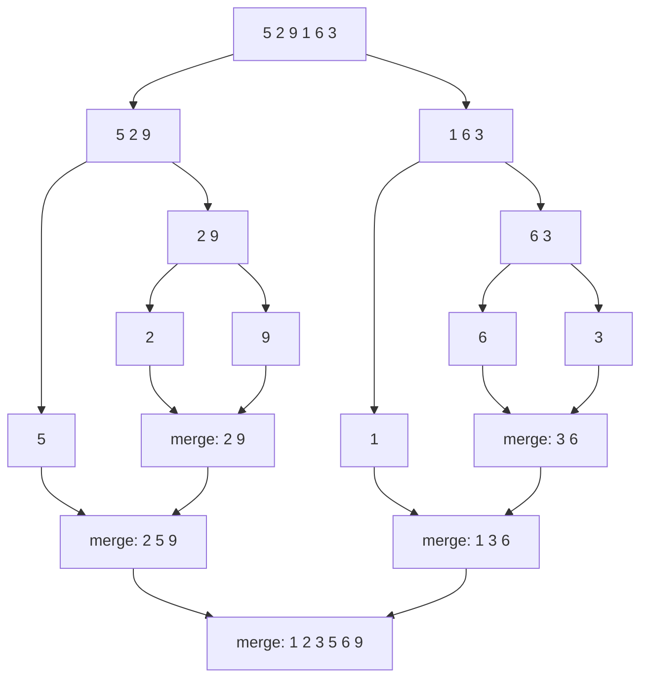
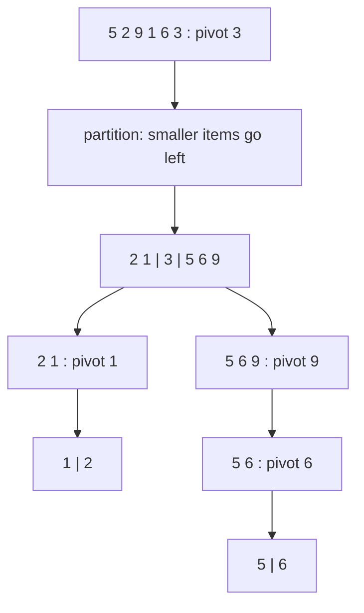
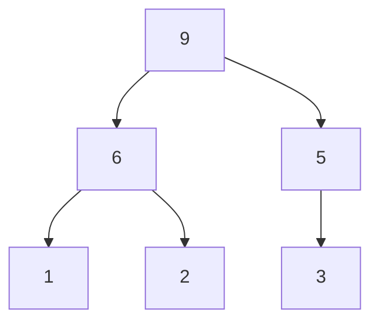

> **Try it:** every visual example below ends with an interactive player: **Play** runs it, **Step** moves one action at a time, and the drop-down switches algorithm on the same data. Red bars are being compared or moved, dark bars are in their final place, a dashed outline marks the pivot.

## 1. Bubble Sort

```java
void bubbleSort(int[] arr) {
    int n = arr.length;
    for (int i = 0; i < n-1; i++) {
        for (int j = 0; j < n-i-1; j++) {
            if (arr[j] > arr[j+1]) {
                // swap arr[j] and arr[j+1]
                int temp = arr[j];
                arr[j] = arr[j+1];
                arr[j+1] = temp;
            }
        }
    }
}
```

**Explanation**: Bubble sort repeatedly steps through the list, compares adjacent elements, and swaps them if they're in the wrong order. The algorithm gets its name because smaller elements "bubble" to the top of the list. Time complexity: O(n²).

**Visual example** (sorting `5 2 9 1 6 3`; the sorted tail is on the right):

| Pass | Swaps made | Array after the pass |
|------|------------|----------------------|
| start | | `5 2 9 1 6 3` |
| 1 | 5↔2, 9↔1, 9↔6, 9↔3 | `2 5 1 6 3 9` |
| 2 | 5↔1, 6↔3 | `2 1 5 3 6 9` |
| 3 | 2↔1, 5↔3 | `1 2 3 5 6 9` |
| 4 | none, so stop early | `1 2 3 5 6 9` |

<div class="sortviz" data-algo="bubble" data-values="5,2,9,1,6,3,8,4"></div>


## 2. Selection Sort

```java
void selectionSort(int[] arr) {
    int n = arr.length;
    for (int i = 0; i < n-1; i++) {
        int minIndex = i;
        for (int j = i+1; j < n; j++) {
            if (arr[j] < arr[minIndex]) {
                minIndex = j;
            }
        }
        // Swap the found minimum element with the element at position i
        int temp = arr[minIndex];
        arr[minIndex] = arr[i];
        arr[i] = temp;
    }
}
```

**Explanation**: Selection sort divides the array into a sorted and unsorted part. It repeatedly finds the minimum element from the unsorted part and puts it at the beginning. Time complexity: O(n²).

**Visual example** (sorting `5 2 9 1 6 3`; `|` separates sorted from unsorted):

| Step | Smallest in the unsorted part | Array after the swap |
|------|-------------------------------|----------------------|
| start | | `5 2 9 1 6 3` |
| 1 | 1 | `1 \| 2 9 5 6 3` |
| 2 | 2 (already in place) | `1 2 \| 9 5 6 3` |
| 3 | 3 | `1 2 3 \| 5 6 9` |
| 4 | 5 (already in place) | `1 2 3 5 \| 6 9` |
| 5 | 6 (already in place) | `1 2 3 5 6 9` |

Selection sort makes at most n-1 swaps, which is its one advantage when writes are expensive.

<div class="sortviz" data-algo="selection" data-values="5,2,9,1,6,3,8,4"></div>


## 3. Insertion Sort

```java
void insertionSort(int[] arr) {
    int n = arr.length;
    for (int i = 1; i < n; i++) {
        int key = arr[i];
        int j = i - 1;
        
        // Move elements that are greater than key to one position ahead
        while (j >= 0 && arr[j] > key) {
            arr[j + 1] = arr[j];
            j = j - 1;
        }
        arr[j + 1] = key;
    }
}
```

**Explanation**: Insertion sort builds the final sorted array one item at a time. It's efficient for small data sets and nearly sorted arrays. Time complexity: O(n²).

**Visual example** (sorting `5 2 9 1 6 3`; the left side of `|` is always sorted):

| Step | Item inserted | Array after inserting |
|------|---------------|-----------------------|
| start | | `5 \| 2 9 1 6 3` |
| 1 | 2 slides past 5 | `2 5 \| 9 1 6 3` |
| 2 | 9 stays | `2 5 9 \| 1 6 3` |
| 3 | 1 slides past 9, 5, 2 | `1 2 5 9 \| 6 3` |
| 4 | 6 slides past 9 | `1 2 5 6 9 \| 3` |
| 5 | 3 slides past 9, 6, 5 | `1 2 3 5 6 9` |

<div class="sortviz" data-algo="insertion" data-values="5,2,9,1,6,3,8,4"></div>


## 4. Merge Sort

```java
void mergeSort(int[] arr, int left, int right) {
    if (left < right) {
        int mid = (left + right) / 2;
        
        // Sort first and second halves
        mergeSort(arr, left, mid);
        mergeSort(arr, mid + 1, right);
        
        // Merge the sorted halves
        merge(arr, left, mid, right);
    }
}

void merge(int[] arr, int left, int mid, int right) {
    // Find sizes of two subarrays to be merged
    int n1 = mid - left + 1;
    int n2 = right - mid;
    
    // Create temp arrays
    int[] L = new int[n1];
    int[] R = new int[n2];
    
    // Copy data to temp arrays
    for (int i = 0; i < n1; i++) {
        L[i] = arr[left + i];
    }
    for (int j = 0; j < n2; j++) {
        R[j] = arr[mid + 1 + j];
    }
    
    // Merge the temp arrays
    int i = 0, j = 0, k = left;
    while (i < n1 && j < n2) {
        if (L[i] <= R[j]) {
            arr[k] = L[i];
            i++;
        } else {
            arr[k] = R[j];
            j++;
        }
        k++;
    }
    
    // Copy remaining elements of L[] if any
    while (i < n1) {
        arr[k] = L[i];
        i++;
        k++;
    }
    
    // Copy remaining elements of R[] if any
    while (j < n2) {
        arr[k] = R[j];
        j++;
        k++;
    }
}
```

**Explanation**: Merge sort uses divide-and-conquer. It divides the array into two halves, sorts them separately, then merges them. Stable sort with O(n log n) time complexity but requires O(n) extra space.

**Visual example** (split down to single items, then merge back up):



Merging two sorted halves only ever looks at the front of each, so each level of the tree costs O(n) and there are about log n levels.

<div class="sortviz" data-algo="merge" data-values="5,2,9,1,6,3,8,4"></div>


## 5. QuickSort

```java
void quickSort(int[] arr, int low, int high) {
    if (low < high) {
        int pi = partition(arr, low, high);
        
        // Recursively sort elements before and after partition
        quickSort(arr, low, pi - 1);
        quickSort(arr, pi + 1, high);
    }
}

int partition(int[] arr, int low, int high) {
    int pivot = arr[high];
    int i = low - 1; // Index of smaller element
    
    for (int j = low; j < high; j++) {
        // If current element is smaller than the pivot
        if (arr[j] < pivot) {
            i++;
            
            // Swap arr[i] and arr[j]
            int temp = arr[i];
            arr[i] = arr[j];
            arr[j] = temp;
        }
    }
    
    // Swap arr[i+1] and arr[high] (or pivot)
    int temp = arr[i + 1];
    arr[i + 1] = arr[high];
    arr[high] = temp;
    
    return i + 1;
}
```

**Explanation**: QuickSort also uses divide-and-conquer. It picks a 'pivot' element and partitions the array around it. Average time complexity is O(n log n), but worst case is O(n²).

**Visual example** (the last item is the pivot; sorting `5 2 9 1 6 3`):



After each partition the pivot is in its final position, so only the two sides remain. A pivot near the middle gives balanced halves; an already sorted array with a last-item pivot gives the O(n²) worst case.

<div class="sortviz" data-algo="quick" data-values="5,2,9,1,6,3,8,4"></div>


## 6. HeapSort

```java
void heapSort(int[] arr) {
    int n = arr.length;
    
    // Build heap (rearrange array)
    for (int i = n / 2 - 1; i >= 0; i--) {
        heapify(arr, n, i);
    }
    
    // One by one extract an element from heap
    for (int i = n - 1; i > 0; i--) {
        // Move current root to end
        int temp = arr[0];
        arr[0] = arr[i];
        arr[i] = temp;
        
        // Call max heapify on the reduced heap
        heapify(arr, i, 0);
    }
}

void heapify(int[] arr, int n, int i) {
    int largest = i; // Initialize largest as root
    int left = 2 * i + 1;
    int right = 2 * i + 2;
    
    // If left child is larger than root
    if (left < n && arr[left] > arr[largest]) {
        largest = left;
    }
    
    // If right child is larger than largest so far
    if (right < n && arr[right] > arr[largest]) {
        largest = right;
    }
    
    // If largest is not root
    if (largest != i) {
        int swap = arr[i];
        arr[i] = arr[largest];
        arr[largest] = swap;
        
        // Recursively heapify the affected sub-tree
        heapify(arr, n, largest);
    }
}
```

**Explanation**: HeapSort uses a binary heap data structure to sort elements. It creates a max heap, then repeatedly extracts the maximum element. Time complexity: O(n log n).

**Visual example** (the array `9 6 5 1 2 3` read as a binary tree, the max heap built from `5 2 9 1 6 3`):



Index `i` has children at `2i+1` and `2i+2`, so the tree lives inside the array with no pointers. Each round swaps the root (the largest) with the last item of the heap, shrinks the heap by one and sifts the new root down.

<div class="sortviz" data-algo="heap" data-values="5,2,9,1,6,3,8,4"></div>


## 7. Radix Sort

```java
void radixSort(int[] arr) {
    // Find the maximum number to know number of digits
    int max = getMax(arr);
    
    // Do counting sort for every digit
    for (int exp = 1; max / exp > 0; exp *= 10) {
        countingSortByDigit(arr, exp);
    }
}

int getMax(int[] arr) {
    int max = arr[0];
    for (int i = 1; i < arr.length; i++) {
        if (arr[i] > max) {
            max = arr[i];
        }
    }
    return max;
}

void countingSortByDigit(int[] arr, int exp) {
    int n = arr.length;
    int[] output = new int[n];
    int[] count = new int[10]; // Since digits are 0-9
    
    // Store count of occurrences
    for (int i = 0; i < n; i++) {
        count[(arr[i] / exp) % 10]++;
    }
    
    // Change count[i] so that count[i] contains actual
    // position of this digit in output[]
    for (int i = 1; i < 10; i++) {
        count[i] += count[i - 1];
    }
    
    // Build the output array
    for (int i = n - 1; i >= 0; i--) {
        output[count[(arr[i] / exp) % 10] - 1] = arr[i];
        count[(arr[i] / exp) % 10]--;
    }
    
    // Copy the output array to arr[]
    for (int i = 0; i < n; i++) {
        arr[i] = output[i];
    }
}
```

**Explanation**: Radix sort sorts integers by processing individual digits. It sorts numbers digit by digit, starting from the least significant digit. Time complexity: O(nk) where k is the number of digits.

**Visual example** (sorting `170 45 75 90 802 24 2 66`, one digit at a time, keeping equal digits in their earlier order):

| Pass | Sorted by | Result |
|------|-----------|--------|
| start | | `170 45 75 90 802 24 2 66` |
| 1 | ones digit | `170 90 802 2 24 45 75 66` |
| 2 | tens digit | `802 2 24 45 66 170 75 90` |
| 3 | hundreds digit | `2 24 45 66 75 90 170 802` |

Each pass must be stable, otherwise the work of the earlier passes is lost.

<div class="sortviz" data-algo="radix" data-values="170,45,75,90,802,24,2,66"></div>


## 8. Counting Sort

```java
void countingSort(int[] arr) {
    int n = arr.length;
    
    // Find the maximum value in arr[]
    int max = arr[0];
    for (int i = 1; i < n; i++) {
        if (arr[i] > max) {
            max = arr[i];
        }
    }
    
    // Create a count array to store count of individual numbers
    int[] count = new int[max + 1];
    
    // Store count of each number
    for (int i = 0; i < n; i++) {
        count[arr[i]]++;
    }
    
    // Change count[i] so that count[i] now contains actual
    // position of this number in output array
    for (int i = 1; i <= max; i++) {
        count[i] += count[i - 1];
    }
    
    // Build the output array
    int[] output = new int[n];
    for (int i = n - 1; i >= 0; i--) {
        output[count[arr[i]] - 1] = arr[i];
        count[arr[i]]--;
    }
    
    // Copy the output array to arr[]
    for (int i = 0; i < n; i++) {
        arr[i] = output[i];
    }
}
```

**Explanation**: Counting sort works by counting the occurrences of each unique element in the array, then using this information to place elements in the correct order. Time complexity: O(n+k) where k is the range of input.

**Visual example** (sorting `4 2 2 8 3 3 1`):

| Value | 1 | 2 | 3 | 4 | 5 | 6 | 7 | 8 |
|-------|---|---|---|---|---|---|---|---|
| Count | 1 | 2 | 2 | 1 | 0 | 0 | 0 | 1 |

Reading the counts from left to right gives `1 2 2 3 3 4 8`. No two items are ever compared, which is how it beats the O(n log n) limit, at the cost of memory proportional to the value range.

<div class="sortviz" data-algo="counting" data-values="4,2,2,8,3,3,1,6"></div>


---

## Understanding Sort Algorithm Selection

### Time Complexities

|Algorithm|Best Case|Average Case|Worst Case|Space Complexity|
|---|---|---|---|---|
|Bubble Sort|O(n)|O(n²)|O(n²)|O(1)|
|Selection Sort|O(n²)|O(n²)|O(n²)|O(1)|
|Insertion Sort|O(n)|O(n²)|O(n²)|O(1)|
|Merge Sort|O(n log n)|O(n log n)|O(n log n)|O(n)|
|Quick Sort|O(n log n)|O(n log n)|O(n²)|O(log n)|
|Heap Sort|O(n log n)|O(n log n)|O(n log n)|O(1)|
|Radix Sort|O(nk)|O(nk)|O(nk)|O(n+k)|
|Counting Sort|O(n+k)|O(n+k)|O(n+k)|O(k)|

### When to Choose Each Algorithm

### For Small Arrays (n < 50)

- **Insertion Sort**: Often fastest for very small arrays due to low overhead.
- **Bubble Sort**: Simple but rarely the best choice.

### For Nearly Sorted Data

- **Insertion Sort**: O(n) time for nearly sorted arrays.
- **Bubble Sort**: Can perform well if data is almost sorted.

### For General Purpose Sorting

- **Quick Sort**: Usually fastest in practice for random data.
- **Merge Sort**: Stable sort with guaranteed O(n log n) performance.
- **Heap Sort**: In-place sorting with guaranteed O(n log n).

### When Stability Matters

(Keeping equal elements in their original order)

- **Merge Sort**: Stable sort.
- **Insertion Sort**: Stable sort for smaller datasets.

### Memory Constraints

- **Heap Sort** or **Quick Sort**: Use when memory is limited as they sort in-place.
- **Merge Sort**: Avoid if memory is limited as it requires O(n) additional space.

### Integer-Only Data with Limited Range

- **Counting Sort**: Best when range of values (k) is small compared to n.
- **Radix Sort**: Excellent for integers with fixed number of digits.

### Parallel Processing

- **Merge Sort**: Easily parallelizable.
- **Quick Sort**: Can be parallelized but less straightforwardly.

### Practical Considerations

- Many modern programming languages use hybrid algorithms (like Timsort in Python and Java, which combines merge sort and insertion sort).
- Standard library implementations are usually optimized and should be preferred over custom implementations unless you have specific requirements.
- For very large datasets, external sorting algorithms may be necessary if data doesn't fit in memory.
