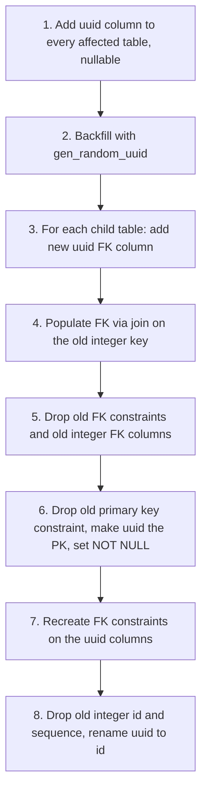
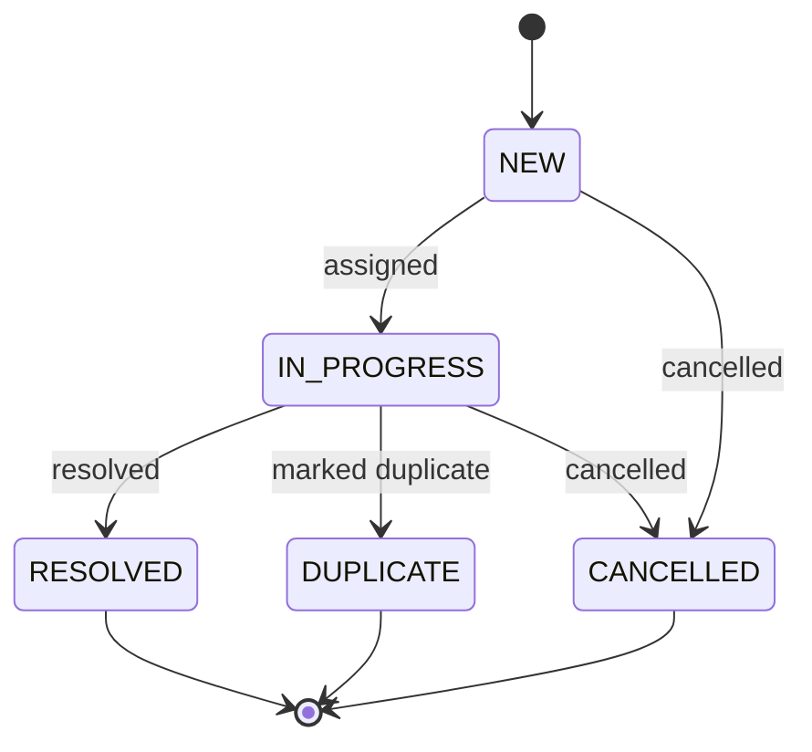

Data-model decisions that were hard to change later: the primary key type, repeated forms, and modelling a workflow as a status field. Related: [[3. Django Payments and Webhooks|Django Payments and Webhooks]], [[2. Multi-Tenant Django by Subdomain|Multi-Tenant Django by Subdomain]].

# 1. UUID Primary Keys From Day One

Auto-increment integer IDs **expose record counts and allow enumeration** (`/cases/1`, `/cases/2`...). That is an API-safety and privacy problem. **Start with UUIDs**:

```python
import uuid
from django.db import models

class BaseModel(models.Model):
    id = models.UUIDField(primary_key=True, default=uuid.uuid4, editable=False)

    class Meta:
        abstract = True
```

Note: UUIDs are not authorisation. Still check permissions on every object ([[2. Web Application Security|2. Web Application Security]]). Random UUIDv4 keys scatter inserts across the index; time-ordered variants (UUIDv7) keep better locality where available.

## Migrating integer keys to UUIDs mid-project

When the data model is already live, Django's ORM will not do this safely in one step. A primary key referenced by foreign keys across tables needs a **precise sequence**:



- Use **`RunSQL`** (or `RunPython` executing SQL) inside the migration, because the ORM abstracts SQL but **production schema changes do not**
- Use **`SeparateDatabaseAndState`** so Django's model state matches the real database
- PostgreSQL supports **transactional DDL**, so the whole migration can roll back on error
- Learn the PostgreSQL **constraint syntax** (`ALTER TABLE ... DROP CONSTRAINT ... ADD PRIMARY KEY`)
- Rehearse on a **copy of production data**, take a backup, plan downtime or a maintenance window
- Third-party apps with their own FKs (`auth`, `admin`, `contenttypes` object IDs stored as text) need special attention

```sql
ALTER TABLE orders ADD COLUMN uuid uuid DEFAULT gen_random_uuid();
UPDATE order_items i SET order_uuid = o.uuid FROM orders o WHERE i.order_id = o.id;
ALTER TABLE order_items DROP CONSTRAINT order_items_order_id_fkey;
-- ... drop old columns, promote uuid to primary key, recreate constraints
```

The lesson is simple: **decide key types before the first migration.**

---

# 2. Mixins for Repeated Forms

A platform with **96 distinct form classes** (applications of many types) had heavy overlap: applicant identity, property or location details, references, attachment handling, near-identical validation. Copy-paste would be unmaintainable; composition with **Python mixins** made it manageable.

```python
class ApplicantFieldsMixin(forms.Form):
    applicant_name = forms.CharField()
    id_number = forms.CharField()

    def clean_id_number(self):
        ...

class PropertyFieldsMixin(forms.Form):
    erf_number = forms.CharField()
    municipality = forms.ModelChoiceField(queryset=Municipality.objects.all())

class AttachmentsMixin(forms.Form):
    attachments = MultiFileField(required=False)

    def clean_attachments(self):
        ...

class RezoningForm(ApplicantFieldsMixin, PropertyFieldsMixin, AttachmentsMixin, BaseSubmissionForm):
    motivation = forms.CharField(widget=forms.Textarea)
```

- A new form type is **assembled from existing mixins in minutes**, not hours of copy-paste
- Mixins must cooperate through `super()` and avoid clashing field names; mind the **method resolution order** (`RezoningForm.__mro__`)
- The same pattern works for **models** (abstract base classes), **class-based views** and **serializers**
- Keep each mixin small and single-purpose; test them independently
- Do not overdo it: when a mixin needs knowledge of its siblings, use composition or a form factory instead

---

# 3. Workflow as a Status Field (State Machine)

Before writing code, the team **evaluated workflow engines** (BPMN engines such as Camunda, other orchestration tooling, django-viewflow, n8n, and multi-tenant frameworks) and **dropped them all**. Their complexity outweighed their value for a system where "workflow" simply means **a case moving through statuses**. See [[4. BPMN and Workflow Engines|BPMN and Workflow Engines]] for the comparison and when engines do pay off.



```python
class Case(BaseModel):
    class Status(models.TextChoices):
        NEW = "NEW"
        IN_PROGRESS = "IN_PROGRESS"
        RESOLVED = "RESOLVED"
        DUPLICATE = "DUPLICATE"
        CANCELLED = "CANCELLED"

    ALLOWED = {
        Status.NEW: {Status.IN_PROGRESS, Status.CANCELLED},
        Status.IN_PROGRESS: {Status.RESOLVED, Status.DUPLICATE, Status.CANCELLED},
    }

    status = models.CharField(max_length=20, choices=Status.choices, default=Status.NEW)

    def transition(self, new_status, by):
        if new_status not in self.ALLOWED.get(self.status, set()):
            raise ValueError(f"{self.status} -> {new_status} not allowed")
        CaseHistory.objects.create(case=self, from_status=self.status,
                                   to_status=new_status, changed_by=by)
        self.status = new_status
        self.save(update_fields=["status"])
```

- **One method** performs transitions, validates them and writes an **audit row** (who, when, from, to)
- **SLA escalation** is a Celery Beat task that finds cases past their deadline and escalates them ([[4. Celery and Message Brokers|Celery and Message Brokers]])
- Case workers operate it **without specialised training** because the model is simple: five statuses
- Choose an engine only when you need long-running human tasks, parallel branches, timers and modelling by non-developers

---

# 4. Containers: Service Names, Not localhost

A frequent early failure: services could not reach each other in Compose. Containers on the same Compose network resolve each other by **service name**; a Django app dialling `localhost:5432` looks inside **its own container**, where PostgreSQL does not exist.

```yaml
services:
  web:
    build: .
    environment:
      DATABASE_URL: postgres://app:secret@db:5432/app      # "db", not localhost
    depends_on:
      db:
        condition: service_healthy
  db:
    image: postgres:16
    healthcheck:
      test: ["CMD-SHELL", "pg_isready -U app"]
```

| Network mode | Behaviour |
| ------------ | --------- |
| **Bridge** (default) | Isolated network; containers reach each other by **DNS service name**; publish ports to reach from the host |
| **Host** | Container shares the host's network stack; `localhost` is the host; no port mapping; Linux only |

Details in [[2. Docker Compose]] and [[1. Docker]].

---

# Checklist

- [ ] UUID primary keys chosen at the start
- [ ] If migrating keys: backfill, repoint FKs, constraint-level SQL, tested on a copy
- [ ] Repeated forms and models built from mixins
- [ ] Workflow = status field + allowed transitions + audit history, unless a real engine is justified
- [ ] Container-to-container traffic uses service names
