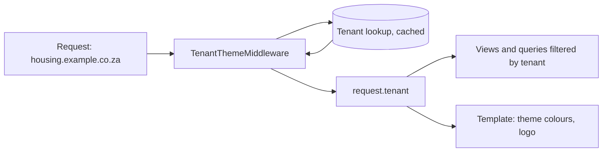

# 02. Multi-Tenant Django by Subdomain

One Django application, one database, several branded sites: each tenant (department, brand, customer) gets its own subdomain, colours and identity. This note covers the design and the traps. Related: [[6. Django on ECS Fargate - Architecture and Lessons|Django on ECS Fargate - Architecture and Lessons]], [[4. WAF in Production|04. WAF in Production]].

## Options compared

| Approach | How | Isolation | Cost / complexity |
| -------- | --- | --------- | ----------------- |
| **Shared schema, tenant column** | Every row has a tenant foreign key | Logical | Lowest |
| **Schema per tenant** (e.g. `django-tenants`) | PostgreSQL schema each | Stronger | Migrations multiply |
| **Database per tenant** | Separate databases | Strongest | Highest |
| **Separate deployments** | A copy of the app per tenant | Total | Highest operations |

Ten departments with the same data model and shared reporting fit **one application and one database** with a tenant identifier. Tools like `django-tenants` were evaluated and **not adopted**: the added machinery outweighed the need.

---

# Resolving the Tenant from the Host



```python
class TenantThemeMiddleware:
    def __init__(self, get_response):
        self.get_response = get_response

    def __call__(self, request):
        host = request.get_host().split(":")[0].lower()
        request.tenant = get_tenant_by_host(host)      # cached lookup
        if request.tenant is None:
            return HttpResponseNotFound()
        return self.get_response(request)
```

Theme values (primary, secondary, accent colours, logo) are injected as **CSS variables** in the base template:

```html
<style>
  :root {
    --brand-primary: {{ request.tenant.primary_colour }};
    --brand-accent: {{ request.tenant.accent_colour }};
  }
</style>
```

Everything that renders must be theme-aware: pages, templates **and emails**. Keep a context processor so templates always get the tenant.

## Always filter by tenant

```python
class TenantQuerySet(models.QuerySet):
    def for_tenant(self, tenant):
        return self.filter(tenant=tenant)
```

- Never fetch an object by ID alone; include the tenant (or you create an **IDOR**: [[2. Web Application Security|02. Web Application Security]])
- Add tests that user or tenant A cannot reach tenant B's rows

---

# Subdomains Must Be Listed Precisely

Ten tenants across three environments means **30 subdomains**. A wildcard certificate covers TLS, but several other layers need **explicit** entries:

| Layer | Why a wildcard is not enough |
| ----- | ---------------------------- |
| **Tenant registry (database)** | The middleware matches the **exact host string**; a subdomain not in the table fails silently |
| **DNS** | Each name (or a wildcard record) must resolve to the load balancer / CDN |
| **`ALLOWED_HOSTS`** | `.example.co.za` allows all, but know what you allow |
| **`CSRF_TRUSTED_ORIGINS`** | Needs scheme and host: `https://housing.example.co.za`; wildcards such as `https://*.example.co.za` are supported in recent Django |
| **Cookie domain** | Leave `SESSION_COOKIE_DOMAIN` unset for **host-only** cookies (isolated per tenant); setting it to the parent domain shares sessions across all subdomains |
| **WAF rules** | Scope-downs and host-based rules ([[4. WAF in Production|04. WAF in Production]]) |
| **CORS / redirects / email links** | Build absolute URLs from the tenant's host |

Any mismatch between a registered subdomain and what the middleware expects **fails silently**, so keep the list in one place, generate related settings from it, and compare it with DNS in every environment.

## Certificates

- One **ACM wildcard** certificate (`*.example.co.za`) covers one level of subdomain; it does **not** cover `a.b.example.co.za` or the apex by itself (add both names)
- CloudFront or the ALB uses the certificate; request it in the correct Region ([[2. AWS CloudFront Deep Dive|AWS CloudFront Deep Dive]])

---

# Cross-Tenant Features

| Feature | Approach |
| ------- | -------- |
| **Inter-tenant collaboration** | Explicit permission model: a case can be shared with another tenant, recorded and audited |
| **Central admin / reporting** | Staff roles that span tenants, clearly separated from tenant roles |
| **Shared reference data** | Tables without a tenant column (lookups), referenced by all |
| **Per-tenant settings** | Columns or a settings table, not separate code paths |

---

# Checklist

- [ ] Tenant resolved from the exact host, cached
- [ ] Every query scoped to the tenant; isolation tests exist
- [ ] Theme via CSS variables; emails theme-aware
- [ ] Subdomain list synced across DB, DNS, `CSRF_TRUSTED_ORIGINS`, WAF and certificates, per environment
- [ ] Cookie domain deliberately chosen
