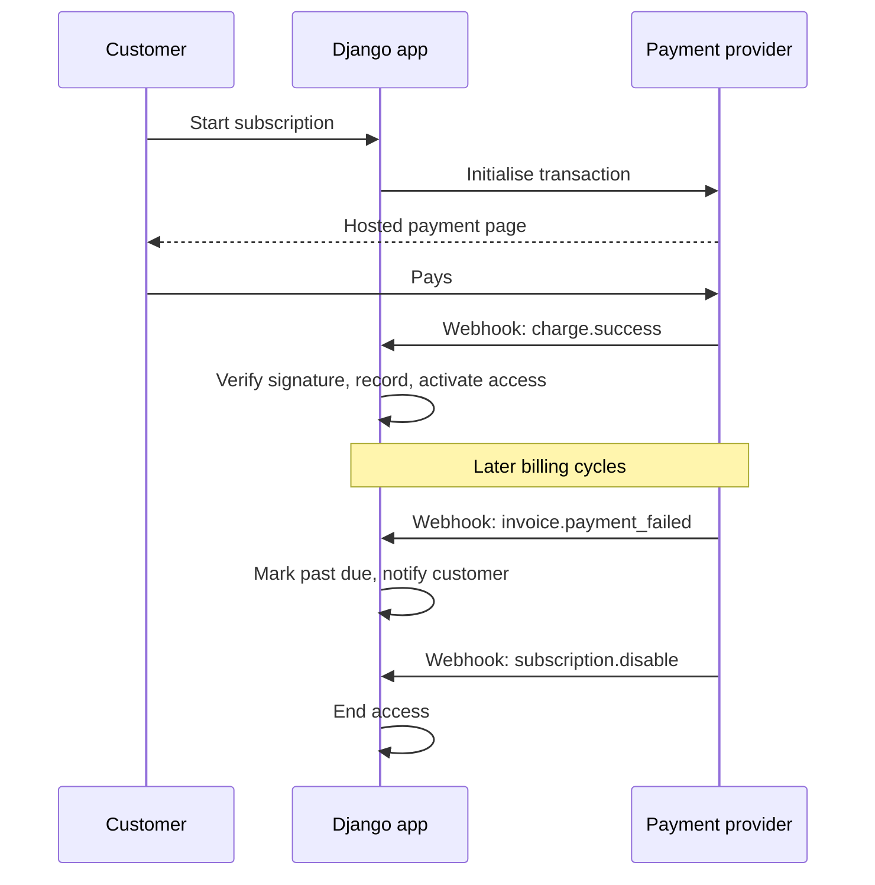
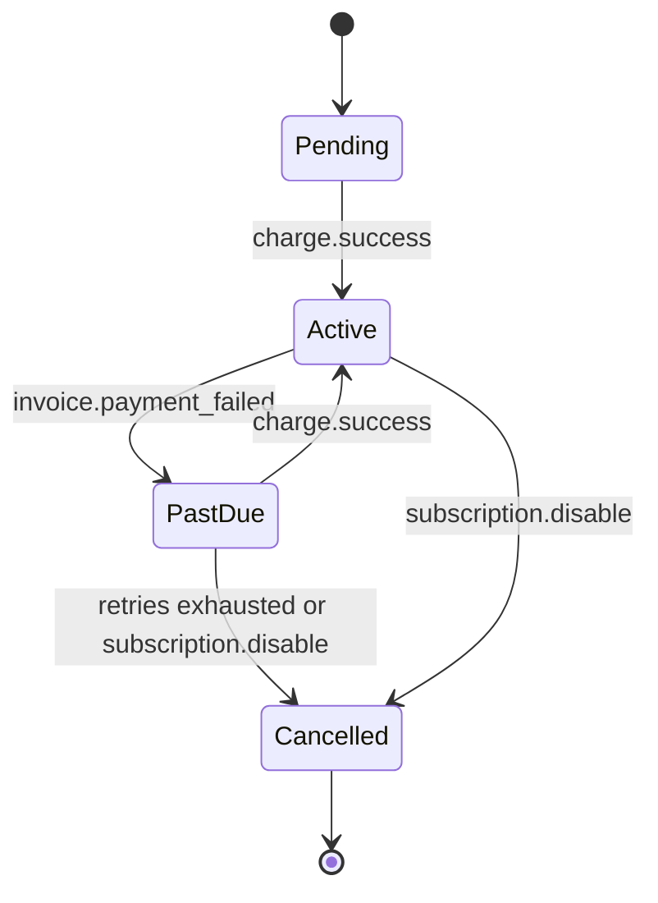

# 03. Django Payments and Webhooks

Taking recurring payments in a Django app means thinking in **webhooks**: the payment provider calls **your** server when something happens, not the other way round. This note uses Paystack as the example provider; the same design fits Stripe and others. Related: [[2. Web Application Security|02. Web Application Security]], [[4. Celery and Message Brokers|Celery and Message Brokers]].

## The model



Libraries from other ecosystems often hide the flow; building it directly teaches the real lifecycle. **Never trust the browser redirect** to say a payment succeeded; trust a **verified webhook** (or a server-side verify call).

## Events to handle (Paystack names)

| Event | Meaning | Typical action |
| ----- | ------- | -------------- |
| `charge.success` | A payment went through | Record payment, activate or extend the subscription |
| `subscription.create` | A subscription started | Store the provider's subscription code |
| `invoice.create` / `invoice.update` | An upcoming or updated invoice | Optional: show the next billing date |
| `invoice.payment_failed` | A renewal charge failed | Mark **past due**, start a retry / grace flow, email the customer |
| `subscription.expiring_cards` | Cards expire soon | **Proactive** email asking the customer to update the card before billing |
| `subscription.disable` | Subscription ended or cancelled | Remove access (at period end) |

Soft failures (insufficient funds, retryable) are different from hard cancellations; model both so users are not locked out by a single declined card.

## Subscription state machine



Keep transitions in one place and reject invalid ones (see [[1. Django Data Modelling Lessons|Django Data Modelling Lessons]]). Gate content on the **subscription status**, not on "they paid once".

---

# A Safe Webhook Endpoint

Rules:
1. **Verify the signature** over the **raw request body**. Paystack sends `x-paystack-signature`, an **HMAC SHA-512** of the body using your secret key
2. Compare with a **constant-time** function
3. Make handlers **idempotent**: providers retry and can send duplicates
4. Respond **`200` quickly**; do the real work in a background task
5. Do not expose the URL as a normal page; exempt it from CSRF (it is authenticated by the signature instead)

```python
import hashlib, hmac, json
from django.conf import settings
from django.http import HttpResponse, HttpResponseForbidden
from django.views.decorators.csrf import csrf_exempt
from django.views.decorators.http import require_POST

@csrf_exempt
@require_POST
def paystack_webhook(request):
    signature = request.headers.get("x-paystack-signature", "")
    expected = hmac.new(
        settings.PAYSTACK_SECRET_KEY.encode(),
        request.body,                      # raw bytes, not re-serialised JSON
        hashlib.sha512,
    ).hexdigest()
    if not hmac.compare_digest(signature, expected):
        return HttpResponseForbidden()

    event = json.loads(request.body)
    process_paystack_event.delay(event)    # Celery task; return fast
    return HttpResponse(status=200)
```

## Idempotency

```python
@shared_task
def process_paystack_event(event):
    reference = event["data"].get("reference") or event["data"].get("id")
    obj, created = WebhookEvent.objects.get_or_create(
        provider="paystack", event_type=event["event"], reference=str(reference),
        defaults={"payload": event},
    )
    if not created:
        return                      # already processed
    handlers[event["event"]](event["data"])
```

- Store every event (payload, received time, processed flag) for **audit and replay**
- A unique constraint on (provider, type, reference) enforces idempotency
- Handle **out-of-order** delivery: look at the current state before changing it
- For `charge.success`, optionally **verify the transaction** with the provider's API and check **amount and currency** match what you expected

---

# Cards, Expiry and Dunning

- Send an email **before** the card expires (`subscription.expiring_cards`)
- On failure: grace period, retry schedule, reminder emails, then cancel (**dunning**)
- Show clear billing status and a self-service **update card** link
- Keep payment data with the provider; never store card numbers (PCI scope)

---

# Testing

- Use the provider's **test keys** and a tunnel (for example `ngrok` or `cloudflared`) to receive webhooks locally
- Replay stored payloads in unit tests; test duplicate, out-of-order and bad-signature cases
- Keep keys in environment variables or a secret store ([[5. Secure Coding and Supply Chain|05. Secure Coding and Supply Chain]])

---

# Checklist

- [ ] Signature verified on the raw body with constant-time comparison
- [ ] Endpoint returns 200 fast; work done in Celery
- [ ] Events stored; handlers idempotent
- [ ] Access tied to subscription state, with grace for soft failures
- [ ] Amount and currency verified
- [ ] Secrets outside git; HTTPS only
