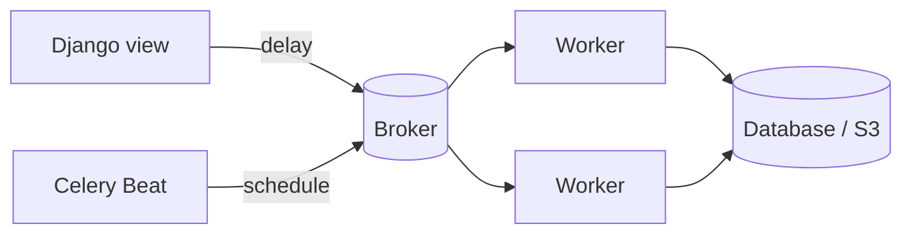
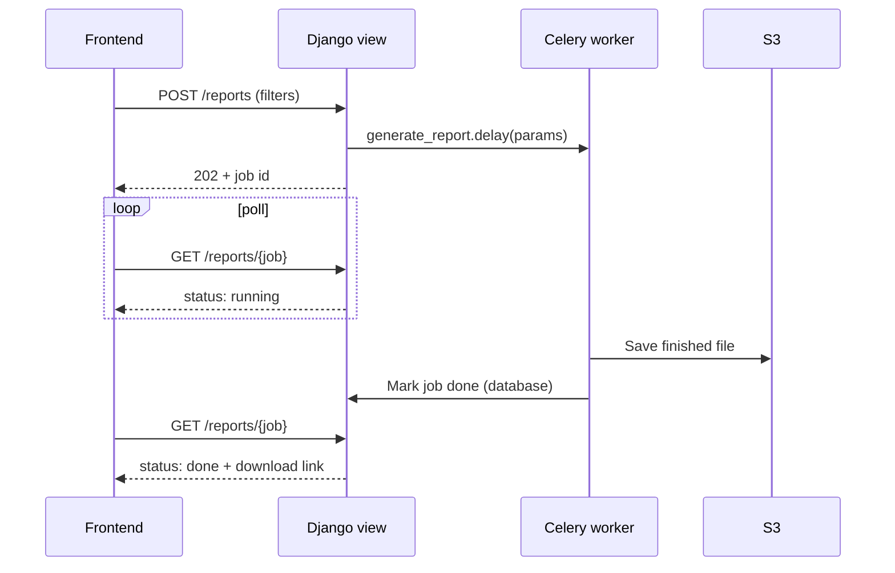
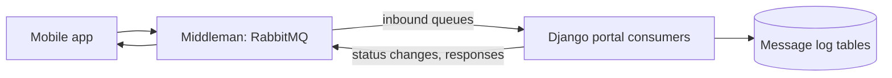

Anything that takes more than a few seconds does not belong in the HTTP request cycle. Celery runs that work in the background; message brokers move work and events between systems. Deployment context: [[6. Django on ECS Fargate - Architecture and Lessons|Django on ECS Fargate - Architecture and Lessons]].

## Parts at a glance

| Part | Role |
| ---- | ---- |
| **Producer** | Your Django code calling `task.delay(...)` |
| **Broker** | Holds queued messages: **Redis**, **RabbitMQ** or **SQS** |
| **Worker** | Process that executes tasks |
| **Result backend** | Optional store for task results (Redis, database) |
| **Celery Beat** | Scheduler that enqueues periodic tasks |



---

# Task Patterns

```python
from celery import shared_task

@shared_task(
    bind=True,
    autoretry_for=(ConnectionError,),
    retry_backoff=True,          # 1s, 2s, 4s ...
    retry_backoff_max=600,
    max_retries=5,
    soft_time_limit=300,
    acks_late=True,
)
def send_receipt(self, payment_id):
    payment = Payment.objects.get(pk=payment_id)    # pass IDs, not objects
    ...
```

| Practice | Why |
| -------- | --- |
| **Pass IDs, not model instances** | Data may change; messages stay small and serialisable |
| **Make tasks idempotent** | Retries and duplicates happen; running twice must be safe |
| **Retry with backoff** | Avoid hammering a failing service |
| **Time limits** | A hung task cannot block a worker forever |
| **`acks_late`** | Message is acknowledged after success, so a crashed worker's task is redelivered |
| **Separate queues** | Slow reports must not starve email; route with `task_routes` |
| **Small, focused tasks** | Easier to retry and monitor |
| **Enqueue after commit** | Use `transaction.on_commit(lambda: task.delay(id))` so the task sees the saved row |

---

# Long Jobs: Trigger, Poll, Download

Report generation (charts, spreadsheets, PDFs) first ran inside the request and began **timing out** as data grew. The fix:



- The view **returns immediately** with a job ID
- The frontend **polls** (or listens over SSE: [[5. Async Django - ASGI, Channels and SSE|Async Django - ASGI, Channels and SSE]])
- The result file goes to **S3**; the user gets a short-lived **presigned URL**
- Rule: anything longer than a few seconds is a background job

Libraries typically used for report output: Matplotlib for charts, openpyxl / XlsxWriter for spreadsheets, WeasyPrint for PDFs.

---

# Scheduled Work with Celery Beat

```python
from celery.schedules import crontab

app.conf.beat_schedule = {
    "nightly-stats": {
        "task": "stats.tasks.publish_nightly_stats",
        "schedule": crontab(hour=1, minute=30),
    },
    "sla-escalation": {
        "task": "cases.tasks.escalate_overdue",
        "schedule": crontab(minute="*/15"),
    },
}
```

- Run **exactly one** Beat process (a separate ECS service), or tasks fire multiple times
- Timezone: set `CELERY_TIMEZONE` and keep stored times in UTC
- SLA escalation: a frequent Beat task finds overdue items and escalates them ([[1. Django Data Modelling Lessons|Django Data Modelling Lessons]])

## Efficient nightly aggregation

A nightly statistics task (counts by type, active vs static users, stalled items, daily and weekly totals) ran against a **live database** inside a narrow window. Poorly written aggregation locks rows or triggers slow scans.

- Aggregate **in the database**: `.values("type").annotate(n=Count("id"))`, with `filter=Q(...)` for conditional counts, not Python loops
- **Index** the columns used in filters and group-bys
- Avoid **N+1 queries** (`select_related`, `prefetch_related`); stream big sets with `.iterator()`
- Prefer a **read replica** when available; run off-peak
- Measure with `EXPLAIN ANALYZE`; keep the task inside its time limit
- Build the payload to **match the consumer's schema exactly** and validate before publishing

---

# Brokers Compared

| | **Redis** | **RabbitMQ** (Amazon MQ) | **SQS** |
| - | --------- | ------------------------ | ------- |
| Model | In-memory lists / pub-sub | AMQP: exchanges, queues, bindings | Managed queue, HTTP API |
| Connection | Long-lived | Long-lived | **HTTP polling** |
| Routing | Basic | **Rich** (direct, topic, fanout, headers) | Per queue (use SNS for fan-out) |
| Delivery | At-most / at-least once (cautious) | At-least once with acks | At-least once, **visibility timeout**, dead-letter queue |
| Ops | Easy, but durability needs care | More to run (or managed) | **No servers** |
| Fits | Celery broker, cache, pub/sub | Integrations with other systems, routing | Simple decoupling on AWS |

## SQS first, then RabbitMQ

A mobile app and a web portal needed to exchange messages. **SQS** came first. As the integration matured it became clear that the **middleman service already ran RabbitMQ** and expected both sides to publish and consume **there**. Migration meant:
- Absorbing the **protocol difference**: HTTP-polled SQS vs long-lived **AMQP** connections
- Re-implementing publisher and consumer logic against the middleman's **schema** and queue names, using the `pika` library
- Handling connection **heartbeats** and reconnects

Lesson: **agree the integration contract and protocol first**; choose the broker the other party already runs.



## Consumer sketch (pika)

```python
import json, pika

params = pika.URLParameters(settings.AMQP_URL)         # heartbeat set in the URL / params
conn = pika.BlockingConnection(params)
ch = conn.channel()
ch.queue_declare(queue="inbound_cases", durable=True)
ch.basic_qos(prefetch_count=10)

def on_message(ch, method, props, body):
    try:
        handle(json.loads(body))
        ch.basic_ack(method.delivery_tag)
    except Exception:
        ch.basic_nack(method.delivery_tag, requeue=False)   # dead-letter exchange handles it

ch.basic_consume(queue="inbound_cases", on_message_callback=on_message)
ch.start_consuming()
```

Run consumers as **their own process / ECS service**, not inside web workers.

## Traceability: log every message

Record each **inbound** message and each **outbound** one in log tables (queue, payload, status, timestamps). Benefits: debugging, **replay** after a bug fix, audit, and proof of what was sent. The same idea as the **outbox pattern**: write the message to the database in the same transaction as the change, then publish from the table.

---

# Operating Celery

- **Monitoring**: Flower, CloudWatch metrics, queue length alarms
- **Concurrency**: processes (prefork) for CPU-bound, threads / gevent for I/O-bound
- **Graceful shutdown**: ECS stop timeout longer than the longest task, or tasks resume via `acks_late`
- **Dead-letter handling**: failed messages parked, inspected, replayed
- Keep secrets and broker URLs in environment variables ([[5. Secure Coding and Supply Chain|5. Secure Coding and Supply Chain]])

---

# Checklist

- [ ] Long work in Celery; request returns a job ID
- [ ] Tasks take IDs, are idempotent, retry with backoff, have time limits
- [ ] Beat runs once; schedules in code
- [ ] Aggregations done in SQL, indexed, off-peak
- [ ] Broker matches the integration contract
- [ ] Messages logged for traceability and replay
