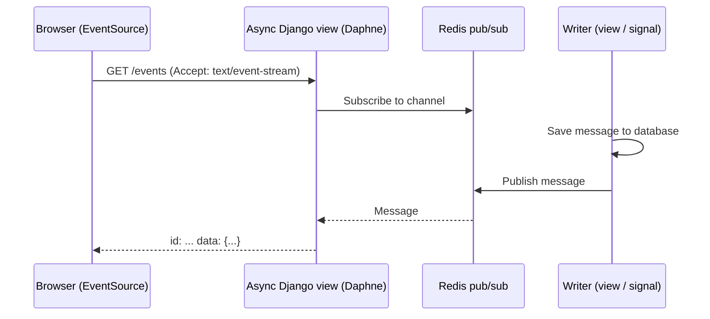

# 05. Async Django - ASGI, Channels and SSE

How Django handles long-lived connections: WebSockets, Server-Sent Events and live notifications. The core idea is knowing **when code runs sync versus async**, and what serves each. Deployment context: [[6. Django on ECS Fargate - Architecture and Lessons|Django on ECS Fargate - Architecture and Lessons]].

## WSGI vs ASGI

| | **WSGI** | **ASGI** |
| - | -------- | -------- |
| Model | Synchronous, one request per worker at a time | Asynchronous, many concurrent connections |
| Connections | Short request / response | Also **WebSockets**, **SSE**, long polling |
| Servers | **Gunicorn**, uWSGI | **Daphne**, **Uvicorn**, Hypercorn |
| Entry point | `wsgi.py` (`application`) | `asgi.py` (`application`) |
| Use when | Ordinary pages and APIs | Real-time features |

`manage.py runserver` is a **development** server only. In production use Gunicorn (WSGI) or an ASGI server, behind a load balancer. Gunicorn can also host ASGI apps with Uvicorn workers.

```
$ gunicorn config.wsgi:application --workers 3 --timeout 60
$ daphne -b 0.0.0.0 -p 8000 config.asgi:application
$ uvicorn config.asgi:application --host 0.0.0.0 --port 8000
```

---

# Sync vs Async: the Conceptual Gap

Async Django still has a synchronous core (the ORM, most libraries). Mixing them wrongly causes **deadlocks, blocked event loops and dropped connections**.

| Situation | Rule |
| --------- | ---- |
| Calling sync code (ORM, `requests`) from `async def` | Wrap with `sync_to_async` or use async APIs (`await Model.objects.aget(...)`, `async for obj in qs`) |
| Calling async code from a normal view | `async_to_sync` |
| Slow blocking call inside async code | Blocks **every** connection on that worker; move it to a thread or a Celery task |
| ORM in async context without wrapping | `SynchronousOnlyOperation` error |

```python
from asgiref.sync import sync_to_async

@sync_to_async
def get_unread(user_id):
    return list(Notification.objects.filter(user_id=user_id, read=False))

async def unread_view(request):
    items = await get_unread(request.user.id)
    return JsonResponse({"count": len(items)})
```

---

# Django Channels

Channels adds WebSockets (and other protocols) to Django on top of ASGI.

| Piece | Role |
| ----- | ---- |
| **Consumer** | Like a view for a connection: `connect`, `receive`, `disconnect` |
| **Routing** | Maps WebSocket URLs to consumers (`URLRouter`) |
| **Channel layer** | Message passing between consumers and from the rest of Django; **Redis** (`channels_redis`) in production |
| **Group** | Named set of channels, e.g. `case_42`, to broadcast to many clients |

```python
class NotifyConsumer(AsyncJsonWebsocketConsumer):
    async def connect(self):
        self.group = f"user_{self.scope['user'].id}"
        await self.channel_layer.group_add(self.group, self.channel_name)
        await self.accept()

    async def notify(self, event):                 # handler for type="notify"
        await self.send_json(event["payload"])

# from anywhere (e.g. a signal, view or Celery task):
async_to_sync(channel_layer.group_send)(
    "user_7", {"type": "notify", "payload": {"text": "Case updated"}})
```

## Redis plays two roles (keep them isolated)

| Role | Purpose |
| ---- | ------- |
| **Channel layer** | Message passing between consumers |
| **Cache backend** | Ordinary caching |

Configure them on **different Redis databases or key prefixes** so they never collide.

---

# Server-Sent Events (SSE)

For **one-way** server-to-browser streams (notifications, live chat messages), SSE is simpler than WebSockets: plain HTTP, automatic reconnect in the browser, works through most proxies.



```python
from django.http import StreamingHttpResponse

async def stream(request, case_id):
    last_id = request.headers.get("Last-Event-ID")

    async def events():
        async for msg in subscribe(f"case:{case_id}", after=last_id):   # Redis pub/sub
            yield f"id: {msg['id']}\ndata: {json.dumps(msg)}\n\n"

    resp = StreamingHttpResponse(events(), content_type="text/event-stream")
    resp["Cache-Control"] = "no-cache"
    resp["X-Accel-Buffering"] = "no"           # stop proxy buffering
    return resp
```

Design points:
- **Decouple persistence from streaming**: the message is **saved first**, a signal **publishes** it to Redis, and the SSE view only streams
- **Reconnect recovery**: browsers send **`Last-Event-ID`** on reconnect; use an ID such as an ISO 8601 timestamp plus UUID to resume without **duplicates or gaps**
- **Feature flag** (for example `CHAT_REALTIME_ENABLED`) so real-time can be switched off without redeploying; the UI falls back to polling
- Heartbeat comments (`: ping`) keep idle connections open through load balancers

## Infrastructure implications

- **ALB idle timeout** (default 60 s) closes quiet streams: raise it or send heartbeats ([[3. AWS Elastic Load Balancing Deep Dive|AWS Elastic Load Balancing Deep Dive]])
- **CloudFront** and proxies must not buffer or cache the stream; use a behavior with caching disabled and a long origin timeout ([[2. AWS CloudFront Deep Dive|AWS CloudFront Deep Dive]])
- Long connections hold a worker/coroutine each: size workers and use an ASGI server for these paths

---

# Choosing

| Need | Pick |
| ---- | ---- |
| Normal pages / REST | WSGI + Gunicorn |
| Server to browser stream only | **SSE** over async views |
| Two-way real time (chat, collaboration, presence) | **WebSockets** with Channels |
| Occasional updates, simple | Polling, optionally short-lived |
| Heavy work triggered by a request | Celery task; push status over SSE / WebSocket ([[4. Celery and Message Brokers|Celery and Message Brokers]]) |

---

# Checklist

- [ ] Know which code is sync and which async; no raw ORM in async paths
- [ ] Production server chosen (Gunicorn or an ASGI server), not `runserver`
- [ ] Redis channel layer and cache isolated
- [ ] Reconnect handled with `Last-Event-ID`; flag to disable
- [ ] Load balancer and CDN timeouts and buffering configured
