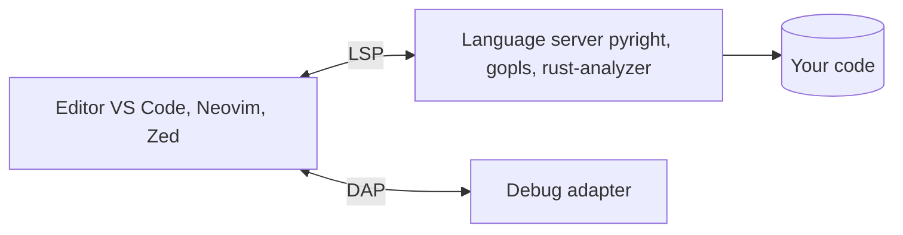

# 07. Text Editors

Picking an editor is picking where you will spend most of your working day. This note compares the main kinds and what to look for. The terminal editors (Vi, Vim, Neovim, Nano) have their own notes in `01. Linux`: [[0. Text Editors|Text Editors]], [[Vim]], [[NeoVim]], [[Nano]].

## The kinds at a glance

| Kind | Examples | Strength | Trade-off |
| ---- | -------- | -------- | --------- |
| **Terminal editors** | Nano, Vim, Neovim, Helix | Everywhere (SSH, servers), fast, keyboard-driven | Learning curve; setup for modern features |
| **Code editors** | VS Code, Sublime Text, Zed, Notepad++ | Fast, extensible, many languages | Debugging and refactoring depend on extensions |
| **IDEs** | IntelliJ IDEA, PyCharm, Visual Studio, Eclipse, Xcode, Android Studio | Deep language understanding, refactoring, debugging, profiling | Heavier, often language-specific |
| **AI-first editors** | Cursor, Windsurf, VS Code or JetBrains with AI assistants | Chat, multi-file edits and generation inside the editor | Review everything; cost; privacy of your code |
| **Cloud / browser** | GitHub Codespaces, Replit, StackBlitz, CodePen | No setup, same environment for everyone | Needs internet; limits on resources |
| **Specialised** | Arduino IDE, PlatformIO, Godot, Unity, RStudio, Jupyter | Built for one domain | Narrow use |

## What really makes an editor good: three ideas

**1. Language servers (LSP)**
A *language server* is a background program that understands one language (Python, Go, Rust...). Editors talk to it over the **Language Server Protocol**, so autocomplete, go-to-definition, rename and error squiggles work the same in VS Code, Neovim, Zed, Helix or Emacs. This is why a light editor can now feel like an IDE.

**2. Debugging and tests inside the editor**
The *Debug Adapter Protocol* (DAP) does the same job for debuggers. Being able to set a breakpoint and run one test from the editor is worth more than any theme.

**3. Remote and reproducible environments**
Edit code on another machine without copying it: VS Code Remote-SSH, **Dev Containers**, Codespaces, or just Neovim over SSH ([[SSH|SSH setup]]). Everyone then builds with the same tools.

## Terminal editors

| Editor | Notes |
| ------ | ----- |
| **Nano** | Shortcuts shown on screen; the right tool for a quick config edit |
| **Vi / Vim** | On almost every server; **modal** editing (normal, insert, visual); fast once learned |
| **Neovim** | Modern Vim: Lua configuration, built-in LSP, large plugin ecosystem |
| **Helix** | Modal editor with LSP and Tree-sitter built in, little configuration |
| **Micro** | Simple, mouse-friendly terminal editor |

Learn at least the basics of **Vim** (or `vi`): `i` insert, `Esc` normal mode, `:w` save, `:q` quit, `:wq` both, `/text` search, `dd` delete a line, `u` undo.

## Code editors

| Editor | Notes |
| ------ | ----- |
| **VS Code** | The most popular; huge extension marketplace, built-in Git, terminal and debugger. **VSCodium** is the build without Microsoft telemetry |
| **Sublime Text** | Very fast, great search and multi-cursor |
| **Zed** | Fast editor written in Rust, built-in collaboration and AI features, open source |
| **Notepad++** | Lightweight Windows editor |
| **Kate / Gedit / Geany** | Straightforward Linux desktop editors |
| ~~Atom~~ | **Retired by GitHub in December 2022**; do not start with it |

## IDEs

| IDE | Best for |
| --- | -------- |
| **IntelliJ IDEA** | Java and Kotlin (also Spring, Gradle, Maven) |
| **PyCharm** | Python, Django, data science |
| **WebStorm** | JavaScript and TypeScript |
| **CLion** | C and C++ |
| **Visual Studio** | C#, .NET and C++ on Windows |
| **Eclipse** | Java and plug-in based development |
| **Android Studio** | Android apps |
| **Xcode** | iOS and macOS (Swift) |

JetBrains IDEs share one design, so learning one transfers to the others.

## AI-assisted editing: how to use it well

- Treat the assistant as a **fast junior colleague**: it drafts, you review.
- Give it **context**: the relevant files, the error message, the goal.
- Ask for **small steps** and run the tests after each one.
- **Read every change** before accepting it; check imports and APIs actually exist.
- Never paste **secrets** into a chat or prompt. Check what your tool sends to its servers, and whether your employer allows it.
- Terminal agents such as Claude Code work alongside any editor: they read and change the project from the command line while you review the diff in your editor.

## Features worth checking before you commit to one

| Feature | Why it matters |
| ------- | -------------- |
| Fuzzy file open and project-wide search | Navigation is most of editing |
| Multi-cursor / multi-file replace | Large mechanical edits |
| Git integration (diff, blame, staging) | Review as you work |
| Integrated terminal | Fewer window switches |
| Formatter and linter on save | Consistent code with no effort |
| Snippets and templates | Skip boilerplate |
| Settings that sync or live in a file | Same setup on every machine |
| Accessibility (screen readers, zoom, themes) | Fits how *you* work |

## Choosing

| Situation | Suggestion |
| --------- | ---------- |
| First time programming | **VS Code** (or PyCharm for Python) |
| Quick edits on servers | **Nano**, then **Vim** |
| Large Java, Kotlin or C# codebase | A **JetBrains** IDE or **Visual Studio** |
| You love the keyboard | **Neovim** or **Helix** |
| Speed and simplicity | **Sublime Text** or **Zed** |
| Team onboarding with identical setups | **Dev Containers** or **Codespaces** |
| Embedded boards | **PlatformIO** (in VS Code) or the **Arduino IDE** |

The best editor is the one you know well. Learn its shortcuts, keep its configuration in version control, and do not switch every month.
