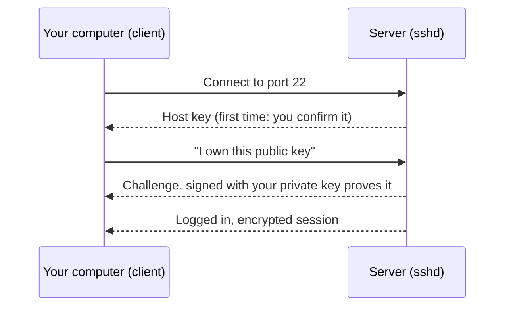

How to set up SSH on a Linux machine (written for Ubuntu) so you can log in remotely, with keys and sensible defaults. Concepts and more tools are in [[15. Remote Access|Remote Access]]; a fuller lock-down is in [[Server Hardening with SSH, UFW and Fail2ban]].


- Your **private key** (`~/.ssh/id_ed25519`) never leaves your computer; the **public key** (`.pub`) is what you put on servers.

## Step 1: Install and start the server

```bash
$ ssh -V                                          # is the client installed?
$ sudo apt update && sudo apt install -y openssh-server
$ sudo systemctl enable --now ssh                 # start now and at boot
$ systemctl status ssh                            # should say active (running)
$ ss -tlnp | grep ssh                             # confirm it is listening (port 22)
```

## Step 2: Create a key pair (on your own computer)

```bash
$ ssh-keygen -t ed25519 -C "you@laptop"           # modern, short, fast keys
# Press Enter for the default location, and set a passphrase
$ ls ~/.ssh                                       # id_ed25519 (private), id_ed25519.pub (public)
```
Use `ed25519` unless something old needs RSA (then `-t rsa -b 4096`). Set a **passphrase**, then let `ssh-agent` remember it so you type it once:
```bash
$ eval "$(ssh-agent -s)" && ssh-add ~/.ssh/id_ed25519
```

## Step 3: Put your public key on the server

```bash
$ ssh-copy-id your_username@server_ip             # also sets the right file permissions
$ ssh your_username@server_ip                     # should now log in with the key
```
No `ssh-copy-id` (for example on Windows)? Do it by hand:
```bash
$ cat ~/.ssh/id_ed25519.pub | ssh your_username@server_ip \
    "mkdir -p ~/.ssh && chmod 700 ~/.ssh && cat >> ~/.ssh/authorized_keys && chmod 600 ~/.ssh/authorized_keys"
```
Permissions matter: SSH ignores keys if `~/.ssh` is not `700` or `authorized_keys` is not `600`, and it must belong to you.

## Step 4: Harden the server (after keys work)

**Do not close your current session until you have tested a new one.** A mistake here locks you out.

```bash
$ sudo nano /etc/ssh/sshd_config.d/50-hardening.conf
```
```
PermitRootLogin no
PasswordAuthentication no
KbdInteractiveAuthentication no
PubkeyAuthentication yes
AllowUsers your_username
MaxAuthTries 3
```
```bash
$ sudo sshd -t                                    # check the config for mistakes (no output = OK)
$ sudo systemctl reload ssh                       # apply
```
- Files in `sshd_config.d/` override the main file on current Ubuntu, so your changes survive upgrades.
- Changing the **port** (for example `Port 2222`) only reduces log noise; it is not real security. On recent Ubuntu, SSH may be started by a **socket** (`ssh.socket`), so a port change also needs `sudo systemctl daemon-reload && sudo systemctl restart ssh.socket`. Verify with `ss -tlnp | grep ssh`.

## Step 5: Firewall

```bash
$ sudo ufw allow OpenSSH                          # or: sudo ufw allow 2222/tcp
$ sudo ufw enable
$ sudo ufw status verbose
```
Allow SSH **before** you enable the firewall. See [[Firewalls]].

## Step 6: A client config makes it easy

`~/.ssh/config` on your own computer:
```
Host home
    HostName 192.168.1.50
    User sharif
    IdentityFile ~/.ssh/id_ed25519

Host prod
    HostName prod.example.com
    User deploy
    Port 2222
    ProxyJump bastion          # hop through another server

Host *
    ServerAliveInterval 60     # keep idle connections alive
```
```bash
$ ssh home              # instead of ssh sharif@192.168.1.50
$ scp file.txt home:~/  # copy a file ([[16. Copy Files Over Network|Copy Files Over Network]])
```

## Useful tricks

```bash
$ ssh -L 8080:localhost:80 home        # local forward: open localhost:8080 to reach the server's port 80
$ ssh -D 1080 home                     # SOCKS proxy through the server
$ ssh -J bastion prod                  # jump host in one command
$ ssh home 'df -h && uptime'           # run a command and exit
$ ssh -v home                          # verbose output when debugging
$ sshfs home:/data ~/mnt               # mount a remote folder
```

## Troubleshooting

| Symptom | Check |
| ------- | ----- |
| `Connection refused` | Is `sshd` running (`systemctl status ssh`)? Right port? Firewall (`ufw status`)? |
| `Connection timed out` | Wrong IP, network or cloud security group blocking the port |
| `Permission denied (publickey)` | Key not in `authorized_keys`, wrong user, or wrong permissions on `~/.ssh` |
| `Too many authentication failures` | `ssh-agent` offering many keys: use `ssh -o IdentitiesOnly=yes -i key host` |
| `REMOTE HOST IDENTIFICATION HAS CHANGED` | Server was rebuilt, **or** something is intercepting. Verify, then `ssh-keygen -R host` |
| Works, then drops | Add `ServerAliveInterval 60`; check the network |

```bash
$ sudo journalctl -u ssh --no-pager | tail -30     # server-side log
$ sudo tail -f /var/log/auth.log                   # watch login attempts live
$ ssh -vvv your_username@server_ip                 # client-side detail
```
