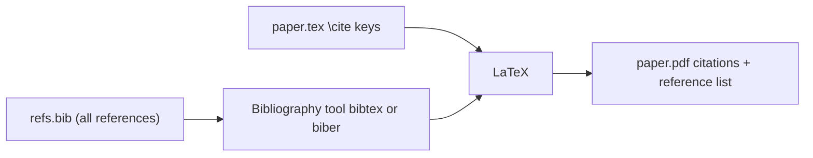

# 01. BibTeX

BibTeX keeps your references in one database file (`.bib`) and builds the bibliography for [[LaTex]] automatically. Workflow context: [[Research Notes]].

## The idea



You cite by **key** in the text; only the cited entries appear in the reference list, formatted in the style you choose.

## An example `refs.bib`

```bibtex
@article{lamport1978time,
  author  = {Lamport, Leslie},
  title   = {Time, Clocks, and the Ordering of Events in a Distributed System},
  journal = {Communications of the ACM},
  volume  = {21},
  number  = {7},
  pages   = {558--565},
  year    = {1978},
  doi     = {10.1145/359545.359563}
}

@inproceedings{dean2004mapreduce,
  author    = {Dean, Jeffrey and Ghemawat, Sanjay},
  title     = {{MapReduce}: Simplified Data Processing on Large Clusters},
  booktitle = {Proceedings of OSDI},
  year      = {2004}
}

@book{kleppmann2017ddia,
  author    = {Kleppmann, Martin},
  title     = {Designing Data-Intensive Applications},
  publisher = {O'Reilly Media},
  year      = {2017}
}
```

## Entry types

| Type | Use for | Key fields |
| ---- | ------- | ---------- |
| `@article` | Journal paper | author, title, journal, year, volume, pages |
| `@inproceedings` | Conference paper | author, title, booktitle, year |
| `@book` | Book | author or editor, title, publisher, year |
| `@incollection` | Chapter in an edited book | plus booktitle, editor |
| `@phdthesis` / `@mastersthesis` | Theses | author, title, school, year |
| `@techreport` | Report | institution, number |
| `@misc` | Websites, software, datasets, preprints | title, author, year, `howpublished`, `url` |

## Using it in a document

```latex
As shown by Lamport~\cite{lamport1978time}, clocks need not be physical.
Several systems build on this~\cite{dean2004mapreduce,kleppmann2017ddia}.

\bibliographystyle{plain}   % style: plain, ieeetr, alpha, abbrv...
\bibliography{refs}         % refs.bib, without the extension
```

**Build** (the order matters because the first run collects the citations):
```
$ pdflatex paper && bibtex paper && pdflatex paper && pdflatex paper
$ latexmk -pdf paper        # does all of that for you
```

## BibLaTeX and biber (the modern option)

```latex
\usepackage[backend=biber,style=authoryear]{biblatex}
\addbibresource{refs.bib}
...
\textcite{lamport1978time} showed that ...   % Lamport (1978) showed ...
\parencite{lamport1978time}                  % (Lamport, 1978)
\printbibliography
```
- Handles **Unicode**, more entry types, URLs and DOIs better, and has flexible styles.
- Build with `latexmk -pdf paper` (it detects `biber`).
- **Use BibTeX** when a journal or template requires it (many do); **use BibLaTeX** otherwise.

## Good habits

- **Keys:** `authoryearword` (`lamport1978time`), unique and lowercase, never changed after you start citing.
- **Authors:** separate with `and`, written as `Last, First`.
- **Protect capitals** with braces: `title = {{MapReduce}: ...}`, or BibTeX will lowercase them.
- **Ranges** use `--` (`558--565`).
- Include the **DOI** where there is one.
- Export from **Zotero** (Better BibTeX plugin gives stable keys) or manage the file with **JabRef**, instead of typing entries by hand.
- Keep **one master `.bib`** for all papers, in version control.

## Common errors

| Message | Likely cause |
| ------- | ------------ |
| `Citation 'x' undefined` | Wrong key, or you did not run bibtex/biber and LaTeX again |
| `I couldn't open database file` | `\bibliography{}` name does not match the file |
| `Missing $ inserted` | Special character in a field (`_`, `&`, `%`): escape with `\` |
| `Empty author` | Missing `author` (use `editor` for edited books) |
| Wrong capitals in titles | Add braces around words that must keep capitals |
| `(?)` in the PDF | Run LaTeX once or twice more after bibtex |
