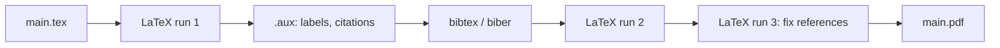

LaTeX is a typesetting system: you write plain text with commands, and it produces a clean PDF. It is the standard for papers, theses, maths and technical reports. Related: [[Research Notes]], [[BibTeX]].

## When to use it

| Use LaTeX for | Use something else for |
| ------------- | ---------------------- |
| Maths, equations, proofs | Quick memos and letters (a word processor) |
| Papers, theses, long documents with references | Web pages and README files (Markdown) |
| Consistent numbering, cross-references, bibliography | Heavy visual design (a layout tool) |
| Version control (it is plain text) | Documents many non-technical people must edit |

## Ways to use it

1. **Online** (nothing to install)
    - [Overleaf](https://www.overleaf.com/): the most popular; real-time collaboration, templates.
    - [Papeeria](https://papeeria.com/) and [CoCalc](https://cocalc.com/features/latex-editor).
2. **Locally** (works offline, faster, fully under your control)
    - macOS: **MacTeX**
    - Linux: **TeX Live** (`sudo apt install texlive-full` is large; `texlive-latex-extra` is a lighter start)
    - Windows: **MiKTeX** or **TeX Live**
    - Editors: **TeXstudio**, **VS Code + LaTeX Workshop**, Vim with VimTeX, or Overleaf's editor.

## Your first document

```latex
\documentclass[11pt,a4paper]{article}

\usepackage[utf8]{inputenc}
\usepackage[margin=2.5cm]{geometry}
\usepackage{amsmath}      % maths
\usepackage{graphicx}     % images
\usepackage{booktabs}     % good-looking tables
\usepackage{hyperref}     % clickable links (load last)

\title{My First Paper}
\author{Your Name}
\date{\today}

\begin{document}
\maketitle

\begin{abstract}
One short paragraph that says what you did and what you found.
\end{abstract}

\section{Introduction}
LaTeX handles numbering, references and layout for you.

\section{Method}
\subsection{Equation}
The quadratic formula is
\begin{equation}
  x = \frac{-b \pm \sqrt{b^2 - 4ac}}{2a}.
  \label{eq:quad}
\end{equation}
See Equation~\ref{eq:quad}.

\end{document}
```

**Compile**
```
$ pdflatex main.tex            # one run
$ latexmk -pdf main.tex        # runs as many times as needed (also bibtex/biber)
$ latexmk -pdf -pvc main.tex   # rebuilds whenever you save
$ latexmk -C                   # clean up build files
$ xelatex main.tex             # or lualatex: for custom fonts and full Unicode
```



## Document classes

| Class | For |
| ----- | --- |
| `article` | Papers, short reports |
| `report` | Longer reports with chapters |
| `book` | Books and theses |
| `beamer` | Slides |
| `IEEEtran`, `acmart`, `llncs` | Publisher templates (conferences, journals) |
| `moderncv` | CVs |

## Useful packages

| Package | What it does |
| ------- | ------------ |
| `amsmath`, `amssymb` | Equations, symbols |
| `graphicx` | `\includegraphics` |
| `booktabs` | Professional tables (`\toprule`, `\midrule`, `\bottomrule`) |
| `hyperref` | Clickable links and references |
| `geometry` | Margins and page size |
| `listings` or `minted` | Code listings (minted needs Python/Pygments) |
| `tikz`, `pgfplots` | Diagrams and plots drawn in LaTeX |
| `biblatex` | Modern bibliography ([[BibTeX]]) |
| `siunitx` | Numbers and units (`\SI{9.81}{m/s^2}`) |
| `cleveref` | Smart references (`\cref{fig:a}` writes "Figure 1") |
| `microtype` | Subtle spacing improvements |

## Maths in a minute

```latex
Inline: $E = mc^2$ and $\sum_{i=1}^{n} i = \frac{n(n+1)}{2}$.

\begin{align}
  f(x) &= (x+1)^2 \\
       &= x^2 + 2x + 1
\end{align}

\[
  \mathbf{A} =
  \begin{pmatrix} 1 & 2 \\ 3 & 4 \end{pmatrix}
\]
```
- `$...$` inline, `\[...\]` or `equation` for display, `align` to line up steps.
- Greek letters: `\alpha \beta \lambda`; fractions: `\frac{a}{b}`; roots: `\sqrt{x}`; limits: `\lim_{x\to 0}`.

## Figures, tables and references

```latex
\begin{figure}[htbp]
  \centering
  \includegraphics[width=0.8\linewidth]{results.png}
  \caption{Accuracy by model.}
  \label{fig:results}
\end{figure}

\begin{table}[htbp]
  \centering
  \begin{tabular}{lrr}
    \toprule
    Model & Accuracy & Time (s) \\
    \midrule
    A & 0.91 & 12 \\
    B & 0.94 & 40 \\
    \bottomrule
  \end{tabular}
  \caption{Results.}
  \label{tab:results}
\end{table}

As Figure~\ref{fig:results} and Table~\ref{tab:results} show, ...
```
- Put **`\label` after `\caption`**; refer with `\ref` (and `~` to avoid a line break before the number).
- LaTeX decides **float placement**; do not fight it, rearrange the text.
- Prefer **vector** figures (PDF, SVG converted to PDF) over low-resolution PNG for plots.

## Citations

```latex
Distributed clocks~\cite{lamport1978time}.
\bibliographystyle{plain}
\bibliography{refs}
```
Full guide: [[BibTeX]].

## Slides with Beamer

```latex
\documentclass{beamer}
\usetheme{Madrid}
\title{My Talk}
\begin{document}
\frame{\titlepage}
\begin{frame}{Why it matters}
  \begin{itemize}
    \item One idea per slide
    \item Use figures, not walls of text
  \end{itemize}
\end{frame}
\end{document}
```

## Quick diagram with TikZ

```latex
\usepackage{tikz}
\begin{tikzpicture}
  \node[draw] (a) at (0,0) {Client};
  \node[draw] (b) at (3,0) {Server};
  \draw[->] (a) -- node[above] {request} (b);
\end{tikzpicture}
```

## Working with Git

```
$ cat .gitignore
*.aux *.log *.out *.toc *.bbl *.blg *.fls *.fdb_latexmk *.synctex.gz
main.pdf          # keep the PDF out of history, or publish it as a release
```
- One sentence per line makes `git diff` readable.
- Keep figures and the `.bib` file in the repo; see [[4. Versioning and Releases|Versioning and Releases]] for tagging a submission version.

## Common errors

| Message | Usually means |
| ------- | ------------- |
| `Undefined control sequence` | Typo in a command, or a missing `\usepackage` |
| `Missing $ inserted` | `_`, `^`, `&`, `%` or `#` in normal text: escape with `\` or use maths mode |
| `File 'x.sty' not found` | Package not installed (`tlmgr install x` on TeX Live) |
| `Runaway argument` / `File ended while scanning` | Unbalanced `{ }` or `\begin` without `\end` |
| `Overfull \hbox` | A line too wide (a warning; reword or allow hyphenation) |
| `Reference ... undefined` / `??` | Compile again; check the label spelling |
| Image not found | Wrong path, or extension needed |

**Tip:** read the *first* error only. Later ones are often caused by it. The line number in the message points at where LaTeX noticed, which can be slightly after the real mistake.

## Cheat sheet

| Want | Write |
| ---- | ----- |
| Bold, italic, code | `\textbf{x}`, `\emph{x}`, `\texttt{x}` |
| Bullet list | `\begin{itemize} \item ... \end{itemize}` |
| Numbered list | `\begin{enumerate} ... \end{enumerate}` |
| Footnote | `\footnote{text}` |
| New page | `\newpage` |
| Non-breaking space | `Figure~\ref{...}` |
| Quotes | ``` ``like this'' ``` |
| Comment | `% ignored` |
| Table of contents | `\tableofcontents` |
| Link | `\href{https://example.com}{text}` |
