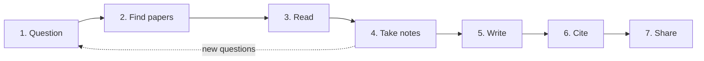

How to find, read, record, write up and share research, with the tools that make each step easier. Writing: [[LaTex]]. Citations: [[BibTeX]].

## The research workflow



## 1. Ask a sharp question

- Write the question in one sentence, then the **claim** you expect to defend.
- Note what would **change your mind**. It tells you what evidence to look for.
- Decide the scope: one system, one dataset, one comparison.

## 2. Find papers

| Source | Good for |
| ------ | -------- |
| **Google Scholar** | Broad search, "cited by", "related articles" |
| **arXiv** | Free preprints in computer science, maths and physics |
| **Semantic Scholar** | Search with summaries and citation context |
| **DBLP** | Computer science authors and venues |
| **ACM Digital Library / IEEE Xplore** | Conference and journal papers (often behind a paywall; many universities have access) |
| **Papers with Code** | Papers linked to implementations (machine learning) |

**Tips:** start from a good **survey**; follow references **backwards** (what it builds on) and citations **forwards** (who built on it); note the **venue** and **year** so you can judge quality.

## 3. Read efficiently: the three passes

1. **Pass one (5 to 10 min):** title, abstract, introduction, headings, conclusion. Decide whether it is worth more time.
2. **Pass two (about 1 hour):** read the figures, tables and main argument. Skip the proofs. Mark references to follow.
3. **Pass three (hours):** reconstruct the work in your head: challenge every assumption, find the weak spots.

Questions to answer for every paper: *What problem? What is new? How was it tested? What are the limits? Would I trust it?*

## 4. Take useful notes

One note per paper, plus a table that compares them.

```markdown
# Author, Year: Short title
**Link / DOI:**  **Venue:**
**Problem:** one sentence
**Method:** how it works, in my words
**Results:** numbers that matter (dataset, metric, baseline)
**Limits:** what it does not show
**Ideas for me:** what to try or cite it for
**Rating:** 1 to 5  **Status:** to read / read / cited
```

**Literature matrix** (the table that makes the writing easy)

| Paper | Problem | Method | Data | Result | Limits |
| ----- | ------- | ------ | ---- | ------ | ------ |
| A (2023) | ... | ... | ... | ... | ... |

- Link paper notes and concept notes with wikilinks (double square brackets); the links become your map of the field.
- Keep a **research log**: date, what you tried, what happened, what next. Future you will need it.
- Put **quotes in quote marks** with the page number, so you never plagiarise by accident.

## 5. Manage references

| Tool | Notes |
| ---- | ----- |
| **Zotero** | Free, open source; browser button saves papers and metadata; PDF annotation; exports `.bib` |
| **JabRef** | Free, open source; works directly on `.bib` files, good with LaTeX |
| **Mendeley** | Popular reference manager |

Save the **PDF and metadata** at the moment you find a paper. Use stable **citation keys** (`smith2023graphs`). Details in [[BibTeX]].

## 6. Write

- Outline first: **problem, gap, contribution, method, evidence, limits**.
- State your contribution in the introduction, plainly.
- One idea per paragraph; figures and tables should be understandable with their captions alone.
- Draft in [[LaTex]] (Overleaf for teams, local for control).
- Write for a reader who is smart but busy: define terms, avoid padding.

## 7. Share and make it reproducible

- **Preprint** on arXiv or an institutional repository so others can read it free.
- **Code and data** in a public repository; fix versions of dependencies (`requirements.txt`, lock files) and record random seeds.
- **Archive a release** on Zenodo to get a **DOI**; link it from the paper. (Zenodo can archive GitHub releases automatically.)
- Add a `CITATION.cff` file so GitHub shows a "Cite this repository" box. See [[4. Versioning and Releases|Versioning and Releases]].
- Get an **ORCID** to identify yourself across papers.
- Choose licences deliberately: code ([[1. Open Source Fundamentals|Open Source licences]]), text and data (Creative Commons).

## Common mistakes

- Reading without recording: you will re-read it again in six months.
- Collecting PDFs and never writing notes.
- Citing a paper you only read the abstract of.
- Trusting a result with no baseline, no error bars or no code.
- Leaving the literature search to the end.
- Forgetting to back up the `.bib` file and notes.

## Notes in this section

- [[LaTex]]: typesetting papers, reports and slides.
- [[BibTeX]]: references and citations.
