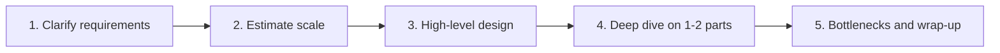
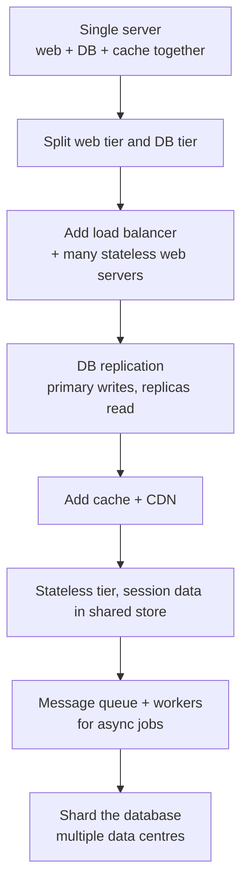

**System design** is deciding how the parts of a software system (clients, servers, databases, caches, queues) fit together so it meets its requirements at the scale it needs. There is no single right answer, only trade-offs you can explain. The other notes in this section: [[2. Building Blocks|Building Blocks]], [[3. Data and Consistency|Data and Consistency]], [[4. Reliability Patterns|Reliability Patterns]], [[5. Worked Designs|Worked Designs]], [[6. Distributed Patterns|Distributed Patterns]].

## A framework for any design question



| Step | What to do | Example (URL shortener) |
| ---- | ---------- | ----------------------- |
| Clarify | Ask who uses it, which features, how big | Create short link, redirect, 100M new links/day? Expire links? |
| Estimate | Rough QPS, storage, bandwidth | ~1,200 writes/s, ~12,000 reads/s |
| High-level | Boxes and arrows, APIs, data model | Client, load balancer, web tier, cache, DB |
| Deep dive | Pick the hard part and go deep | How to generate unique short codes |
| Wrap up | Failure points, scaling, monitoring | What if the cache dies? |

- Functional requirements = what it does. Non-functional = how well (latency, availability, consistency, durability).
- State assumptions out loud; change them when the answer changes the design.

## Scaling from one user to millions



- **Vertical scaling** (scale up): bigger machine. Simple, but has a ceiling and is a single point of failure.
- **Horizontal scaling** (scale out): more machines. Needs a load balancer and stateless servers.
- **Stateless web tier**: keep no session data on the server itself, so any request can go to any server and servers can be added or killed freely.
- **Database scaling**: replication first (read-heavy), sharding when one primary can no longer hold the writes or the data.
- **Multiple data centres**: route users to the nearest one with **GeoDNS**; replicate data across them.

## Back-of-the-envelope estimation

Round numbers, powers of two, and show your working.

| Power | Value | Name |
| ----- | ----- | ---- |
| 2^10 | ~1 thousand | 1 KB |
| 2^20 | ~1 million | 1 MB |
| 2^30 | ~1 billion | 1 GB |
| 2^40 | ~1 trillion | 1 TB |

**Latency numbers worth remembering** (orders of magnitude)

| Operation | Time |
| --------- | ---- |
| Memory read | ~100 ns |
| SSD random read | ~100 µs |
| Same-datacentre round trip | ~0.5 ms |
| Disk seek (HDD) | ~10 ms |
| Cross-continent round trip | ~150 ms |

- Memory is fast, disk is slow, networks cost the most. Compress data, avoid disk seeks, minimise cross-region trips.
- A day has about **86,400 s**, call it **~100,000 s**, so `X per day / 100,000 = X per second`.

**Worked example: a photo app with 10M daily active users**
```
$ users            = 10,000,000 / day
$ uploads per user = 2 photos / day  -> 20M uploads / day
$ upload QPS       = 20,000,000 / 100,000 = ~200 / s
$ peak QPS         = 2 x average          = ~400 / s
$ photo size       = 2 MB
$ storage per day  = 20M x 2 MB = 40 TB / day
$ storage 5 years  = 40 TB x 365 x 5 = ~73 PB
```
That 73 PB number is what tells you to use object storage and not a database.

## Availability

| Availability | Downtime per year |
| ------------ | ----------------- |
| 99% ("two nines") | ~3.65 days |
| 99.9% | ~8.8 hours |
| 99.99% | ~52 minutes |
| 99.999% | ~5 minutes |

- Components in **series** multiply (two 99.9% parts give ~99.8%); components in **parallel** (redundancy) raise it.
- Related: [[CAP theorem and its implications]], [[04. Database Architecture|Database Architecture]], [[N-Tier Architecture]].
