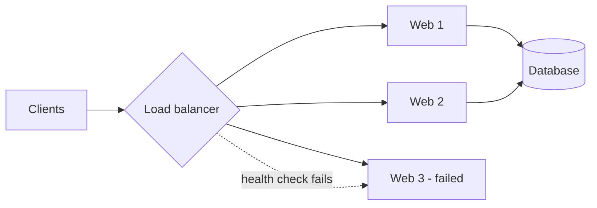
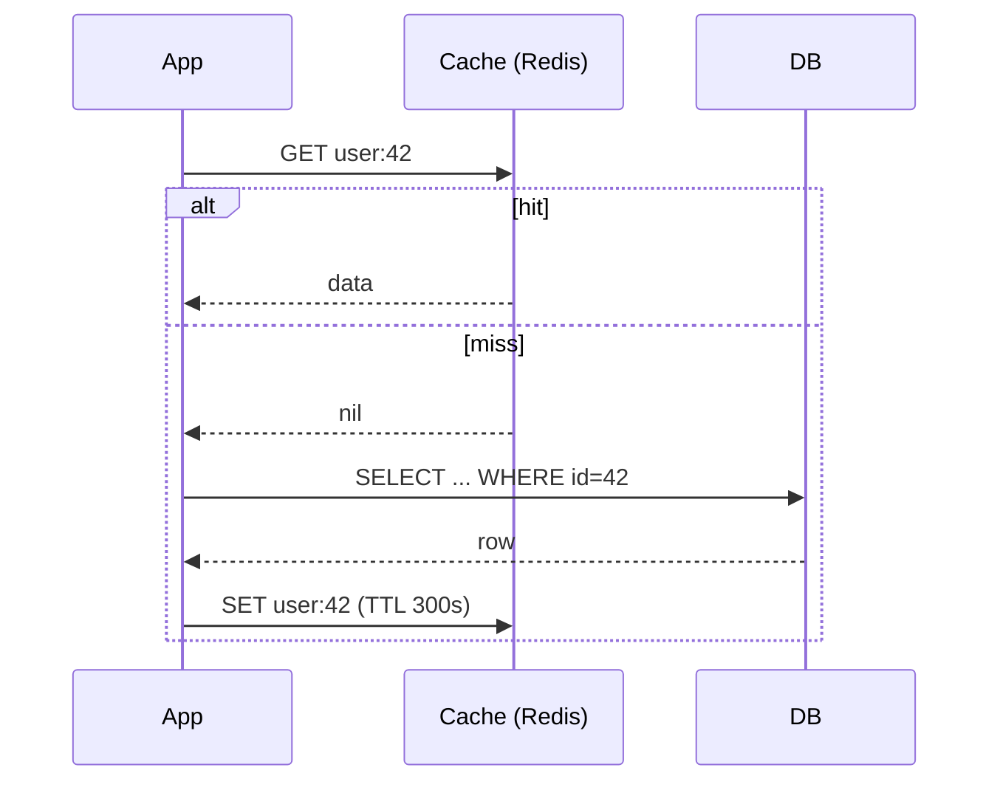
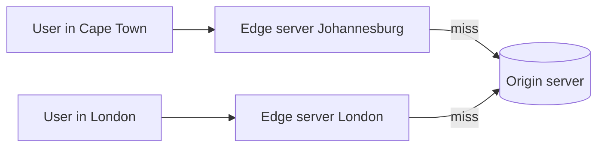
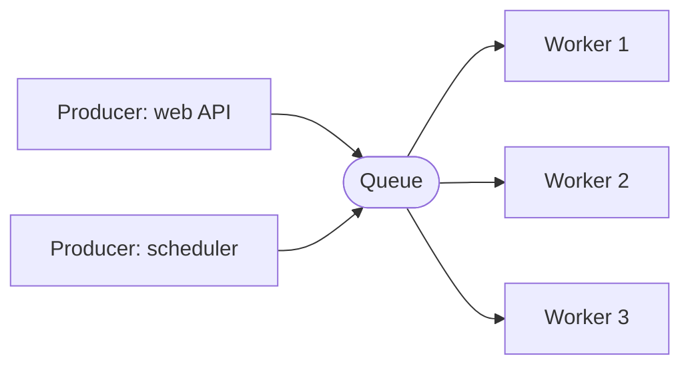

# 02. Building Blocks

The standard pieces almost every large design is assembled from. Cloud-specific versions are in [[3. AWS Elastic Load Balancing Deep Dive|AWS Elastic Load Balancing]] and [[08. Azure and GCP Edge Delivery and Load Balancing|Azure and GCP Edge Delivery]]. Back to [[1. Fundamentals|Fundamentals]]. Sidecar, ambassador and readiness-probe style patterns are in [[6. Distributed Patterns|Distributed Patterns]].

## At a glance

| Block | Solves | Common tools |
| ----- | ------ | ------------ |
| DNS | Name to IP, geo routing | Route 53, Cloud DNS, Cloudflare |
| Load balancer | Spread traffic, hide failures | Nginx, HAProxy, ALB/NLB |
| Cache | Cut latency and DB load | Redis, Memcached |
| CDN | Serve static content near users | CloudFront, Cloudflare, Akamai |
| Message queue | Decouple and absorb bursts | Kafka, RabbitMQ, SQS |
| API gateway | Auth, rate limit, routing in one place | Kong, API Gateway, Envoy |
| Object storage | Large files and media | S3, Blob Storage, GCS |

## Load balancing



- Clients talk to the balancer's address; backends can use private IPs.
- **Health checks** remove dead servers; the balancer routes around them.
- **Algorithms**
  - Round robin: take turns. Fine when requests cost about the same.
  - Least connections: send to the least busy. Better for long requests.
  - IP hash: the same client always lands on the same server (sticky).
  - Weighted: bigger servers get more.
- **Layer 4** balances on IP and port (fast). **Layer 7** reads HTTP, so it can route by path or host (`/api` vs `/static`).
- The balancer itself must not be a single point of failure: run a pair (active/passive or active/active).

## Caching



This is **cache-aside** (lazy loading), the most common pattern.

| Strategy | How it works | Trade-off |
| -------- | ------------ | --------- |
| Cache-aside | App checks cache, falls back to DB, fills cache | Simple; first read is slow, data can go stale |
| Read-through | Cache fetches from DB itself | Cleaner app code; cache must know the DB |
| Write-through | Write to cache and DB together | Always fresh; slower writes |
| Write-back | Write to cache, flush to DB later | Fast writes; data loss if cache dies first |

**Eviction** when full: LRU (least recently used, the usual default), LFU (least frequently used), FIFO.

```
$ redis-cli SET user:42 '{"name":"Sam"}' EX 300     # expires in 5 minutes
$ redis-cli GET user:42
$ redis-cli TTL user:42
```

- Cache data that is **read often and changes rarely**. Do not cache data that must always be exact.
- Set a **TTL** so stale entries expire.
- **Cache stampede**: a hot key expires and thousands of requests hit the DB at once. Fix with request coalescing or a lock so only one request refills it.
- **Invalidation** (knowing when cached data is wrong) is the hard part.

## CDN



- Edge servers close to users cache **static** files (images, CSS, JS, video).
- First request is a miss and goes to the origin; later ones are served from the edge.
- Control freshness with `Cache-Control: max-age=...` headers, or **purge** and use **versioned file names** (`app.v3.js`).
- Related note on static hosting: [[10. Static Sites on Cloudflare|Static Sites on Cloudflare]].

## Message queues



- The producer drops a message and carries on; consumers process at their own pace.
- **Why:** decouple services, smooth traffic spikes, retry failed work, scale workers independently.
- **Example:** photo upload. The API stores the file and enqueues `resize(photo_id)`; workers create thumbnails later, so the user does not wait.
- **Queue vs log:** SQS/RabbitMQ delete a message once handled. **Kafka** keeps an ordered log that many consumers can replay.
- Delivery guarantees: at-most-once, **at-least-once** (usual), exactly-once (hard). With at-least-once, make consumers **idempotent** (handling a message twice is harmless).
- A **dead-letter queue** holds messages that keep failing so they can be inspected.

## API gateway and reverse proxy

- One entry point for clients: authentication, TLS termination, rate limiting ([[4. Reliability Patterns|Reliability Patterns]]), routing to the right service, logging.
- A **reverse proxy** (Nginx) sits in front of servers; a forward proxy sits in front of clients.

## Object storage

- Store large blobs (images, video, backups) as objects addressed by key, not as database rows.
- Cheap, durable (replicated), served via CDN. The database keeps only the URL or key.
- **Pre-signed URLs** let a client upload straight to storage, so large files never pass through your servers.
