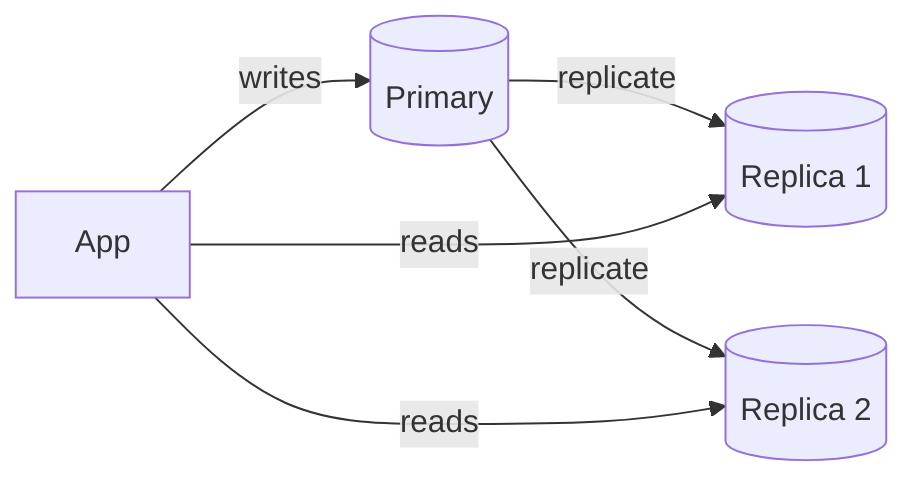
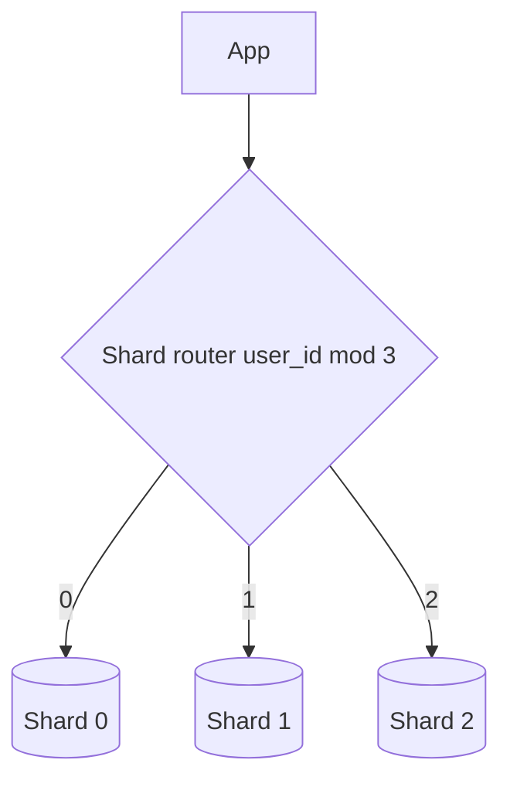
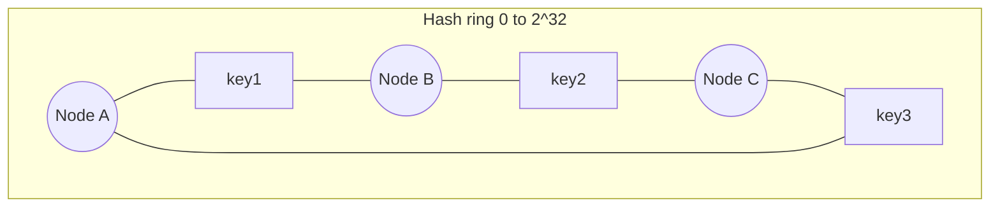
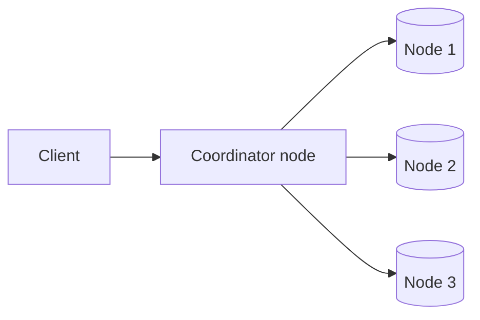

# 03. Data and Consistency

How data is spread across machines and how to keep copies agreeing. Background: [[CAP theorem and its implications]], [[Key-value stores]], [[5. Power of Indexing|Power of Indexing]], [[08. When to use NoSQL vs. relational databases|SQL vs NoSQL]]. Back to [[1. Fundamentals|Fundamentals]].

## Replication



- **Primary/replica**: all writes to one node, copies serve reads. Scales reads and gives a failover target.
- If the primary dies, **promote** a replica. Async replication can lose the last few writes; sync replication is safer but slower.
- **Replication lag**: a user writes, then reads from a stale replica and sees old data. Fix: read your own writes from the primary for a short time.
- **Multi-primary** accepts writes in several places (e.g. one per region) but needs **conflict resolution** (last write wins, version vectors).

## Sharding (partitioning)

Split one big dataset across many databases, each holding a **shard**.



- Choose the **shard key** carefully: it should spread load evenly and match how you query (`user_id` is a good key for a per-user app).
- Sharded caches and hot-shard handling (replicate only the busy shard) are in [[6. Distributed Patterns|Distributed Patterns]].
- Problems to plan for:
  - **Hot shards** (a celebrity user floods one shard).
  - **Resharding** when you add nodes: with `mod N`, changing N moves almost every key.
  - **Joins across shards** are expensive; denormalise or query in the app.

## Consistent hashing

Fixes the resharding problem: adding or removing a node moves only a small share of keys.



- Hash both **nodes** and **keys** onto the same ring. A key belongs to the **first node clockwise** from it.
- Add a node: it takes over only the keys between it and its predecessor. Remove a node: its keys go to the next node.
- **Virtual nodes**: each physical node appears at many points on the ring so load spreads evenly.
- Used by Cassandra, DynamoDB, memcached client libraries and CDNs.

```python
import bisect, hashlib

def h(x): return int(hashlib.md5(x.encode()).hexdigest(), 16)

class Ring:
    def __init__(self, nodes, vnodes=100):
        self.ring = sorted((h(f"{n}#{i}"), n) for n in nodes for i in range(vnodes))
        self.keys = [k for k, _ in self.ring]
    def get(self, key):
        i = bisect.bisect(self.keys, h(key)) % len(self.ring)
        return self.ring[i][1]

print(Ring(["a", "b", "c"]).get("user:42"))
```

## Consistency models

| Model | Promise | Example use |
| ----- | ------- | ----------- |
| **Strong** | Every read sees the latest write | Bank balance, inventory |
| **Eventual** | Replicas converge given time, reads may be stale | Likes count, feeds |
| **Read-your-writes** | You always see your own updates | Profile edits |

- **CAP**: during a network partition choose consistency (reject some requests) or availability (answer, maybe stale).
- **Quorum**: with `N` replicas, write to `W` and read from `R`. If `W + R > N`, a read overlaps the latest write.

```
$ N=3 W=2 R=2   -> 2 + 2 > 3  -> strongly consistent reads
$ N=3 W=1 R=1   -> fast, but may read stale data
```

## Resolving conflicting writes: vector clocks

When two replicas accept writes to the same key at the same time, which value wins? A **vector clock** is a list of `(server, counter)` pairs stored with each value.

```
$ write on A: D1 [A:1]
$ write on A: D2 [A:2]        # descends from D1, so D1 is simply replaced
$ write on B (from D2): D3 [A:2, B:1]
$ write on C (from D2): D4 [A:2, C:1]
$ D3 vs D4: neither contains the other -> CONFLICT, client must merge
```
- If every counter in one clock is `<=` the other, one value is an ancestor and can be dropped; otherwise they are **siblings** and the application merges them.
- Downside: clocks grow, so old pairs are trimmed. Many stores use simple "last write wins" instead and accept lost updates.

## Key-value store design (the idea)



- Spread keys by consistent hashing; replicate each key to the next N nodes on the ring.
- Writes go to memory plus an append-only **commit log**, then flush to sorted files on disk (**LSM tree**); **Bloom filters** skip files that cannot contain a key.
- Detect failed nodes by **gossip** (nodes swap heartbeat lists), and repair stale replicas by comparing **Merkle trees** or when reading.
- Temporary failure: a neighbour holds writes (**hinted handoff**) and passes them on when the node returns.

## Unique ID generation

Auto-increment breaks once you have many database servers. Options:

| Approach | Pros | Cons |
| -------- | ---- | ---- |
| UUID | No coordination | 128-bit, not sortable by time |
| Ticket server (one DB hands out IDs) | Simple | Single point of failure |
| **Snowflake** | 64-bit, roughly time-sorted, no coordination | Needs clock sync |

```
Snowflake ID (64 bits)
| 1 bit sign | 41 bits timestamp (ms) | 5 bits datacentre | 5 bits machine | 12 bits sequence |
```
- Each machine can make 4,096 IDs per millisecond and IDs sort by time.
