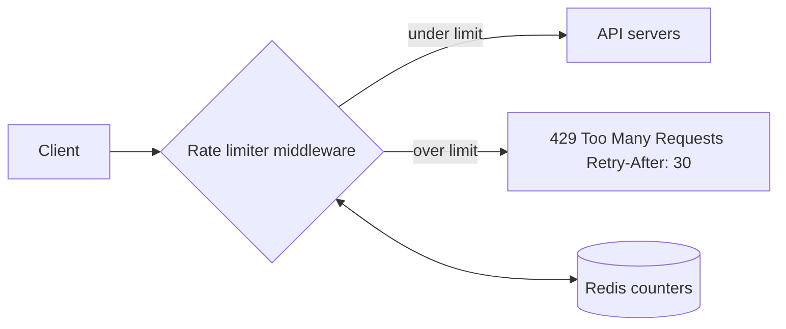
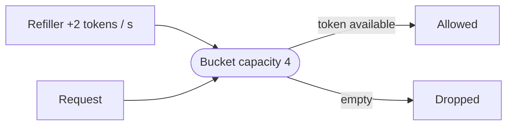
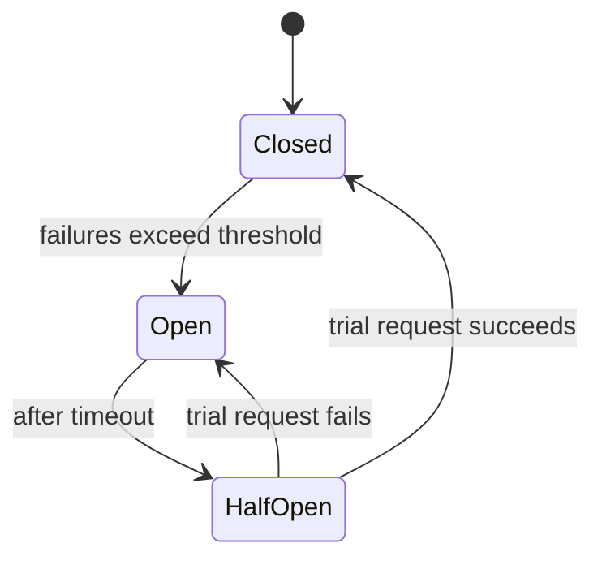

Patterns that keep a system up and fair when traffic spikes or parts fail. Back to [[1. Fundamentals|Fundamentals]]; pieces used here are in [[2. Building Blocks|Building Blocks]].

## Rate limiting

A rate limiter caps how many requests a client can make in a period. It protects against abuse and bots, stops one noisy user starving the rest, and keeps cost down on paid third-party calls.



- Do it **server-side** or in an **API gateway**, never only in the client (clients can be forged).
- Counters live in **Redis** (in-memory, fast): `INCR` to count, `EXPIRE` to reset.
- Reply `429` with headers: `X-Ratelimit-Limit`, `X-Ratelimit-Remaining`, `Retry-After`.
- Rules are config, e.g. `login: 5 per minute per IP`, `marketing messages: 5 per day per user`.
- One rule can have different keys: per user, per IP, per endpoint, or one global bucket.

### Algorithms compared

| Algorithm | Idea | Bursts | Memory | Weak spot |
| --------- | ---- | ------ | ------ | --------- |
| **Token bucket** | Bucket refills at a fixed rate; each request takes a token | Allowed up to bucket size | Tiny | Tuning size and refill rate |
| **Leaking bucket** | Requests queue and drain at a fixed rate | Smoothed out | Small | Old requests can block new ones |
| **Fixed window counter** | One counter per time window | Edge spikes | Tiny | 2x the quota across a window boundary |
| **Sliding window log** | Keep a timestamp per request | Exact | High | Stores every timestamp |
| **Sliding window counter** | Weighted blend of current and previous window | Smoothed | Small | Approximate |



**Token bucket in code**
```python
import time

class TokenBucket:
    def __init__(self, capacity, refill_per_sec):
        self.capacity, self.rate = capacity, refill_per_sec
        self.tokens, self.last = capacity, time.monotonic()

    def allow(self):
        now = time.monotonic()
        self.tokens = min(self.capacity, self.tokens + (now - self.last) * self.rate)
        self.last = now
        if self.tokens >= 1:
            self.tokens -= 1
            return True
        return False
```

**Sliding window counter worked example** (limit 7 per minute)
```
$ previous minute = 5 requests, current minute = 3, we are 30% into the current minute
$ estimate = 3 + 5 x (1 - 0.3) = 6.5   -> rounds to 6, under 7, allow
```

**Fixed window problem**: limit 5 per minute, 5 requests at 2:00:50 and 5 more at 2:01:10. Both windows are fine, yet 10 requests landed in 20 seconds.

### Distributed gotchas
- **Race condition**: two servers read the counter, both see 4, both write 5. Fix with an atomic Redis command or a Lua script, not read-then-write.
- **Many limiter nodes**: keep counters in one shared Redis (or sync between nodes) instead of per-server memory.

```
$ redis-cli INCR rl:user42:2026-10-29T10:15
$ redis-cli EXPIRE rl:user42:2026-10-29T10:15 60
```

## Retries and backoff

- Retry only **idempotent** operations (GET, or a POST carrying an idempotency key), otherwise a retry can charge a card twice.
- **Exponential backoff with jitter**: wait 1s, 2s, 4s... plus a random amount, so clients do not all retry together (a **retry storm**).

```python
delay = min(cap, base * 2 ** attempt)
time.sleep(random.uniform(0, delay))     # "full jitter"
```

## Circuit breaker



- **Closed**: calls pass through. **Open**: fail immediately, giving the broken service room to recover. **Half-open**: let one trial call through.
- Prevents **cascading failure**, where one slow dependency ties up every thread in its callers.

## Other safeguards

| Pattern | What it does |
| ------- | ------------ |
| Timeouts | Never wait forever on a dependency |
| Bulkheads | Separate resource pools so one failing feature cannot sink the rest |
| Graceful degradation | Serve cached or reduced results instead of an error |
| Health checks and failover | Detect dead nodes and move traffic, see [[2. Building Blocks|Building Blocks]] |
| Dead-letter queue | Park messages that keep failing |
| Idempotency keys | Make a repeated request safe |
| Monitoring and alerts | Metrics, logs, tracing: you cannot fix what you cannot see |
