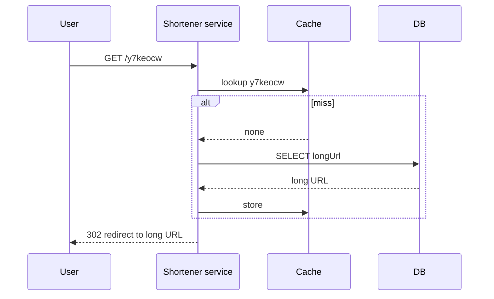
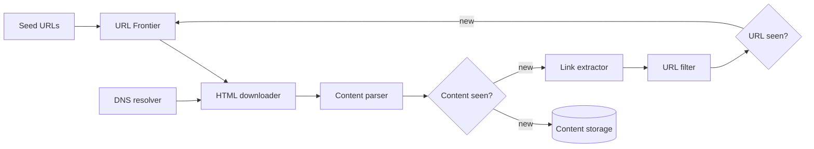
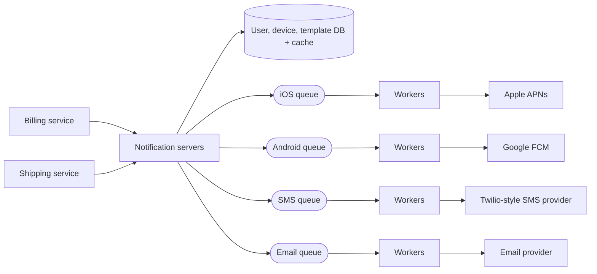
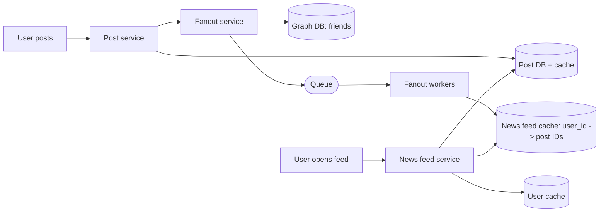
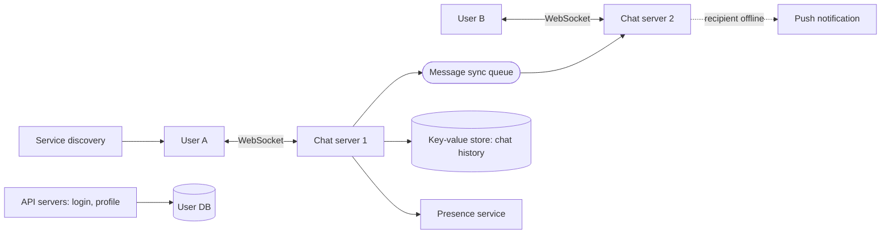
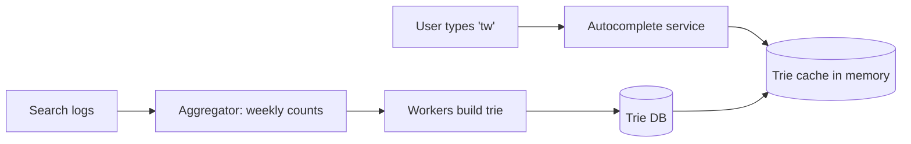
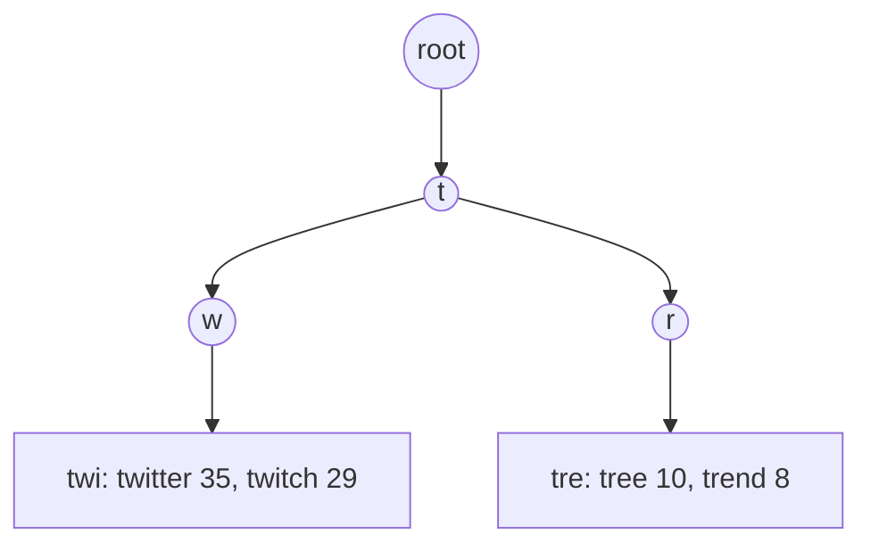
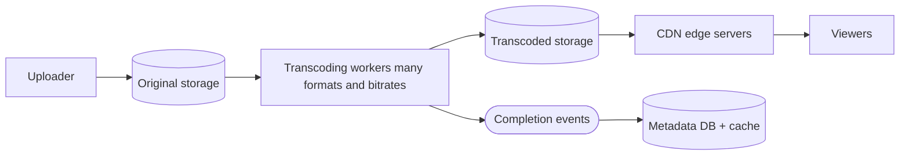
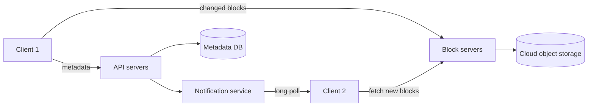

Each design follows the same steps from [[1. Fundamentals|Fundamentals]]: requirements, estimate, high-level design, deep dive. They reuse the pieces in [[2. Building Blocks|Building Blocks]], [[3. Data and Consistency|Data and Consistency]] and [[4. Reliability Patterns|Reliability Patterns]].

## At a glance

| Design | Hard part | Key ideas |
| ------ | --------- | --------- |
| URL shortener | Short unique codes, heavy reads | Base 62, cache, 301 vs 302 |
| Web crawler | Politeness and duplicates | URL frontier, Bloom filter |
| Notification system | Many channels, bursts | Queues per channel, retries, dedupe |
| News feed | Fanout to followers | Push vs pull, hybrid |
| Chat system | Real-time delivery | WebSocket, presence, message IDs |
| Search autocomplete | Fast prefix lookup | Trie, top-k cached, offline rebuild |
| Video streaming | Huge files, many devices | Transcoding pipeline, CDN |
| File sync (cloud drive) | Big files, conflicts | Chunking, block-level sync, versioning |

---

## 1. URL shortener

**Requirements:** make a short link from a long URL, redirect from short to long; 100M new URLs/day, reads 10x writes.

```
$ writes  = 100,000,000 / 86,400  = ~1,160 / s
$ reads   = 1,160 x 10            = ~11,600 / s
$ records = 100M x 365 x 10 years = 365 billion
$ storage = 365 billion x 100 B   = ~365 TB
```

**API**
```
POST /api/v1/data/shorten   { "longUrl": "https://example.com/very/long/path" }  ->  short URL
GET  /{shortUrl}                                                                  ->  redirect
```



**301 vs 302**
- **301** (permanent): the browser caches it, so later clicks skip your server. Less load, but you cannot count clicks.
- **302** (temporary): every click comes through you. Use this when analytics matter.

**Generating the code**
- Allowed characters: `0-9 a-z A-Z` = 62. Need the smallest `n` with `62^n >= 365 billion`. `62^7` is about 3.5 trillion, so **7 characters**.
- **Option A, hash + collision handling:** take the first 7 characters of MD5/CRC32. If that code exists, append something and hash again. Needs a DB check on every write (a Bloom filter makes it cheaper).
- **Option B, base 62 of a unique ID:** get a unique number (see snowflake in [[3. Data and Consistency|Data and Consistency]]) and convert it. No collisions, but codes are guessable and ID generation must be distributed.

```python
ALPHABET = "0123456789abcdefghijklmnopqrstuvwxyzABCDEFGHIJKLMNOPQRSTUVWXYZ"

def to_base62(n):
    out = ""
    while n:
        n, r = divmod(n, 62)
        out = ALPHABET[r] + out
    return out or "0"

print(to_base62(11157))   # 2tx
```

**Scale it:** cache the hot links, add read replicas, rate limit creation, shard by short code.

---

## 2. Web crawler

Used by search engines, archives and data mining. Goal: download pages and follow links, at scale, without being rude or looping.



- **Traversal:** BFS with a FIFO queue. DFS can go impossibly deep.
- **URL frontier** handles the hard parts:
  - **Politeness:** one queue per host with one worker each and a delay between requests, so a site is never flooded.
  - **Priority:** rank URLs (PageRank, traffic, update rate); front queues for priority, back queues for politeness.
  - **Freshness:** recrawl by how often a page changes.
- **Duplicates:** "URL seen?" and "Content seen?" use a **Bloom filter** or hash of the page. Around 29% of web pages are duplicates.
- **Robots.txt:** check and cache each site's rules before crawling it.
- **Traps:** cap URL length and depth, skip infinite calendars and session-ID links.
- **Scale:** many crawl servers, cache DNS lookups, crawl from nearby data centres, make workers stateless and restartable.

---

## 3. Notification system

Send push (APNs for iOS, FCM for Android), SMS and email to users.



- **One queue per channel**, so an outage at one provider does not block the others.
- **Contact info:** store device tokens and phone numbers at signup; a user can have many devices.
- **Reliability:** log every notification; retry failed sends with backoff; use a dead-letter queue.
- **No duplicates:** keep an event ID and skip ones already sent (providers can still send twice, so this is best effort).
- **User settings:** check opt-outs before sending; add **rate limiting** so users are not spammed ([[4. Reliability Patterns|Reliability Patterns]]).
- **Extensible:** wrap each provider behind one interface so you can swap them (for example FCM is unavailable in some regions).

---

## 4. News feed



**Fanout** = delivering a new post to every follower's feed.

| Model | How | Good | Bad |
| ----- | --- | ---- | --- |
| **Push** (fanout on write) | Write the post ID into each follower's feed cache on posting | Fast reads | Slow for users with millions of followers; wasted work for inactive users |
| **Pull** (fanout on read) | Build the feed when the user opens it | No wasted work; no hot key | Slow reads |
| **Hybrid** | Push for normal users, pull for celebrities | Best of both | More complex |

- Cache only **post IDs** in the feed (not whole posts) and cap the length; hydrate the rest from post and user caches.
- Media is served from a **CDN**.
- Use a **graph database** for friend relationships, and **consistent hashing** to spread hot keys.

---

## 5. Chat system

**Connections:** HTTP is client-initiated, so the receiving side needs a trick.

| Technique | How | Verdict |
| --------- | --- | ------- |
| Polling | Client asks every few seconds | Wasteful |
| Long polling | Server holds the request until a message arrives | Better, still awkward at scale |
| **WebSocket** | One persistent two-way connection (starts as HTTP, upgraded) | Standard choice |



- **Stateless** parts (login, profile, groups) are normal HTTP services. The **chat servers are stateful** (they hold connections), so a service-discovery component picks which one a client connects to.
- **History** goes in a key-value or wide-column store (huge write volume, mostly recent reads), see [[Key-value stores]].
- **Message IDs** must sort by time within a chat: use snowflake-style IDs ([[3. Data and Consistency|Data and Consistency]]).
- **1-to-1:** A sends, the chat server stores it and relays to B's server; if B is offline, send a push notification.
- **Group chat:** small groups can copy each message into every member's inbox queue.
- **Presence (online/offline):** the client sends a heartbeat; if none arrives within a timeout, mark offline (avoids flicker on brief disconnects).

---

## 6. Search autocomplete

Return the top suggestions for what the user has typed so far, in well under 100 ms.



- A **trie** stores strings by shared prefix. Each node holds the **top-k** suggestions (cache them at the node so a lookup is just "walk to the prefix").



- **Build offline:** counts come from search logs and the trie is rebuilt periodically (weekly), because updating it on every query is too slow.
- **Speed-ups:** limit prefix length; cache responses in the browser (`Cache-Control: max-age=3600`); shard by first letters.
- **Extras:** filter hateful or unsafe terms; support other languages (Unicode in the trie).

---

## 7. Video streaming



- **Upload:** clients upload large files in **chunks** straight to object storage with pre-signed URLs, so retries only resend a chunk.
- **Transcoding:** convert into many resolutions, bitrates and containers so every device can play it. Split the work into a **DAG** of tasks (video, audio, thumbnail, watermark) run in parallel, driven by queues.
- **Streaming:** adaptive protocols (HLS, MPEG-DASH) switch quality as bandwidth changes. Serve from the **CDN**; popular videos at the edge, long-tail videos from storage.
- **Cost control:** CDN is the biggest bill, so cache only the popular videos and encode rarely watched ones on demand.
- **Safety:** access control, signed URLs, copyright checks.

---

## 8. File sync (cloud drive)



- **Chunking:** split files into blocks (around 4 MB), hash each block; only blocks whose hash changed are uploaded (**delta sync**), and identical blocks are stored once (**deduplication**). Compress and encrypt blocks.
- **Metadata** (file name, folder, version, block list) lives in a relational DB because it needs strong consistency; file contents live in object storage.
- **Sync:** the server tells other clients "something changed" (long poll or WebSocket); they fetch the new metadata and only the missing blocks.
- **Conflicts:** two users edit the same file. First write wins; the second gets a conflicted copy for the user to merge.
- **Reliability:** keep **versions** (rollback), replicate storage across regions, move old data to cold storage.
