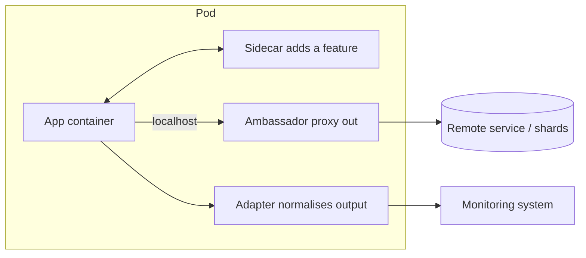
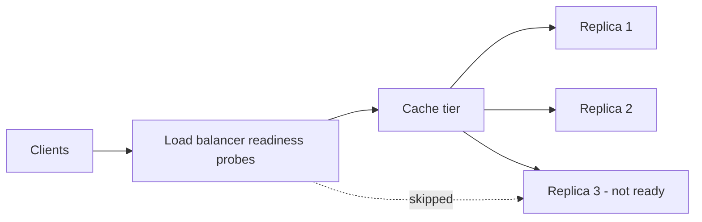
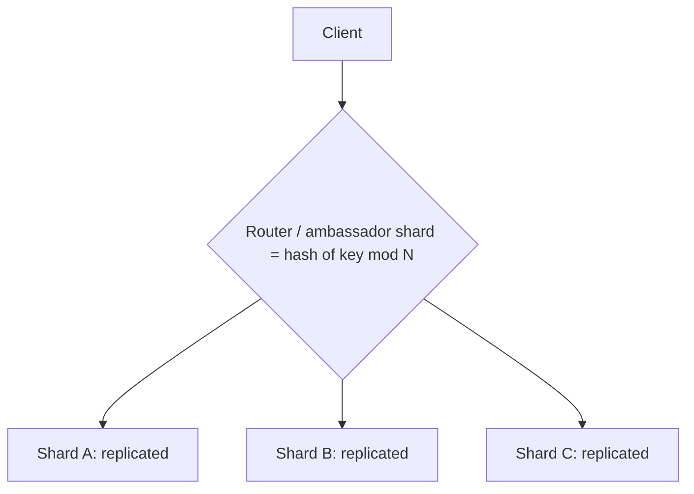
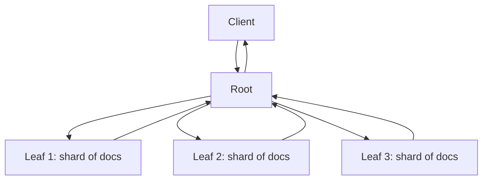
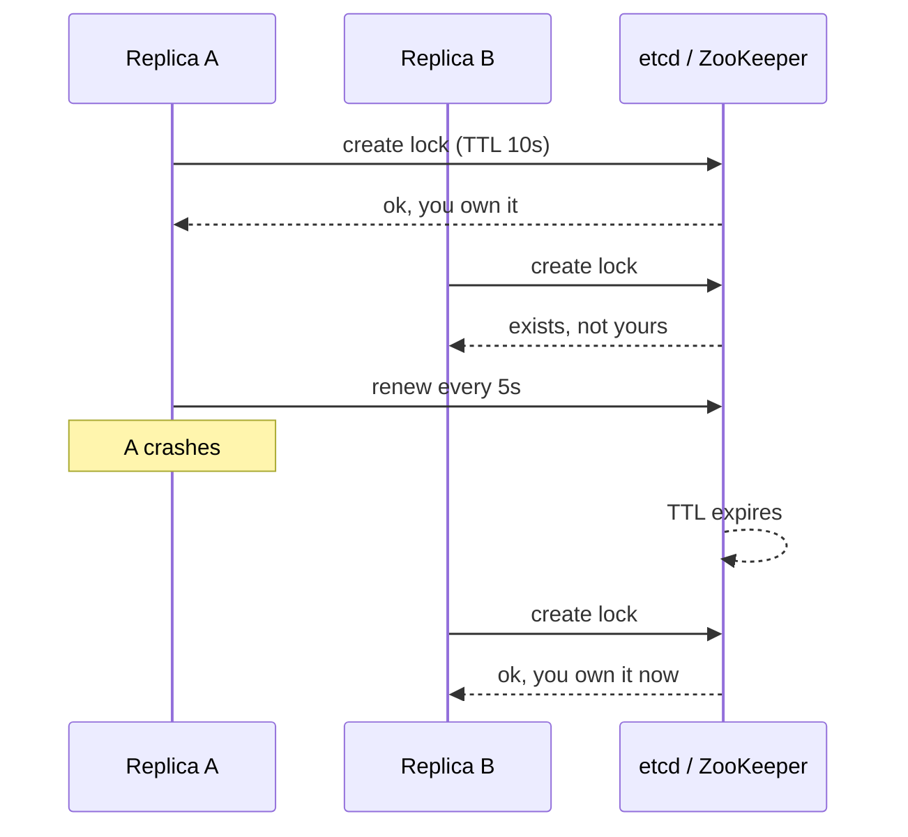
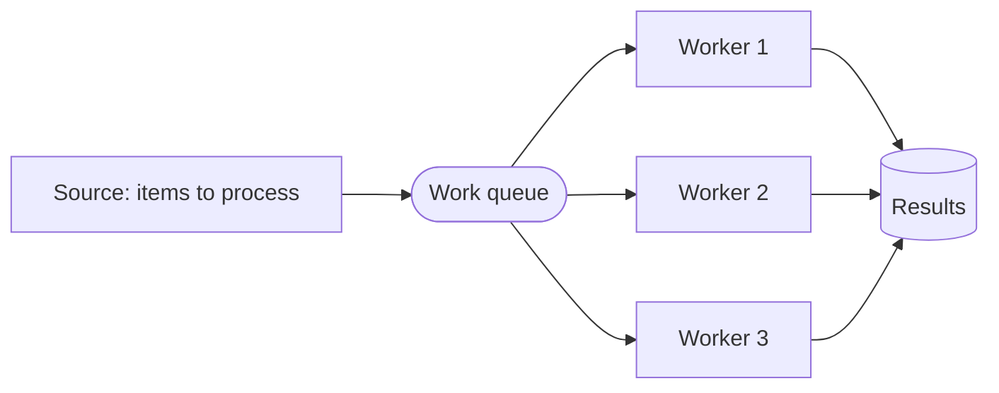
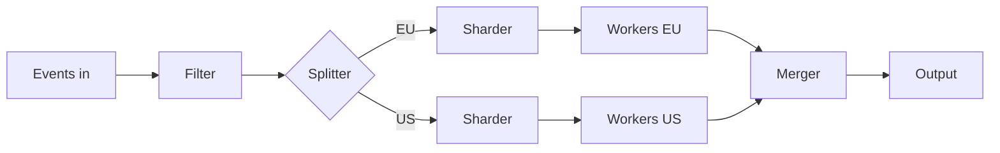
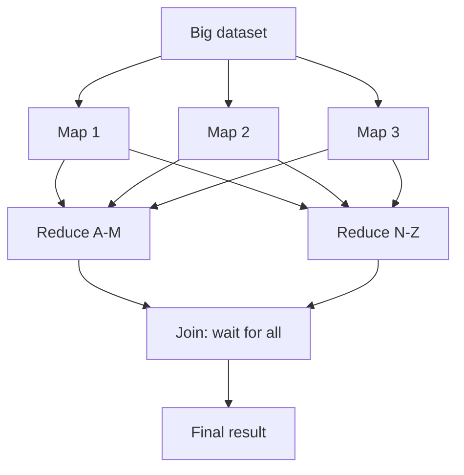

Reusable shapes for building services out of containers and cooperating processes, from a container-patterns reading. They sit between the building blocks and the full designs: [[2. Building Blocks|Building Blocks]], [[3. Data and Consistency|Data and Consistency]], [[5. Worked Designs|Worked Designs]]. Runtime side: [[1. Docker|Docker]] and Kubernetes Pods in [[4. Running Your Containers in Kubernetes|Running Containers in Kubernetes]].

## At a glance

| Group | Pattern | One-line idea |
| ----- | ------- | ------------- |
| Single node | **Sidecar** | Helper container beside the app, sharing its lifecycle |
| Single node | **Ambassador** | Helper that talks to the outside world on the app's behalf |
| Single node | **Adapter** | Helper that makes the app look like a standard interface |
| Serving | **Replicated, load-balanced** | Many identical copies behind a balancer |
| Serving | **Sharded** | Each copy owns part of the data |
| Serving | **Scatter/gather** | Fan a request out, merge the replies |
| Serving | **Functions (FaaS)** | Short-lived code run per event |
| Serving | **Ownership election** | Exactly one replica owns a job at a time |
| Batch | **Work queue** | Shared queue, pool of workers |
| Batch | **Event-driven batch** | Chain of stages triggered by events |
| Batch | **Coordinated batch** | Join and reduce results from parallel stages |

---

# Single-node patterns

All three run in the **same Pod / host** as the main container, so they share network and disk and are scheduled together. The point is a **clean boundary**: each container does one job and can be reused or replaced alone.



## Sidecar
- Adds a capability **without changing the app**: HTTPS in front of a legacy HTTP-only service, log shipping, config refresh, a git-sync that keeps files up to date.
- **Example:** an old web app only speaks HTTP. A sidecar running Nginx terminates TLS on 443 and forwards to `localhost:8080`.
- **Dynamic config:** a sidecar polls a config service and rewrites a shared file or signals the app, so config changes need no redeploy.
- Design each container with a **small, documented API** (env vars, ports, volumes) so it is reusable.

## Ambassador
- A proxy that **hides the messy outside world** from the app. The app always talks to `localhost`.
- **Sharding ambassador:** the app thinks it talks to one Redis; the ambassador routes each key to the right shard.
- **Service brokering:** it finds which backend to use, so the app has no discovery code.
- **Request splitting / experiments:** send 5% of traffic to a new version, or mirror requests for testing.
- **Dev vs prod:** same app code, different ambassador config.

```
$ app -> redis://localhost:6379        # the app's view
$ ambassador -> shard 1 / 2 / 3        # picks one by hashing the key
```

## Adapter
- Converts the app's own interface into the one **everything else expects**.
- **Monitoring:** an app exposes custom stats; an adapter reformats them as Prometheus metrics.
- **Logging:** adapters normalise many log formats into one before shipping.
- **Health:** an adapter runs a deeper check (does a query really work?) and exposes a simple `/healthz`.

---

# Serving patterns

## Replicated, load-balanced services
Stateless copies behind a balancer ([[2. Building Blocks|Building Blocks]]). Scales requests per second and survives failures.

- **Readiness probe:** the balancer only sends traffic to a replica that reports ready. "Alive" (process running) and "ready" (can serve) are different checks.
- **Session tracking:** if a user must reach the same replica, use **sticky sessions** (hash on IP or cookie). The cost is uneven load and loss of the session if that replica dies; prefer moving session state into a shared store so replicas stay stateless.
- **Caching layer:** put a cache (Nginx, Varnish, Redis) in front of the replicas. Run it as its own replicated tier so it scales separately. Stale data is the price.
- **SSL termination:** let the balancer or a sidecar decrypt TLS once, so the app servers do plain HTTP inside the network.
- **Rate limiting / DoS defence:** a layer in front that throttles per client ([[4. Reliability Patterns|Reliability Patterns]]).



## Sharded services
Replication scales requests; **sharding scales data size**. Each shard holds a slice and a **router** picks the shard from a key.



- **Sharded cache:** the dataset is too big for one cache's memory, so split it. Losing one shard only drops a slice of the cache, though the database then takes that load.
- **Replicated + sharded:** each shard has several replicas, to survive failures and share load.
- **Good sharding function:** deterministic (same key, same shard), uniform (even spread), and **consistent hashing** so resizing moves few keys ([[3. Data and Consistency|Data and Consistency]]).
- **Pick the key** to match access patterns (user ID, not timestamp, or one shard takes all new writes).
- **Hot shards:** one popular item (a viral photo) overloads one shard. Add replicas to that shard only, and move cold shards together. Autoscale per shard.

## Scatter/gather
Scale for **time**: split one request into parts, run them in parallel, merge. Latency becomes the slowest part, not the sum.



| Variant | How it works | Example |
| ------- | ------------ | ------- |
| **Root distribution** | Every leaf can do the whole job; the root just splits work | Rendering image tiles, a computation split by range |
| **Leaf sharding** | Each leaf holds part of the data; the root asks all of them | **Distributed search:** each shard searches its own documents, root merges the top results |

- **Search example:** query `"error 500"` goes to 20 index shards, each returns its best 10, the root keeps the overall best 10.
- **Tail latency:** the slowest leaf delays everything. Use **timeouts**, **replicas** and **hedged requests** (ask two replicas, take the first answer); return partial results rather than fail.
- Make the root replicated too, so it is not a single point of failure.

## Functions and event-driven processing (FaaS)
Code runs only **when an event arrives** and scales to zero between events. See also [[3. AWS Compute|AWS Compute]] (Lambda).

| Good fit | Poor fit |
| -------- | -------- |
| Rare or spiky events, small stateless steps | Long-running work, large in-memory state, constant high load (always-on is cheaper) |

- **Benefits:** no servers to manage, pay per run, simple scaling.
- **Challenges:** cold starts, limited run time, no local state (**use external storage**), hard to debug locally, vendor lock-in.
- **Patterns:** a **decorator** function (add auth/logging around another), **webhook** handlers, **event pipelines** (function chains where each output triggers the next), scheduled jobs.
- **Example:** upload an image to storage, which fires a function to make a thumbnail, which fires another to update the database.


## Ownership election
Some jobs must have **exactly one owner** (running a nightly report, handling one customer's data, a primary node). Replicas elect one.

- Do **not** write Paxos or Raft yourself. Use a replicated store that offers it: **etcd, ZooKeeper, Consul**.
- Build a **lock** on top: create a key if it does not exist, with a **lease/TTL**. The holder renews it; if it dies, the lease expires and another replica takes over.
- **Fencing / versioning:** a slow ex-owner may still think it owns the job. Attach a **version number** (compare-and-swap), so stale writers are rejected.
- **Do you need it?** Prefer designs where concurrent work is safe. A database transaction or an idempotent job is often simpler than election.



---

# Batch patterns

## Work queue systems
Jobs go into a shared queue; a pool of identical workers pulls and processes them. Scale by adding workers.



- **Generic design:** a *source* container produces work items; a *worker* container implements `run(item)`; the queue infrastructure is shared and reusable.
- **Dynamic scaling:** scale workers on queue length (KEDA, autoscaling).
- **Reliability:** a worker takes a **lease** on an item; if it dies the item reappears. Process items **idempotently**.
- **Multi-worker pattern:** chain several different worker containers on the same item (for example, resize, then watermark), each a separate, reusable image.

## Event-driven batch processing
A **pipeline of queues**: each stage reads events, does one step, writes events for the next. Useful building blocks:

| Stage type | What it does | Example |
| ---------- | ------------ | ------- |
| **Copier** | Duplicate one stream to several consumers | Send each order to billing and shipping |
| **Filter** | Pass only matching items | Keep only paid orders |
| **Splitter** | Route items to different streams by rule | Split by region or priority |
| **Sharder** | Spread items across N identical workers by key | Hash on customer ID |
| **Merger** | Combine several streams into one | Collect events from many sources |



- **Publisher/subscriber** infrastructure (Kafka, SNS, Pub/Sub) carries the events so stages stay independent.
- Each stage can **fail and restart** without the others noticing, which is why queues are used between stages.

## Coordinated batch processing
When parallel work must be **brought back together**.

- **Join:** wait until *all* parallel branches of a stage finish before starting the next one (a barrier).
- **Reduce:** combine many partial results into one. Reduce is done in **steps** so no single node is overloaded (a tree).
- **Example, word count / histogram:**
  - Split a big file across 100 workers (the **map** step).
  - Each worker counts its words and emits a partial count.
  - Reducers merge counts for each key (**reduce**), and finally one reducer sums the totals.



- Rule of thumb: **make each step idempotent** and store intermediate output durably, so a failed worker only repeats its own slice.

---

# Choosing a pattern

| Need | Reach for |
| ---- | --------- |
| Add TLS / logging / config sync to an old app | Sidecar |
| Hide shards, discovery or A/B routing from the app | Ambassador |
| Expose metrics in a standard form | Adapter |
| More requests per second | Replicated, load-balanced |
| More data than one machine holds | Sharded |
| Lower latency of one big request | Scatter/gather |
| Rare, spiky, short tasks | Functions |
| Exactly one worker may act | Ownership election |
| Lots of independent jobs | Work queue |
| Multi-step flow with branching | Event-driven batch |
| Results must be combined | Coordinated batch (join, reduce) |
