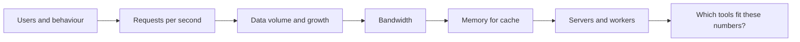
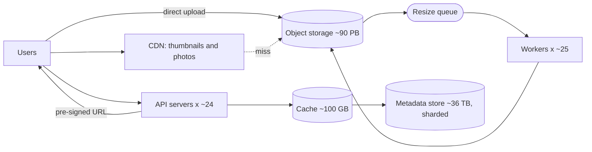
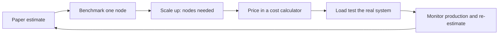

Turning a vague idea into numbers, and the numbers into decisions. This expands the short example in [[1. Fundamentals|Fundamentals]]. The next notes use these numbers to pick tools: [[8. Choosing Data Stores|Choosing Data Stores]] and [[9. Choosing a Language|Choosing a Language]].

## The method



- Every number is an **assumption**: write it down, say it aloud, change it when told otherwise.
- Use round numbers. `86,400 s/day` is about `100,000`, so `per day / 100,000 = per second`.
- Work out **average**, then **peak** (usually 2x to 3x average, more for events like sales or live games).
- Estimate **reads and writes separately**; they scale differently.
- Always finish with *"so what?"*: which design choice does each number force?

## Worked example: a photo app with 10M daily active users

**Assumptions**
```
$ DAU                 = 10,000,000
$ uploads per user    = 2 / day
$ views per user      = 50 photos / day
$ original photo      = 2 MB
$ thumbnail / preview = ~200 KB served in feeds
$ metadata per photo  = ~1 KB (id, owner, url, caption, time, EXIF)
$ keep data           = 5 years
$ peak                = 2 x average
```

### 1. Request rates
```
$ uploads / day   = 10M x 2           = 20M
$ upload QPS      = 20M / 100,000     = ~200 / s   (peak ~400 / s)
$ views / day     = 10M x 50          = 500M
$ view QPS        = 500M / 100,000    = ~5,000 / s (peak ~10,000 / s)
$ read : write    = 5,000 : 200       = 25 : 1   -> read heavy
```
**So what?** Reads dominate, so caching and a CDN come first. Writes (200/s) are small for any database.

### 2. Storage
```
$ originals / day      = 20M x 2 MB          = 40 TB / day
$ originals / 5 years  = 40 TB x 365 x 5     = ~73 PB
$ resized variants     = +25% (3 sizes)      = ~90 PB logical
$ with durability      = x3 copies           = ~270 PB raw
$                        or erasure coding   = ~130 PB raw (about x1.4)
$ metadata / 5 years   = 20M x 365 x 5 = 36.5B rows x 1 KB = ~36.5 TB
```
**So what?**
- 73 PB of blobs cannot live in a database. Use **object storage** (S3, Blob, GCS) and keep only the URL in the database.
- 36.5 TB of metadata and 36.5 billion rows is too big for one ordinary relational server, so plan to **shard** or choose a store built to scale out ([[8. Choosing Data Stores|Choosing Data Stores]]).

### 3. Bandwidth
```
$ ingress   = 200 / s x 2 MB          = 400 MB/s = ~3.2 Gbps  (peak ~6.4 Gbps)
$ egress    = 5,000 / s x 200 KB      = 1 GB/s   = ~8 Gbps    (peak ~16 Gbps)
$ if we served 2 MB originals instead = 10 GB/s  = ~80 Gbps   <- unaffordable
```
**So what?**
- Egress dwarfs ingress: serve from a **CDN**; most views never reach your servers.
- **Generate resized variants** at upload time. Serving originals multiplies bandwidth by 10.
- Large uploads should go **straight to object storage** with pre-signed URLs, so 400 MB/s never passes through your app servers.

### 4. Cache memory (80/20 rule: 20% of items serve 80% of traffic)
```
$ metadata read volume / day = 500M x 1 KB    = ~500 GB
$ hot 20%                    = ~100 GB        -> fits in a few Redis nodes
```
**So what?** A modest cache cluster absorbs most reads. The database sees a small fraction of the 5,000 reads/s.

### 5. Servers and workers (rough, assumes each app server handles ~1,000 simple requests/s)
```
$ API servers  = (10,000 reads + 400 writes) / 1,000   = ~11
$ with 2x headroom + spread across 3 zones             = ~24
$ image resize = 200 / s x 0.5 s CPU each              = 100 cores avg, 200 at peak
$              = ~25 machines of 8 cores, autoscaled on queue length
```
**So what?** Resizing is the expensive part. Put it behind a **queue** with autoscaled workers ([[2. Building Blocks|Building Blocks]]), not in the upload request.

### The resulting design



## Reusable numbers

| Quantity | Rule of thumb |
| -------- | ------------- |
| Seconds per day | 86,400, call it 100,000 |
| Seconds per month / year | ~2.5M / ~30M |
| 1M requests/day | ~12 / s |
| 1B requests/day | ~12,000 / s |
| Peak factor | 2x to 3x average |
| Read:write for social apps | 10:1 to 100:1 |
| Text row | ~1 KB; tweet-like post ~300 B |
| Photo / video / HD movie | ~2 MB / ~50 MB per minute / ~4 GB |
| 1 Gbps | ~125 MB/s |

**Very rough single-machine limits** (order of magnitude, depends on hardware and workload; always measure)

| Component | Ballpark |
| --------- | -------- |
| Web/API server (simple requests) | hundreds to a few thousand req/s |
| Relational DB (one node, indexed key access) | thousands to tens of thousands of simple queries/s; tens of millions to low billions of rows; up to a few TB |
| Redis / Memcached node | ~100,000 ops/s, limited by RAM |
| Kafka broker | hundreds of thousands of msgs/s |
| Single disk | SSD thousands of IOPS and hundreds of MB/s |

Use these to ask: *does one machine handle it, or must I scale out?*

## What the numbers tell you

| If you see... | Then consider |
| ------------- | ------------- |
| Data in TB to PB, files or media | Object storage plus metadata DB |
| Reads far above writes | Cache, CDN, read replicas |
| Writes in tens of thousands/s or more | Partitioned stores, queues, append-only logs ([[8. Choosing Data Stores|Wide-column / time-series]]) |
| Data fits on one machine and < ~1,000 QPS | A single Postgres. Do not over-engineer |
| Spiky traffic | Queues, autoscaling, serverless |
| Global users | CDN, multi-region replicas, GeoDNS |
| Strict correctness (money) | Relational, transactions, strong consistency |
| Heavy CPU per request (video, ML) | Async workers, queue, separate scaling |

## Calculator you can reuse

```python
def size(dau, per_user_writes, per_user_reads, item_bytes, meta_bytes, years, peak=2):
    sec = 100_000
    w = dau * per_user_writes / sec
    r = dau * per_user_reads / sec
    day_bytes = dau * per_user_writes * item_bytes
    return {
        "write_qps": (round(w), round(w * peak)),
        "read_qps":  (round(r), round(r * peak)),
        "storage_PB": day_bytes * 365 * years / 1e15,
        "metadata_TB": dau * per_user_writes * 365 * years * meta_bytes / 1e12,
        "ingress_MBps": w * item_bytes / 1e6,
    }

print(size(10_000_000, 2, 50, 2_000_000, 1_000, 5))
```

## Tools

Estimates tell you where to look; tools tell you if you were right. Workflow: **estimate -> benchmark one node -> multiply -> price it -> load test the whole thing -> monitor and correct.**



| Stage | Tool | Use it for |
| ----- | ---- | ---------- |
| Do the sums | Spreadsheet, Python or a notebook (the calculator above) | Changing one assumption and seeing the effect everywhere |
| Sanity-check latency | "Latency Numbers Every Programmer Should Know" tables | Memory vs SSD vs network costs |
| Benchmark the app | **k6**, **Locust**, **wrk**, **hey**, JMeter, Gatling | Requests/s one server handles; latency under load |
| Benchmark the database | **pgbench** (Postgres), **sysbench**, **YCSB**, `cassandra-stress` | Queries/s and latency on your schema and hardware |
| Benchmark disk and network | **fio**, **iperf3** | IOPS, throughput, bandwidth between machines |
| Price it | AWS Pricing Calculator, Azure Pricing Calculator, Google Cloud Pricing Calculator | Turning "24 servers, 90 PB, 8 Gbps egress" into a monthly bill |
| Measure real usage | Prometheus and Grafana, cloud monitoring dashboards | Replacing assumptions with real QPS, sizes and peaks |
| Right-size containers | Kubernetes HPA/VPA, tools like Goldilocks or Kubecost | CPU and memory requests that match reality |
| Draw it | Mermaid, Excalidraw, draw.io | Showing the design the numbers produced |

**Commands to start with**
```
$ k6 run --vus 100 --duration 30s script.js          # scripted load, JS test files
$ wrk -t4 -c100 -d30s http://localhost:8080/health   # quick HTTP throughput test
$ hey -z 30s -c 50 http://localhost:8080/            # simple load generator
$ locust -f locustfile.py --headless -u 200 -r 20    # Python user-behaviour tests

$ pgbench -i -s 100 appdb                            # create test data (scale 100)
$ pgbench -c 32 -j 4 -T 60 appdb                     # 32 clients, 60 seconds

$ fio --name=randread --rw=randread --bs=4k --size=1G \
      --iodepth=32 --ioengine=libaio --direct=1 --runtime=30 --time_based
$ iperf3 -s                                          # on machine A
$ iperf3 -c <machine-A-ip>                           # on machine B: network speed
```
See also the Linux notes on performance troubleshooting: [[Performance]].

**Little's Law**: the quick formula behind most sizing.
```
$ concurrent requests = arrival rate x time in system
$ 1,000 req/s x 0.1 s  = 100 requests in flight
$ so a server with a 50-connection pool needs 2 servers, or faster queries
```
- If latency doubles under load, concurrency doubles too; this is how small slowdowns cascade into outages ([[4. Reliability Patterns|Reliability Patterns]]).

**Tips**
- Benchmark with **realistic data and request mixes**. An empty database and one endpoint hide most problems.
- Run the load generator on a **separate machine**, or it competes for the same CPU.
- Watch **percentiles (p95, p99)**, not only the average.
- Find the **knee**: raise load step by step until latency climbs sharply. Run at about 50% to 70% of that point for headroom.
- Test the **peak plus failure**: kill a node mid-test.
- Keep results with the hardware and config used so you can compare later.

## Common mistakes

- Estimating only the **average** and not the peak.
- Forgetting **replication** (x3) and **growth** (usage and size rise every year).
- Mixing **bits and bytes** (Gbps vs GB/s).
- Treating storage and **bandwidth** as the same problem.
- Designing for 100x the realistic load on day one. Size for roughly **1 to 2 years ahead** and keep a path to scale.
