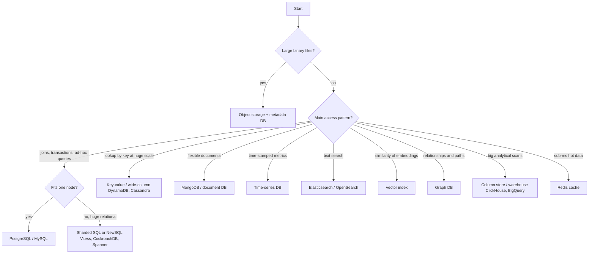
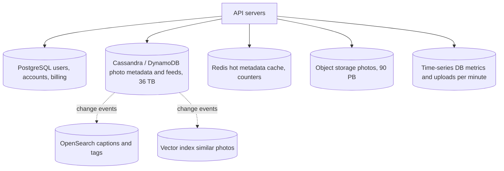

# 08. Choosing Data Stores

How to decide which database (or databases) a system needs, from the numbers in [[7. Capacity Estimation and Sizing|Capacity Estimation]]. General background: [[08. When to use NoSQL vs. relational databases|SQL vs NoSQL]], [[10. Modern Database Trends|Modern Database Trends]], [[05. ACID|ACID]] and [[CAP theorem and its implications]].

## The default

> **Start with PostgreSQL (or MySQL) unless a requirement clearly rules it out.**

- Strong consistency, transactions, joins, constraints, mature tooling, and it scales further than most people expect.
- Add other stores **only when a specific number or access pattern demands it**. Each extra database is more to run, secure, back up and keep in sync.

## Ask these questions first

| # | Question | Why it matters |
| - | -------- | -------------- |
| 1 | What is the **shape** of the data? (rows, documents, graph, time series, vectors, blobs) | Picks the family |
| 2 | How is it **queried**? (by key, range, join, aggregate, full-text, similarity) | The most important question |
| 3 | **Read:write** ratio and write rate? | Write-heavy leads to LSM stores; read-heavy leads to cache and replicas |
| 4 | **Size now and in 5 years?** | Single node or distributed |
| 5 | How strict is **consistency**? (money vs likes) | Transactions vs eventual |
| 6 | **Latency** target? | In-memory vs disk |
| 7 | **Availability and geography**? | Multi-region, no single primary |
| 8 | Team's **skills and operations budget**? | Managed service vs self-run |



## The families at a glance

| Family | Examples | Best for | Weak at |
| ------ | -------- | -------- | ------- |
| **Relational (OLTP)** | PostgreSQL, MySQL, SQL Server | Transactions, joins, reporting, most apps | Writes beyond one node without sharding |
| **NewSQL** | CockroachDB, Spanner, TiDB, Vitess | SQL semantics at horizontal scale | Complexity, cost, latency across regions |
| **Key-value** | Redis, DynamoDB, Memcached | Caches, sessions, counters, simple lookups | Queries beyond the key |
| **Document** | MongoDB, Couchbase | Flexible or nested records, fast iteration | Heavy joins, cross-document transactions |
| **Wide-column** | **Cassandra**, ScyllaDB, HBase, Bigtable | Huge write volume, time-ordered data, multi-region | Ad-hoc queries, joins, changing queries |
| **Time-series** | TimescaleDB, InfluxDB, Prometheus, QuestDB | Metrics, sensors, events with timestamps | General-purpose use |
| **Search** | Elasticsearch, OpenSearch, Meilisearch | Full-text, filters, relevance ranking | Source of truth, transactions |
| **Vector** | pgvector, Qdrant, Milvus, Weaviate, Pinecone | Similarity search over embeddings | Exact-match queries, transactions |
| **Graph** | Neo4j, Neptune | Relationships, paths, recommendations | Bulk scans, simple CRUD |
| **Analytical (OLAP)** | ClickHouse, BigQuery, Snowflake, Redshift | Aggregations over billions of rows | Single-row updates |
| **Object storage** | S3, Azure Blob, GCS | Files, media, backups, data lakes | Queries, small objects, low-latency updates |

Per-family detail: [[Key-value stores]], [[Column-family stores]], [[Document databases]], [[Graph databases]].

## When to reach for Cassandra (or similar wide-column stores)

Cassandra spreads data over many nodes with **no single primary**, writes append to a log (LSM tree) so **writes are very fast**, and every node can accept reads and writes.

**Good fit when most of these are true**
- **Write-heavy**: tens of thousands to millions of writes per second.
- **Lots of data**: many TB to PB, growing continuously.
- **Access by known keys**: "latest N items for user X", "all readings for device Y today".
- **Time-ordered per key** (feeds, messages, events, sensor data).
- **Always available, multi-region**: tolerate node or data-centre loss with no downtime.
- You can accept **eventual or tunable consistency**.

**Poor fit when**
- You need **joins, ad-hoc queries, or many secondary indexes**.
- You need **multi-row ACID transactions**.
- The dataset is small (a single Postgres is simpler and cheaper).
- Your queries change often (you model tables **per query**, so changes mean new tables).
- You lack operations skills (repairs, compaction, tombstones need care). Consider managed options (DynamoDB, Astra, Keyspaces).

```sql
-- Cassandra (CQL): model the table around the query "latest photos for a user"
CREATE TABLE photos_by_user (
  user_id   bigint,
  taken_at  timeuuid,
  photo_id  bigint,
  url       text,
  caption   text,
  PRIMARY KEY ((user_id), taken_at)      -- partition key, clustering key
) WITH CLUSTERING ORDER BY (taken_at DESC);

SELECT * FROM photos_by_user WHERE user_id = 42 LIMIT 20;   -- one partition, fast
```
- **Partition key** decides the node (hashing, see [[3. Data and Consistency|consistent hashing]]); **clustering key** sorts rows inside the partition.
- **Tunable consistency**: `QUORUM` reads and writes (`R + W > N`) give strong reads; `ONE` is fastest but may be stale.
- Avoid huge partitions and hot keys (a celebrity user) by splitting the key, e.g. `(user_id, month)`.

## Time-series databases

Use when data is **append-only, timestamped, queried by time range**, and old data should be **rolled up or expired**.

```
$ sensors              = 10,000 devices x 1 reading / s  = 10,000 writes / s
$ per day              = 10,000 x 86,400 = 864M points   (~17 GB at 20 B each)
$ typical queries      = "average per minute, last 24 h, for device 7"
```
- Features you want: **time partitioning**, compression (10x or more), **continuous aggregates** (hourly rollups), **retention policies** (drop raw data after 30 days), fast `GROUP BY time bucket`.
- **Small scale:** TimescaleDB (a Postgres extension) keeps SQL and joins. **Monitoring:** Prometheus. **Very high ingest or analytics:** ClickHouse or InfluxDB.
- Do not use for: general business data, or data you update in place.

## Vector databases

Store **embeddings** (arrays of numbers produced by an ML model) and find the **nearest** ones: semantic search, "similar photos", recommendations, retrieval for AI assistants (RAG).

```
$ "red sports car" -> embedding model -> [0.12, -0.8, ... 768 numbers]
$ query: nearest 10 vectors by cosine similarity (approximate)
```
- **Approximate nearest neighbour (ANN)** indexes such as **HNSW** or IVF trade a little accuracy for big speed.
- **Start with pgvector** if you already run Postgres and have up to a few million vectors. You keep one database and can filter with normal SQL.
- **Move to a dedicated vector DB** (Qdrant, Milvus, Weaviate, Pinecone) when you have tens to hundreds of millions of vectors, need low-latency filtered search at scale, or heavy update rates.
- Memory is the cost: `1M vectors x 768 dims x 4 bytes = ~3 GB` before the index.

```sql
-- pgvector
CREATE EXTENSION vector;
ALTER TABLE photos ADD COLUMN embedding vector(768);
CREATE INDEX ON photos USING hnsw (embedding vector_cosine_ops);
SELECT id FROM photos ORDER BY embedding <=> '[0.12,-0.8,...]' LIMIT 10;
```

## Other quick calls

- **Cache / counters / leaderboards / rate limits / sessions:** Redis ([[4. Reliability Patterns|rate limiting]]).
- **Full-text search, faceted filters, log search:** Elasticsearch or OpenSearch, fed from the primary DB. It is an index, not the source of truth.
- **Graph traversal** ("friends of friends", fraud rings): graph DB, or recursive SQL for small graphs.
- **Reporting over billions of rows:** column store or warehouse, loaded from the OLTP database (CDC/ETL, see [[09. Advanced Db Concepts|Advanced Db Concepts]]).
- **Files and media:** always object storage, never database BLOBs at scale.

## Polyglot persistence: the photo app

One system, several stores, each for what it does best.



| Data | Store | Why (from the numbers) |
| ---- | ----- | ---------------------- |
| Accounts, payments | PostgreSQL | Small, needs transactions and integrity |
| Photo metadata and feeds | Cassandra or DynamoDB | 36 TB, 36B rows, access by `user_id`, newest first, write-heavy, multi-region |
| Hot reads | Redis | 5,000 reads/s, 100 GB hot set |
| Image files | Object storage | 73 PB cannot sit in a database |
| Search by caption/tag | OpenSearch | Full-text on a copy, rebuilt from the source |
| "More like this" | Vector store (start with pgvector) | Embeddings per photo |
| Operational metrics | Prometheus / Timescale | Timestamped and rolled up |

Keep stores in sync with **events** (queue or change-data-capture), and treat all but one as **derived data** that can be rebuilt.

## Mistakes to avoid

- Picking a database because it is fashionable ("we need NoSQL for scale") with 10 GB of data.
- Using one database for everything **or** five databases for a prototype.
- Treating a search index or cache as the source of truth.
- Choosing Cassandra and then needing joins and ad-hoc reports.
- Ignoring consistency: money and inventory belong in a transactional store.
- Ignoring **operations**: who backs it up, upgrades it, restores it?
- Not testing with realistic data volumes and a **load test** before committing.

## Quick cheat sheet

| Need | Pick |
| ---- | ---- |
| Normal app, unsure | PostgreSQL |
| Same, but outgrew one node | Read replicas, then shard (Vitess, Citus) or CockroachDB |
| Millions of writes/s, partition by key | Cassandra / ScyllaDB / DynamoDB |
| Flexible JSON documents | MongoDB (or Postgres `jsonb`) |
| Cache and counters | Redis |
| Metrics and sensors | TimescaleDB / Prometheus / InfluxDB |
| Text search | OpenSearch / Elasticsearch |
| Similarity search | pgvector first, then Qdrant / Milvus |
| Relationships | Neo4j |
| Analytics | ClickHouse / BigQuery |
| Files | S3 / Blob / GCS |
