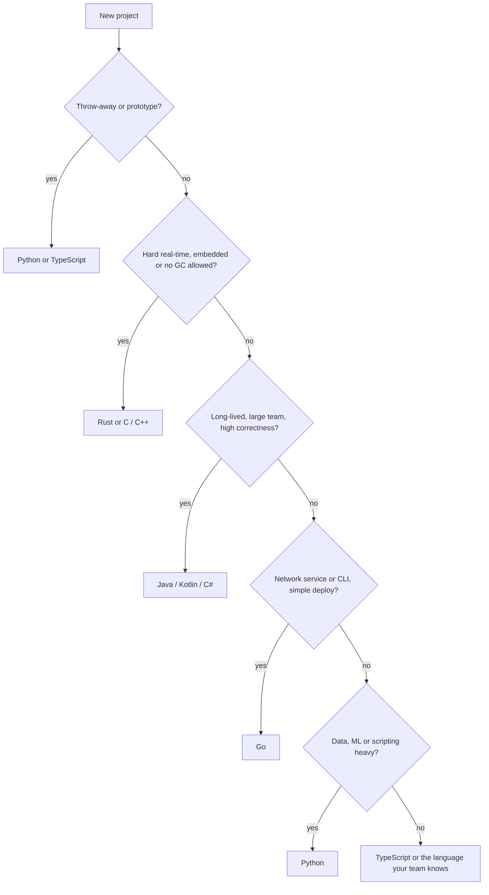
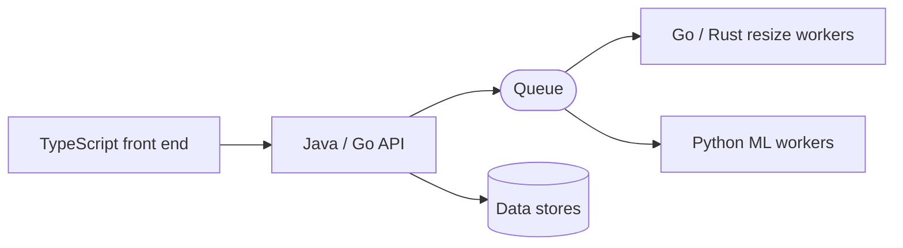

# 09. Choosing a Language

How to pick a programming language for a project: fast to build vs fast to run vs safe to maintain. Language background: [[03. Levels of Programming Languages|Levels of Programming Languages]], [[04. Programming Language Categories|Language Categories]] and the individual notes ([[Python]], [[Java]], [[Go]], [[Rust]], [[C-Sharp]], [[JavaScript]], [[C++]]). Companion notes: [[7. Capacity Estimation and Sizing|Capacity Estimation]], [[8. Choosing Data Stores|Choosing Data Stores]].

## The short answer

| If the project is... | Lean towards |
| -------------------- | ------------ |
| A quick script, prototype, data or ML work | **Python** |
| A long-lived system where correctness and many developers matter | **Java / Kotlin / C#** (static types, mature tooling) |
| A network service or CLI needing simple concurrency and one binary | **Go** |
| Performance and memory safety are both critical | **Rust** |
| Browser UI, or one language across front and back end | **TypeScript** |
| Extreme low-latency, games, drivers, embedded | **C / C++ / Rust** |
| Massive numbers of concurrent connections, fault tolerance | **Elixir / Erlang** (or Go) |
| Statistics and research | **R / Python / Julia** |

## What "better" means

You are trading several things at once:

| Axis | Question |
| ---- | -------- |
| **Speed of development** | How fast can we build and change it? |
| **Runtime speed** | How much CPU and memory per request? |
| **Safety / correctness** | How many bugs does the compiler stop before production? |
| **Concurrency** | How easily can it use many cores and connections? |
| **Ecosystem** | Are there good libraries, frameworks, cloud SDKs? |
| **People** | Can we hire and train for it? Does the team know it? |
| **Operations** | Startup time, memory, deployment size, observability |
| **Lifespan** | Will it be maintained for 10+ years? |

| Language | Time to build | Run speed | Compile-time safety |
| -------- | ------------- | --------- | ------------------- |
| Python | Fastest | Slower | Low (add type hints) |
| JavaScript / Ruby | Fast | Slower to medium | Low |
| TypeScript | Fast | Medium | Medium to high |
| Go | Fast | Fast | Medium |
| Java / C# / Kotlin | Medium | Fast after warm-up | High |
| Rust | Slow (learning curve) | Fastest | Highest |
| C / C++ | Slow | Fastest | Low |

## Language profiles

| Language | Strengths | Watch out for | Typical use |
| -------- | --------- | ------------- | ----------- |
| **Python** | Very fast to write, huge ecosystem (web, data, ML, automation) | Slower at CPU-bound work; threads limited by the GIL; runtime type errors unless you add type hints and tests | Prototypes, scripts, APIs, data science, ML glue |
| **JavaScript / TypeScript** | One language for browser and server; async I/O; TypeScript adds static types | Runtime quirks in plain JS; large dependency trees | Web apps, APIs, tooling |
| **Java** | Mature, statically typed, fast after warm-up (JIT), excellent tooling, huge enterprise ecosystem, long-term stability | Verbose, heavier memory and start-up (improving), slower to prototype | Banking, enterprise back ends, Android, large teams |
| **Kotlin** | Java ecosystem, concise, null-safety | Smaller talent pool than Java | Android, modern JVM services |
| **C#** | Like Java with excellent tooling, strong in Microsoft and game (Unity) worlds | Ecosystem tied to Microsoft in some areas | Enterprise, Windows, games |
| **Go** | Simple, fast compile, built-in concurrency (goroutines), single static binary, small containers | Fewer abstractions, more repetition | Network services, cloud tools, CLIs |
| **Rust** | C-like speed with compile-time memory safety, no garbage-collector pauses | Steep learning curve, slower development | Systems, performance-critical or security-critical code |
| **C / C++** | Maximum control and speed | Manual memory, whole classes of bugs, slower development | OS, engines, embedded, trading |
| **Elixir / Erlang** | Millions of lightweight processes, fault-tolerant "let it crash" model | Smaller ecosystem and talent pool | Chat, messaging, telecom |
| **Ruby** | Productive web development (Rails) | Slower runtime | Startups, web apps |

## Python for quick, Java for long-lived and "strongly error-free"

**Why Python wins for a quick project**
- Less code and no compile step, so ideas become working software in hours.
- Libraries for almost everything (web, data, ML, automation).
- Most web apps spend their time **waiting on databases and networks**, not on CPU, so Python's raw speed rarely matters (large sites have run on Python).
- Cost: errors tend to appear at **runtime**, and CPU-heavy loops are slow.

**Why Java (or C#, Kotlin) wins for a long process with a big team**
- **Static types** catch many mistakes at compile time: wrong types, missing methods, null misuse (more so in Kotlin, or Java with annotations).
- Refactoring is safer: the compiler and IDE show everything affected.
- Mature **build, test, profiling and monitoring** tools; long-term support (LTS) releases.
- Strong concurrency libraries and a fast, tuned runtime (JIT, garbage collection) for **sustained** load.
- Cost: more code and ceremony, slower start.

**Can Python be made safer?** Yes, to a degree:
```
$ add type hints         def total(items: list[float]) -> float: ...
$ run a type checker     mypy src/    (or pyright)
$ lint and format        ruff check . && ruff format .
$ write tests            pytest --cov
$ validate inputs        pydantic models at the boundaries
```
This narrows the gap, but the checks are optional rather than enforced by the language.

**"Almost no runtime errors" ranking (roughly, compile-time guarantees)**

| More guarantees | Languages |
| --------------- | --------- |
| Highest | **Rust**, Ada/SPARK, Haskell/OCaml (strong, expressive types; Rust also prevents data races and memory errors) |
| High | **Java, C#, Kotlin, Swift, TypeScript (strict mode)** |
| Medium | Go (simple types, but nil and some error handling are easy to ignore) |
| Lower | Python, JavaScript, Ruby (types checked at runtime) |
| Lowest safety | C, C++ (manual memory, undefined behaviour) |

Safety-critical domains (aerospace, medical, automotive) often use **Ada, C with strict standards, or Rust**, with formal verification and heavy testing.

## Decision flow



## Rules of thumb

1. **Use what the team already knows** unless there is a strong reason to change. Learning a new language *and* a new problem at once is slow.
2. **Architecture beats language** for performance. Caching, indexes, queues and fewer round trips ([[2. Building Blocks|Building Blocks]]) matter far more than the language, for I/O-bound systems.
3. **Measure first.** Profile before rewriting. Move only the hot path to a faster language (Python calling Rust/C extensions, or a Go microservice for one component).
4. **It is fine to use several.** Python for ML and scripts, Go or Java for services, TypeScript for the front end, joined by APIs and queues.
5. **Check the ecosystem for your need**: a first-class library for your database, cloud, protocol or ML model saves months.
6. **Match the lifespan.** A weekend tool and a 10-year banking platform deserve different choices.
7. **Consider hiring and maintenance**: an exotic language is a risk if its only expert leaves.
8. **Deployment matters**: Go and Rust produce one static binary; JVM and Python need a runtime; containers hide some of that.

## Example: choices for the photo app

| Component | Language | Reason |
| --------- | -------- | ------ |
| First prototype of upload and feed | Python (FastAPI/Django) | Ship in days; the load is tiny |
| Core API at 10,000 reads/s | Java/Kotlin or Go | Steady throughput, strong typing, many developers |
| Image resize workers | Go or Rust (or Python calling libvips) | CPU-bound; native speed matters |
| ML tagging and embeddings | Python | The ML ecosystem lives there |
| Web and mobile front end | TypeScript, Swift/Kotlin | Platform standards |
| Payments | Java/C# with strict review | Correctness over speed of change |



## Mistakes to avoid

- Choosing by benchmark headlines instead of your workload.
- Rewriting a working system in a "faster" language when the database was the bottleneck.
- Picking a language only to look modern.
- Ignoring the cost of **maintaining** code in many languages.
- Using a dynamically typed language for a huge long-lived codebase **without** tests, type hints and CI ([[1. CI-CD Pipelines|CI/CD]]).
- Underestimating Rust and C++ learning curves for a deadline-driven project.
