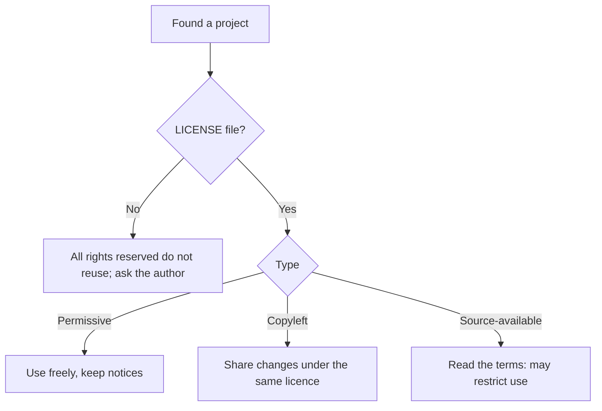

What open source actually means, how licences work, and the habits that make a project (yours or someone else's) safe to use. Other notes in this section: [[2. Contributing Etiquette|Contributing Etiquette]], [[3. Running a Project|Running a Project]], [[4. Versioning and Releases|Versioning and Releases]], [[5. Security and Supply Chain Hygiene|Security and Supply Chain Hygiene]].

**Sources used:** the Open Source Guides, choosealicense.com, Keep a Changelog, Semantic Versioning, Conventional Commits, Contributor Covenant, GitHub community docs and the OpenSSF Scorecard checks. Not legal advice.

## The core idea

- Code is **copyright-protected by default**. Nobody may use, copy, change or share it without permission.
- A **licence** is that permission. No licence file means others have **no rights** to reuse your code, even if the repo is public.
- A public GitHub repo is only *visible* and forkable; it is **not** licensed.
- Use a **standard licence** (MIT, Apache-2.0, GPL...) so people instantly know what they may do. Custom terms put people off and cause legal reviews.



## Common licences

| Licence | Type | You may | You must | Notes |
| ------- | ---- | ------- | -------- | ----- |
| **MIT** | Permissive | Use commercially, modify, distribute, sublicense | Keep copyright and licence notice | Short and simple, very common |
| **Apache-2.0** | Permissive | Same, plus explicit **patent grant** | Keep notices, state changes | Good for companies; has a trademark clause |
| **BSD (2/3-clause)** | Permissive | Same as MIT | Keep notice | 3-clause adds "no endorsement" |
| **MPL-2.0** | Weak copyleft (per file) | Mix into any project | Share changes to MPL **files** | Middle ground |
| **LGPL-3.0** | Weak copyleft (libraries) | Link from any project | Share changes to the library | For libraries |
| **GPL-3.0** | Strong copyleft | Use, modify, distribute | Release source of the **whole combined work** under GPL | Derivatives stay open |
| **AGPL-3.0** | Strongest copyleft | Same as GPL | Also share source if users use it **over a network** | Closes the SaaS loophole |
| **Unlicense / CC0** | Public-domain style | Anything | Nothing | CC0 is for non-code too |
| **BSL, SSPL** | Source-available | Read the code | Follow usage limits | Often **not** OSI open source |

**Simple chooser**
```
$ want maximum adoption, little friction?           -> MIT
$ want adoption plus a patent grant?                -> Apache-2.0
$ want improvements always shared back?             -> GPL-3.0 (AGPL-3.0 for network services)
$ a library others link into closed-source apps?    -> LGPL-3.0 or MPL-2.0
```

## Do and don't

**Do**
- Put a `LICENSE` file at the repo root, with the full licence text and the **year and holder** filled in.
- Add an **SPDX identifier** in package metadata, e.g. `license = "MIT"` (`pyproject.toml`) or `"license": "Apache-2.0"` (`package.json`).
- Check the licences of **dependencies** before choosing yours. A GPL dependency can force your project to be GPL-compatible.
- Check licences of **non-code assets** too: fonts, icons, images, datasets, and AI models can carry extra terms (Creative Commons variants, non-commercial clauses).
- Keep the original copyright notice when you reuse permissive code.

**Don't**
- Publish code with no licence and expect people to reuse it.
- Copy code from a project with no licence into yours.
- Write your own licence.
- Strip another author's copyright notice.
- Assume "free to download" means "free to use commercially".
- **Change a licence casually.** Adding a licence to an unlicensed project, or relicensing, needs agreement from all copyright holders (unless a contributor agreement already allows it).

## Checking what you depend on

```
$ pip-licenses --format=markdown          # Python deps and their licences
$ npx license-checker --summary           # Node deps
$ cargo install cargo-license && cargo license
```
- Keep a short list of **allowed** licences (MIT, Apache-2.0, BSD) and flag anything else for review.
- Related: [[5. Security and Supply Chain Hygiene|Security and Supply Chain Hygiene]] and [[5. Secure Coding and Supply Chain|Secure Coding and Supply Chain]].

## Who owns contributions?

| Option | Meaning | Use when |
| ------ | ------- | -------- |
| **Inbound = outbound** (default) | Contributors licence their work under the project's licence just by submitting | Most projects; GitHub's terms make this the default |
| **DCO** (Developer Certificate of Origin) | Each commit says `Signed-off-by:` to certify the right to submit it | You want a light check with no paperwork |
| **CLA** (Contributor Licence Agreement) | Signed agreement, sometimes with a patent grant and relicensing rights | Companies needing a dual or proprietary edition |

```
$ git commit -s -m "fix: handle empty input"
# adds:  Signed-off-by: Your Name <you@example.com>
```

## Contributing from a job

- Check your **employment agreement**: your employer may own what you write, especially if it relates to their business or uses their equipment.
- Before open-sourcing company code, check third-party licences, trade secrets, patents, trademarks, and anything that collects user data.
