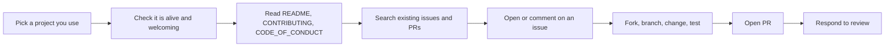

# 02. Contributing Etiquette

The unwritten rules of taking part in somebody else's project. Back to [[1. Open Source Fundamentals|Fundamentals]]. The maintainer's side is in [[3. Running a Project|Running a Project]].

## Before you start



**Is the project healthy?**
- Recent commits and releases.
- Issues and PRs get replies, and PRs are reviewed and merged.
- Maintainers are polite and thank contributors.
- It has a licence ([[1. Open Source Fundamentals|Fundamentals]]).

**Read the orientation files first:** `README`, `CONTRIBUTING.md`, `CODE_OF_CONDUCT.md`, and any PR or issue templates. They tell you the commit style, test commands and what the maintainers will not accept.

**Find a first task:** look for labels like `good first issue` and `help wanted`, or fix docs, typos and broken links. Watch the repo for a while to learn how people talk.

## General etiquette

| Do | Don't |
| -- | ----- |
| Give context: what you tried, why it matters | Post "X is broken, please fix" |
| Search docs and old issues before asking | Ask what the README already answers |
| Keep messages short and direct | Write walls of text |
| Keep discussion **public** | DM maintainers to chase a review |
| Assume good intent, stay civil | Argue or get hostile after a "no" |
| Respect the maintainers' final decision (you can fork) | Demand a feature |
| Be patient; they are often volunteers | Expect instant replies |
| Thank people for their time | Ghost after opening a PR |

## Good issues

Include these, in this order:

```markdown
**What I expected**
**What happened** (exact error text)
**Steps to reproduce** (minimal example)
**Environment** (OS, language/runtime version, project version)
**What I already tried**
```

- One problem per issue.
- Use a **minimal reproducible example**, not your whole app.
- Comment on an issue **before** starting work so two people do not do the same job.
- Close issues you solved yourself, and say how.
- **Security problems are not public issues.** See [[5. Security and Supply Chain Hygiene|Security and Supply Chain Hygiene]].

## Good pull requests

- **Small and focused:** one change per PR. Typos and obvious fixes can go straight in; anything large should be **discussed in an issue first**.
- **Link the issue:** `Closes #37` in the description.
- **Explain the why**, not just the what. Add before/after screenshots for UI changes.
- **Follow the project's style**, formatter, templates and commit convention (see [[4. Versioning and Releases|Versioning and Releases]]).
- **Add or update tests** and docs; run the tests locally first.
- **Sync with upstream** often so you avoid merge conflicts.
- **Open early as a draft** if you want feedback before it is finished.

```
$ git clone https://github.com/you/project && cd project
$ git remote add upstream https://github.com/owner/project
$ git switch -c fix/empty-input
# ...edit, test...
$ git commit -m "fix: handle empty input"
$ git fetch upstream && git rebase upstream/main
$ git push -u origin fix/empty-input        # then open the PR
```

## After you submit

- Reply to feedback promptly; ask if a request is unclear.
- Do not take review comments personally; they are about the code.
- If there is no reply after about a week, **politely ping in the same thread**.
- If you cannot finish, say so, so someone else can pick it up.
- A rejection is about fit, not about you. Thank them and move on.

## AI-assisted contributions

- You are **responsible for everything you submit**, whoever or whatever wrote it.
- Read, run and understand AI-generated code before opening the PR.
- Do not paste unverified output or invented API calls.
- Follow any project policy about AI use; some projects ask you to disclose it.
- Check licensing: do not submit code you cannot show you have the right to contribute.

## Common mistakes

- Opening a huge unrequested refactor.
- Mixing unrelated changes (formatting plus a bug fix) in one PR.
- Ignoring the PR template or failing CI.
- Force-pushing over review history without saying so.
- Reformatting files you did not need to touch.
- Copying code from elsewhere without checking its licence.
