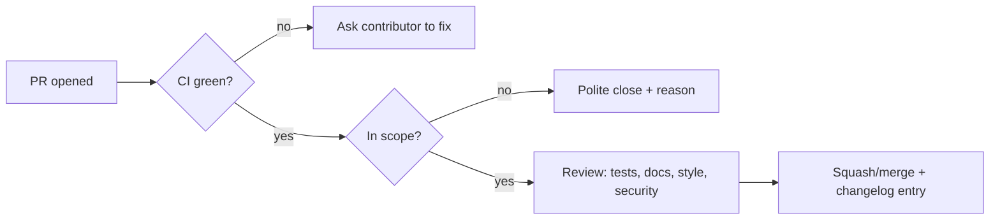

# 03. Running a Project

How to set up and look after a project so other people can use and help with it. Back to [[1. Open Source Fundamentals|Fundamentals]]; the contributor's view is in [[2. Contributing Etiquette|Contributing Etiquette]].

## Repository checklist

```
project/
├── README.md             what it is, install, quick start
├── LICENSE               full licence text, year, holder
├── CONTRIBUTING.md       how to propose and submit changes
├── CODE_OF_CONDUCT.md    expected behaviour
├── SECURITY.md           how to report vulnerabilities
├── CHANGELOG.md          what changed per version
├── .github/
│   ├── ISSUE_TEMPLATE/   bug and feature forms
│   ├── PULL_REQUEST_TEMPLATE.md
│   ├── CODEOWNERS        who reviews which paths
│   ├── dependabot.yml    automated dependency updates
│   └── workflows/        CI (tests, lint, release)
└── docs/ or examples/
```

| File | What goes in it |
| ---- | --------------- |
| **README** | One-line purpose, install, minimal example, where to get help, licence badge |
| **LICENSE** | Standard text, not custom |
| **CONTRIBUTING** | Dev setup, how to run tests, commit/branch style, review process, what is out of scope |
| **CODE_OF_CONDUCT** | Standards and who to contact; the **Contributor Covenant** is the usual base |
| **SECURITY** | Supported versions and a private way to report ([[5. Security and Supply Chain Hygiene|Security]]) |
| **SUPPORT** | Where to ask questions (Discussions, chat) so issues stay for bugs |
| **CHANGELOG** | Human-written release notes ([[4. Versioning and Releases|Versioning]]) |

**Org-wide defaults:** a **public repo named `.github`** under your account supplies default community files (CONTRIBUTING, CODE_OF_CONDUCT, SECURITY, SUPPORT, templates, FUNDING) for every repo that lacks its own. The **LICENSE must live in each repo**. If a repo has its own issue templates, none of the defaults apply.

## A good README

```markdown
# Project name
One sentence: what it does and who it is for.

## Install
    pip install project

## Quick start
    from project import run
    run("hello")

## Documentation / Support / Contributing / Licence
```
- Show the **shortest working example** near the top.
- State what the project does **not** do.
- Keep it accurate; verify claims against the real repo (commands, file names).

## Contributor Covenant in brief

- **Expected:** empathy and kindness, respect for different views, graceful feedback, owning mistakes, putting the community first.
- **Not acceptable:** sexualised language, trolling and insults, harassment, publishing private information, anything unprofessional.
- **Enforcement ladder:** correction (private warning) -> warning -> temporary ban -> permanent ban.
- A code of conduct only works if someone is **named to receive reports**.

## Day-to-day habits

**Do**
- Write down the project's **vision and scope** so "no" is easy to explain.
- Document how PRs are reviewed and how fast people can expect a reply.
- Move private questions into **public** channels so answers help everyone.
- Use **templates** to get complete bug reports.
- **Automate**: tests, lint, dependency updates, release notes, stale-issue cleanup.
- Require **passing checks and a review** before merge (branch protection).
- Label issues (`good first issue`, `help wanted`, `bug`, `needs repro`).
- Share ownership: give active contributors more responsibility.
- Say when you are away or short of time.

**Don't**
- Leave issues and PRs to rot; close what you will not do.
- Accept changes you do not believe improve the project.
- Over-engineer rules and tooling so contributing becomes a chore.
- Tolerate abuse. Remove people who will not collaborate.
- Feel guilty about stepping back; burnout kills projects.

## Saying no

```
Thanks for taking the time to send this. We are keeping the core small,
so we will not add this feature here. It would work well as a plugin; see
docs/plugins.md. Closing, but happy to help if you build one.
```
- Thank them, give a one or two sentence reason, link to docs.
- Be kind and firm; do not leave it open out of guilt, and do not ignore it.

## Review checklist (maintainer)



## Handing over

- Keep docs good enough that someone else could take over.
- Add co-maintainers early; document how people become one.
- If you step away, say so clearly, archive the repo or name a successor, and point to maintained forks.
