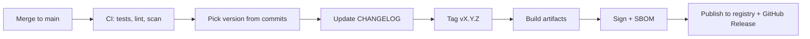

# 04. Versioning and Releases

How to number, describe and ship releases so users can upgrade safely. Back to [[1. Open Source Fundamentals|Fundamentals]]; pipelines are in [[1. CI-CD Pipelines|CI/CD Pipelines]] and [[2. GitHub Actions|GitHub Actions]].

## Semantic Versioning (SemVer): `MAJOR.MINOR.PATCH`

| Bump | When | Example |
| ---- | ---- | ------- |
| **MAJOR** | Incompatible public API change | `2.4.1` -> `3.0.0` |
| **MINOR** | Backward-compatible new feature (or a deprecation) | `2.4.1` -> `2.5.0` |
| **PATCH** | Backward-compatible bug fix | `2.4.1` -> `2.4.2` |

- Lower numbers reset when a higher one increases (`2.4.1` -> `3.0.0`, not `3.4.1`).
- **`0.y.z`** is initial development: anything may change. Releasing **`1.0.0`** declares a stable public API. If people already rely on it in production, it should probably be 1.0.0.
- **Released versions are immutable.** Never edit a published version; publish a new one.
- **Pre-release** labels: `1.0.0-alpha.1 < 1.0.0-beta < 1.0.0-rc.1 < 1.0.0`.
- **Build metadata** `1.0.0+20260301` is ignored when comparing versions.
- **Deprecate before you remove:** ship a MINOR release that deprecates a feature, keep it for at least one minor release, then remove it in the next MAJOR.
- Accidentally broke something in a MINOR? Release a new MINOR that restores compatibility; do not rewrite the old one.

```
$ 1.4.0  adds a new function           -> MINOR
$ 1.4.1  fixes a crash                 -> PATCH
$ 1.5.0  deprecates old_func()         -> MINOR (document it)
$ 2.0.0  removes old_func()            -> MAJOR
```

### What counts as the "public API"?
Anything users depend on: functions and classes, CLI flags, config keys, file formats, HTTP endpoints, and documented behaviour. Define it in the docs, otherwise anything can be argued to be a breaking change.

## Conventional Commits

A commit format that tools can read, so releases and changelogs can be automated.

```
<type>[optional scope][!]: <description>

[optional body]

[optional footer(s)]
```

| Type | Meaning | SemVer effect |
| ---- | ------- | ------------- |
| `feat` | New feature | MINOR |
| `fix` | Bug fix | PATCH |
| `docs`, `style`, `refactor`, `perf`, `test`, `build`, `ci`, `chore` | Other work | none by default |
| any type with `!` or `BREAKING CHANGE:` footer | Breaking change | **MAJOR** |

```
feat(api): add pagination to /users
fix: prevent racing of requests
feat!: drop support for Node 18

BREAKING CHANGE: `extends` key in config is now used for extending other configs
```

**Good commits**
- Short imperative summary under about 70 characters, with the body explaining **why**.
- One logical change per commit.
- Reference issues in footers: `Refs: #123`, `Closes #37`.

**Avoid:** "fix stuff", "wip", "final final v2", giant commits that mix many changes.

## Changelogs (Keep a Changelog)

Write for **humans**, not machines. Name the file `CHANGELOG.md`, newest version first, with an `Unreleased` section at the top.

```markdown
# Changelog
All notable changes to this project are documented here.
The format is based on Keep a Changelog, and this project follows Semantic Versioning.

## [Unreleased]

## [1.1.0] - 2026-10-29
### Added
- Pagination for the users endpoint.
### Deprecated
- `old_func()`, use `new_func()` instead.
### Fixed
- Crash when the input file is empty.

## [1.0.0] - 2026-09-01
- Initial stable release.
```

| Section | Meaning |
| ------- | ------- |
| **Added** | New features |
| **Changed** | Changes to existing behaviour |
| **Deprecated** | Will be removed soon |
| **Removed** | Now removed |
| **Fixed** | Bug fixes |
| **Security** | Vulnerability fixes |

**Do:** list every version; use ISO dates (`YYYY-MM-DD`); call out breaking changes and deprecations; make version headings link to the diff; mark pulled releases `[YANKED]`.
**Don't:** paste raw `git log`; skip deprecation notices; use ambiguous dates (`03/04/05`); record only some changes.

## Release flow



```
$ git tag -a v1.1.0 -m "v1.1.0"
$ git push origin v1.1.0
$ gh release create v1.1.0 --notes-file RELEASE_NOTES.md dist/*
```

- Tag with a leading `v` (`v1.1.0`) and keep tags matching published versions.
- Never move or delete a published tag; a bad release is **yanked** and superseded.
- Automate with tools such as release-please, semantic-release or changesets, which read Conventional Commits to bump versions and write notes.
- Sign tags and artifacts when you can ([[5. Security and Supply Chain Hygiene|Security and Supply Chain Hygiene]]).

## Versioning for users of libraries

- **Pin or range your dependencies sensibly:** exact pins for applications, compatible ranges for libraries (`>=1.2,<2`, `^1.2.0`, `~=1.2`).
- Commit **lockfiles** for applications so builds are repeatable.
- Read the changelog before a MAJOR upgrade.
