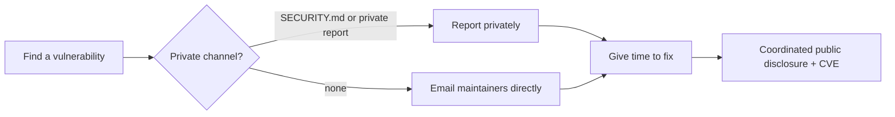

Security habits that every open-source project (and every project that depends on one) should follow. Back to [[1. Open Source Fundamentals|Fundamentals]]. Deeper coverage: [[5. Secure Coding and Supply Chain|Secure Coding and Supply Chain]].

## Reporting a vulnerability (as a finder)



**Do**
- **Never open a public issue** for a vulnerability.
- Read `SECURITY.md`; use GitHub's **private vulnerability reporting** or the listed email.
- Include affected versions, impact, and minimal steps to reproduce.
- Give maintainers a reasonable window to fix before going public (90 days is a common norm).
- Test only on systems you own or have permission to test.

**Don't:** publish proof-of-concept exploits first, demand payment, or access other people's data.

## Handling reports (as a maintainer)

- Add a **`SECURITY.md`** with the supported versions and how to report. Turn on private vulnerability reporting.
- Acknowledge quickly, fix in private, release a patch, then publish an **advisory** (and request a **CVE** when warranted).
- Record the fix under **Security** in the changelog ([[4. Versioning and Releases|Versioning and Releases]]).

```markdown
# Security Policy

## Supported versions
| Version | Supported |
| ------- | --------- |
| 2.x     | yes       |
| 1.x     | security fixes only |

## Reporting a vulnerability
Please do not open a public issue. Use "Report a vulnerability" under the
Security tab, or email security@example.com. We aim to reply within 3 days.
```

## Secrets and repo hygiene

- Never commit keys, tokens, passwords or `.env` files. Use a **`.gitignore`** and a secret scanner (push protection, gitleaks).
- If a secret leaks: **rotate it first**, then clean history. Deleting the commit does not un-leak it.
- Do not commit **binaries** you cannot review; build from source in CI.
- Keep personal or private material out of public repos; check `git ls-files` before publishing.

## Dependencies

| Practice | Why |
| -------- | --- |
| **Automated updates** (Dependabot, Renovate) | Stay patched with small reviewable PRs |
| **Lockfiles** | Repeatable builds |
| **Pin versions/hashes** in build and CI | A moved tag or hijacked package cannot change your build |
| **Fewer dependencies** | Smaller attack surface |
| **Audit** (`npm audit`, `pip-audit`, `cargo audit`, OSV) | Find known vulnerabilities |
| **Check the package name** | Avoid typosquatting and dependency confusion |
| **SBOM** (SPDX or CycloneDX) | A list of what is inside a release |

```
$ pip-audit
$ npm audit --omit=dev
$ osv-scanner --lockfile=package-lock.json
```

## Securing the project itself

- **Branch protection** on the default branch: no force-push or deletion, require reviews and passing checks.
- **Code review** by a human on every change.
- **Least-privilege CI tokens:** set `permissions:` in workflows to the minimum.
- Pin third-party actions to a **commit SHA**, and never run untrusted PR code with secrets.
- Use **2FA** for every maintainer and registry account; prefer short-lived or trusted-publishing credentials over long-lived tokens.
- **Sign releases** (Sigstore/cosign, GPG) and publish provenance.
- Run **static analysis** (CodeQL) and consider fuzzing for parsers.

```yaml
# .github/workflows/ci.yml
permissions:
  contents: read          # default to read-only
jobs:
  test:
    runs-on: ubuntu-24.04
    steps:
      - uses: actions/checkout@<full-commit-sha>   # pinned, not @main
```
See [[3. GitHub Actions Deep Dive|GitHub Actions Deep Dive]] for workflow security.

## Scorecard: a checklist of what good looks like

The OpenSSF Scorecard grades a repo on automatic checks. Use it as a to-do list.

| Check | Meaning |
| ----- | ------- |
| Binary-Artifacts | No unreviewable binaries committed |
| Branch-Protection | Default branch protected |
| CI-Tests | Tests run on PRs |
| Code-Review | Changes reviewed by a human |
| Contributors | Several contributors or organisations |
| Dangerous-Workflow | No risky Actions patterns |
| Dependency-Update-Tool | Dependabot or Renovate on |
| Fuzzing | Fuzz or property tests |
| License | Recognised licence file |
| Maintained | Recent activity |
| Packaging | Published through a package manager |
| Pinned-Dependencies | Build deps pinned |
| SAST | Static analysis runs |
| SBOM | Bill of materials published |
| Security-Policy | `SECURITY.md` present |
| Signed-Releases | Artifacts signed or with provenance |
| Token-Permissions | Least-privilege workflow tokens |
| Vulnerabilities | No known unfixed vulnerabilities |
| Webhooks | Secrets on webhooks |

```
$ scorecard --repo=github.com/owner/project
```

## Quick "is this safe to depend on?" check

1. Licence compatible with yours?
2. Recent releases and commits? More than one maintainer?
3. Open security advisories or unpatched issues?
4. Download count and reputation (not just stars)?
5. Does it do more than it should (install scripts, network calls)?
6. Is the package name exactly right?
