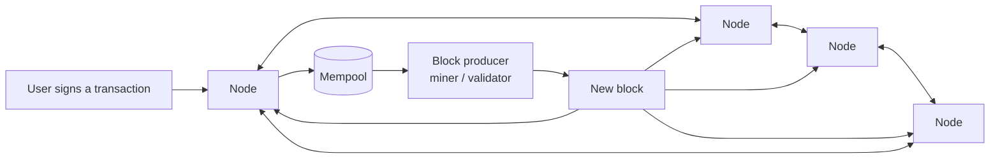
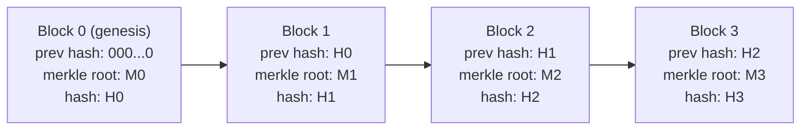
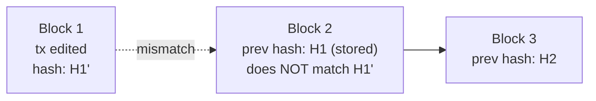
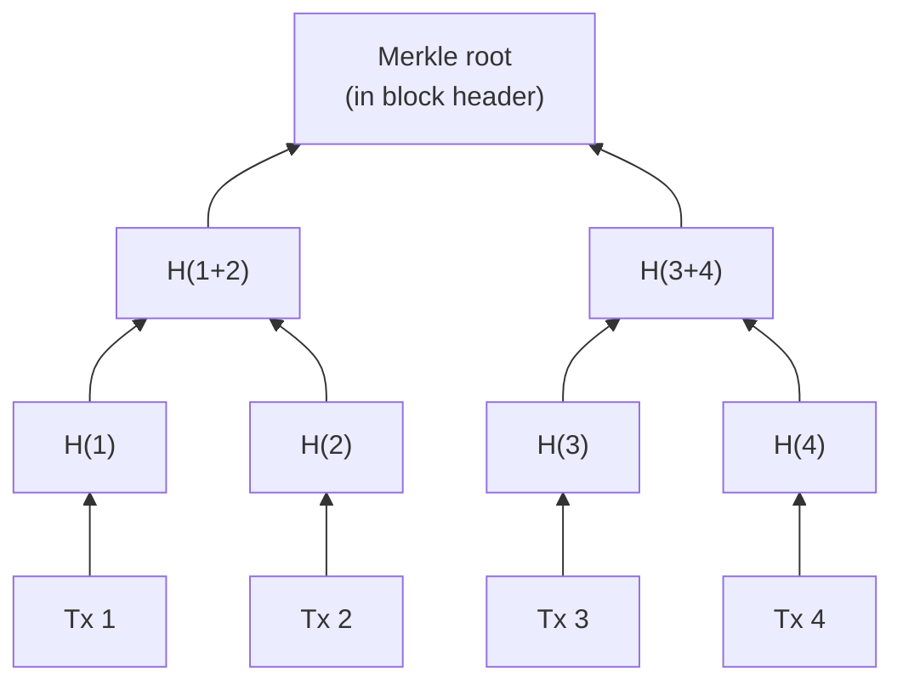
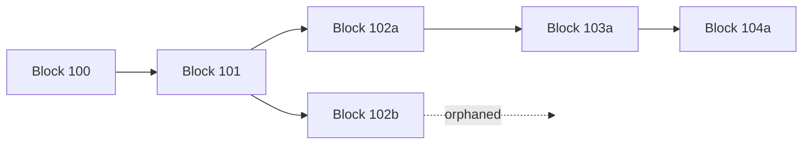
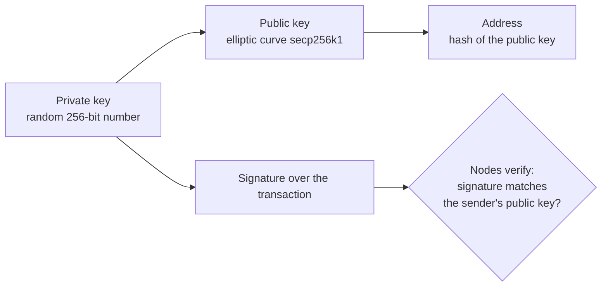

# 01. Blockchain Fundamentals

What a blockchain is, how blocks are chained, and how a network of strangers agrees on one history. What is inside a transaction and a block, byte by byte, is in [[2. What Travels the Chain|What Travels the Chain]]; a runnable toy chain and the step-by-step journey of transactions and blocks are in [[3. How the Chain Moves|How the Chain Moves]].

## Terms at a glance

| Term | Meaning |
| ---- | ------- |
| **Ledger** | An append-only record of who owns what / what happened |
| **Transaction** | A signed instruction (move value, call a contract) |
| **Block** | A batch of transactions plus a header that links to the previous block |
| **Hash** | A fixed-size fingerprint of data (SHA-256, Keccak-256). Change one bit and the whole hash changes |
| **Merkle tree** | Hashes of hashes, so one root hash commits to every transaction in a block |
| **Node** | A computer running the protocol, holding the chain and checking every rule |
| **Consensus** | The rule for agreeing which block comes next (proof of work, proof of stake) |
| **Mempool** | Each node's waiting room of valid but not-yet-included transactions |
| **Wallet** | Software holding a private key; it signs, it does not "store coins" |
| **Smart contract** | Code stored on the chain and run by every node (Ethereum and similar) |

---

# The Idea in One Picture

A database that nobody owns. Every node keeps a full copy and re-checks every rule, so no single party can rewrite history.

---

# How Blocks Are Chained

Each block header contains the **hash of the previous block's header**. That hash covers everything in that block, including *its* previous-hash, so the chain of references runs all the way back to the first (genesis) block.

## Why tampering is obvious

Change one transaction in Block 1 and its Merkle root changes, so its header hash changes, so Block 2's "prev hash" no longer matches, and so on for every later block. An attacker would have to redo the work (or control the stake) for **every block after the edit**, faster than the honest network adds new ones.

> Immutability is economic, not magical: the data is not impossible to change, it is too expensive to change once enough blocks sit on top (finality).

---

# Merkle Trees

Transactions are not hashed as one blob. They are hashed in pairs, repeatedly, up to one **Merkle root** stored in the header.

Benefit: a light client can prove "Tx 3 is in this block" with just the sibling hashes along the path (`H(4)`, `H(1+2)`) and the header, without downloading the block. Bitcoin duplicates the last hash when a level has an odd count; Ethereum uses a Merkle-Patricia trie instead (see the next note).

---

# Forks and Which Chain Wins

Two producers can find a valid block at nearly the same time. Nodes keep both briefly, then follow the rule for the "best" chain; the loser's block becomes **orphaned / uncled** and its transactions return to the mempool.

| Chain | Rule for the best chain |
| ----- | ----------------------- |
| Bitcoin (proof of work) | The chain with the most accumulated work (usually the longest) |
| Ethereum (proof of stake) | LMD-GHOST fork choice plus Casper FFG finality: validators vote, and a block becomes final after two epochs (about 13 minutes) |

---

# Consensus: Proof of Work vs Proof of Stake

| | Proof of work | Proof of stake |
| - | ------------- | -------------- |
| Who proposes a block | Whoever finds a hash below the target first | A validator chosen pseudo-randomly, weighted by stake |
| Cost of attacking | Hardware and electricity | Losing staked coins (slashing) |
| Energy use | Very high | Roughly 99% lower |
| Examples | Bitcoin | Ethereum (since September 2022, "the Merge"), Solana, Cardano |
| Header carries | A `nonce` that was ground until the hash is under the target | A proposer signature and attestations from other validators |

Proof of work in a sentence: change the `nonce`, hash the 80-byte header, repeat until the result is numerically below the `target`. Verifying takes one hash; finding takes trillions.

---

# Public Keys, Addresses and Signatures

Ownership is just knowing a private key.

- Bitcoin: address = encoded `RIPEMD160(SHA256(pubkey))` (or a taproot key)
- Ethereum: address = last 20 bytes of `Keccak256(pubkey)`, usually shown as `0x...` (40 hex characters)
- The signature proves you authorised *this exact transaction*; change any field and it no longer verifies
- Lose the key and nobody can recover the funds; leak it and anybody can spend them

---

# Chain Types

| Type | Who can join | Examples |
| ---- | ------------ | -------- |
| **Public** | Anyone reads, writes and validates | Bitcoin, Ethereum |
| **Layer 2 rollup** | Posts compressed batches to a public chain for security | Arbitrum, Optimism, Base |
| **Permissioned / consortium** | Approved organisations only | Hyperledger Fabric, R3 Corda |

Rule of thumb: if one trusted party could run the database, use a database ([[10. Modern Database Trends|Modern Database Trends]]). A chain earns its cost only when several parties who do not trust each other must share one record.

---

# Recall Questions

1. What exactly does a block header's "previous hash" cover, and why does that make old blocks tamper-evident?
2. Why can a light client verify a transaction without the whole block?
3. What decides which of two competing blocks survives?
4. Is a wallet storing your coins? What does it hold?
5. When is a database a better answer than a blockchain?
