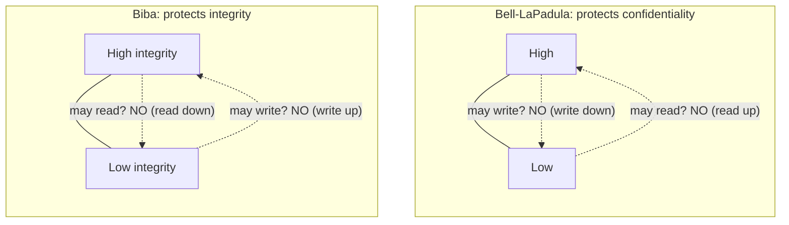
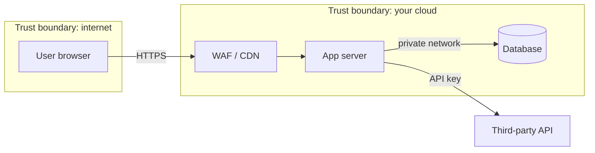
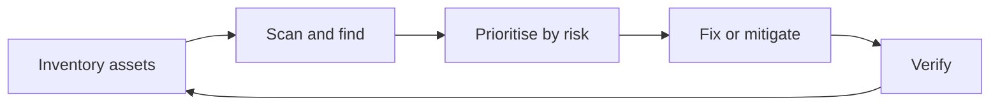

# 01. Security Fundamentals

The ideas every other security note builds on. Specifics are in [[2. Web Application Security|02. Web Application Security]], [[3. HTTP Security Headers and CSP|03. HTTP Security Headers and CSP]], [[6. Cloud Security|06. Cloud Security]] and [[5. Secure Coding and Supply Chain|05. Secure Coding and Supply Chain]].

## Principles at a glance

| Principle | Meaning | Example |
| --------- | ------- | ------- |
| **CIA triad** | Keep data **confidential**, keep it **intact**, keep it **available** | Encrypt (C), checksum / sign (I), backups and redundancy (A) |
| **Least privilege** | Give only the access a job needs, for as long as it needs it | A deploy role that can write one bucket, not `*` |
| **Defence in depth** | Layer controls so one failure is not a breach | WAF + input validation + parameterised queries + DB user with limited rights |
| **Secure by default** | The safe setting is the default one | New buckets private, new users have no access |
| **Fail closed** | On error, deny | Auth service down means "no", not "yes" |
| **Zero trust** | Never trust by network location; verify every request | Identity-aware access instead of "inside the VPN" |
| **Separation of duties** | No single person can do and approve | Author cannot merge to production alone |
| **Minimise attack surface** | Remove what you do not need | Close unused ports, delete unused accounts, drop unused dependencies |

---

# AAA: Who, What, Prove It

| Step | Question | Examples |
| ---- | -------- | -------- |
| **Authentication** | Who are you? | Password + MFA, passkeys, certificates, OIDC |
| **Authorisation** | What may you do? | RBAC, ABAC, policies, scopes |
| **Accounting / audit** | What did you do? | Audit logs, CloudTrail, activity logs |

- **MFA everywhere** that matters (admin, cloud console, email, source control). Prefer passkeys or authenticator apps over SMS
- Store passwords only as **slow salted hashes** (Argon2id, bcrypt, scrypt, PBKDF2), never encrypted or plain
- Authentication proves identity; **check authorisation on every request on the server**, not in the UI

## Passwords and human factors

Security fails at the human edge more often than in the cipher. Passwords are a poor mechanism for how memory works: people cannot remember rarely used or frequently changed items, cannot forget on demand, and find recall harder than recognition.

A password system is more than a login box:
- registration and strength checking
- **recovery** (security questions, email, SMS), which is often the easier route in for an attacker than guessing the password
- the protocol that checks the password, and synchronisation across devices
- intrusion detection (a login from an unusual place) and single sign-on

Points that hold up in practice:
- **Recovery is part of the attack surface.** SMS codes are exposed to SIM-swap fraud, where an attacker convinces the phone company they lost the phone
- **Protect the stored form.** Combine the password with a random salt, run it through a slow cryptographic one-way function, and store both the salt and the hash. Old Unix kept a world-readable password file that anyone could dictionary-attack
- **Failed-login logs leak passwords**: users type the username and password out of phase, so a log entry for a non-existent username may be a real password. Protect the logs
- **Password managers** are a pragmatic answer: random passwords per site, and the browser only fills a matching address. Costs: a forgotten master password, everything exposed at once if the manager is compromised, and a master password that is not always set by default
- Outsourcing identity management to a large provider can make sense, because intrusion detection works best at scale

## Access control models

| Model | Who decides | Idea |
| ----- | ----------- | ---- |
| **Discretionary (DAC)** | The owner (Unix file permissions) | Users set access on their own files |
| **Mandatory (MAC)** | The system policy, independent of what users or their programs do | Labels on subjects and objects |

**Bell-LaPadula** (confidentiality, 1973) has two rules:
- **Simple security property**: no process may read data at a higher level (no read up)
- **\*-property**: no process may write data to a lower level (no write down)

The \*-property was the critical addition, aimed at Trojan horses: malicious or buggy code running at a high level cannot copy secrets down to where an attacker can read them. It constrains the *programs* a user runs, not just the user.

**Biba** (integrity, 1975) is the dual: confidentiality limits who can read, integrity limits who can write. Turn the model upside down: **no read down, no write up**, so low-integrity data cannot contaminate a high-integrity object. The "low water mark" principle says an object's integrity is the lowest level of anything that contributed to it.

Real systems:
- **Windows** labels processes and objects Low, Medium, High or System, with a default of no write up. Files are Medium; the browser and everything it downloads are Low, so a downloaded file can read most things but not modify them without a user action. Note the limit: integrity-only MAC does not stop Low malware reading your data
- **SELinux** also aims to limit the effect of a compromise, and separates policy from enforcement. See [[SELinux and AppArmor]]
- Classification plus codewords forms a **compartment**; a user needs all the codewords attached to read it (need to know)

Why the user/root line mattered less over time: Windows applications often ran as administrator, so compromising one gave admin access, and attackers split into **targeted** attackers (want one person's accounts) and **scale** attackers (want many machines for a botnet, no admin rights needed).

See [[11. Security Engineering Themes|11. Security Engineering Themes]] for protocols, economics and assurance.

---

# Threat Modelling

Ask four questions: **What are we building? What can go wrong? What do we do about it? Did we do a good job?**

**STRIDE** is a checklist for "what can go wrong":

| Letter | Threat | Property broken | Typical control |
| ------ | ------ | --------------- | --------------- |
| **S** | Spoofing | Authentication | MFA, signed tokens |
| **T** | Tampering | Integrity | Signatures, TLS, checksums |
| **R** | Repudiation | Non-repudiation | Audit logs |
| **I** | Information disclosure | Confidentiality | Encryption, access control |
| **D** | Denial of service | Availability | Rate limits, autoscaling, CDN |
| **E** | Elevation of privilege | Authorisation | Least privilege, input validation |

Draw a data-flow diagram, mark **trust boundaries** (browser to server, server to database, your cloud to a third party) and look at what crosses each one.

## Model first: the data-flow diagram

- Five element types: **external entity, process, data store, data flow, trust boundary**
- Put a trust boundary wherever the level of trust or privilege changes; threats concentrate where data crosses one
- **Validate the diagram** against the real system (code, deployment, config). A model that doesn't match reality finds threats in a system that doesn't exist
- Check every data flow has a purpose and no element is missing

## STRIDE-per-element

Not every threat applies to every element, which makes the pass faster than running all six letters everywhere.

| Element | S | T | R | I | D | E |
| ------- | - | - | - | - | - | - |
| External entity | x | | x | | | |
| Process | x | x | x | x | x | x |
| Data flow | | x | | x | x | |
| Data store | | x | (x) | x | x | |

- (x): a data store matters for repudiation only when it holds logs
- **STRIDE-per-interaction** takes each connected pair (for example a process reading a data store) as the unit to analyse, which suits larger diagrams

Other ways to find threats:
- **Attack trees**: the attacker's goal at the root, ways to reach it as children (AND / OR nodes); good for one high-value asset
- **CAPEC**: a catalogue of attack patterns to use as a checklist
- **LINDDUN**: the privacy counterpart to STRIDE (linkability, identifiability, non-repudiation, detectability, disclosure, unawareness, non-compliance)

## What to do with each threat

| Response | Meaning |
| -------- | ------- |
| **Avoid** | Remove the feature or data |
| **Address** | Add a mitigation |
| **Accept** | Keep the risk, with a named owner signing off |
| **Transfer** | Move it to someone else (insurance, vendor contract) |

Ignoring a risk without recording it is not a strategy.

- Prefer **changing the design** over bolting on a control; a design change removes the whole class of threat
- Think a few moves ahead: one fix often creates the next problem
- You need to be a harder target than the alternatives, not a perfect one

## Making it routine

- One ticket per threat; write **assumptions** down explicitly
- Set an **exit criterion**, for example "every element and every boundary crossing has been checked against STRIDE"
- Re-run when the design changes, not on a calendar
- Threat model a new API or technology as its own scenario

---

# Cryptography in Practice

| Need | Use | Avoid |
| ---- | --- | ----- |
| Data in transit | **TLS 1.2+** (prefer 1.3), valid certificates | Plain HTTP, self-signed in production |
| Data at rest | Disk / database / object encryption with managed keys (AES-256) | Home-made schemes |
| Passwords | Argon2id, bcrypt | MD5, SHA-1, plain SHA-256 |
| Integrity / signing | HMAC, digital signatures (Ed25519, RSA-PSS) | Unkeyed hashes for trust |
| Random tokens | OS CSPRNG (`secrets` in Python) | `random`, timestamps |
| Key storage | A KMS / vault / HSM | Keys in source code or images |

Rule: **do not invent cryptography**. Use a well-reviewed library and keep keys apart from the data they protect.

---

# Vulnerability Management

- **CVE** identifies a known flaw; **CVSS** scores severity (0 to 10). Prioritise by severity **and** exposure (internet-facing, exploitable, sensitive data)
- Patch on a schedule; track end-of-life software
- Where to follow new CVEs, exploits and news (NVD, CISA KEV, EPSS, OSV, advisories, research blogs): [[8. Staying Current - Vulnerabilities, Exploits and News|08. Staying Current]]
- **Pen tests** and **bug bounties** find what scanners miss. Always have written permission before testing anything you do not own
- Passive checks are safe to run often: see [[7. Siteward Web Security Scanner|Siteward Web Security Scanner]]

---

# Incident Response (the short version)

1. **Prepare**: contacts, runbooks, logging in place, backups tested
2. **Detect**: alerts, user reports, anomaly detection
3. **Contain**: isolate the host, revoke keys and sessions
4. **Eradicate and recover**: remove the cause, restore from known-good
5. **Learn**: blameless review, fix the root cause, update detection

Good logs decide how fast you can answer "what happened, when, from where". See [[6. Cloud Security|06. Cloud Security]] for audit logging services.

## Compromise versus bug

- A vulnerability is not automatically an incident. With layered defences you should not need to handle every bug like a compromise
- Treat **extreme-risk** vulnerabilities as incidents even if nothing is exploiting them yet (Heartbleed, Shellshock and similar). Under coordinated disclosure, confidentiality may justify a heightened response

## Security incidents are not outages

- An outage does not resist being fixed. **An attacker may be watching your response** and working against it
- Fixing before you understand the compromise can tip them off or destroy evidence. Establish what you are dealing with, then act
- Don't panic: a few seconds gained by rushing are lost to a plan that fails

## Running a serious incident

- **Declare it**: "we are declaring an incident involving X, and I am the incident commander". Being explicit aligns everyone and tells executives that normal processes may be bypassed until it is contained
- The commander keeps control and delegates to leads: an **operations lead** (the tactical counterpart who runs the investigation), plus communications, legal and a management liaison. Run explicit handovers and watch for burnout
- Use **operational security** on the response itself, because a discovered attacker may go quiet (hiding footholds) or destroy as much as they can on the way out

  Common mistakes:
    - Discussing the incident over a medium the attacker can monitor, such as email
    - Logging into compromised servers (exposes your credentials)
    - Touching the attacker's command-and-control servers, port scanning them or looking up their domains
    - Locking accounts, changing passwords or taking systems offline before the scope is understood
    - Using analysis workstations that share credentials the attacker may have stolen

  Better practice:
    - Meet in person where possible; otherwise use new machines and a clean environment for chat and documentation
    - Deploy remote forensic agents or key-based access in advance, so evidence is collected without logging in with secrets
    - Say explicitly what is confidential
    - For each step, consider what a shrewd attacker would conclude from it (a sudden rush of policy tightening signals discovery)
- Keep **forensic evidence** in mind: disk and memory imaging, log analysis. Compartments let you freeze one part while recovering another
- Control communications to executives, staff, customers and legal parties
- After containment, hand the incident back, then do a blameless review

See [[10. Designing Secure and Reliable Systems|10. Designing Secure and Reliable Systems]] for designing systems that are easier to contain and recover.

---

# Everyday Checklist

- [ ] MFA on every important account; password manager in use
- [ ] Software and OS updated; unused services off
- [ ] Secrets out of source control ([[5. Secure Coding and Supply Chain|05. Secure Coding and Supply Chain]])
- [ ] HTTPS everywhere with HSTS and security headers ([[3. HTTP Security Headers and CSP|03. HTTP Security Headers and CSP]])
- [ ] Least-privilege roles; no shared admin accounts ([[6. Cloud Security|06. Cloud Security]])
- [ ] Backups tested; restore practised
- [ ] Logs centralised and monitored
- [ ] WAF rules identical in every environment ([[4. WAF in Production|04. WAF in Production]])
- [ ] Host and network hardened: [[Server Hardening with SSH, UFW and Fail2ban]] and [[13. Network Security|Network Security]]
