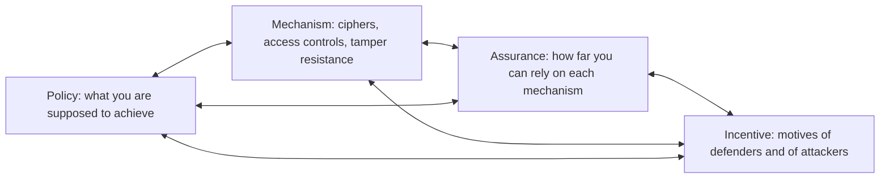
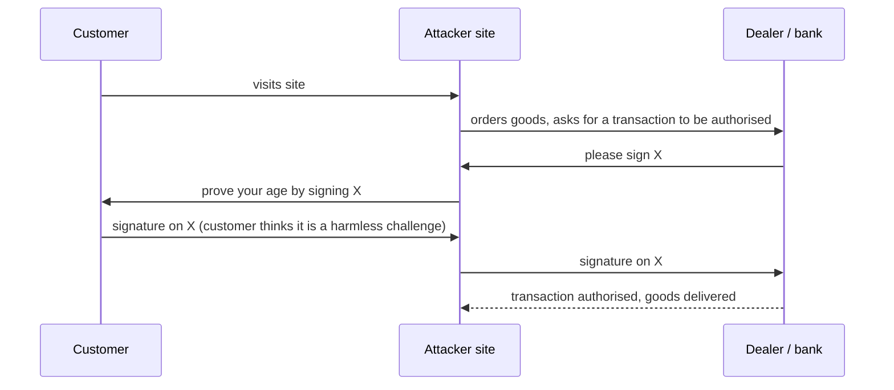

# 11. Security Engineering Themes

Foundational ideas from a large security engineering text, kept to the parts that apply to systems you build and run. Authentication, passwords and access control models are in [[1. Security Fundamentals|01. Security Fundamentals]]; design principles are in [[10. Designing Secure and Reliable Systems|10. Designing Secure and Reliable Systems]].

## The four-part framework

Dependable systems need four things to come together:



- Many failures are **policy** failures, not mechanism failures: the checkpoint worked, but the policy allowed the wrong thing
- **Incentives** explain odd choices. Decision makers favour visible controls over effective ones, which is "security theatre": measures built to produce a feeling of security
- When a control looks pointless, ask who benefits from it being there

---

# Protocols

Most real attacks go through protocol design, not broken ciphers. Protocol vulnerabilities usually give more and simpler attacks than cryptographic weaknesses.

## Freshness and nonces

A message must prove it is fresh, not a replay of an old one. A **nonce** (number used once) provides that: a random number, a counter, a challenge from a third party, or a timestamp.

```
T -> G : T, {T, N}KT
```

Reads as: token T sends the garage G its name and the encrypted pair (its name, nonce N) under its own key KT. The garage looks up KT, decrypts, checks that N has not been seen and that the plaintext contains T.

Trade-offs between nonce types:

| Nonce | Problem |
| ----- | ------- |
| Random number | The verifier must remember many old values; a "valet attack" records codes and replays them later |
| Counter | Synchronisation: it can be bumped accidentally many times, so the receiver needs a recovery window |
| Timestamp | Needs a trustworthy clock, which cheap devices lack |

## Key management and sloppy implementation

- **Key diversification**: derive each device key from its ID and a master key (`KT = {T}KM`). Extracting one token's key only lets an attacker clone that token; a full break needs the master key, which belongs in an HSM or tamper-resistant smartcard
- A 128-bit key does not help if it is derived from a 16-bit device number. The real strength is the smaller input
- Prepayment electricity meters that only checked "this code differs from the last one" could be recharged forever by alternating two valid tickets (A, B, A, B...). The check was not freshness, only inequality

## Assumptions change

The original bank-card design encrypted the PIN but sent the magnetic-strip data in clear, assuming card readers were always in trusted places (ATMs, teller desks). Once cards were used at shop terminals, that assumption failed: a card with clear security data was being put into untrusted machines. The change was gradual, so nobody saw the problem coming. **Re-check protocol assumptions whenever the environment changes.**

## Chosen protocol attacks

If users can be tricked into reusing a key or token in a second protocol, an attacker designs that second protocol to attack the first.



- Using one authentication key in more than one application is dangerous, and letting others bootstrap their security off yours can be foolish
- Example: SMS codes for banking rely on the phone company's identity checks, which SIM-swap fraud defeats
- Practical takeaway: keep high-value credentials (banking) separate from low-value ones, and separate by application, not just by account

---

# Distributed Systems

## Concurrency is a security issue

Concurrency control, like access control, stops users interfering with each other, accidentally or on purpose. Problems occur at every level, hardware to business logic:

- Using **old data** (a replay of out-of-date credentials)
- **Race conditions** where two programs race to update security state: a privileged operation done in two phases can be attacked halfway by renaming the object it acts on (the old Unix `mkdir` issue)
- Inconsistent updates, deadlocks, and data that never converges
- Cost trade-off: propagate state quickly (expensive) or accept a window of old data

Modern systems are more concurrent (fleet scale, many cores, virtual CPUs), so these bugs are more common, not less.

## Naming

Names only mean something in a context, and adding names adds complexity.

- A certificate that says "the holder of this key may administer machine X" is a **bearer token**, like a metal key: whoever holds the private key is the admin
- Attach a person's name and you add a dependency on whatever proves that name (a passport), and a new failure mode if it is compromised
- Hierarchical names ("the person who teaches at X") and flat ones (an email address) are not the same kind of thing, and linking them causes trouble
- Large providers now act as global identity namespaces (your email address). That solves some naming problems and concentrates others

---

# Economics of Security

Many persistent failures look irrational until you look at **incentives**.

- Things fail when **one party carries the cost of protection and another carries the risk of failure**
- **Disclosure and patching**: publish a flaw and users are exposed until the patch; report privately and the vendor may never bother. Evidence showed public disclosure makes vendors fix bugs faster, and reported vulnerabilities fall over time, so software can improve with age "like wine, not milk". This settled into **responsible (coordinated) disclosure**
- **Structural models** of defence:

| Model | Reliability depends on | Example |
| ----- | ---------------------- | ------- |
| **Weakest link** | The laziest or most careless party | One careless programmer introduces a vulnerability |
| **Best shot** | The single best effort | A security architect or champion |
| **Sum of efforts** | Everyone's work added together | Vulnerability testing |

  More agents help in the sum-of-efforts case and hurt in the weakest-link case. That is why large software firms end up with more testers and fewer, more competent programmers
- Security is a mix of all three, so decide which model each control actually follows

---

# Assurance and Sustainability

- **Assurance is no longer static.** Having a lab test a product years ago does not make it secure now; patching, vulnerability disclosure and updates matter as much as pre-release testing
- Systems that used to be tested to death and never patched (cars, medical devices) are now online, so they must be maintained and updated like phones and laptops
- Measuring assurance is rough: have capable, motivated people tried to break it enough? That raises what "enough" means, what the "system" includes, and whether the usability is tolerable for ordinary users
- Third-party evaluation schemes were meant to make risks transparent but often became a **liability shield**
- Two questions: **are we building the right system, and are we building it right?** There is no silver bullet; secure development is many small practices, plus attitudes and work habits, not a secret process
- **Safety and security are entangled**: both are emergent properties that must be designed in, both require systematic thinking about what can go wrong, by accident or malice. Accidents expose systems to attack, and attacks degrade systems into danger

---

# Takeaways

- Separate policy, mechanism, assurance and incentive when diagnosing a failure
- Use a nonce for freshness, and check the *strength* of the smallest input to any derived key
- Do not reuse a credential across applications
- Re-check protocol assumptions when the deployment environment changes
- Treat concurrency bugs as security bugs
- Ask who bears the cost and who bears the risk before blaming users
- Plan to patch and maintain for the whole life of the system
