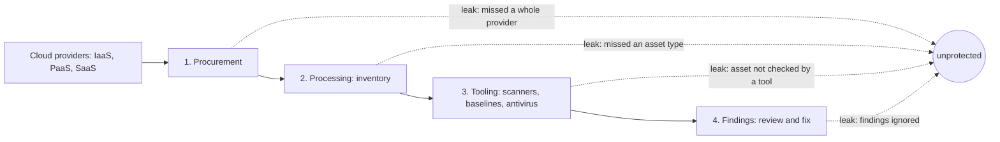
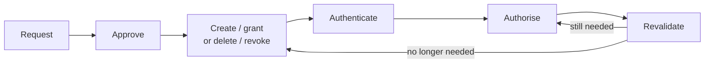

# 12. Cloud Security Practice

The provider-neutral practice behind cloud security: what you own, how you find every asset, how identity is managed over its whole life, how vulnerabilities are found and measured, and how you detect and respond. Service names per provider are in [[6. Cloud Security|06. Cloud Security]]; principles are in [[1. Security Fundamentals|01. Security Fundamentals]], and design patterns in [[10. Designing Secure and Reliable Systems|10. Designing Secure and Reliable Systems]].

---

# Principles in the Cloud

**Least privilege** includes automation, not just people. A component reading a database should not hold credentials that can write to it. Default to **deny**, and make people request and get approval for anything beyond that.
- The cloud console is a special case: with many providers, console access gives broad power over everything the provider manages, regardless of controls inside the operating systems. Control it like physical data-centre access, and record what those users do

**Defence in depth** accepts that almost any control can fail. For each control, ask "what if this fails?" If the answer is unacceptable, you lack depth.
- Watch for a single failure that defeats several controls at once, such as one inventory gap that makes multiple tools miss the same asset
- Independent layers multiply: two overlapping controls that are each 95% effective give 99.75% together. Returns diminish, so five or six layers in one area is rarely worth it

**Zero trust** is better read as "zero implicit trust": trust is earned, not granted because someone reached you on the network or has a company device. Typical forms (see [[9. Zero Trust Networks|09. Zero Trust Networks]]):
- Require encryption and authentication on every connection, even inside "trusted" networks
- Limit users' network access to only the applications they need
- MFA with re-authentication periodically or for higher-risk actions

**Threat actors** to design for, and keep a named persona for each: organised crime (money), hacktivists (discredit, vandalise, disrupt), insiders, and state actors.

**Draw the system and mark trust boundaries**:
1. User and administrator as separate actors
2. A box for each component, lines labelled with how they communicate, a cylinder where data is stored
3. Draw how the administrator gets in too (provider console and API, the operating system)
4. Dotted trust boundaries: inside one, components trust each other, so compromising one gives all of them
5. Shrink boundaries as far as is reasonable; **focus first on every line that crosses a boundary**

## Shared responsibility

The line moves with the service type (IaaS, PaaS, SaaS), and the exact category matters less than knowing what the service provides.

| Layer | IaaS | PaaS | SaaS |
| ----- | ---- | ---- | ---- |
| Physical and hypervisor | Provider | Provider | Provider |
| Network | **Shared**: the provider owns its network, you carve your virtual network into zones and set the rules between them | Check the provider's documentation | Check the provider's documentation |
| Operating system | You | Provider | Provider |
| Middleware | You | **Shared**: provider patches, you keep security settings such as encryption | Provider |
| Application | You | You | Provider |
| Data access | You | You | You |

- Rule of thumb: **if you can break it, you are usually responsible for securing it**
- Data access is almost always yours. An open object-storage bucket is encrypted and still exposed
- Many incidents come from assuming the provider handles something when nobody does. Read your agreement
- Example: Spectre and Meltdown were fixed in the hypervisor by the provider, but the operating system patch was the customer's job

## Risk management

Risk = likelihood x impact. Aggregated risks can combine (two redundant power lines each failing is minor, both failing is not).

| Response | Meaning |
| -------- | ------- |
| **Avoid** | Turn the system off; the benefit goes too |
| **Mitigate** | Lower likelihood or impact, for example hold less sensitive data |
| **Transfer** | Pay someone else to carry it; cloud does a lot of this for the lower layers |
| **Accept** | Write it down and get stakeholders to agree |

Unacceptable: not knowing your risks, or accepting them without weighing the consequences. Keep at least a list of known risks, actions taken and approvals. Compare the same four responses in [[1. Security Fundamentals|01. Security Fundamentals]].

---

# Asset Management Pipeline

You cannot protect what you cannot see. Think of a pipeline from the cloud providers to your security tools, and find the **leaks**.

| Leak | What goes wrong | Fix |
| ---- | --------------- | --- |
| **Procurement** | A whole provider is missed because the spend was unseen or the service is free | Review IT charges, get limited audit credentials from each spender. Free services still have terms on your data |
| **Processing** | You queried the provider but missed an asset type (VMs inventoried, buckets not) | Use portals, APIs or provider inventory services, and go through each asset type. Assets can nest (a server in a container in a VM) |
| **Tooling** | An asset is known but no tool checks it | Feed the inventory to each tool: IP addresses to the network scanner, URLs to the web scanner, VMs to the baseline checker |
| **Findings** | Tools report problems that nobody reviews | You may accept a finding, but ignoring it without review is a leak. Noisy tools with false positives are the usual cause |

- Prefer **automation over manual inventory**; a manual one is better than none for infrequently changing assets
- The inventory credentials follow least privilege: read only metadata, change only tags
- **Tag assets** consistently (tags can be case sensitive, so `ApplicationA` and `applicationA` differ): function, environment (dev, test, production), application, owning department, version, data classification, and automation tags
- Tags let automation enforce policy, for example flagging a development VM that holds sensitive data or production credentials

---

# Identity and Access Management Lifecycle

IAM is more than authentication and authorisation. The two ends of the lifecycle are where organisations usually fail.

- **Request**: record who asked, how the requester was authenticated, and who approved. Requests are usually made out of band, not in the cloud IAM system
- **Approve**: explicit approval inside an organisation, often two (the user's supervisor and the system owner); public sign-ups can be implicit with anti-fraud checks
- **Act**: automate where possible to reduce human error
- Include **non-human identities**: many teams control people well and leave automation lax
- Distinguish the **identity store** (the database) from the **protocol** (OpenID, SAML, LDAP)
- Three audiences: employees to the cloud (B2B, "Cloud IAM"), customers to your applications (B2C, "CIAM"), employees to your applications (B2E, "workforce identity")

## Authentication

- **MFA** combines different factors: something you know, have, or are. Two passwords are one factor. Use it for privileged access, sensitive data and email (which resets other passwords). Passwordless with a device plus fingerprint can be stronger and easier
- **Step-up authentication** asks for more only for higher-risk actions (reading a balance versus transferring money)
- **Passwords**: never reuse; assume a site's administrators are malicious; use a password wallet and store master and recovery keys physically secured; generate unremembered ones randomly (about 20 characters); for the one you must remember, use a six-word Diceware passphrase with the same symbol between words
- **Shared IDs** (root, Administrator): avoid; if unavoidable, use privileged access management that checks credentials out and rotates them on return, and can record sessions
- **Federation and SSO**: one identity, with the other system deferring to your identity provider's signed assertion
- **Instance metadata and identity documents**: a process can ask a well-known endpoint for a signed proof of the host's identity. Any process on the host can ask, so a container could pose as the whole host unless blocked from the metadata service. Only co-locate processes of the same trust level

## Secrets management

Secrets used by one system to talk to another (passwords, API keys, tokens, key pairs). MFA cannot apply, so these may be your only defence.

- Easy to **rotate**, on a schedule and whenever a leak is suspected; rotation that needs downtime is a problem
- Encrypted at rest and in motion, handed out only after authentication and authorisation
- Ideally **no human knows them**
- The store itself is well protected; do not give vault keys to dozens of people
- Make secrets **as useless as possible** if stolen: read-only access to one database, not root everywhere
- Log every access and change
- **Never in source code or the repository**: a repository protects the integrity of code, not secrecy, and not everyone who can see code should see production secrets

## Authorisation

- **Centralised authorisation** lets you see and revoke part of someone's access without deleting the identity. The application enforces (**PEP**), a central system decides (**PDP**), and an administrator console sets policy (**PAP**)
- **Roles** are assumed and dropped, with temporary credentials, and each assumption is logged. A shared ID is a standalone identity with fixed credentials; a role is a status another identity takes on
- **Group** = a set of entities with no permissions attached. **Role** = a set of permissions with no members attached
- **Revalidation**:
  - Automated: a leaver's access must be revoked through an **offboarding feed**, processed at least daily by anything issuing long-lived tokens, because deleting the identity does not kill cached tokens
  - **Positive confirmation**: access is lost unless someone says it is still needed; use for high-impact access
  - **Negative confirmation**: access stays unless someone says it is not needed; acceptable for lower impact

---

# Vulnerability Management

Find vulnerabilities in the places they hide (data access, application, middleware, operating system, network, virtualised and physical infrastructure), and spend effort where it pays off. A common pitfall is four or five tools bought to tick boxes, none providing value.

| Tool | What it does | Notes |
| ---- | ------------ | ----- |
| **Network scanner** | Probes addresses and ports, checks versions and configuration | Sees what an attacker sees; cannot see libraries or web applications. Reported versions cause false positives. Needs the inventory, and must reach restricted segments |
| **Agentless scanner** | Logs in with credentials; checks missing patches and security configuration | Finds local privilege escalation. Credentials make it a target, so use least privilege. Understands only systems it recognises |
| **Agent-based scanner** | Small agent pushes results to a console | Only outbound connections; credentials problem moves to deployment; the agent itself must be kept updated |
| **Container scanner** | Inspects images, or monitors at runtime | Agents suited to VMs hurt containers; containers rarely allow logins |
| **DAST** | Tests a running web app or API like a user | Finds XSS and SQL injection; may need credentials |
| **SAST** | Analyses your source code | Run on commit in the pipeline; must support your language |
| **SCA** | Matches open-source dependencies and versions to known vulnerabilities | Finds issues like Log4j; see [[5. Secure Coding and Supply Chain|05. Secure Coding and Supply Chain]] |
| **IAST** | Watches the code from inside while it is exercised | Fewer false positives than SAST or DAST |
| **RASP** | Blocks attacks at runtime (not a scanner) | Similar protection to a distributed WAF; can slow production |
| **Penetration test** | Someone tries to get in and reports weaknesses | Automated scans are not pentests; independent tests are required by PCI DSS and FedRAMP moderate and high |

Practical points:
- Scan the test environment in the deployment pipeline; unresolved findings feed a bug tracker and ideally block the deploy
- Speed matters most for internet-facing components
- Prefer **replacing a vulnerable system with a fresh one** to fixing it in place, since automated fixes can break availability
- Allow scanners through firewalls: an unknown vulnerability is a bigger risk than a scanner's access path
- Maintain a documented process for masking false positives, or teams will ignore all results

## Metrics

| Metric | Reading it |
| ------ | ---------- |
| **Tool coverage** | Percentage of in-scope assets each tool actually covers; should trend to 100%. Low coverage shows pipeline leaks |
| **Mean time to remediate** | Break down by severity and by internal versus internet-facing. Mitigation without a patch (disabling a feature) counts. External delays, such as Spectre and Meltdown patch availability, can push it up without a process failure |
| **Systems with open vulnerabilities** | Use a percentage, split by exposure, severity and cause (missing patch or misconfiguration). It naturally balloons after announcements and benchmark changes |
| **False positives** | Measures the burden on teams |
| **False negatives** | Issues another method found that this tool should have; too many gives false confidence |
| **Recurrence rate** | Vulnerabilities returning after being fixed point to a process problem |

---

# Detection, Response and Recovery

You usually see only the logs for your side of the shared responsibility line, plus a new source: **privileged-user activity in the cloud control plane**.

## What and how to watch

- Choose by **threat model and assets**. Network volume metrics help against data theft, but not against a backdoor inserted into software you distribute (volume and destination do not change, content does)
- Sources: privileged user access, defensive tool logs, cloud service logs and metrics, operating system logs, middleware, the secrets server, and your application
- **Aggregate** into a separate account with different administrator credentials, so a compromised system cannot wipe its own logs and disks do not fill
- Then parse, search and correlate, alert and automate responses, and use a SIEM
- **Threat hunting** comes only after the basics work: form a hypothesis ("an advanced persistent threat targets us") and query your data to prove or disprove it
- **Monitor the administrators** too. This assumes an attacker may hold valid admin credentials. In the book's example, administrators reach machines through a session-recording service, and the raw "toxic" recordings (which may contain secrets) are stored apart from the sanitised logs

## Preparing

- **Team**: primary and backup technical leaders, and primary and backup business leaders who can authorise taking systems down or making payments; specialists matching your threat model
- **Plans**: write plans for likely cloud scenarios, and **know what your provider will do** (extra logs, forensic images, security contacts). The provider usually responds only to breaches of its own services, though for DDoS it may help, or cut off your network access to protect others
- Do not discover the provider's terms mid-incident

## Responding

Two models for understanding an attack:

| Lockheed Cyber Kill Chain | MITRE ATT&CK tactics (examples) |
| ------------------------- | ------------------------------- |
| Reconnaissance | Initial access |
| Weaponization | Execution |
| Delivery | Persistence |
| Exploitation | Privilege escalation |
| Installation | Defence evasion |
| Command and control | Credential access |
| Actions on objective | Discovery, lateral movement, collection... |

**OODA loop**:
1. **Observe**: gather provider logs, firewall and operating system logs, metrics
2. **Orient**: understand what is happening and what is next, using internal knowledge of key assets and external threat intelligence (government alerts are free)
3. **Decide**: take systems offline, revoke access, quarantine, build a new environment
4. **Act**: repeatable cloud builds make this faster

Other points:
- **Forensics**: make a documented, repeatable copy of anything important and record a cryptographic hash (such as SHA-256) so anyone can verify the copy is unchanged
- **Block access**: reset passwords and API keys, including automation's, which is disruptive. Have pre-built tools to do it quickly and all at once. Internal segmentation helps contain it
- **Stop data exfiltration and command-and-control** by shutting outbound communication if not already done
- **Recovery**: the simplest and most effective way is to **redeploy** affected systems and switch traffic over; rebuild workstations from known-good images. Otherwise get executive acknowledgement of the risk of running systems an attacker controlled, since a single altered registry entry can let them back
- Cloud helps because compute is separated from data, and compute is easier to rebuild than data
- Finish with notifications and **lessons learned**, tracked with metrics

For the general incident process see [[1. Security Fundamentals|01. Security Fundamentals]].

---

# Checklist

- Do we know every provider, account and asset type, and does every tool see them all?
- Are findings reviewed, with a recorded decision when not fixed?
- Are requests, approvals and revalidation recorded for humans and automation?
- Is there an offboarding feed that kills tokens, not just identities?
- Are secrets out of code, rotatable and as narrow as possible?
- Are logs held in a separate account from what they monitor?
- Do we know what the provider will do in an incident?
- Can we redeploy a compromised system from a known-good build?
