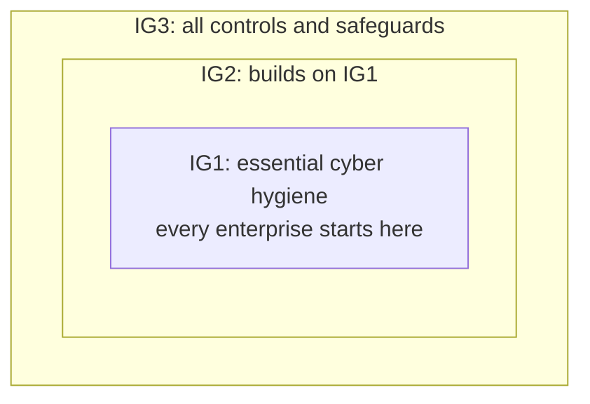
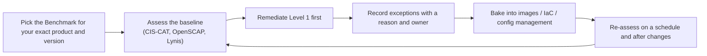

# 13. CIS Controls and Benchmarks

The Center for Internet Security (CIS) publishes two things that are easy to confuse: the **CIS Controls** (a prioritised list of what to do) and the **CIS Benchmarks** (exact configuration settings for a specific product). Commands for running assessments are in [[Compliance]] and [[Server Hardening with SSH, UFW and Fail2ban]]; this note is the framework and how to use it.

> **Sources:** [CIS Controls](https://www.cisecurity.org/controls) and [CIS Benchmarks](https://www.cisecurity.org/cis-benchmarks). Benchmark PDFs are version-specific, so read the one that matches the exact product and version you run.

| | CIS Controls | CIS Benchmarks |
| - | ------------ | -------------- |
| **Answers** | What should we do, and in what order? | How exactly should this product be configured? |
| **Scope** | The whole enterprise | One technology and version (an OS, a cloud, a database, Kubernetes...) |
| **Unit** | Control and safeguard | Numbered recommendation |
| **Use for** | Programme planning, priorities, reporting | Hardening, audit, evidence |

---

# CIS Controls

The current version is **v8.1**: 18 controls with 153 safeguards in total (the same count as v8).

| # | Control | Where it is covered in this vault |
| - | ------- | --------------------------------- |
| 1 | Inventory and control of enterprise assets | [[12. Cloud Security Practice|12. Cloud Security Practice]] (asset pipeline) |
| 2 | Inventory and control of software assets | [[5. Secure Coding and Supply Chain|05. Secure Coding and Supply Chain]] (SBOM, dependencies) |
| 3 | Data protection | [[6. Cloud Security|06. Cloud Security]], [[Crytography]] |
| 4 | Secure configuration of enterprise assets and software | Benchmarks below, [[Server Hardening with SSH, UFW and Fail2ban]] |
| 5 | Account management | [[12. Cloud Security Practice|12. Cloud Security Practice]] (identity lifecycle) |
| 6 | Access control management | [[1. Security Fundamentals|01. Security Fundamentals]], [[10. Designing Secure and Reliable Systems|10. Designing Secure and Reliable Systems]] |
| 7 | Continuous vulnerability management | [[1. Security Fundamentals|01. Security Fundamentals]], [[8. Staying Current - Vulnerabilities, Exploits and News|08. Staying Current]] |
| 8 | Audit log management | [[12. Cloud Security Practice|12. Cloud Security Practice]] (detection) |
| 9 | Email and web browser protections | [[3. HTTP Security Headers and CSP|03. HTTP Security Headers and CSP]] |
| 10 | Malware defences | Not covered in depth yet |
| 11 | Data recovery | [[10. Designing Secure and Reliable Systems|10. Designing Secure and Reliable Systems]] (recovery) |
| 12 | Network infrastructure management | [[13. Network Security|10. Network Security]] |
| 13 | Network monitoring and defence | [[13. Network Security|10. Network Security]], [[4. WAF in Production|04. WAF in Production]] |
| 14 | Security awareness and skills training | Not covered |
| 15 | Service provider management | [[12. Cloud Security Practice|12. Cloud Security Practice]] (shared responsibility) |
| 16 | Application software security | [[2. Web Application Security|02. Web Application Security]], [[5. Secure Coding and Supply Chain|05. Secure Coding and Supply Chain]] |
| 17 | Incident response management | [[1. Security Fundamentals|01. Security Fundamentals]] |
| 18 | Penetration testing | [[12. Cloud Security Practice|12. Cloud Security Practice]], [[7. Siteward Web Security Scanner|07. Siteward]] |

The first six are the foundation: you cannot protect assets you do not know about (1, 2), you cannot configure what you have not inventoried (4), and access (5, 6) and data (3) depend on both. The gaps in the table (malware defences and training) are honest ones: this vault is about building and running systems, not the people side.

## Implementation Groups

Safeguards are tagged with an **Implementation Group** so an organisation can start where its risk and resources allow.

- **IG1**: foundational safeguards against the most common attacks. Start here regardless of size
- **IG2**: adds to IG1 for organisations with more resources and risk
- **IG3**: everything
- Pick the group from your **risk profile and available resources**, finish it, then move up. The groups are cumulative

---

# CIS Benchmarks

Prescriptive configuration recommendations for more than 25 vendor product families: operating systems, cloud providers, network devices, server software and more. They are produced by a global, consensus-based community of experts, and a catalogue lists them by technology and version.

- The PDFs are free to download; other formats (Word, Excel, XML) are for CIS SecureSuite members. Check the terms on the download page before reusing the content commercially
- Updates follow the community's schedule and the product's own releases. Windows Benchmarks cover the latest build within 90 days of its release

## Profiles

| Profile | Intent |
| ------- | ------ |
| **Level 1** | A base set you can implement fairly promptly. Reduces attack surface while keeping the system usable |
| **Level 2** | Defence in depth for environments where security is paramount. Can cause problems if applied without care |
| **STIG** | Includes STIG-specific recommendations, replacing the former Level 3 |

## How a recommendation reads

Each numbered recommendation in a Benchmark PDF typically carries (verify in the document you download): a profile, a description, a rationale, the impact of applying it, an **audit** procedure, a **remediation** procedure, the default value and a mapping to CIS Controls. Many are marked **Automated** or **Manual**, meaning whether a tool can check it or a person must.

The audit and remediation steps are what make a Benchmark practical: they are runnable, so the same text can drive a scan, a fix and a report.

## Working with a Benchmark

- **Assess before you change anything**, so you have a baseline and can see what the fixes did
- **Test remediation on a copy.** A setting that is right in general can break your application or lock you out (see "Don't Lock Yourself Out" in the hardening note)
- **Level 1 first.** Take Level 2 selectively, with the impact notes in front of you
- **Exceptions are normal.** Write down the recommendation, the reason, the owner and a review date. An unexplained deviation is the failure; a documented one is the process working. This mirrors "accept" in [[1. Security Fundamentals|01. Security Fundamentals]]
- **Do it once, in code.** Apply the settings in your base image, Terraform or Ansible so every new system starts compliant, instead of fixing machines by hand
- **Re-run.** Drift is constant, and Benchmarks change with each product version

## Tooling

| Tool | Notes |
| ---- | ----- |
| **CIS-CAT Pro Assessor** | CIS's own assessor for conformance to Benchmarks |
| **CIS Hardened Images** | Virtual images already hardened to a Benchmark, offered on cloud marketplaces |
| **CIS Build Kits** | Help configure systems to a Benchmark |
| **OpenSCAP** | Open-source scanner and remediation generator |
| **Lynis** | Open-source audit tool, with hardening suggestions |
| **kube-bench** | Runs the CIS Kubernetes Benchmark against a cluster |

Commands for CIS-CAT, OpenSCAP and kube-bench are in [[Compliance]]; Lynis is in the hardening note.

---

# Using Them Together

1. Use the **Controls** to decide what matters and in what order (start with IG1)
2. Use the **Benchmarks** to implement control 4 (secure configuration) for each product you run
3. Report against the Controls (each Benchmark recommendation maps back to them), so a scan result becomes evidence for a control
4. Treat both as a floor, not a ceiling: a clean Benchmark scan does not mean the application is secure ([[2. Web Application Security|02. Web Application Security]])

---

# Checklist

- Which Implementation Group are we working to, and is it finished?
- Is there an inventory of every asset and every piece of software (controls 1 and 2)?
- Do we have a baseline scan for each product, against the right Benchmark version?
- Are Level 1 recommendations applied, and Level 2 chosen deliberately?
- Is every exception written down with an owner and a review date?
- Are settings baked into images or code, and re-checked on a schedule?
